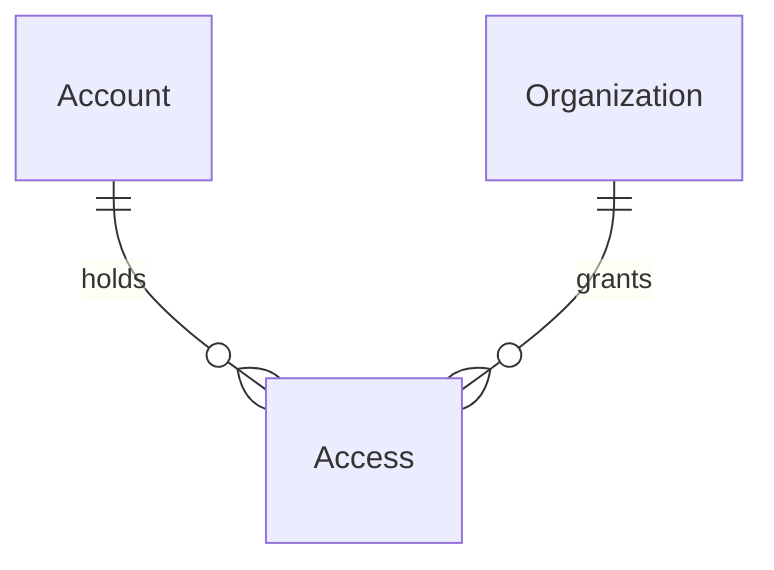

# Administration intake

> Plan this with **tlc-plan**.
> Decisions below carry the literal shape - copy them, do not re-derive them.
> The confirmation, success, and mail-failure drawings are superseded by `.design/administration-list.md`. The door, the write, and the notice strings in this file still hold.

## Situation

- Project: in active construction
- Decision: committed by the user, 22 Sep 2026, in this discovery
- In flight: branch `development-coordinator-seed` and `.tasks/development-coordinator-seed.md` plant a local Organization and coordinator so Google sign-in can pass the door. That task leaves a screen to create an Organization out of its scope. This design does not change the seed.
- At stake: costly. The change sits on `OperatorAuthenticator`, the sign-in path. A wrong allowlisted email can open administration, or the real seller stays on `/denied`. The form itself reverts in an afternoon. One author has touched that path, in a burst from 15–18 Sep 2026.

## Problem

The product is being sold to other organizations. After a purchase, the organization name and the coordinator email are already known, and that sale has to open the close flow that already exists. What stalls is the sale itself: someone must run `bin/rails coordinator:bootstrap` with `ORGANIZATION_NAME` and `COORDINATOR_EMAIL`. That command aborts when the email already has an Account, so a second organization for the same coordinator cannot be opened from it. Why now, rather than with the later management screens: each sale is waiting on that console step, and the list, correction, and removal wait on a review trigger that has not happened.

## Evidence

- Sales volume is untracked. Nobody can say how many organizations will be registered. That number would have kept the console in place; the user discarded the console because a sale should not depend on it. Counting registrations after this screen exists is what would measure it.
- The substitute in the repo is `coordinator:bootstrap` (`lib/tasks/coordinator.rake`), which persists nothing and exits non-zero when `Account.exists?(email:)`.

## Journey

The seller signs in with Google. The coordinator named on the form later signs in with Google and lands in the close flow that already exists (home, setup, month). Invites sent from inside an organization stay out of band.

- Empty: `GET /administration` shows the name and email fields. Nothing is written.
- Invalid: a blank name or an email `NormalizedEmail` rejects re-renders the form with the Portuguese notice below. Nothing is written.
- Confirmation: submitting the valid form stores the trimmed name and normalized email in the session and shows those two values. Nothing is written. "Corrigir" returns to the form with those values filled in.
- Confirm: one transaction creates the Organization, creates the Account when the email has none, and creates coordinator Access. No Invite. Then the request sends the mail.
- Existing Account: the same confirm attaches coordinator Access to that Account and sends the "organização nova" mail. Sign-in for that email stays the Google button on `/login`.
- Mail failure: the Organization and the Access stay. The screen says the mail did not go out and offers resend for that registration.
- Resend: sends the same mail again and shows success or the same failure.
- Another sale: "Cadastrar outra organização" clears that result and shows the empty form.
- Repeat confirm: a confirm with no pending values in the session writes nothing.
- Typo already saved: the email and the name stay. This version does not change or remove them.
- Abandoned confirmation: signing out (`reset_session`) drops the pending values and the result. No rows were written for a confirmation that was never confirmed.
- Signed out: any administration route redirects to `/login`.
- Signed in, not the allowlisted email: `404`, with no form body.
- `ADMINISTRATOR_EMAIL` unset or blank: nobody is the administrator; the same `404`.
- Allowlisted email with no Account and no Invite: the Google callback creates the Account, creates no Organization, and redirects to `/administration`. The header shows the product name and "Sair".
- Allowlisted email that already coordinates an organization: the callback keeps today's redirect to `/`. The header adds "Administração".
- Coordinator after the mail: Google sign-in with that email opens the organization home. Setup and the month are unchanged.

The binding drawing is the screen `administration` below. Visitor mode is Operate: one person, at a laptop, registering one sale. It uses the livro-caixa rules in `DESIGN.md`: a left-aligned short form capped at 28rem, labels above the fields, the error notice under the title, a caixa primary button, no card, no icon besides the mark, no success color. Red appears only on the validation notice and the mail-failure notice.

### Screen `administration`

Header when no organization is focused. `Sair` is the quiet caixa action. `Início`, `Documentos`, and `Configuração` are absent.

```
┌ header: ▣ Fechamento mensal                              Sair ┐
```

Header when an organization is focused and the account is the administrator. `Administração` is an ink link, the same weight as `Início`, placed after `Configuração` when that link is present.

```
┌ header: ▣ ONG Norte    Início  Documentos  Configuração  Administração  Sair ┐
```

Empty form. `GET /administration` with no result in the session. The sentence sits under the title in body weight. Fields are sheet on a 1px rule, full width of the 28rem column. `Continuar` is the primary button.

```
┌ header ────────────────────────────────────────────────────────┐
│                                                                │
│  Administração                                      (h1)       │
│  Cadastre a organização e o coordenador que vai fechá-la.      │
│                                                                │
│  Nome da organização                                           │
│  [                                              ]              │
│                                                                │
│  E-mail do coordenador                                         │
│  [                                              ]              │
│                                                                │
│  [ Continuar ]                                                 │
└────────────────────────────────────────────────────────────────┘
```

Invalid. The form stays, with the values the person typed. Each failed field adds one notice directly under the title, name first. Blank name: `Informe o nome da organização.` Invalid email: `Informe um e-mail válido.` The notice is margem text with a 3px margem left border. The field border stays the ruling line.

```
│  Administração                                      (h1)       │
│  │ Informe o nome da organização.                              │
│                                                                │
│  Cadastre a organização e o coordenador que vai fechá-la.      │
│  …fields, still filled…                                        │
```

Confirmation. `POST /administration` renders this in place of the form. Nothing is written. The two values are sentences, label weight then body, separated by a ruling line. `Confirmar` is primary. `Corrigir` is the secondary button (ink border) and returns to the form with these values filled in.

```
┌ header ────────────────────────────────────────────────────────┐
│                                                                │
│  Confirmar cadastro                                 (h1)       │
│                                                                │
│  Nome da organização                                           │
│  ONG Norte                                                     │
│  ─────────────────────────────────────────────                 │
│  E-mail do coordenador                                         │
│  coordenador@exemplo.org                                       │
│                                                                │
│  [ Confirmar ]   [ Corrigir ]                                  │
└────────────────────────────────────────────────────────────────┘
```

Success. `GET /administration` while the session result has `mail_sent` true. No red. The record sits under the sentence so the sale can be read back. `Cadastrar outra organização` is the secondary button.

```
┌ header ────────────────────────────────────────────────────────┐
│                                                                │
│  Administração                                      (h1)       │
│  E-mail enviado para coordenador@exemplo.org.                  │
│                                                                │
│  Nome da organização                                           │
│  ONG Norte                                                     │
│  ─────────────────────────────────────────────                 │
│  E-mail do coordenador                                         │
│  coordenador@exemplo.org                                       │
│                                                                │
│  [ Cadastrar outra organização ]                               │
└────────────────────────────────────────────────────────────────┘
```

Mail failure. The same record, with the notice under the title. `Reenviar e-mail` is primary. `Cadastrar outra organização` is secondary. There is no spinner and no second color for success.

```
┌ header ────────────────────────────────────────────────────────┐
│                                                                │
│  Administração                                      (h1)       │
│  │ O cadastro foi gravado, mas o e-mail não saiu.             │
│                                                                │
│  Nome da organização                                           │
│  ONG Norte                                                     │
│  ─────────────────────────────────────────────                 │
│  E-mail do coordenador                                         │
│  coordenador@exemplo.org                                       │
│                                                                │
│  [ Reenviar e-mail ]   [ Cadastrar outra organização ]         │
└────────────────────────────────────────────────────────────────┘
```

A signed-in non-administrator receives `404` and no page. Below 640px the header links wrap under the name. The form column stays 28rem and left-aligned; the buttons wrap under each other when they no longer fit on one line.

## Verdict

Build the smaller thing: one intake screen, not the management area. The console step leaves the sale; list, correction, and removal stay out until the review. Confirmed by the user, 22 Sep 2026.

Cheaper paths considered: `coordinator:bootstrap` plus an email pasted by hand, discarded because each sale would still depend on the console and the command refuses an existing Account. A public form the buyer fills, discarded because the product does not record a purchase, so any visitor could create an Organization. The management screens (list, correct, remove), deferred to the review trigger below.

## Success

- Worked if: the first sale registered on this screen ends with that coordinator signing in with Google and seeing the organization, and nobody runs `coordinator:bootstrap` for it.
- Early signal: on that first submission, the coordinator reaches the home, or the screen shows that the mail did not go out and resend on that screen works. The bet is going wrong when the mail arrives and the person still sees "Você não foi convidado a usar este sistema.", or when a mail failure has no resend on that screen.
- Review: the user, when the first mistyped email has to be corrected or they need to see who is already registered. Administration then gains the list, correction, and removal.

## Boundary

In: the administration intake screen, confirm-before-write, `Organization.register_coordinator`, the welcome mail, resend on that result, and the Google door for the allowlisted email.

Out: list, correction, and removal of a registration — the review trigger. A buyer-facing form — no purchase record. Renaming an Organization. Changing `coordinator:bootstrap` or the development seed. Mail for later Invites. Choosing an SMTP vendor. Accountant, package archive, and SEFAZ certificate — those stay on `/setup` after the coordinator signs in.

## Shape

The seller is one Google email, `ADMINISTRATOR_EMAIL`. That person opens `/administration`, confirms the name and the coordinator email, and `Organization.register_coordinator` writes the Organization, the Account when needed, and coordinator Access. The mail goes out in the same request, after the transaction commits; a delivery failure stays on that screen with resend. `administrator?` is the only door, so the review's list can reuse it.

What this will not survive: a second person who must open the screen without a deploy, and any correction or deletion of a registration. The first forces the allowlist to become more than one email. The second is the review.



### Adds

- `GET /administration` — the form, or the last result while `session[:administration_result]` is set
- `POST /administration` — validates, stores `session[:administration_pending]` as `{ "name" => trimmed name, "email" => normalized email }`, renders the confirmation, writes nothing
- `POST /administration/confirm` — reads the pending hash, calls `Organization.register_coordinator`, clears the pending hash, sends the mail, stores `session[:administration_result]` as `{ "organization_id" => id, "mail_sent" => true/false }`, redirects to `GET /administration`
- `POST /administration/mail` — resends for `session[:administration_result]["organization_id"]` and redirects to `GET /administration`
- `POST /administration/another` — deletes `session[:administration_result]` and redirects to `GET /administration`
- `AdministrationController`
- `Organization.register_coordinator(name:, email:)` — one transaction: `Organization.create!(name:)`, `Account.create!(email:)` when missing, `Access.create!(kind: :coordinator)`. Returns the Organization. `organizations.name` is unique on `lower(name)`
- Unique index on `lower((organizations.name)::text)`
- `CoordinatorWelcomeMailer.welcome(organization)` — text body, sent with `deliver_now` after the transaction commits
- `administrator?` — `NormalizedEmail.normalize(ENV["ADMINISTRATOR_EMAIL"]) == current_account.email`, false when the env is blank
- Header link `Administração` to `/administration` when `administrator?` and a focused organization is present
- Header `Sair` when an Account is signed in and no organization is focused
- Env `ADMINISTRATOR_EMAIL`, `MAIL_FROM`, `MAILER_HOST`, `SMTP_ADDRESS`, `SMTP_PORT`, `SMTP_USER_NAME`, `SMTP_PASSWORD`
- `config.action_mailer.raise_delivery_errors = true` in development and production
- `config.action_mailer.smtp_settings` in production from those SMTP env vars, applied when `SMTP_ADDRESS` is present
- `config.action_mailer.default_url_options` host from `MAILER_HOST`
- `ApplicationMailer` default from `ENV["MAIL_FROM"]`, read when the mail is sent
- A README sentence listing `ADMINISTRATOR_EMAIL`, `MAIL_FROM`, `MAILER_HOST`, and the SMTP env vars

### Changes

- `OperatorAuthenticator` → a verified email equal to `ADMINISTRATOR_EMAIL` signs in even with zero Access and zero Invites; creates that Account when it is missing; does not create an Organization. Pending Invites for that email still accept as they do today.
- `OmniauthCallbacksController#google_oauth2` → when the signed-in result has no organization, redirect to `/administration`
- `ApplicationController#sign_in` → `session[:organization_id] = organization&.id`
- `app/views/layouts/_header.html.erb` → the Administração link, and `Sair` without a focused organization

### Leaves

- `bin/rails coordinator:bootstrap` is not edited. It still aborts when the email already has an Account. A duplicate `ORGANIZATION_NAME` now fails the insert because `lower(organizations.name)` is unique
- `.tasks/development-coordinator-seed.md` and `db/seeds.rb`
- Invite delivery stays out of band
- `Access` kind stays `coordinator` and `submitter`
- `CONTEXT.md` gains no new term
- List, correction, and removal
- Any other Google email with no Invite and no Access still ends on `/denied` and persists no Account
- `/setup`, months, and documents still require a focused organization

An `administrators` table, or a flag on `Account`, pays off when a second person must open this screen without a deploy. One email is the seller today.

Also in the field, for perspective and not as candidates: a purchase token that opens the form to the buyer — there is no purchase record to issue it. A background job for the mail — the screen has to show the delivery failure of that submission.

## Roadmap

Administration intake — the allowlisted door, `Organization.register_coordinator`, the welcome mail, and the screen — clear.

## Decisions

| Decision | Choice | Why this | Alternative, and what would make it win | Reversibility |
|---|---|---|---|---|
| Who opens the screen | `administrator?` is true only when `NormalizedEmail.normalize(ENV["ADMINISTRATOR_EMAIL"])` equals `current_account.email`. Blank env is false. | The seller is one person, and the review's later screens can call the same predicate | An `administrators` table when a second person must open the screen without a deploy | costly |
| Sign-in without Access | `OperatorAuthenticator` creates the Account for that verified email when missing and returns `:signed_in` with no organization. `sign_in` stores `organization&.id`. The callback redirects to `/administration`. | The seller is not a coordinator of the customer organization, and today's callback sends zero Access to `/denied` | Requiring a bootstrapped Access before the form when the seller already coordinates a house organization in every environment | costly |
| Other callers | Signed-out administration routes redirect to `/login`. A signed-in non-administrator gets `head :not_found`. | `require_coordinator_organization` already answers unauthorised HTML with `404` | A dedicated "forbidden" page when the visual identity gains one | reversible |
| Write | `Organization.register_coordinator(name:, email:)` in one transaction. Name is `name.to_s.strip`. Email goes through `NormalizedEmail`. Existing Account is reused. Kind is `coordinator`. No Invite row. | Bootstrap already writes these three rows, and it refuses the second organization | An Invite the coordinator must accept, when the sale should not grant Access before the first Google sign-in | reversible |
| Confirm before write | `POST /administration` only stores `session[:administration_pending]`. `POST /administration/confirm` is the write. A confirm with no pending hash writes nothing. | A mistyped email cannot be fixed in this version, so the values are shown before the row exists | Writing on the first submit, when correction exists | reversible |
| Invalid form | Blank name notice `Informe o nome da organização.` Invalid email notice `Informe um e-mail válido.` Taken name notice `Já existe uma organização com esse nome.` | `config/locales/pt-BR.yml` has no ActiveRecord errors, and the default strings are English | `rails-i18n` for the whole app, when more forms need the full error catalog | reversible |
| Organization name | Unique index on `lower((name)::text)`. The stored name stays the stripped text the person typed. `ONG Norte` occupies `ong norte` and `  ONG NORTE  `. The form answers a taken name with `422` and does not store pending. A confirm that loses the insert rolls back, sends no mail, and shows the same notice | The user required the index on 22 Sep 2026, and the same day required that letter case count as the same name | A case-sensitive index, which would keep `ONG Norte` and `ong norte` as two organizations. Leaving the name non-unique, as coordinator-access planned ("two NGOs may share a name"), when a second organization should reuse a name and removal exists | costly |
| Mail | `CoordinatorWelcomeMailer.welcome(organization).deliver_now` after commit. From `ENV["MAIL_FROM"]`. Body is text. One coordinator Access (`count == 1`): `A organização {name} está pronta. Entre com o Google usando {email}, pelo botão Entrar com Google.` Otherwise: `A organização {name} foi adicionada à sua conta. Entre com o Google usando {email}, pelo botão Entrar com Google.` The login URL uses `MAILER_HOST`. | The coordinator has to know which Google email opens the organization, and a second organization is a different sentence | A job, when delivery latency blocks the request often enough to miss the failure on this screen | reversible |
| Mail failure | Rescue the delivery error. Rows stay. `session[:administration_result]` stores `"mail_sent" => false`. Notice `O cadastro foi gravado, mas o e-mail não saiu.` Button `Reenviar e-mail` posts `/administration/mail`. | A mail outage must not roll back the sale, and resend has to be on this screen | Rolling back the transaction when delivery fails, when a registration without a mail is worse than no registration | reversible |
| Result and another sale | After confirm, redirect to `GET /administration`, which renders the result while the session hash is set. Success copy `E-mail enviado para {email}.` `POST /administration/another` clears it. Button `Cadastrar outra organização`. | Refresh has to keep resend, and the next sale needs an empty form | A result row in Postgres, when the result must survive sign-out | reversible |
| Own email | When the coordinator email is the signed-in administrator, set `session[:organization_id]` to the new organization. Otherwise leave focus as it was. | Registering a customer must not switch the seller into that customer's close | Always focusing the new organization, when the seller's next step is that customer's setup | reversible |
| Delivery configuration | `raise_delivery_errors = true` in development and production. Production `smtp_settings` from `SMTP_ADDRESS`, `SMTP_PORT`, `SMTP_USER_NAME`, `SMTP_PASSWORD` when `SMTP_ADDRESS` is present. `default_url_options` host from `MAILER_HOST`. No vendor gem. | The app already boots ActionMailer with SMTP commented out and `from@example.com`; missing SMTP is the mail-failure state | A specific provider gem, when that provider is chosen outside this feature | reversible |
| Bootstrap | The rake task is not edited. It still aborts when the email already has an Account. A duplicate `ORGANIZATION_NAME`, including one that differs only by letter case, now fails inside the existing transaction because of the unique index on `lower(organizations.name)` | The local seed and the console path stay available, and the form is the sale path that accepts an existing Account | Teaching bootstrap to attach a second organization, when the console should keep doing what the form does | reversible |
| Screen `administration` | Form step `h1` is `Administração` with the sentence `Cadastre a organização e o coordenador que vai fechá-la.` Confirmation replaces the form; its `h1` is `Confirmar cadastro`. Column is the 28rem short form, left-aligned. Drawing: Journey, screen `administration`. | The user confirmed this composition on 22 Sep 2026. A short form is already the cap in `DESIGN.md` | Keeping the fields visible under the confirmation, when the written values are not enough to check | reversible |

## Open

1. Which mailbox account fills the SMTP env vars. The screen treats a missing mailbox as the mail-failure state. Left out of this task on 22 Sep 2026.

## Sources

- Conversation, 22 Sep 2026 — the sale records the organization name and the coordinator email; the user submits the form; confirm before write; an existing Account gains a new Organization; mail failure keeps the rows and resends from that screen; a saved typo waits for the review, which adds the list, correction, and removal. Shape the same day: confirmation replaces the form; the form opens with `Cadastre a organização e o coordenador que vai fechá-la.`
- `lib/tasks/coordinator.rake` — today's write, and the abort when the Account exists
- `app/models/operator_authenticator.rb` — zero Access with no Invite returns `:denied` and creates no Account
- `app/controllers/application_controller.rb` — `sign_in` stores `organization.id`; `require_coordinator_organization` returns `404`
- `.specs/features/coordinator-access/plan.md` — no public signup; invite mail is out of band
- `.specs/features/visual-identity/design.md` — header, notice, and the setup form this screen has to sit beside
- `CONTEXT.md` — Organization, Account, Access, Coordinator; a coordinator may hold more than one organization
- `config/environments/production.rb` — SMTP settings are commented out; `default_url_options` host is `example.com`; `ApplicationMailer` default from is `from@example.com`
