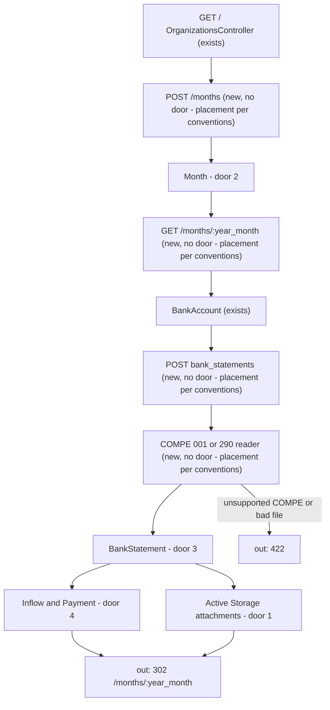
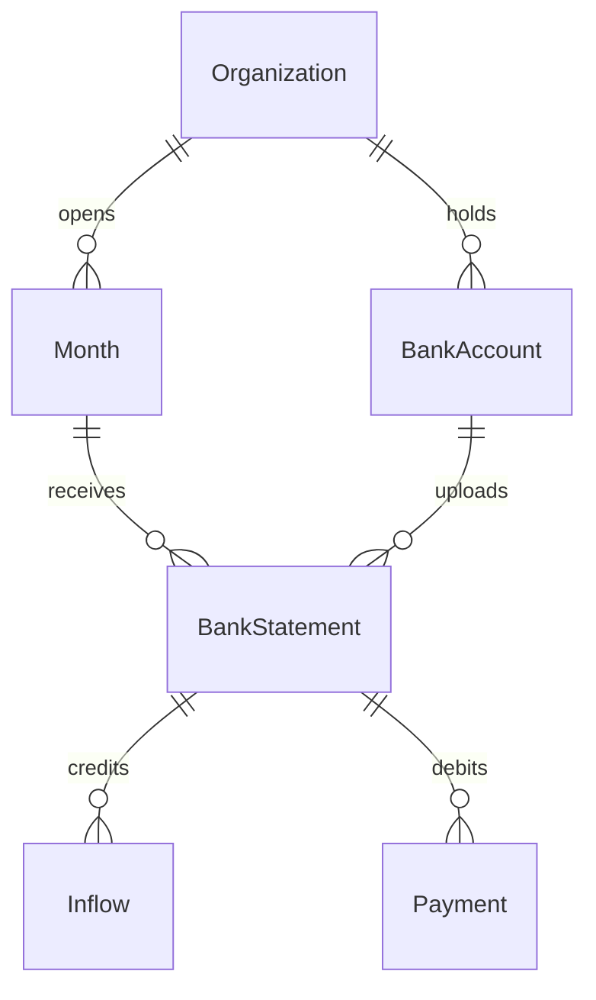

# Bank statement upload

Sources:

- https://github.com/gutors/ai-accounting-assistant/issues/31 - this cut: blob interface; PDF + CSV/XLSX upload; inflows and payments of the open month
- https://github.com/gutors/ai-accounting-assistant/issues/4 - two paths per bank-account and month (manual PDF+CSV/XLSX or Open Finance JSON); this version is upload only; matching later reads the spreadsheet, not the PDF
- https://github.com/gutors/ai-accounting-assistant/issues/16 - Open Finance consent stays out of the product
- https://github.com/gutors/ai-accounting-assistant/issues/8 - no national CSV/XLSX column standard; date, amount, debit/credit, and history are the fields a spreadsheet can contribute; column names need a bank sample
- https://github.com/gutors/ai-accounting-assistant/issues/26 - import from a card per active bank account on the open month; status falta/presente; replace while open is the same gesture; inactive drops out of import; already-imported movements stay
- `CONTEXT.md` - Bank statement, Inflow, Payment, Bank account, Closed month (read-only is #34, not this cut)
- [ADR-0001](../../../docs/adr/0001-rails-8-hotwire.md) - Rails 8 + Hotwire; working files behind the blob interface; Active Storage only if this feature’s Landing chooses it
- Anonymized May 2026 fixtures in `.scratch/monthly-package-anon/` (gitignored) - BB 11-column `Extrato` sheet and PagSeguro `report` sheet; amounts and layouts kept

No design source for the screens. Verification stays on project profile `standard` (no binding screen, so not `ui`).

## Problem

A coordinator can record standing bank accounts, but the product still has no open month and no bank movements. Payments for a month do not exist until a statement is inserted; without that insert there is nothing to match, except, or close. Issue #31 gives no conversion figure; the cost is that every later close slice has no Inflow or Payment to read.

When this ships, a coordinator opens a `{YYYY-MM}` month, uploads PDF plus CSV/XLSX on each active account card, and sees that month’s inflows and payments. The product still does not consent to Open Finance, parse a supporting document, confirm a match, or write to Drive.

## Out of scope

| Excluded | Why |
| --- | --- |
| Open Finance JSON fetch and bank consent | #16; #31 recorte |
| Spreadsheet parsers for catalog banks other than COMPE `001` and `290` | #8: column names need a sample; only BB and PagSeguro fixtures exist |
| OFX, CNAB 240, `.xls`, PDF text extraction as the movement source | #4: matching uses CSV/XLSX on the manual path; PDF is the accountant consult copy |
| Column-mapping UI for an unknown layout | new capability; missing bank is a product change (#26) |
| Supporting documents, matches, suggestions, document exceptions | #31; #32 / #33 |
| Close-for-send, closed-month read-only, Drive month folder | #34 / #19; this cut has no closed month |
| Requiring a statement on every active account before the month can be used | that gate is close-for-send (#26) |
| Submitter access and hiding payments from submitters | #35; this spine is coordinator-only |
| Production object-store brand (S3, GCS, …) | platform: brand not locked; Disk is the local adapter |
| Creating banks or bank accounts here | close-setup (#30) already owns the catalog and cards |

## Assumptions

| Assumption | Chosen default | Rationale | Confirmed? |
| --- | --- | --- | --- |
| Blob interface | Active Storage: enable the engine, `has_one_attached` on the statement for `pdf` and `spreadsheet`; Disk service in development (`storage/`) and test (`tmp/storage`) | ADR-0001 deferred this to the first file feature; AS already stores metadata in Postgres and swaps Disk for a cloud service without a second port; a custom BlobStore would reimplement that and be copied by documents and the A1 file | y |
| Month workspace | `GET /months/:year_month` (`2026-05`); home (`/`) keeps coordinators/invites and gains `Meses` | #26 puts import on the open month, not on `/setup`; home is already the access surface | y |
| Opening a month | `POST /months` with `year_month=YYYY-MM` creates or finds that Month and redirects; `GET` of a month that was never opened is `404` | an open month is a place you already are (#26); creating on GET would open months by prefetch | y |
| Both files required | PDF and CSV/XLSX on every successful upload; no PDF-only and no spreadsheet-only | #4 manual path; PDF optional only on the Open Finance path, which this version does not have | y |
| Replace | same `POST` while the month is open; no confirm dialog; old movements and attachments of that account+month are replaced | #26: same gesture; deactivate on setup also has no confirm | y |
| Parsers this cut | COMPE `001` (BB 11-column `Extrato` / matching CSV headers) and COMPE `290` (PagSeguro `Data`/`Tipo`/`Descrição`/`Entradas`/`Saidas`/`Saldo`); any other catalog COMPE is `422` | #8 plus the two anonymized fixtures; Itaú and the rest wait for samples | y |
| BB skip rows | do not persist a movement when trimmed `Historico` is `Saldo Anterior` or `S A L D O` | those rows are balances on the May 2026 BB fixture, including a prior-month `30/04/2026` opening balance | y |
| PagSeguro skip rows | do not persist a movement when `Tipo` is `Saldo do dia` | day-balance rows on the PagSeguro fixture; they carry no Entradas/Saidas | y |
| History text | BB: trimmed `Historico`, then ` — ` plus trimmed `Detalhamento Hist.` when that cell is non-blank. PagSeguro: `Tipo`, then ` — ` plus `Descrição` when non-blank | #8: history is the extrato literal; BB splits it across two columns | y |
| Amounts | integer cents; Brazilian comma strings (`155,00`) and PagSeguro numeric cells (including negative `Saidas`) convert by rounding to the nearest cent, then take the absolute value for `Saidas` | AGENTS.md money lock; PagSeguro fixture uses Excel numbers and signed outflows | y |
| Dates outside the month | after skip rules, any remaining movement whose `Data` is not in the opened `{YYYY-MM}` rejects the upload (`422`); persist nothing of that statement | the file is the wrong month, not a row to silently drop | y |
| Empty after skips | valid; status `Presente`; zero inflows and zero payments | #26: a zero month still uploads the bank files; no “sem movimentação” shortcut | y |
| File bound | each of PDF and spreadsheet at most 10 MiB (`10485760` bytes) | operator files; the largest anonymized PDF here is ~169 KiB | y |
| Spreadsheet extensions | `.xlsx` and `.csv` only (CSV delimiter `,` or `;`, UTF-8 then Windows-1252) | #31 names CSV/XLSX; no `.xls`/OFX sample in this cut | y |
| Card copy | `Falta` when that active account has no statement this month; `Presente` when it has both files, showing each original filename | #26 status falta/presente (quais arquivos) | y |
| Movement lists | month page headings `Recebimentos` and `Pagamentos`; date `dd/mm/YYYY`; amount `R$ 155,00`; include the bank-account unique name; date ascending, file order on a tie | #22 chronological; locale `pt-BR` | y |
| Inactive after import | movements remain on the lists; that account has no upload card | #26 | y |
| Month list order | home lists opened months as `YYYY-MM`, descending | newest close is the usual next gesture | y |
| Production Disk | not chosen here; local Disk only. Hosting later picks a non-Disk Active Storage service | container disk is ephemeral; brand is not locked | y |

**Open questions:** none - all resolved or logged above.

## Criteria

Grouped by slice. Numbering runs across the whole plan.

### S1: Open month and account cards (P1)

**Acceptance Criteria**

1. WHEN an unauthenticated request hits `GET /months/2026-05` THEN the system SHALL respond `302` to `/login`
2. IF a signed-in Account with no focused organization requests `GET /months/2026-05` THEN the system SHALL respond `302` to `/login`
3. WHEN a coordinator with a focused organization opens `/` THEN the system SHALL include the heading `Meses` and a form that posts `year_month` to `/months`
4. WHEN the focused organization has no Month THEN `/` SHALL include the text `Nenhum mês aberto`
5. WHEN a coordinator submits `year_month=2026-05` THEN the system SHALL persist one Month for that organization and that calendar month, and respond `302` to `/months/2026-05`
6. WHEN a coordinator submits `year_month=2026-05` and that Month already exists THEN the system SHALL persist no second Month and respond `302` to `/months/2026-05`
7. WHEN a coordinator with a focused organization opens `/months/2026-05` THEN the system SHALL respond `200`, render with default locale `pt-BR`, and include the text `2026-05`
8. WHEN `/months/2026-05` renders and the focused organization has zero active BankAccounts THEN the page SHALL include the text `Nenhuma conta bancária ativa`
9. WHEN `/months/2026-05` renders and the focused organization has an active BankAccount with no statement for that Month THEN the page SHALL include that account’s unique name and the text `Falta`
10. WHEN that BankAccount has coordinates THEN the month page SHALL include that coordinates text on the account’s card
11. WHEN `/` renders after Month `2026-05` exists THEN `/` SHALL include a link whose text is `2026-05` and whose href is `/months/2026-05`
12. IF a coordinator submits `year_month=2026-13` THEN the system SHALL persist no Month and respond `422`
13. IF a coordinator requests `GET /months/2026-13` THEN the system SHALL respond `404`
14. IF a coordinator requests `GET /months/2026-04` and that organization has no Month for `2026-04` THEN the system SHALL respond `404`
15. IF an unauthenticated request submits `POST /months` THEN the system SHALL persist no Month and respond `302` to `/login`
16. WHILE focus is organization A, `GET /months/2026-05` SHALL not include BankAccount unique names that belong only to organization B

**Independent test:** sign in, submit `2026-05` from `Meses`, see `Falta` on an active account card; submit `2026-13` (`422`); open `/months/2026-04` without opening it (`404`); switch focus and confirm the other organization’s account name is absent.

### S2: Banco do Brasil upload (P1)

**Acceptance Criteria**

17. WHEN a coordinator POSTs a PDF and the BB May 2026 fixture `.xlsx` (headers `Data`, `observacao`, `Data balancete`, `Agencia Origem`, `Lote`, `Numero Documento`, `Cod. Historico`, `Historico`, `Valor R$ `, `Inf.`, `Detalhamento Hist.`) for an active COMPE `001` BankAccount on Month `2026-05` THEN the system SHALL persist one BankStatement for that pair, respond `302` to `/months/2026-05`, and that card SHALL include `Presente` plus both original filenames
18. WHEN that BB fixture is imported for `2026-05` THEN the system SHALL persist exactly 18 Inflows and exactly 13 Payments on that BankStatement
19. WHEN that BB fixture is imported THEN the system SHALL persist a Payment of `15500` cents dated `2026-05-11` whose history includes `Tarifa Pacote de Serviços`
20. WHEN that BB fixture is imported THEN the system SHALL persist an Inflow of `6300` cents dated `2026-05-04` whose history is `Pix - Recebido — 04/05 17:51 DIEGO OLIVEIRA VIEIRA`
21. WHEN that BB fixture is imported THEN the system SHALL persist no Inflow and no Payment whose history is `Saldo Anterior` or `S A L D O`
22. WHEN `/months/2026-05` renders after that import THEN it SHALL include the headings `Recebimentos` and `Pagamentos`, the date `11/05/2026`, the amount `R$ 155,00`, and that BankAccount’s unique name on that payment row
23. The system SHALL persist Inflow and Payment amounts as integer cents (`15500` for `R$ 155,00`)
24. WHEN that import succeeds THEN the BankStatement SHALL have a PDF blob and a spreadsheet blob retrievable through Active Storage (not through Drive)
25. IF a coordinator POSTs only a PDF and no spreadsheet THEN the system SHALL persist no BankStatement and respond `422` with the text `Envie o PDF e a planilha`
26. IF a coordinator POSTs only a spreadsheet and no PDF THEN the system SHALL persist no BankStatement and respond `422` with the text `Envie o PDF e a planilha`
27. IF a coordinator POSTs a `.xlsx` whose header row is not those 11 BB names for a COMPE `001` account THEN the system SHALL persist no BankStatement and respond `422` with the text `Não foi possível ler a planilha`
28. WHEN a coordinator POSTs a PDF and a `.csv` whose header row is those 11 BB names and whose data rows match the BB fixture (18 inflows, 13 payments after skip rules) THEN the system SHALL persist exactly 18 Inflows and exactly 13 Payments
29. IF an unauthenticated request POSTs a statement THEN the system SHALL persist no BankStatement and respond `302` to `/login`

**Independent test:** open `2026-05`, upload the anonymized BB PDF+XLSX on the BB account card, see `Presente`, `R$ 155,00` under `Pagamentos`, 18/13 counts; POST PDF-only (`422`); POST a scrambled-header xlsx (`422`).

### S3: PagSeguro, replace, unsupported bank (P1)

**Acceptance Criteria**

30. WHEN a coordinator POSTs a PDF and the PagSeguro May 2026 fixture `.xlsx` (header row `Data`, `Tipo`, `Descrição`, `Entradas`, `Saidas`, `Saldo`) for an active COMPE `290` BankAccount on Month `2026-05` THEN the system SHALL persist exactly 64 Inflows and exactly 7 Payments on that BankStatement
31. WHEN that PagSeguro fixture is imported THEN the system SHALL persist no Inflow and no Payment whose history starts with `Saldo do dia`
32. WHEN that PagSeguro fixture is imported THEN the system SHALL persist a Payment of `151240` cents dated `2026-05-11` whose history is `Pix enviado — VITOR CASTRO FERREIRA`
33. WHEN that PagSeguro fixture is imported THEN the system SHALL persist an Inflow of `2` cents dated `2026-05-01` whose history is `Rendimento da conta — Rendimento líquido sobre dinheiro em conta`
34. WHEN a coordinator POSTs a new PDF and spreadsheet for a BankAccount that already has a BankStatement on that Month THEN the system SHALL persist exactly one BankStatement for that pair, SHALL persist only the new files’ Inflows and Payments, and SHALL not leave the previous Inflow or Payment rows
35. IF a coordinator POSTs PDF and spreadsheet for an active BankAccount whose bank COMPE is not `001` or `290` THEN the system SHALL persist no BankStatement and respond `422` with the text `Este banco ainda não tem leitura de planilha`
36. IF two concurrent statement POSTs target the same BankAccount and Month THEN the system SHALL persist exactly one BankStatement for that pair

**Independent test:** upload PagSeguro PDF+XLSX, see 64/7 and `R$ 1.512,40`; replace the BB files with a one-row CSV and confirm the tarifa payment is gone; upload on an Itaú (`341`) account (`422`).

### S4: Isolation, inactive, bounds (P1)

**Acceptance Criteria**

37. IF a coordinator POSTs a statement for a BankAccount that belongs to an organization they are not focused on THEN the system SHALL leave that organization unchanged and respond `404`
38. IF a coordinator POSTs a statement for an inactive BankAccount that has no statement on that Month THEN the system SHALL persist no BankStatement and respond `404`
39. WHEN a coordinator deactivates a BankAccount that already has a BankStatement on Month `2026-05` THEN `GET /months/2026-05` SHALL still include that statement’s Payment histories and SHALL not include `Falta` for that account
40. IF a coordinator POSTs a PDF or spreadsheet larger than `10485760` bytes THEN the system SHALL persist no BankStatement and respond `422` with the text `Cada arquivo pode ter no máximo 10 MB`
41. IF a coordinator POSTs a movement file whose extension is not `.csv` or `.xlsx` THEN the system SHALL persist no BankStatement and respond `422` with the text `Envie o PDF e a planilha`
42. IF a COMPE `001` spreadsheet, after skip rules, contains a movement whose `Data` is not in `2026-05` THEN the system SHALL persist no BankStatement for that POST and respond `422` with the text `A planilha tem movimentação fora de 2026-05`
43. WHEN a spreadsheet yields zero Inflows and zero Payments after skip rules THEN the system SHALL persist the BankStatement and `/months/2026-05` SHALL include `Presente` for that account
44. WHILE focus is organization A, `GET /months/2026-05` SHALL not include Inflow or Payment history text that exists only on organization B’s statements
45. WHILE `/months/2026-05` lists two or more Payments THEN their dates SHALL appear in ascending order
46. IF a request sends `DELETE /months/2026-05` THEN the system SHALL leave the Month in place and respond `404`

**Independent test:** upload as org A, switch focus to B (`404` on A’s account id, B’s month has none of A’s history); deactivate the BB account and still see `R$ 155,00`; POST a 10 MiB+1 file (`422`); POST a BB xlsx with one extra `01/04/2026` Pix row (`422`).

## Traceability

| ID | Slice | Criteria | Status |
| --- | --- | --- | --- |
| MONTH-01 | S1 | 1, 2, 3, 4, 5, 6, 7, 8, 9, 10, 11, 12, 13, 14, 15, 16 | In checks |
| STMT-01 | S2 | 17, 18, 19, 20, 21, 22, 23, 24, 25, 26, 27, 28, 29 | In checks |
| STMT-02 | S3 | 30, 31, 32, 33, 34, 35, 36 | In checks |
| STMT-03 | S4 | 37, 38, 39, 40, 41, 42, 43, 44, 45, 46 | In checks |

## Observable

| Surface | Decision | Landing |
| --- | --- | --- |
| screen `/` | empty months | AC 4 |
| screen `/` | loading | n/a - Turbo full-page / redirect |
| screen `/` | error / unauthorised | existing - unauthenticated `/` is `302` `/login` |
| screen `/` | destructive action confirms | existing - revoke still confirms on home |
| screen `/` | density and ordering | AC 11 - opened months as `YYYY-MM` descending |
| screen `/` | month entry | AC 3, AC 5 |
| screen `/months/:year_month` | empty active accounts | AC 8 |
| screen `/months/:year_month` | empty statement on a card | AC 9 |
| screen `/months/:year_month` | empty movement lists after a zero-row import | AC 43 |
| screen `/months/:year_month` | loading | n/a - Turbo full-page / redirect |
| screen `/months/:year_month` | error state | AC 12, AC 25, AC 26, AC 27, AC 35, AC 40, AC 41, AC 42 |
| screen `/months/:year_month` | unauthorised | AC 1, AC 2, AC 15, AC 29 |
| screen `/months/:year_month` | density and ordering | AC 22, AC 45 |
| screen `/months/:year_month` | destructive action confirms | n/a - replace is the same POST; no delete of Month |
| HTML `POST /months` | who may call it | AC 5, AC 15 |
| HTML `POST /months` | error shape and codes | AC 12, AC 15 |
| HTML `POST /months` | versioning | n/a - first HTML surface, no published API version |
| HTML `POST /months` | rate limit | n/a - coordinator-only, small operator set |
| HTML `GET /months/:year_month` | who may call it | AC 7, AC 1, AC 2 |
| HTML `GET /months/:year_month` | error shape and codes | AC 13, AC 14 |
| HTML `GET /months/:year_month` | versioning | n/a - first HTML surface |
| HTML `GET /months/:year_month` | rate limit | n/a - coordinator-only |
| HTML `POST /months/:year_month/bank_statements` | who may call it | AC 17, AC 29, AC 37 |
| HTML `POST /months/:year_month/bank_statements` | error shape and codes | AC 25, AC 26, AC 27, AC 29, AC 35, AC 37, AC 38, AC 40, AC 41, AC 42 |
| HTML `POST /months/:year_month/bank_statements` | versioning | n/a - first HTML surface |
| HTML `POST /months/:year_month/bank_statements` | rate limit | n/a - coordinator-only |
| HTML `DELETE /months/:year_month` | who may call it | AC 46 - nobody; always `404` |
| HTML `DELETE /months/:year_month` | error shape and codes | AC 46 |
| HTML `DELETE /months/:year_month` | versioning | n/a - no delete resource |
| HTML `DELETE /months/:year_month` | rate limit | n/a - no successful delete |
| collection months | grouping | AC 16 - focused organization only |
| collection months | naming | AC 5, AC 7, AC 11 - `{YYYY-MM}` |
| collection months | ordering | AC 11 - descending on home |
| collection months | duplicates | AC 6 |
| collection months | exception that does not fit | AC 12, AC 13, AC 14 - invalid or never opened |
| collection account cards | grouping | AC 9, AC 16, AC 39 - active, plus movements that already exist |
| collection account cards | naming | AC 9 - bank-account unique name |
| collection account cards | ordering | existing - setup already lists accounts by ascending name; same on the month |
| collection account cards | duplicates | AC 34, AC 36 - one statement per account+month |
| collection account cards | exception that does not fit | AC 8, AC 38, AC 39 - none active; inactive cannot start an import |
| collection inflows/payments | grouping | AC 22 - `Recebimentos` vs `Pagamentos` |
| collection inflows/payments | naming | AC 20, AC 32 - history text |
| collection inflows/payments | ordering | AC 45 |
| collection inflows/payments | duplicates | AC 34 - replace drops the previous rows |
| collection inflows/payments | exception that does not fit | AC 21, AC 31, AC 43 - skip balances; zero-row still Presente |

## Flow

This reuses `require_account`, `focused_organization`, `BankAccount`, and the `Bank` catalog from coordinator-access and close-setup. It does not call Drive and does not parse PDF text.

Unauthenticated HTML on these routes still goes through `ApplicationController` (exists) to `302` `/login`. XLSX bytes are read with `rubyXL` (door 5); CSV with the stdlib.

## Relations

One-way constraints: Month unique per Organization and calendar month `{YYYY-MM}` (door 2), BankStatement unique per Month and BankAccount (door 3), Inflow and Payment are distinct entities (door 4). No columns and no types here.

## Surface

| Route | In | Out | Status |
| --- | --- | --- | --- |
| `GET /` | session · focus | home HTML · `Meses` · `YYYY-MM` links | `200`, `302` |
| `POST /months` | session · focus · `year_month` | Month · redirect or home HTML | `302`, `422` |
| `GET /months/:year_month` | session · focus | month HTML · cards · `Recebimentos` · `Pagamentos` | `200`, `302`, `404` |
| `POST /months/:year_month/bank_statements` | session · focus · `bank_account_id` · pdf · spreadsheet | BankStatement · Inflows · Payments · redirect or month HTML | `302`, `422`, `404` |
| `DELETE /months/:year_month` | session · year_month | none | `404` |

## Landing

| One-way door | Literal shape | Alternative rejected |
| --- | --- | --- |
| 1. Active Storage is the working-file interface | enable `active_storage/engine`; `bin/rails active_storage:install`; `BankStatement has_one_attached :pdf` and `has_one_attached :spreadsheet`; `config.active_storage.service` is `:test` (Disk, `tmp/storage`) in test and `:local` (Disk, `storage/`) in development. Drive is not a service. | Custom `BlobStore` port with a Disk adapter — duplicates AS metadata tables and would be copied by supporting documents and the A1 slot. Putting files on Drive at upload — Drive is only the package archive at close-for-send. |
| 2. Month identity | `Month` belongs to `Organization`; unique per organization on the calendar month key `YYYY-MM` (example `2026-05`). Opening finds or creates. This cut never writes a closed state. | Inferring the month only from spreadsheet dates with no Month row — #20 allows more than one open month, so the coordinator must name which one. A global Month not scoped to Organization — movements would leak. |
| 3. One current statement per account and month | `BankStatement` belongs to `Month` and `BankAccount`; unique pair; replace updates that row and replaces attachments and child movements. | Append-only statement versions — #26 says replace is the same gesture and the package later keeps one `extrato-{slug}`. Two live statements for the same pair — payments would duplicate. |
| 4. Inflow and Payment are separate records | distinct entities, both belonging to `BankStatement`; credit (`C` / `Entradas`) creates Inflow; debit (`D` / `Saidas`) creates Payment. Amounts are integer cents. | Single `Movement` with a kind flag — Payment later grows match, exception, and missing-document; Inflow must not. STI on one table — same mixing, and matching would filter forever. |
| 5. XLSX reader | gem `rubyXL` to read `.xlsx`; Ruby stdlib `CSV` for `.csv`. | `roo` — extra adapters this cut does not need (`.xls`, Google Drive). Hand-rolled ZIP/XML — PagSeguro numeric cells and future sharedStrings files would re-decide the parser. |

- Nothing else in this change is hard to reverse. COMPE `001`/`290` layouts and the skip strings are criteria, not doors: another sample adds a reader. Closed-month guards stay in #34.

## Impact

| Front | What changes |
| --- | --- |
| domain | new term: `Month` — one organization’s calendar month `{YYYY-MM}`, opened by the coordinator; this cut only ever open |
| domain | existing term: `Bank statement` — first persisted as the current PDF+spreadsheet for one BankAccount on one Month |
| domain | existing term: `Inflow` — first persisted credit movement (integer cents, date, history) |
| domain | existing term: `Payment` — first persisted debit movement; still unmatched; no exception mark |
| domain | existing term: `Bank account` — still the standing card; now also the import target on the open month |
| stored data | no Month or statement rows to migrate. Active Storage tables are new and empty. Existing organizations and bank accounts unchanged. Coordinator-access’s “skips Active Storage” application spec is superseded by door 1 |
