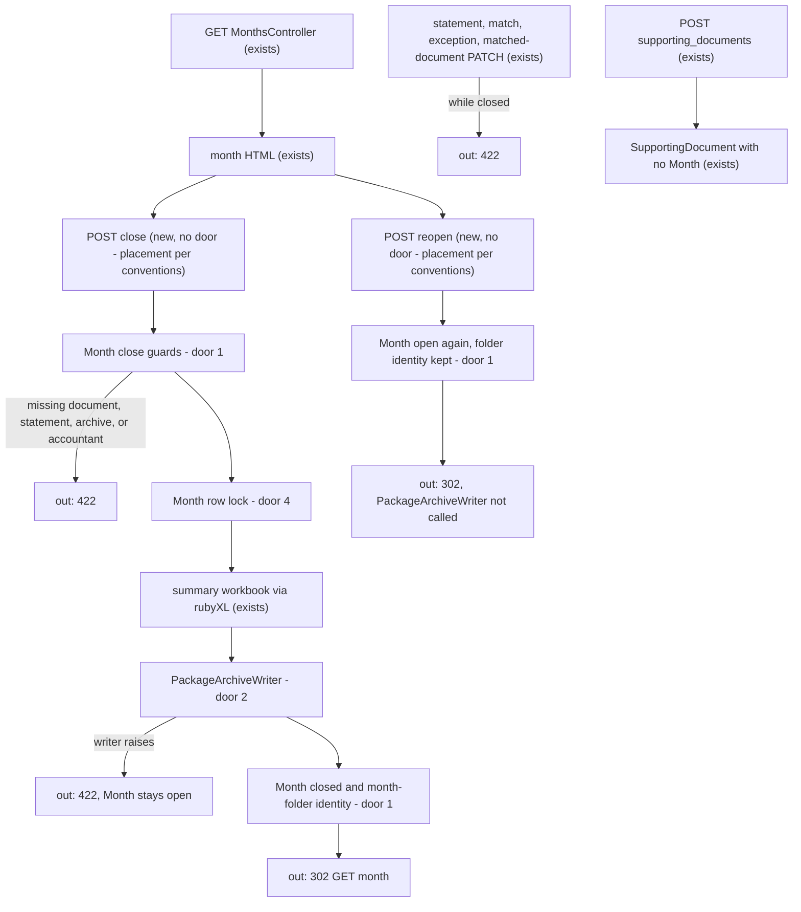
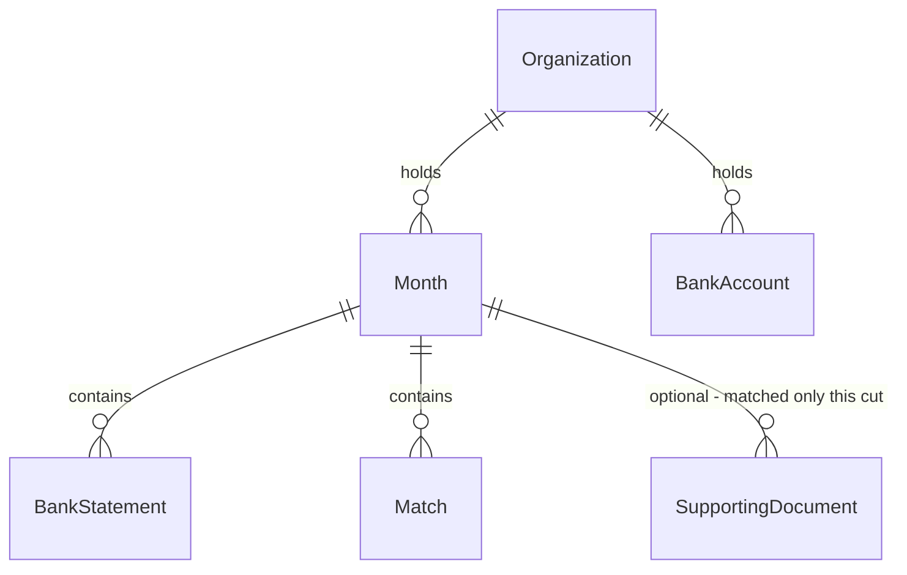

# Close for send

Sources:

- https://github.com/gutors/ai-accounting-assistant/issues/34 - this cut: freeze the month; write summary spreadsheet and `{YYYY-MM}` month folder to the package archive; reopen does not touch Drive; unmatched-in-package and restore are #39
- https://github.com/gutors/ai-accounting-assistant/issues/6 - the system only prepares the package; close does not complete without the Drive copy; destination email is a reminder, not a send target
- https://github.com/gutors/ai-accounting-assistant/issues/18 - unmatched documents do not block close; this cut does not put any in the package (#39)
- https://github.com/gutors/ai-accounting-assistant/issues/19 - closed month is read-only; reopen returns open with data intact and does not touch Drive; the next close replaces the same month folder; restore is #39
- https://github.com/gutors/ai-accounting-assistant/issues/20 - a supporting document has no month until a match (already) or unmatched-in-package (#39); insert without a month does not change a closed month
- https://github.com/gutors/ai-accounting-assistant/issues/22 - summary spreadsheet layout (one sheet `YYYY-MM`, accountant header, Recebimentos / Custos/Despesas, exception column, unmatched section omitted when empty)
- https://github.com/gutors/ai-accounting-assistant/issues/23 - designate existing archive folder (already); product creates `{YYYY-MM}`; re-close empties and rewrites contents, same Drive id; tree `resumo-YYYY-MM.xlsx`, `extratos/`, `notas/`
- https://github.com/gutors/ai-accounting-assistant/issues/26 - every active bank account needs a statement before close
- `CONTEXT.md` - Close-for-send, Closed month, Month folder, Monthly package, Summary spreadsheet, Package archive, Missing document, Unmatched document
- [ADR-0001](../../../docs/adr/0001-rails-8-hotwire.md) - Rails 8 + Hotwire; close-for-send may be a long Puma request or an Active Job — picked in Landing here; Account ≠ Drive writer

No design source for the screens. Verification stays on project profile `standard` (no screen mock, so not `ui`). The spreadsheet layout is #22, proven by workbook cells.

## Problem

A coordinator can import statements, confirm matches, and mark exceptions, but the month never freezes and nothing is written to the package archive. The accountant still cannot receive a monthly package from this product: there is no summary spreadsheet, no `{YYYY-MM}` folder, and a month with a missing document is indistinguishable from a month that is ready. Issue #34 gives no conversion figure; the cost is that the close ritual stops at lists the coordinator already has.

When this ships, a coordinator of an open month with every payment matched or excepted, every active account’s statement present, an accountant presentation name, and a package-archive folder, closes for send: the month becomes read-only, and the package lands in `{YYYY-MM}` on Drive. They can reopen without touching Drive. The product still does not email the accountant, restore a damaged folder, or put unmatched documents in the package.

## Out of scope

| Excluded | Why |
| --- | --- |
| Email or any dispatch to the accountant | #34; #6 / #17 — coordinator delivers |
| Restore a damaged month folder from the frozen copy | #34; #39 |
| Choosing unmatched documents into the package; `notas-sem-casamento/`; spreadsheet unmatched section | #34; #39 / #20 |
| Creating the package-archive folder or changing Drive ACL | #23: coordinator already owns the folder and sharing |
| Drive scopes on operator login; treating the writer Google account as Account | ADR-0001; Account ≠ Drive writer |
| Open Finance JSON as a statement path | #16; upload already owns files |
| Extra exception kinds, suggestions | #36 / #37 |
| Submitter access | #35; insert-without-month stays allowed for the coordinator |
| Accountant login | accountant is not an operator |

## Assumptions

| Assumption | Chosen default | Rationale | Confirmed? |
| --- | --- | --- | --- |
| Execution | close-for-send runs inside the Puma request; the response returns after Drive write and persist; no `closing` state | #19 forbids a third state; ADR-0001 already sized request timeout in minutes; a job would need progress UI the month page does not have | y |
| Drive writer credentials | process env `GOOGLE_DRIVE_REFRESH_TOKEN` with existing `GOOGLE_CLIENT_ID` / `GOOGLE_CLIENT_SECRET`; one writer account for the product | writer is dedicated and shared across organizations; SEFAZ encrypts in Postgres because the A1 is per organization | y |
| Drive adapter in test | in-memory writer; specs never call Google | no secrets or network in CI; #39 restore reuses the same port | y |
| Drive adapter in development | in-memory unless `GOOGLE_DRIVE_REFRESH_TOKEN` is set | local `bin/rails server` must close without a real writer | y |
| Puma timeout | `worker_timeout` 300 seconds | platform budget is minutes; default 60s is shorter than a Drive upload of the package | y |
| Accountant gate | presentation name required to close; tax id, razão social, PIX, destination optional | #22 header always has the name; PIX and destination stay off the spreadsheet | y |
| Archive gate | `package_archive_folder_id` required to close | #6: close does not complete without the copy | y |
| Statement gate | every *active* BankAccount has a BankStatement on that Month; inactive without a statement does not block; statements on inactive accounts still enter the package | #26: every active account needs a statement; #26 already-imported movements stay | y |
| Close control | `POST /months/:year_month/close` from the month page; labeled submit `Fechar para envio` is the confirm; no extra dialog | same as statement upload and deactivate | y |
| Reopen control | `POST /months/:year_month/reopen`; labeled submit `Reabrir`; no extra dialog | reopen is reversible and does not touch Drive | y |
| Spreadsheet `Onde` | bank-account unique name | that name is what the accountant already reads on `extrato-{slug}` | y |
| Spreadsheet `Item` / `O que` | Inflow/Payment `history` | #22: bank history, not an accounting category | y |
| Spreadsheet `Detalhe` / `Detalhes` | empty this cut | Inflow/Payment have no second text field | y |
| Spreadsheet dates | `dd/mm/YYYY` strings (`11/05/2026`) | same as the month page locale `pt-BR` | y |
| Spreadsheet amounts | Excel numeric `155` for `15500` cents (cents / 100 written to the cell only) | #22 totals use `SUM`; domain amounts stay integer cents in Postgres | y |
| Tax id on the spreadsheet | formatted `11.222.333/0001-81` / `390.533.447-05`; digits stay on Organization | header is what the accountant reads | y |
| Document `id-curto` | persisted SupportingDocument id decimal string | #23: stable across re-close if the set is unchanged | y |
| Payee slug in filenames | `ActiveSupport::Inflector.parameterize(payee)` | same as bank-account slug | y |
| Empty `notas/` | omit files under `notas/` when the month has no matched documents; do not create `notas-sem-casamento/` | this cut never ships unmatched files; empty folders are not the package | y |
| Home list | still `YYYY-MM` links only; closed copy lives on the month page (`Mês fechado`) | home is the access/month index from earlier cuts | y |
| Organization setup while a month is closed | `/setup` stays writable | #19 freezes the month, not standing accountant/archive/accounts | y |
| In-app download of the xlsx | none this cut | the package is the month folder; coordinator already has the archive | y |

**Open questions:** none - all resolved or logged above.

## Criteria

Grouped by slice. Numbering runs across the whole plan.

### S1: Close gates and freeze (P1)

**Acceptance Criteria**

1. WHEN a coordinator POSTs `/months/2026-05/close` for an open Month whose one Payment of `22000` cents is a missing document THEN the system SHALL persist that Month not closed, SHALL not invoke the package-archive writer, and SHALL respond `422` with the text `Há documento faltante`
2. WHEN that Month has an active BankAccount `Conta Principal` with no BankStatement THEN the system SHALL persist the Month not closed and respond `422` with the text `Importe o extrato de cada conta ativa`
3. WHEN the focused organization has no `package_archive_folder_id` THEN POST close SHALL persist the Month not closed and respond `422` with the text `Informe a pasta do arquivo do pacote`
4. WHEN the focused organization has no accountant presentation name THEN POST close SHALL persist the Month not closed and respond `422` with the text `Cadastre o contador`
5. WHEN `2026-05` has a BankStatement on every active BankAccount, accountant presentation name `Maria Contadora`, package-archive folder id `15uNXeRBIhVvZJIhL4yTw4IsStMhUaaxl`, and every Payment matched or excepted THEN POST close SHALL persist the Month closed, invoke the package-archive writer once, and respond `302` to `/months/2026-05`
6. WHEN that close succeeds THEN `GET /months/2026-05` SHALL respond `200` and include `Mês fechado` and SHALL not include `Fechar para envio`
7. IF an unauthenticated request POSTs `/months/2026-05/close` THEN the system SHALL persist no Month closed and respond `302` to `/login`
8. IF the package-archive writer raises THEN POST close SHALL persist the Month not closed and respond `422` with the text `Não foi possível gravar no arquivo do pacote`
9. IF a coordinator POSTs close while the Month is already closed THEN the system SHALL leave it closed, SHALL not invoke the writer, and SHALL respond `422` with the text `Mês fechado`
10. WHEN an inactive BankAccount has no statement and every active BankAccount has a statement and no missing document THEN POST close SHALL persist the Month closed and respond `302`

**Independent test:** plant `2026-05` ready except one `Documento faltante` (`422`); fix the gates; POST close; see `Mês fechado` and `302`. Fail the writer (`422`, still open).

### S2: Summary spreadsheet (P1)

**Acceptance Criteria**

11. WHEN close succeeds for organization `ONG Norte` and Month `2026-05` THEN the written workbook SHALL have exactly one sheet named `2026-05` and SHALL include `Planilha-resumo — ONG Norte`
12. WHEN accountant presentation name is `Maria Contadora`, tax id `11222333000181`, and razão social `Contábil LTDA` THEN that sheet SHALL include `Maria Contadora`, `Contábil LTDA`, and `11.222.333/0001-81`
13. WHEN tax id is CPF `39053344705` and razão social is absent THEN that sheet SHALL include `390.533.447-05` and SHALL not include a razão social line for that accountant
14. WHEN PIX `chave-pix` and destination email `ana@example.com` are set THEN that sheet SHALL not include `chave-pix` and SHALL not include `ana@example.com`
15. WHEN the Month has an Inflow of `6300` cents on `2026-05-04` with history `Pix - Recebido` on BankAccount `Conta Principal` THEN the Recebimentos section SHALL include `04/05/2026`, numeric `63`, `Conta Principal`, and `Pix - Recebido`
16. WHEN the Month has a Payment of `15500` cents marked `bank_fee` with history `Tarifa Pacote de Serviços` THEN the Custos/Despesas section SHALL include `Tarifa bancária`, numeric `155`, that history, and an empty `Arquivo(s)` for that row
17. WHEN a Payment of `22000` cents is matched to two recibos (`Padaria Central` on `2026-05-11` and `Mercado Silva` on `2026-05-12`) THEN that expense row’s `Arquivo(s)` SHALL equal those two documents’ `notas/` filenames separated by `; `
18. WHEN two Payments are matched to one recibo `Padaria Central` THEN both expense rows SHALL include that document’s `notas/` filename in `Arquivo(s)`
19. WHEN a Match has observation `desconto não documentado` THEN that expense row SHALL include `desconto não documentado`
20. WHEN close succeeds THEN the sheet SHALL include labels `Receita total`, `Despesas total`, and `Resultado mês`, and each of those three value cells SHALL contain a formula whose text includes `SUM` for the two totals and a minus for `Resultado mês`
21. WHEN close succeeds with no unmatched documents in the package THEN the workbook SHALL not include `sem casamento`
22. WHEN Custos/Despesas has two payments on `2026-05-04` and `2026-05-20` THEN those rows SHALL appear in that date order

**Independent test:** close a planted May with one inflow `R$ 63,00`, one tarifa `R$ 155,00`, and one 1:N match; open the written xlsx; check sheet name, header, numeric amounts, `; ` files, and `SUM`.

### S3: Month folder on the archive (P1)

**Acceptance Criteria**

23. WHEN close succeeds for `2026-05` THEN the writer SHALL receive a month folder named `2026-05` under parent `15uNXeRBIhVvZJIhL4yTw4IsStMhUaaxl` whose files include `resumo-2026-05.xlsx`
24. WHEN that Month’s BankAccount slug is `conta-principal` and the statement has a PDF and an `.xlsx` spreadsheet THEN the writer files SHALL include `extratos/extrato-conta-principal.pdf` and `extratos/extrato-conta-principal.xlsx`
25. WHEN that spreadsheet blob’s filename ends in `.csv` THEN the writer files SHALL include `extratos/extrato-conta-principal.csv` and SHALL not include `extratos/extrato-conta-principal.xlsx`
26. WHEN a matched recibo has payee `Padaria Central`, `document_on` `2026-05-11`, and a `.jpg` photo THEN the writer files SHALL include `notas/recibo-2026-05-11-padaria-central-{id}.jpg` where `{id}` is that document’s persisted id
27. WHEN a matched nota fiscal has payee `Mercado Silva`, `document_on` `2026-05-11`, a `.jpg` photo and a `.xml` THEN the writer files SHALL include `notas/nota-2026-05-11-mercado-silva-{id}.jpg` and `notas/nota-2026-05-11-mercado-silva-{id}.xml` with the same `{id}`
28. WHEN close succeeds THEN the writer files SHALL not include any path starting with `notas-sem-casamento/`
29. WHEN the first close of `2026-05` succeeds THEN the system SHALL persist that Month’s month-folder identity equal to the folder id the writer returned
30. WHEN a later close of the same Month succeeds THEN the writer SHALL replace contents of that same folder id and SHALL not create a second folder name `2026-05` under the parent
31. The operator OmniAuth scopes SHALL remain `openid` and `email` only

**Independent test:** close; assert the in-memory tree (`resumo-2026-05.xlsx`, `extratos/extrato-conta-principal.pdf`, `notas/recibo-…-1.jpg`); reopen; close again; same folder id, contents replaced; `GoogleOauth.scopes` unchanged.

### S4: Closed month is read-only (P1)

**Acceptance Criteria**

32. WHILE `2026-05` is closed, `GET /months/2026-05` SHALL include `Mês fechado` and `Reabrir` and SHALL not include `Enviar extrato`, `Confirmar casamento`, `Marcar tarifa`, or `Desfazer casamento`
33. WHILE `2026-05` is closed, `GET /months/2026-05` SHALL still include a matched payment’s `Casado` label and history text
34. IF a coordinator POSTs a BankStatement to `/months/2026-05/bank_statements` WHILE the Month is closed THEN the system SHALL leave existing statements in place and respond `422` with `Mês fechado`
35. IF a coordinator POSTs a Match to `/months/2026-05/matches` WHILE the Month is closed THEN the system SHALL persist no new Match and respond `422` with `Mês fechado`
36. IF a coordinator DELETEs a Match WHILE the Month is closed THEN the system SHALL leave that Match in place and respond `422` with `Mês fechado`
37. IF a coordinator POSTs a document exception WHILE the Month is closed THEN the system SHALL persist no mark and respond `422` with `Mês fechado`
38. IF a coordinator DELETEs a document exception WHILE the Month is closed THEN the system SHALL leave the mark in place and respond `422` with `Mês fechado`
39. IF a coordinator PATCHes payee `Outro` on a SupportingDocument whose Month is the closed `2026-05` THEN the system SHALL leave the payee unchanged and respond `422` with `Mês fechado`
40. WHEN a coordinator POSTs a new recibo to `/supporting_documents` WHILE `2026-05` is closed THEN the system SHALL persist that SupportingDocument with no Month and respond `302` to `/supporting_documents`

**Independent test:** close; confirm the month page is view-only; POST statement/match/exception and PATCH a matched document (`422`); insert a new recibo (no month, `302`).

### S5: Reopen, isolation, concurrency (P1)

**Acceptance Criteria**

41. WHEN a coordinator POSTs `/months/2026-05/reopen` on a closed Month THEN the system SHALL persist the Month not closed, SHALL not invoke the package-archive writer, and SHALL respond `302` to `/months/2026-05`
42. WHEN that reopen succeeds THEN `GET /months/2026-05` SHALL include `Fechar para envio` and `Enviar extrato` and SHALL not include `Mês fechado`
43. WHEN that reopen succeeds THEN Matches, Payments, and BankStatements of `2026-05` SHALL remain, and the persisted month-folder identity SHALL remain
44. IF a coordinator POSTs reopen WHILE the Month is open THEN the system SHALL respond `422` with `Mês aberto` and leave it open
45. IF an unauthenticated request POSTs reopen THEN the system SHALL leave the Month closed and respond `302` to `/login`
46. IF a coordinator focused on organization A POSTs close for a `2026-05` that exists only on organization B THEN the system SHALL leave B unchanged and respond `404`
47. IF a coordinator focused on organization A POSTs reopen for a closed `2026-05` that exists only on organization B THEN the system SHALL leave B closed and respond `404`
48. IF two concurrent POSTs close the same open `2026-05` THEN the system SHALL persist that Month closed exactly once and SHALL invoke the writer exactly once
49. WHILE focus is organization A, `GET /months/2026-05` after A’s close SHALL not include organization B’s accountant presentation name

**Independent test:** close, reopen (Drive writer not called, `Casado` still there, `Fechar para envio` back); POST reopen while open (`422`); two overlapping close POSTs (one closed, one writer call).

## Traceability

| ID | Slice | Criteria | Status |
| --- | --- | --- | --- |
| CLOSE-01 | S1 | 1, 2, 3, 4, 5, 6, 7, 8, 9, 10 | In checks |
| SHEET-01 | S2 | 11, 12, 13, 14, 15, 16, 17, 18, 19, 20, 21, 22 | In checks |
| DRIVE-01 | S3 | 23, 24, 25, 26, 27, 28, 29, 30, 31 | In checks |
| FROZEN-01 | S4 | 32, 33, 34, 35, 36, 37, 38, 39, 40 | In checks |
| OPEN-01 | S5 | 41, 42, 43, 44, 45, 46, 47, 48, 49 | In checks |

## Observable

| Surface | Decision | Landing |
| --- | --- | --- |
| screen `/months/:year_month` | empty payments | existing - AC 2 of match-and-exception; close still allowed when every active account has a statement (S1) |
| screen `/months/:year_month` | empty unmatched pool | existing - `Nenhum documento sem casamento`; this cut does not choose from the pool |
| screen `/months/:year_month` | loading | n/a - Turbo full-page request; close waits on the same POST |
| screen `/months/:year_month` | error state | AC 1, AC 2, AC 3, AC 4, AC 8, AC 9, AC 44 |
| screen `/months/:year_month` | unauthorised | AC 7, AC 45 |
| screen `/months/:year_month` | density and ordering | AC 6, AC 32, AC 33, AC 42 - closed copy `Mês fechado`; open copy keeps lists and adds `Fechar para envio` |
| screen `/months/:year_month` | destructive action confirms | n/a - `Fechar para envio` and `Reabrir` submit immediately, same as deactivate |
| screen `/supporting_documents` | empty / loading / density | existing - insert/edit list unchanged |
| screen `/supporting_documents` | error / unauthorised | AC 39, AC 40 - closed month is `422` on PATCH of a month-assigned document; insert still `302` |
| screen `/supporting_documents` | destructive action confirms | existing - no destroy |
| HTML `POST /months/:year_month/close` | who may call it | AC 5, AC 7, AC 46 |
| HTML `POST /months/:year_month/close` | error shape and codes | AC 1, AC 2, AC 3, AC 4, AC 8, AC 9, AC 46 |
| HTML `POST /months/:year_month/close` | versioning | n/a - first HTML surface for this resource |
| HTML `POST /months/:year_month/close` | rate limit | n/a - coordinator-only, small operator set |
| HTML `POST /months/:year_month/reopen` | who may call it | AC 41, AC 45, AC 47 |
| HTML `POST /months/:year_month/reopen` | error shape and codes | AC 44, AC 45, AC 47 |
| HTML `POST /months/:year_month/reopen` | versioning | n/a - first HTML surface |
| HTML `POST /months/:year_month/reopen` | rate limit | n/a - coordinator-only |
| HTML `GET /months/:year_month` | who may call it | existing - coordinator with focus |
| HTML `GET /months/:year_month` | error shape and codes | existing - `404` invalid or never opened; this cut adds closed/open copy |
| HTML `GET /months/:year_month` | versioning | n/a - existing HTML surface |
| HTML `GET /months/:year_month` | rate limit | n/a - coordinator-only |
| HTML `POST /months/:year_month/bank_statements` | who may call it | existing - coordinator; this cut adds closed rejection |
| HTML `POST /months/:year_month/bank_statements` | error shape and codes | AC 34 |
| HTML `POST /months/:year_month/bank_statements` | versioning | n/a - existing HTML surface |
| HTML `POST /months/:year_month/bank_statements` | rate limit | n/a - coordinator-only |
| HTML `POST /months/:year_month/matches` | error shape and codes | AC 35 |
| HTML `POST /months/:year_month/matches` | who may call it | existing - coordinator |
| HTML `POST /months/:year_month/matches` | versioning | n/a - existing |
| HTML `POST /months/:year_month/matches` | rate limit | n/a - coordinator-only |
| HTML `DELETE /months/:year_month/matches/:id` | error shape and codes | AC 36 |
| HTML `DELETE /months/:year_month/matches/:id` | who may call it | existing - coordinator |
| HTML `DELETE /months/:year_month/matches/:id` | versioning | n/a - existing |
| HTML `DELETE /months/:year_month/matches/:id` | rate limit | n/a - coordinator-only |
| HTML `POST /months/:year_month/payments/:id/document_exception` | error shape and codes | AC 37 |
| HTML `POST /months/:year_month/payments/:id/document_exception` | who may call it | existing - coordinator |
| HTML `POST /months/:year_month/payments/:id/document_exception` | versioning | n/a - existing |
| HTML `POST /months/:year_month/payments/:id/document_exception` | rate limit | n/a - coordinator-only |
| HTML `DELETE /months/:year_month/payments/:id/document_exception` | error shape and codes | AC 38 |
| HTML `DELETE /months/:year_month/payments/:id/document_exception` | who may call it | existing - coordinator |
| HTML `DELETE /months/:year_month/payments/:id/document_exception` | versioning | n/a - existing |
| HTML `DELETE /months/:year_month/payments/:id/document_exception` | rate limit | n/a - coordinator-only |
| HTML `PATCH /supporting_documents/:id` | error shape and codes | AC 39 |
| HTML `PATCH /supporting_documents/:id` | who may call it | existing - coordinator |
| HTML `PATCH /supporting_documents/:id` | versioning | n/a - existing |
| HTML `PATCH /supporting_documents/:id` | rate limit | n/a - coordinator-only |
| HTML `POST /supporting_documents` | who may call it | AC 40 - still allowed while a month is closed |
| HTML `POST /supporting_documents` | error shape and codes | existing - insert validations unchanged |
| HTML `POST /supporting_documents` | versioning | n/a - existing |
| HTML `POST /supporting_documents` | rate limit | n/a - coordinator-only |
| document `resumo-YYYY-MM.xlsx` | structure | AC 11, AC 12, AC 15, AC 16, AC 20, AC 21 |
| document `resumo-YYYY-MM.xlsx` | tone | n/a - labels are #22 Portuguese headings, not prose |
| document `resumo-YYYY-MM.xlsx` | depth | AC 14, AC 16, AC 19 - no PIX/email; exception type; match observation when present |
| document `resumo-YYYY-MM.xlsx` | what the reader does next | n/a - accountant receives the folder from the coordinator, outside this product |
| collection month-folder files | grouping | AC 23, AC 24, AC 26, AC 28 - root xlsx, `extratos/`, `notas/`; no `notas-sem-casamento/` |
| collection month-folder files | naming | AC 23, AC 24, AC 25, AC 26, AC 27 |
| collection month-folder files | ordering | n/a - Drive listing order is not part of the package; the spreadsheet is the index |
| collection month-folder files | duplicates | AC 30 - one `{YYYY-MM}` folder id; re-close replaces contents |
| collection month-folder files | exception that does not fit | AC 10, AC 28 - inactive without statement omitted; unmatched omitted this cut |

## Flow

This reuses `Month`, `Payment.missing_document?`, `BankStatement` blobs, `Organization` accountant and archive folder id, `Match`, `SupportingDocument`, `require_account`, `focused_organization`, and `rubyXL` (already the statement reader) to write the workbook. It does not email, restore, or attach Drive scopes to operator login.

Unauthenticated HTML on the new routes still goes through `ApplicationController` (exists) to `302` `/login`. Workbook bytes and blob bytes are built before the writer runs. The writer runs before persist-closed so a Drive failure leaves the Month open.

## Relations

One-way constraints: a Month is open or closed, never a third state (door 1), closed is the only state in which month mutations are refused (door 1), month-folder identity is optional until the first successful close and is kept across reopen (door 1), a Month belongs to one Organization (existing). No columns and no types here.

## Surface

| Route | In | Out | Status |
| --- | --- | --- | --- |
| `POST /months/:year_month/close` | session · focus | Month closed · month-folder identity · archive tree · redirect or month HTML | `302`, `422`, `404` |
| `POST /months/:year_month/reopen` | session · focus | Month open · same month-folder identity · redirect or month HTML | `302`, `422`, `404` |
| `GET /months/:year_month` | session · focus | month HTML · `Mês fechado` / `Fechar para envio` | `200`, `302`, `404` |
| `POST /months/:year_month/bank_statements` | session · focus · files | unchanged when open · none when closed | `302`, `422`, `404` |
| `POST /months/:year_month/matches` | session · focus · ids | unchanged when open · none when closed | `302`, `422`, `404` |
| `DELETE /months/:year_month/matches/:id` | session · focus · id | unchanged when open · Match kept when closed | `302`, `404`, `422` |
| `POST /months/:year_month/payments/:id/document_exception` | session · focus · `kind` | unchanged when open · none when closed | `302`, `422`, `404` |
| `DELETE /months/:year_month/payments/:id/document_exception` | session · focus · id | unchanged when open · mark kept when closed | `302`, `404`, `422` |
| `PATCH /supporting_documents/:id` | session · focus · fields | unchanged when document has no closed Month · none when it has | `302`, `422`, `404` |
| `POST /supporting_documents` | session · focus · files | SupportingDocument with no Month | `302`, `422` |

## Landing

| One-way door | Literal shape | Alternative rejected |
| --- | --- | --- |
| 1. Month is open or closed; month-folder identity survives reopen | `months.closed` boolean `null: false, default: false`. `months.month_folder_id` nullable string, kept when reopening. Open means `closed` is false. No `closing` value. Reopen sets `closed` false and does not clear `month_folder_id`. | A `status` enum including `closing` — #19: only open or closed. Clearing `month_folder_id` on reopen — the next close would create a second `{YYYY-MM}` and break the stable Drive id. Storing closed only as `closed_at` without a boolean — callers would branch on null vs time under two names. |
| 2. Package archive writes go through a port; operator login is not the writer | `PackageArchiveWriter` with `replace_month_folder(parent_id:, name:, folder_id:, files:)` returning the Drive folder id. Test/development-without-token: in-memory tree keyed by folder id. Production (and development with token): Drive API v3 `files.list` (`name = '{YYYY-MM}' and mimeType = 'application/vnd.google-apps.folder' and '{parent}' in parents and trashed = false`), `files.create` of a folder when none, `files.list` + `files.delete` of children then media `files.create` of each package file. Scope `https://www.googleapis.com/auth/drive` on the writer refresh token only. Gems `google-apis-drive_v3` and `googleauth` (`UserRefreshCredentials` from `GOOGLE_DRIVE_REFRESH_TOKEN`). Operator `GoogleOauth.scopes` stay `openid,email`. Zero hits: create. One hit: reuse id. More than one: raise (close `422`). | `drive.file` scope — cannot see a folder the coordinator created and shared. Calling Drive from `MonthsController` without a port — #39 restore and every spec would talk to Google. Attaching Drive scopes to OmniAuth — Account ≠ Drive writer. Service-account impersonation — the lock is a dedicated user account the coordinator shares the folder with, not a GCP service account. |
| 3. Summary spreadsheet is one xlsx sheet `YYYY-MM` with #22 sections | Workbook written with existing `rubyXL`. Sheet name `{YYYY-MM}`. Title `Planilha-resumo — {organization.name}`. Header block: presentation name; razão social only when tax id is CNPJ; formatted CPF/CNPJ. Sections Recebimentos (`Data`, `Valor`, `Onde`, `Item`, `Detalhe`) and Custos/Despesas (`Data`, `Valor`, `Onde`, `O que`, `Detalhes`, `Exceção`, `Arquivo(s)`, `Observação`). Totals `Receita total`, `Despesas total`, `Resultado mês` as formulas (`SUM` / minus). No unmatched section this cut. `Arquivo(s)` names match door 5. Exception copy `Tarifa bancária` / `Honorário do contador`. | CSV or HTML summary — #22 locks xlsx. Adding gem `caxlsx` — `rubyXL` already writes cells and formulas (`add_cell` formula argument) and is the statement reader. Putting PIX or destination on the sheet — #17 / #22. |
| 4. Close runs in the request; one closer at a time | `POST /close` holds `SELECT FOR UPDATE` on the Month row from after the cheap gates until persist-closed. Writer runs inside that lock, then `closed` is set true. The waiting second request sees `closed` and returns `422` without a second writer call. Reopen is the same lock, writer not called. No Active Job, no Solid Queue job, no `closing` row. | Active Job / Solid Queue — would need a third state or a parallel “in flight” flag #19 forbids, plus a progress surface the coordinator does not have; the same Puma process would still do the work on a scale-to-zero box. Mark closed before Drive — #6: close does not complete without the copy; a crash would freeze a month with no folder. |
| 5. Package file names are stable stems | Statements: `extratos/extrato-{bank_account.slug}.{ext}` from the blob’s filename extension (`pdf` / `xlsx` / `csv`). Documents: `notas/{nota\|recibo}-{YYYY-MM-DD}-{parameterize(payee)}-{id}.{ext}` with photo and XML sharing the stem. `id` is the SupportingDocument primary key. | Embedding the chave or payee raw with spaces — #23 stem is slug + short id. A generated UUID per close — re-close of an unchanged set would rename files and break accountant bookmarks. A folder per payment — #23: the spreadsheet is the index. |

- Nothing else in this change is hard to reverse. Button copy, 300s Puma timeout, and which two new controller actions exist are criteria or placement.

Door 1 and door 2 reach past this feature: #39 restore rewrites the same month folder from the frozen product copy and must not invent a second writer. Door 4 reaches past this feature: later dispatch (#17) stays a separate request, not this POST.

## Impact

| Front | What changes |
| --- | --- |
| domain | existing term: `Close-for-send` — first HTTP act: freeze the Month and write the month folder |
| domain | existing term: `Closed month` — first persisted: `closed` true until reopen; read-only in the product |
| domain | existing term: `Month folder` — first written `{YYYY-MM}` under the package archive; identity kept on the Month |
| domain | existing term: `Summary spreadsheet` — first generated `resumo-YYYY-MM.xlsx` as #22 |
| domain | existing term: `Package archive` — still a designated folder; now also written at close |
| domain | existing term: `Unmatched document` — still does not block close; still not placed in the package this cut |
| stored data | existing `months` rows stay open (`closed` false, no folder id). No backfill. Unique `(organization, year_month)` still holds. Adding `closed` default false succeeds on current rows |
