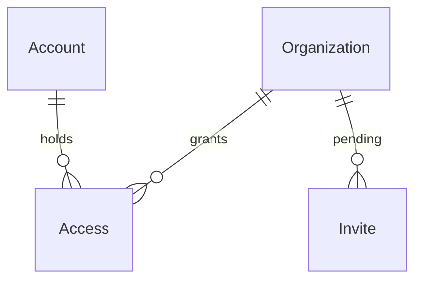

# Coordinator access

Sources:

- https://github.com/gutors/ai-accounting-assistant/issues/29 - this cut: Rails 8 boots, Google OIDC, Account, Organization, coordinator Access, invite by email, first-organization bootstrap; no public signup
- https://github.com/gutors/ai-accounting-assistant/issues/24 - one person one Account by email; Google proves that email; Access per organization; coordinator invites; several coordinators; product never leaves zero; no public signup
- https://github.com/gutors/ai-accounting-assistant/issues/2 - coordinator may hold more than one organization; session switches focus
- [ADR-0001](../../../docs/adr/0001-rails-8-hotwire.md) - Rails 8 + Hotwire; OmniAuth/OIDC gem picked here, not Devise
- `CONTEXT.md` - Account, Access, Coordinator, Organization
- `AGENTS.md` - `openid email` only, `email_verified` plus invite-email match, Account ≠ Drive writer

No design source for the screens. Verification stays on project profile `standard`.

## Problem

There is no application a coordinator can sign into. The close ritual, the glossary, and the platform lock exist on paper; a planted coordinator still cannot prove their email, see the organization they close, or grant coordinator Access to anyone else. Anyone with a Google login would be indistinguishable from an invited coordinator if a naive signup existed. Issue #29 gives no conversion figure; the cost is that no later close feature has an operator.

When this ships, a planted coordinator signs in with Google, works inside one focused organization, invites another coordinator by email, and cannot take the last coordinator Access off an organization. A Google identity that was neither planted nor invited does not become an Account.

## Out of scope

| Excluded | Why |
| --- | --- |
| Submitter invite, submitter isolation, justification | #29 / #35; spine is coordinator-only |
| Creating or renaming organizations in the UI | first organization is bootstrap/seed; close setup is #30 |
| Replacing the last coordinator in the UI | #24: the last one is replaced in the same setup that planted the first |
| Magic-link / non-Google email proof | #24: Google in this version |
| Outbound invite email (SMTP / Action Mailer) | email is the invite identifier; delivery of “please sign in” is out of band this cut |
| Drive writer OAuth, Drive scopes on operator login | Account ≠ Drive writer; archive is a later feature |
| Bank accounts, statements, supporting documents, matches, close-for-send | later spine features |
| Accountant login | accountant is not an operator |
| Public signup | #24 |
| Host brand, Kamal, Active Storage as the blob interface | host not locked; first file feature picks the blob interface |

## Assumptions

| Assumption | Chosen default | Rationale | Confirmed? |
| --- | --- | --- | --- |
| How the invitee learns to sign in | no mailer; coordinator tells them out of band; Access is granted when they Google-sign-in with that email | #24’s “convite por e-mail” is the identifier; SMTP is a new ops surface this cut does not need | y |
| Access `kind` stored now | enum includes `coordinator` and `submitter`; this feature only writes `coordinator` | #24 forbids coordinator+submitter on the same org; unique Access per Account per Organization encodes that before #35 | y |
| Invite lifetime | pending until accepted or cancelled; no TTL | none was specified; expiry can be added without changing the unique key | y |
| Email match | trim, lowercase, then exact match; no Google alias expansion | AGENTS: invite-email match; aliases are a later product decision | y |
| Self-revoke | allowed when at least one other coordinator Access remains | the invariant is “never zero”, not “cannot leave” | y |
| Organization presentation name | required, not globally unique | two NGOs may share a name; identity is the row, not the string | y |
| Focus storage | `organization_id` in the encrypted session cookie | enough to switch in one browser; a stored last-focus column is a later convenience | y |
| Google OAuth client | `GOOGLE_CLIENT_ID` / `GOOGLE_CLIENT_SECRET` in the environment; OmniAuth stubbed in specs | secrets stay out of the repo | y |
| Bootstrap entry | `bin/rails coordinator:bootstrap` reads `ORGANIZATION_NAME` and `COORDINATOR_EMAIL` | `db/seeds.rb` on `db:prepare` would plant accounts in every environment that boots | y |

**Open questions:** none - all resolved or logged above.

## Criteria

Grouped by slice. Numbering runs across the whole plan.

### S1: Planted coordinator signs in (P1)

**Acceptance Criteria**

1. WHEN an unauthenticated request hits HTML that requires a session THEN the system SHALL respond `302` to `/login`
2. WHEN a visitor opens `/login` THEN the system SHALL respond `200` and include the text `Entrar com Google`
3. WHEN Google OIDC succeeds with `email_verified` true and that normalized email already has coordinator Access THEN the system SHALL set the session to that Account, set focus to an organization of that Access, and respond `302` to the organization home that includes that organization’s name
4. WHEN Google OIDC succeeds a second time for an email that already has an Account THEN the system SHALL persist no second Account and set the session to the existing Account
5. IF Google OIDC succeeds and `email_verified` is not true THEN the system SHALL persist no Account, set no session, and respond `302` to `/login`
6. IF Google OIDC fails THEN the system SHALL set no session and respond `302` to `/login`
7. WHEN a coordinator with a session submits logout THEN the system SHALL clear the session and respond `302` to `/login`
8. The system SHALL request only the Google scopes `openid` and `email`
9. The system SHALL render `/login` and the organization home with default locale `pt-BR`

**Independent test:** bootstrap one organization and email, complete a stubbed Google callback for that verified email, see the organization name, log out, and hit `/` as a guest (`302` `/login`).

### S2: Uninvited Google is refused (P1)

**Acceptance Criteria**

10. IF Google OIDC succeeds with a verified email that has no Account and no pending Invite THEN the system SHALL persist no Account, set no session as an operator, and respond `302` to `/denied`
11. WHEN `/denied` is opened THEN the system SHALL respond `200` and include the text `não foi convidado`
12. WHEN Google OIDC succeeds again with that same uninvited verified email THEN the system SHALL still persist no Account for that email

**Independent test:** stub Google for an email that was never bootstrapped or invited; confirm zero Account rows and `/denied`.

### S3: Invite another coordinator (P1)

**Acceptance Criteria**

13. WHEN a coordinator of the focused organization submits a well-formed email that has neither standing Access nor a pending Invite on that organization THEN the system SHALL persist one pending Invite of kind `coordinator` for that email and respond `302` to the organization home
14. WHEN the organization home renders THEN the system SHALL list standing coordinator emails and pending Invite emails of that organization
15. WHEN the focused organization has no pending Invite THEN the organization home SHALL list no pending-invite email
16. WHEN Google OIDC succeeds with a verified email that matches a pending Invite THEN the system SHALL reuse or create the Account, persist coordinator Access on that organization, delete that Invite, set the session, and respond `302` to the organization home
17. IF a coordinator submits an email that already has standing coordinator Access on that organization THEN the system SHALL persist no Invite and respond `422`
18. IF a coordinator submits an email that already has a pending Invite on that organization THEN the system SHALL persist no additional Invite and respond `422`
19. IF a coordinator submits a string that is not an email THEN the system SHALL persist no Invite and respond `422`
20. IF an unauthenticated request submits an Invite THEN the system SHALL persist no Invite and respond `302` to `/login`
21. WHEN two concurrent Invite submissions use the same email and organization THEN the system SHALL persist exactly one pending Invite

**Independent test:** sign in as the planted coordinator, invite a second email, complete a stubbed Google callback for that email, and see both emails as standing coordinators.

### S4: Revoke without leaving zero (P1)

**Acceptance Criteria**

22. WHEN a coordinator of the focused organization confirms revoke of another coordinator Access on that organization and at least one coordinator Access would remain THEN the system SHALL delete that Access and respond `302` to the organization home
23. WHEN a coordinator chooses to revoke an Access THEN the system SHALL require a confirmation step and SHALL not delete the Access until that confirmation is submitted
24. IF a revoke would leave zero coordinator Accesses on the organization THEN the system SHALL leave Accesses unchanged and respond `422`
25. IF two concurrent revokes would drop the organization’s coordinator Access count to zero THEN the system SHALL persist exactly one remaining coordinator Access and respond `422` to the request that would have taken the last
26. WHEN a coordinator cancels a pending Invite on the focused organization THEN the system SHALL delete that Invite and respond `302` to the organization home
27. WHILE an Account has no remaining Access, WHEN Google OIDC succeeds for that email THEN the system SHALL leave the Account in place, set no organization focus, and respond `302` to `/denied`

**Independent test:** invite and accept a second coordinator, revoke them (list drops to one), then revoke the last remaining Access (`422`, still one).

### S5: Focus across organizations (P2)

**Acceptance Criteria**

28. WHEN an Account holds coordinator Access on more than one organization THEN the organization home SHALL include a control that lists those organizations’ names
29. WHEN the coordinator selects another organization they have coordinator Access on THEN the system SHALL set focus to that organization and respond `302` to that organization’s home
30. WHILE focus is organization A the system SHALL not list Access or Invite rows that belong only to organization B
31. IF the coordinator requests to focus an organization they have no Access on THEN the system SHALL respond `404` and leave focus unchanged

**Independent test:** bootstrap two organizations for the same email, sign in, switch focus, invite on A, confirm B’s home does not list that Invite.

### S6: Bootstrap the first organization (P1)

**Acceptance Criteria**

32. WHEN `bin/rails coordinator:bootstrap` runs with `ORGANIZATION_NAME` and `COORDINATOR_EMAIL` set and that email has no Account THEN the system SHALL persist one Organization, one Account for that normalized email, and one coordinator Access, then exit `0`
33. IF `COORDINATOR_EMAIL` is missing or not an email THEN the command SHALL persist nothing and exit non-zero
34. IF that email already has an Account THEN the command SHALL persist no second Account and exit non-zero

**Independent test:** run bootstrap with a throwaway name and email; sign in via S1. Run it again with the same email and confirm non-zero exit.

## Traceability

| ID | Slice | Criteria | Status |
| --- | --- | --- | --- |
| AUTH-01 | S1 | 1, 2, 3, 4, 5, 6, 7, 8, 9 | In checks |
| AUTH-02 | S2 | 10, 11, 12 | In checks |
| INVITE-01 | S3 | 13, 14, 15, 16, 17, 18, 19, 20, 21 | In checks |
| ACCESS-01 | S4 | 22, 23, 24, 25, 26, 27 | In checks |
| FOCUS-01 | S5 | 28, 29, 30, 31 | In checks |
| BOOT-01 | S6 | 32, 33, 34 | In checks |

## Observable

| Surface | Decision | Landing |
| --- | --- | --- |
| screen `/login` | empty / density / ordering | n/a - one sign-in control, no collection |
| screen `/login` | loading | n/a - full-page redirect to Google |
| screen `/login` | error state | AC 5, AC 6 |
| screen `/login` | unauthorised | AC 1, AC 2 - this is the unauthenticated screen |
| screen `/login` | destructive action confirms | n/a - no destructive action |
| screen `/denied` | empty / loading / density | n/a - the page is the refusal |
| screen `/denied` | error / unauthorised | AC 10, AC 11 |
| screen `/denied` | destructive action confirms | n/a - no destructive action |
| screen organization home | empty pending invites | AC 15 |
| screen organization home | loading | n/a - Turbo full-page / redirect |
| screen organization home | error state | AC 17, AC 18, AC 19, AC 24 |
| screen organization home | unauthorised | AC 1, AC 20, AC 31 |
| screen organization home | density and ordering | AC 14 - standing emails then pending emails |
| screen organization home | destructive action confirms | AC 23 |
| screen organization home | focus switcher hidden vs listed | AC 28 - listed only when more than one Access |
| HTML `POST /auth/google_oauth2` | who may call it | AC 2 - unauthenticated visitor |
| HTML `POST /auth/google_oauth2` | error shape and codes | AC 6 |
| HTML `POST /auth/google_oauth2` | versioning | n/a - OmniAuth callback URL is registered at Google, not versioned |
| HTML `POST /auth/google_oauth2` | rate limit | n/a - operator set is small; Google owns login throttling |
| HTML `GET /auth/google_oauth2/callback` | response shape | AC 3, AC 4, AC 10, AC 16 |
| HTML `GET /auth/google_oauth2/callback` | error shape and codes | AC 5, AC 6 |
| HTML `POST` Invite | who may call it | AC 13, AC 20 |
| HTML `POST` Invite | error shape and codes | AC 17, AC 18, AC 19, AC 20 |
| HTML `POST` Invite | versioning | n/a - first HTML surface, no published API version |
| HTML `POST` Invite | rate limit | n/a - coordinator-only, small operator set |
| HTML `DELETE` Access | who may call it | AC 22 |
| HTML `DELETE` Access | error shape and codes | AC 24, AC 25, AC 31 |
| HTML `DELETE` Access | versioning | n/a - first HTML surface |
| HTML `DELETE` Access | rate limit | n/a - small operator set |
| command `bin/rails coordinator:bootstrap` | flags and defaults | AC 32 - `ORGANIZATION_NAME`, `COORDINATOR_EMAIL`; no defaults |
| command `bin/rails coordinator:bootstrap` | output and verbosity | AC 32 - exit `0` on create |
| command `bin/rails coordinator:bootstrap` | exit codes | AC 32, AC 33, AC 34 |
| command `bin/rails coordinator:bootstrap` | failure halfway | AC 33, AC 34 - persist nothing |
| collection coordinators | grouping | AC 14 - standing vs pending |
| collection coordinators | naming | AC 14 - email |
| collection coordinators | ordering | AC 14 - emails as listed on the home |
| collection coordinators | duplicates | AC 17, AC 18, AC 21 |
| collection coordinators | exception that does not fit | AC 24 - last coordinator cannot leave the collection |

## Flow

No product app exists. This generates the Rails 8 process ADR-0001 already locked, and it uses CONTEXT terms Account, Access, Organization, and Coordinator rather than a Devise User/Role.

Sign-in:

1. unauthenticated HTML -> `Rails app` (door 1) - `302` `/login`
2. `POST /auth/google_oauth2` -> `OmniAuth Google` (door 2) - Google with `openid email`
3. callback verified email -> `Account` (door 3) lookup by normalized email, else `Invite` (door 5)
4. on Invite match, persist `Access` (door 4) and delete the Invite
5. out: session + focus `organization_id` (door 7), `302` organization home

Invite (signed-in coordinator):

1. `POST` email on focused organization -> reject unless coordinator Access on that organization
2. persist `Invite` (door 5) kind `coordinator`

Revoke:

1. `DELETE` Access -> last-coordinator guard (door 6) then delete Access; Account remains

Bootstrap:

1. `ORGANIZATION_NAME` + `COORDINATOR_EMAIL` -> `coordinator:bootstrap` (door 8) persists Organization, Account, coordinator Access

## Relations

One-way constraints: Account email unique (door 3), Access unique per Account per Organization (door 4), Access kind not null with `coordinator` and `submitter` in the enum (door 4), pending Invite unique per Organization per email (door 5). No columns and no types here.

## Surface

| Route | In | Out | Status |
| --- | --- | --- | --- |
| `GET /login` | none | login HTML · `Entrar com Google` | `200` |
| `POST /auth/google_oauth2` | Rails CSRF | redirect to Google | `302` |
| `GET /auth/google_oauth2/callback` | Google OIDC callback | session · redirect to organization home or `/denied` or `/login` | `302` |
| `DELETE /session` | session | cleared session · redirect to `/login` | `302` |
| `GET /denied` | none | denied HTML · `não foi convidado` | `200` |
| `GET /` | session · focus | organization home HTML · coordinator emails · pending emails | `200`, `302` |
| `POST /coordinator_invites` | session · focus · `email` | pending Invite · redirect or errors | `302`, `422` |
| `DELETE /coordinator_invites/:id` | session · focus | Invite gone · redirect | `302`, `404` |
| `DELETE /accesses/:id` | session · focus · confirmation | Access gone · redirect or last-coordinator error | `302`, `422`, `404` |
| `POST /focus` | session · `organization_id` | new focus · redirect or not found | `302`, `404` |

## Landing

| One-way door | Literal shape | Alternative rejected |
| --- | --- | --- |
| 1. Rails 8 app in this repo root | `rails new . --database=postgresql --css=tailwind --skip-test --skip-kamal --skip-active-storage`; then `rspec-rails`, Solid Queue left on (Rails 8 default), `config.i18n.default_locale = :pt-BR` | Next.js in-repo (ADR-0001 cannot express Hotwire); app in a subdirectory (splits `CONTEXT.md` from `app/`); Minitest (`AGENTS.md` / `.cursor/rules/rails.mdc` pin RSpec); Kamal generated (host brand is not locked); Active Storage generated (would look like the blob interface before the first file feature) |
| 2. Google operator login | gems `omniauth-google-oauth2` and `omniauth-rails_csrf_protection`; provider `:google_oauth2`; scopes `openid,email`; no Drive scope; callback `GET /auth/google_oauth2/callback` | Devise (ADR-0001: do not invent Devise because Rails); `omniauth_openid_connect` (Google is the only IdP this version; extra issuer/discovery config for one provider) |
| 3. Account identity | one Account per person; unique normalized email; Google `uid` unique when present | Google `uid` as the only key — an Invite exists before Google has seen the person |
| 4. Access standing | one Access row per Account per Organization; `kind` enum `coordinator` \| `submitter`; this feature writes only `coordinator` | a role on Account — Access is per organization (#24); two tables (`coordinator_memberships`) — glossary is Access |
| 5. Pending Invite | Invite rows exist only while pending; unique per Organization per email; deleted on accept or cancel | an Access row with a nullable Account — mixes standing and pending in one uniqueness story |
| 6. Never zero coordinators | destroy of coordinator Access runs in a transaction that locks that organization’s coordinator Accesses and aborts with `422` if the remaining count would be `0` | count-then-delete without a lock — two concurrent revokes both see two rows and both delete |
| 7. Organization focus | encrypted session stores `organization_id`; queries for Access and Invite are scoped to it | subdomain per organization (needs DNS this cut does not have); a cookie-less Current (cannot switch in one session) |
| 8. First organization | `bin/rails coordinator:bootstrap` with `ORGANIZATION_NAME` and `COORDINATOR_EMAIL`; no public registration route | a signup form — #24: Google of someone not invited or planted must not create an Account |

- Nothing else in this change is hard to reverse

## Impact

| Front | What changes |
| --- | --- |
| domain | existing term: `Account` — a person’s standing login by email; first persisted row; lives beside OmniAuth |
| domain | existing term: `Access` — coordinator (and later submitter) standing on one Organization; unique per Account per Organization |
| domain | existing term: `Organization` — first persisted NGO; presentation name only (no tax id, per CONTEXT) |
| domain | new term: `Invite` — pending grant of coordinator Access by email on one Organization, deleted on accept or cancel; user-facing copy is convite; add a CONTEXT row when this is approved |
| domain | existing term: `Coordinator` — now reachable: a person with coordinator Access after bootstrap or accepted Invite |
| stored data | nothing to migrate — empty database; bootstrap plants the first Organization + Account + Access |
