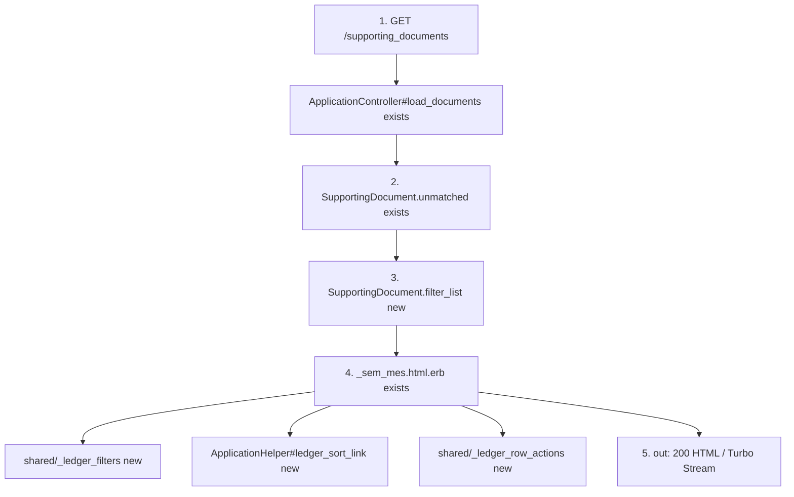
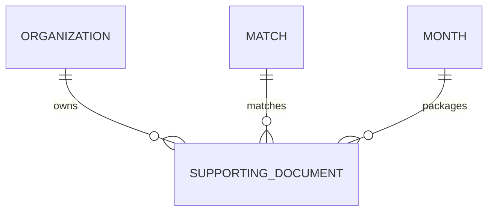

# Documents Sem mês list, filters, sorting, and action icons

**Approved**: 2026-11-18 - user: "Implement the plan as specified, it is attached for your reference."

## Problem

On `GET /supporting_documents`, the `#sem-mes` list renders every `SupportingDocument` of the focused organization (`SupportingDocument.listed`), including documents that have already been confirmed in a `Match` (`match_id` present). Over successive months, matched documents accumulate in `#sem-mes` forever. Coordinators and submitters also have no way to filter `#sem-mes` by payee, document kind, or date range, cannot sort the list by date or amount, and the `Ações` column renders text links/buttons instead of reusable action icons. Evidence: `app/controllers/application_controller.rb` `#load_documents` and `app/views/supporting_documents/_sem_mes.html.erb`.

When this ships, `#sem-mes` excludes matched documents (`match_id` present) while keeping unmatched documents (both `month_id: nil` and unmatched documents included in a closed package `Sem casamento em YYYY-MM`). The list includes a reusable filter bar (`Favorecido`, `Tipo`, `De`, `Até`, `Filtrar`, `Limpar`), reusable sortable column headers (`Data` and `Valor` toggling `asc` and `desc`), and reusable inline SVG action icons (`Editar` pencil in `caixa` and `Excluir` trash in `margem`).

## Shape

Reuses `SupportingDocument.unmatched` and `.ledger-sheet` / `.ledger-doc`, adding a query rule `SupportingDocument.filter_list` in the model layer and reusable view helpers/partials (`shared/_ledger_filters.html.erb`, `ApplicationHelper#ledger_sort_link`, `shared/_ledger_row_actions.html.erb`). All filtering and sorting rules run on `SupportingDocument` in Active Record, directly reachable by model and request specs.

1. `GET /supporting_documents` (with optional `q`, `kind`, `date_from`, `date_to`, `sort`, `dir`) -> `ApplicationController#load_documents` (exists)
2. `SupportingDocument.unmatched` (exists) - scopes to `match_id: nil`, excluding matched documents while keeping `month_id: nil` and unmatched package documents
3. `SupportingDocument.filter_list` (new) - filters by `q` (case-insensitive payee substring), `kind` (`nota_fiscal` / `recibo`), `date_from` (`document_on >=`), `date_to` (`document_on <=`), and orders by `date` (`document_on`) or `amount` (`amount_cents`) in `asc` or `desc` (tie-broken by `id`)
4. `_sem_mes.html.erb` (exists) -> renders `shared/_ledger_filters` (new), `ApplicationHelper#ledger_sort_link` (new) on `Data` and `Valor`, and `shared/_ledger_row_actions` (new) with `Editar` and `Excluir` SVG icons
5. out: HTML response `200` (or Turbo Stream replacement of `#sem-mes` after insert)

**Changes underneath**

| Front | What changes |
| --- | --- |
| domain | `#sem-mes` on `/supporting_documents` now lists only `SupportingDocument.unmatched` (`match_id: nil`), superseding earlier specs that asserted `Casado em YYYY-MM` inside `#sem-mes`. Unmatched documents included in a closed package (`month_id` present, `match_id: nil`) still appear with `Sem casamento em YYYY-MM` |
| stored data | nothing to migrate |
| readers | `GET /supporting_documents`, `POST /supporting_documents`, `POST /supporting_documents/identify`, `POST /supporting_documents/batch` (`#sem-mes`); submitter justification checkboxes still use `month_id.nil? && justification_id.nil?` from an unfiltered unmatched scope so active list filters do not hide checkboxes in `Vários documentos, um valor` |

New: `nothing - read only`.

## Surface

| Route | In | Out | Status | Who |
| --- | --- | --- | --- | --- |
| `GET /supporting_documents` | `q`, `kind`, `date_from`, `date_to`, `sort`, `dir` (optional query params) | `#sem-mes` filtered and sorted list | `200`, `302` `/login` | authenticated Coordinator (organization's unmatched documents) or Submitter (own unmatched documents); unauthenticated gets `302` `/login` |

## Landing

None - query parameters, model scopes, and view partials/helpers are reversible with no schema change, no external gem, and no external consumer.

- Nothing else in this change is hard to reverse

## Criteria

### S1: Sem mês excludes matched documents and keeps unmatched ones (P1)

Matched documents no longer appear in `#sem-mes`, preventing infinite list growth across months.

**Acceptance Criteria**

1. WHEN a supporting document belongs to a confirmed `Match` (`match_id` present) THEN `GET /supporting_documents` SHALL NOT include that document in `#sem-mes` for either a coordinator or a submitter
2. WHEN a supporting document has `match_id: nil` and `month_id: nil` THEN `GET /supporting_documents` SHALL include that document in `#sem-mes`
3. WHEN a supporting document has `match_id: nil` and belongs to a closed month package (`month_id` present) THEN `GET /supporting_documents` for a coordinator SHALL include that document in `#sem-mes` with `Sem casamento em YYYY-MM`

### S2: Filtering by payee, kind, and date range (P1)

Coordinators and submitters can filter `#sem-mes` by payee substring, document kind, and date bounds using the reusable filter bar.

**Acceptance Criteria**

4. WHEN `q` is provided (for example `q=padaria`) THEN `SupportingDocument.filter_list` and `GET /supporting_documents` SHALL return only unmatched documents whose `payee` matches `q` case-insensitively
   - `q=padaria` matches `Padaria Central`; `q=PADARIA` matches `Padaria Central`; `q=Inexistente` returns empty (`Nenhum documento`)
5. WHEN `kind` is `nota_fiscal` or `recibo` THEN `SupportingDocument.filter_list` and `GET /supporting_documents` SHALL return only unmatched documents of that kind; an unknown `kind` value SHALL be ignored
   - `kind=recibo` -> only recibos; `kind=nota_fiscal` -> only notas fiscais; `kind=outro` -> all unmatched documents
6. WHEN `date_from` and/or `date_to` are valid ISO dates THEN `SupportingDocument.filter_list` and `GET /supporting_documents` SHALL return only unmatched documents with `document_on >= date_from` and/or `document_on <= date_to`; invalid date strings SHALL be ignored without error
   - `date_from=2026-05-10` excludes `2026-05-09` and includes `2026-05-10`; `date_to=2026-05-12` includes `2026-05-12` and excludes `2026-05-13`; `date_from=invalid` does not raise and returns unfiltered dates
7. WHEN any filter (`q`, `kind`, `date_from`, `date_to`) is active on `GET /supporting_documents` THEN the filter bar SHALL render a `Limpar` link pointing to `/supporting_documents` (preserving active `sort`/`dir` if non-default or resetting cleanly)

### S3: Sorting by date and amount (P1)

Users can sort `#sem-mes` by `Data` or `Valor` in ascending or descending order via reusable header links.

**Acceptance Criteria**

8. WHEN no `sort` parameter is given THEN `#sem-mes` SHALL order documents by `document_on DESC, id DESC`, mark the `Data` column header with `aria-sort="descending"`, and link `Data` to `sort=date&dir=asc`
9. WHEN `sort=date&dir=asc` is given THEN `#sem-mes` SHALL order documents by `document_on ASC, id ASC`, mark `Data` with `aria-sort="ascending"`, and link `Data` to `sort=date&dir=desc`
10. WHEN `sort=amount&dir=desc` is given THEN `#sem-mes` SHALL order documents by `amount_cents DESC, id DESC`, mark `Valor` with `aria-sort="descending"`, and link `Valor` to `sort=amount&dir=asc`
11. WHEN `sort=amount&dir=asc` is given THEN `#sem-mes` SHALL order documents by `amount_cents ASC, id ASC`, mark `Valor` with `aria-sort="ascending"`, and link `Valor` to `sort=amount&dir=desc`
12. WHILE filters (`q`, `kind`, `date_from`, `date_to`) are active, WHEN the sort header links are rendered THEN their `href` SHALL preserve those filter parameters

### S4: Reusable action icons for Editar and Excluir (P1)

The `Ações` column uses reusable inline SVG icon controls for `Editar` and `Excluir`.

**Acceptance Criteria**

13. WHEN a document is rendered in `#sem-mes` THEN its `[data-cell=actions]` cell SHALL contain a link to `/supporting_documents/:id/edit` with `aria-label="Editar"`, `title="Editar"`, and an inline `<svg>` icon
14. WHEN a document in `#sem-mes` has `month_id: nil` and the viewer is a coordinator or the document's author THEN `[data-cell=actions]` SHALL contain a delete button to `/supporting_documents/:id` with `aria-label="Excluir"`, `title="Excluir"`, `data-turbo-confirm="Excluir este documento?"`, and an inline `<svg>` icon; WHEN `month_id` is present THEN the delete button SHALL be absent

## Out of scope

| Excluded | Why |
| --- | --- |
| Applying the filter bar, sort header, and action icons to other screens (`months/show`, `matches/show`, `setup/show`, `organizations/show`, `administration/show`) in this PR | user chose to create the reusable components and apply them in Documentos first, leaving adoption on other screens for follow-up steps |
| Filtering by observation or filename | user requested filtering by date, kind, and payee name |

## Assumptions

| Assumption | Chosen default | Rationale | Confirmed? |
| --- | --- | --- | --- |
| Sem mês exclusion rule | Hide only matched documents (`match_id` present), keeping `month_id: nil` and unmatched documents sent in a closed package | user selected `unmatched_only` | y |
| Filter and sort UX | Compact filter bar above the grid (`Favorecido`, `Tipo`, `De`, `Até`) + clickable `Data` and `Valor` column headers with `↑`/`↓` | user selected `header_sort_inline_bar` | y |
| Action column style | Icon-only buttons/links (pencil in `caixa` for Editar, trash in `margem` for Excluir) with `aria-label` and `title` | user selected `icon_only` | y |
| Rollout scope | Build reusable components now and apply them to `Documentos` in this cut | user selected `component_now_docs_first` | y |

**Open questions:** none - all resolved or logged above.

## Differences from the source

None - the product matches the source

## Sources

- User request and confirmed answers (`unmatched_only`, `header_sort_inline_bar`, `icon_only`, `component_now_docs_first`) - non-binding prototype `.impeccable/mocks/documents-sem-mes.html` created as design exploration in this session
