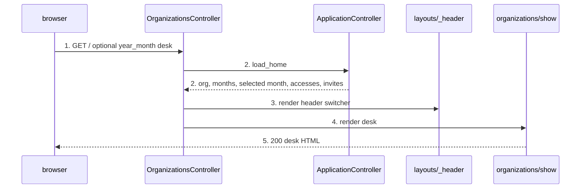
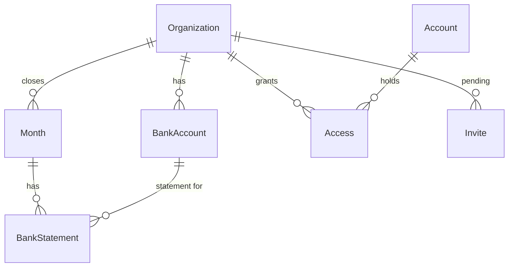
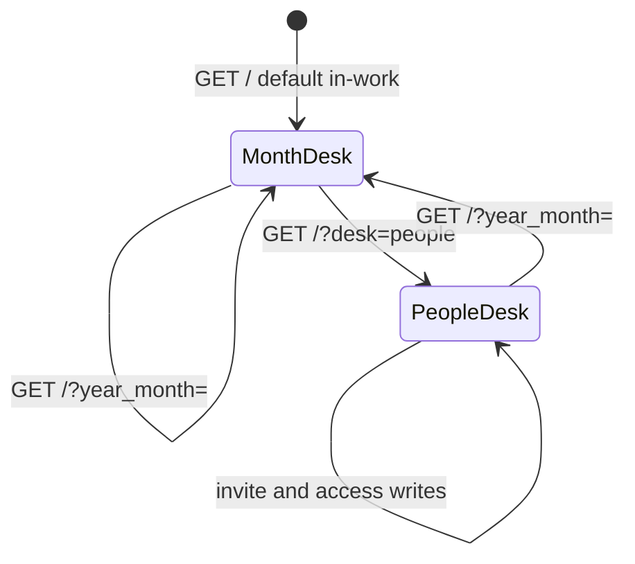
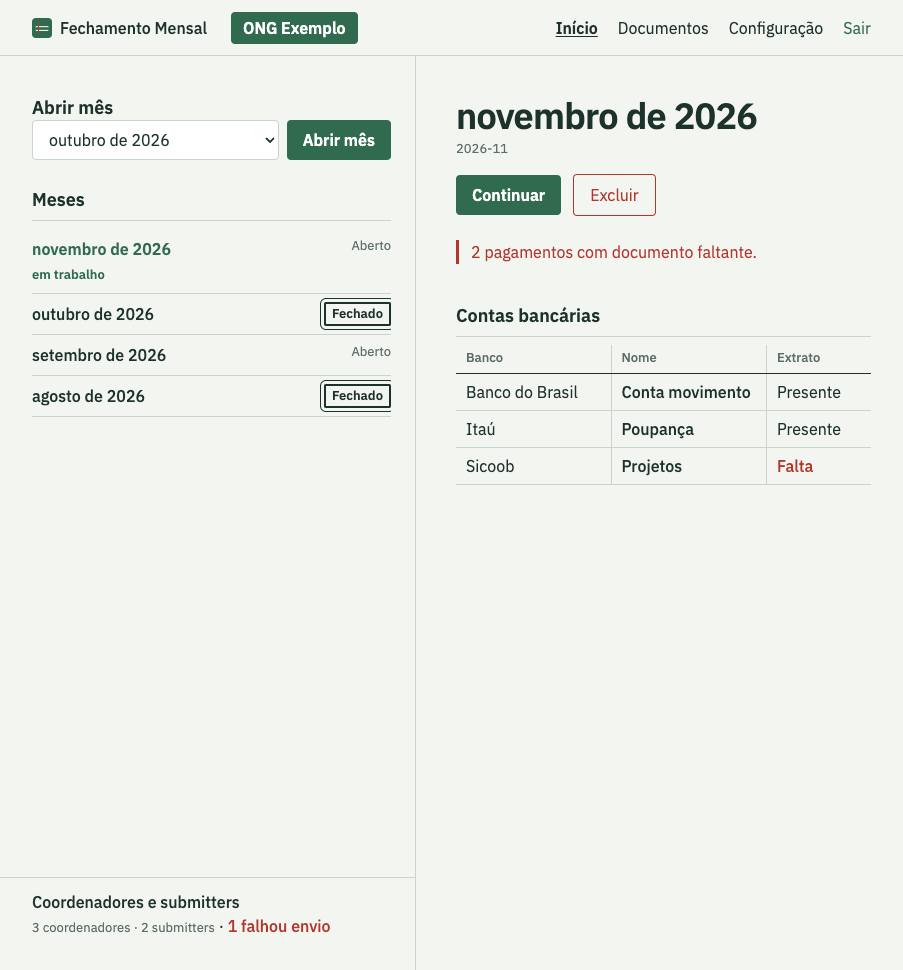
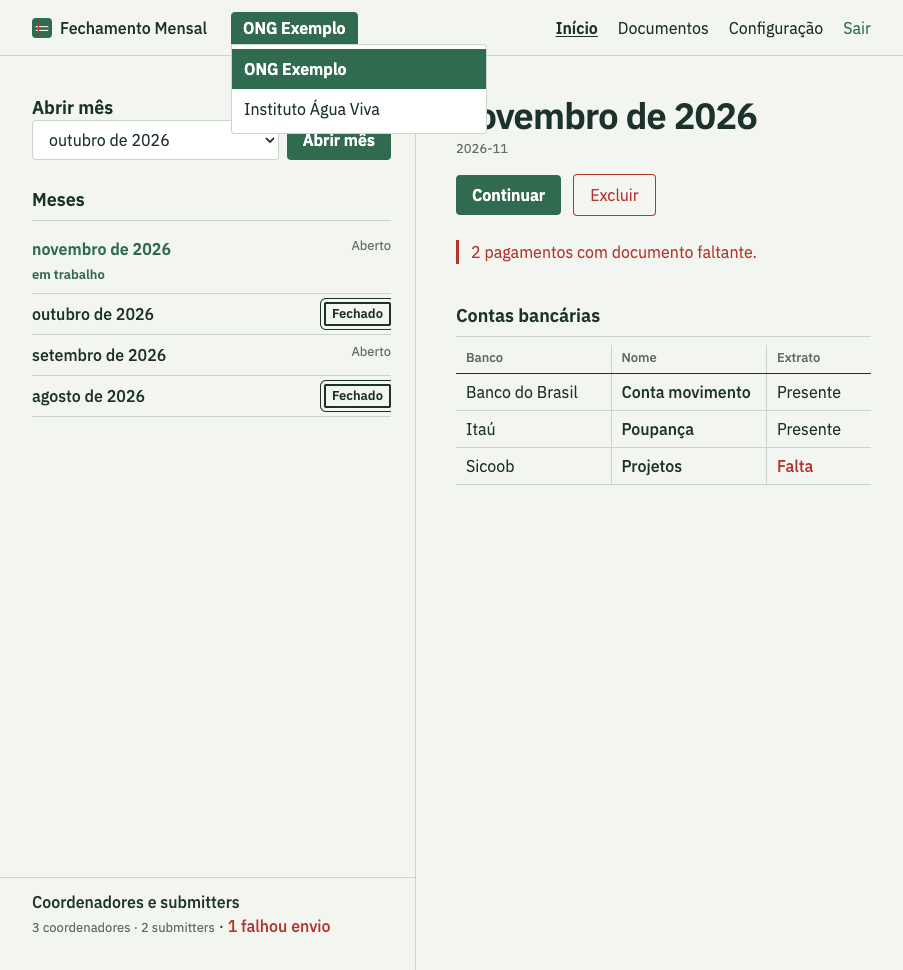
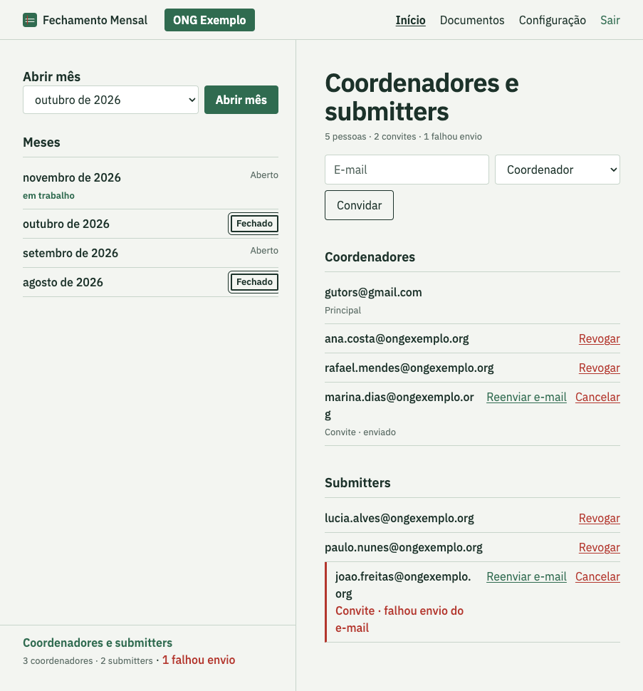
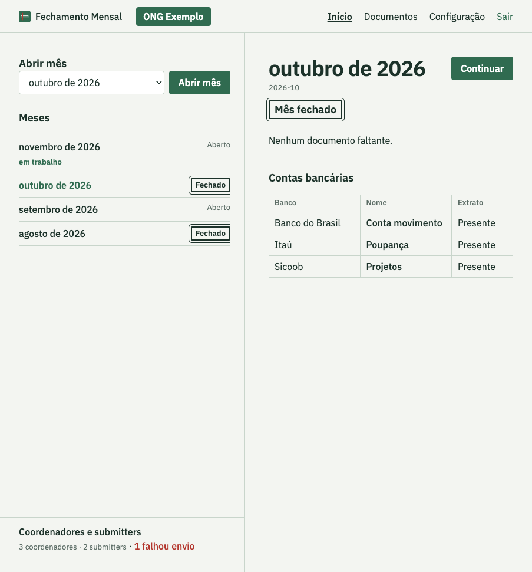

# Home desk select

**Approved**: 2026-11-18 - user: "Siga com o plano"

## Problem

The coordinator home already has a two-pane desk, but organization chips still sit on the month index, every never-sent month carries `Excluir` on the row, and clicking a month leaves `/` for `/months/:year_month`. People live in a closed `
` `Pessoas` below the desk, so coordinators, submitters, pending invites and a failed send are off-screen until someone opens that disclosure. The evidence is the live `app/views/organizations/show.html.erb` and the request that people stay findable, organization choice become a header list, a month selection fill the right desk, and `Excluir` wait until that month is on the desk. The cost is a misclick on `Excluir`, a trip off home to inspect a closed month, and people work that requires scrolling past the desk.

When this ships, a coordinator with more than one organization switches it from a header button; a month row keeps them on `/` with that month on the right; `Excluir` is a secondary control on a never-sent month that is on the desk; and `Coordenadores e submitters` stays pinned at the bottom of the left column and opens the people book on the right.

## Shape

Reuses `GET /`, `OrganizationsController#show`, `ApplicationController#load_home`, `POST /focus`, `POST /months`, `DELETE /months/:year_month`, and the existing invite and access write routes. The right pane is the selected month or the people book, not a second month overview; `Continuar` still goes to `GET /months/:year_month`. Selected month, missing-document copy, Extrato Presente/Falta, `never_sent?`, standing-access order, invite kind, and failed-send counts are decided in `load_home` (exists), in a layer request specs already reach — not in the view.

1. Coordinator `GET /` with optional `year_month` and optional `desk=people` -> `OrganizationsController#show` (exists) - calls `load_home`
2. `ApplicationController#load_home` (exists) - loads focused organization, focusable organizations, months `year_month` desc, the selected month (the `year_month` query when it belongs to the organization, otherwise the in-work open month), that month's active bank accounts, statements by account, missing-document payment count, standing accesses in insertion order, and invites
3. `layouts/_header` (exists) - when more than one focusable organization, the organization switcher control; always the principal nav
4. `organizations/show` (exists) - coordinator: two-pane desk as in the captures; submitter: Documentos sentence, no desk
5. out: `200` HTML; `POST /focus`, `POST /months`, `DELETE /months/:year_month`, and invite/access writes (exist) keep method, params, and status; people writes redirect to `/?desk=people`

**Changes underneath**

| Front | What changes |
| --- | --- |
| domain | none - Aberto/Fechado, Presente/Falta, documento faltante, `never_sent?`, Principal keep their meaning. Selected month is the desk subject; in-work remains the newest open month |
| stored data | nothing to migrate |
| readers | coordinator `GET /`; header; submitter `GET /` (chips leave the body); specs in `organizations_spec` / `focus_spec` / `screens_spec` that pin left-column chips, `Pessoas` details, `Excluir` on month rows, and month titles linking to `/months/:year_month` |

New: nothing - read only.

## Surface

| Route | In | Out | Status | Who |
| --- | --- | --- | --- | --- |
| `GET /` | optional `year_month`, optional `desk=people` | HTML desk or submitter home | `200`, `302` | signed-in Account with organization Access; unsigned get `302` |

`POST /focus`, `POST /months`, `DELETE /months/:year_month`, invite create/mail/destroy, and access revoke keep method, params, status, and who may call.

## Landing

None - query params on `GET /` and view composition. No schema, no new route, no new dependency.

- Nothing else in this change is hard to reverse

## Criteria

### S1: The month desk matches the capture (P1)

A coordinator with more than one organization and an open never-sent month sees the first viewport the month-desk capture draws.

**Acceptance Criteria**

1. WHEN a coordinator focused on an organization that is not their only one, with an open never-sent in-work month that still has missing documents and one account without a statement, GETs `/` THEN the system SHALL show the coordinator home in `.specs/features/home-desk-select/captures/month-desk.png`
2. WHEN that coordinator GETs `/` THEN the Meses list SHALL not include `Excluir` and SHALL not include a link to `/months/:year_month`
3. WHEN that coordinator GETs `/` THEN the left column pin SHALL include the title `Coordenadores e submitters` and SHALL remain in the first viewport while the Meses list scrolls
4. WHILE the left column pin is in view and that organization has 3 standing coordinators, 2 standing submitters, and 1 invite whose last delivery failed, the pin SHALL include `3 coordenadores · 2 submitters` and `1 falhou envio` in `margem`, and SHALL not include `convite`
5. WHILE that organization has 1 standing coordinator and 1 standing submitter and no failed invite, the pin SHALL include `1 coordenador · 1 submitter` and SHALL not include `falhou envio`

### S2: Organization is a header list (P1)

**Acceptance Criteria**

6. WHILE the account has exactly one organization, WHEN the coordinator GETs `/` THEN the header SHALL include that organization name and SHALL not render a control with `aria-haspopup="listbox"`; the left column SHALL not include `nav[aria-label="Organizações"]` and SHALL not include `role="group"` `aria-label="Organização"`
7. WHILE the account has two organizations, WHEN the coordinator GETs `/` THEN the header SHALL include a button whose accessible name is `Organização: <focused name>. Abrir lista`, `aria-haspopup="listbox"`, `aria-expanded="false"`
8. WHEN that coordinator uses that header button THEN the system SHALL show the list in `.specs/features/home-desk-select/captures/org-list.png`
9. WHEN the list is open, the focused organization SHALL be `aria-current="true"`; WHEN the coordinator uses the unfocused organization’s option THEN the system SHALL `POST /focus` with that `organization_id` and the next `GET /` SHALL be that organization’s month desk (not `desk=people`)
10. WHEN the list is open and the coordinator presses Escape, or uses a control outside the switcher, THEN the list SHALL close and the button SHALL be `aria-expanded="false"`

### S3: A month row fills the right desk (P1)

The in-work month is the newest open month (`year_month` desc, not closed). It is the default selected month on `GET /`. Any listed month can sit on the right.

**Acceptance Criteria**

11. WHEN the coordinator uses a Meses row for `2026-10` THEN the next request SHALL be `GET /?year_month=2026-10`
12. WHEN that coordinator GETs `/?year_month=2026-10` for a closed month THEN the system SHALL show the right desk in `.specs/features/home-desk-select/captures/closed-month.png`
13. WHEN the coordinator GETs `/?year_month=2026-11` for the open never-sent in-work month THEN the right column SHALL include `<h1>` that month’s `month_title`, the body SHALL include `2026-11`, Continuar SHALL be a link to `/months/2026-11`, and Excluir SHALL be a secondary danger button whose confirm is `Excluir este fechamento?`
14. WHEN the coordinator uses Excluir and confirms THEN the system SHALL `DELETE /months/:year_month` and keep today’s success redirect and toast
15. IF the selected month is closed, or open and not `never_sent?`, THEN the right column SHALL not include `Excluir`
16. WHEN the selected month is closed THEN the right column SHALL include the stamp `Mês fechado` and Continuar SHALL still link to `/months/:year_month`
17. WHILE the selected month has accounts confirmed and 2 payments missing a document, the right column SHALL include exactly one missing-document sentence `2 pagamentos com documento faltante.` in `margem`
18. WHILE the selected month has accounts confirmed and 0 payments missing a document, the sentence SHALL be `Nenhum documento faltante.` and SHALL not use `margem` for that sentence
19. WHILE the selected month is not accounts-confirmed, the right column SHALL not include `documento faltante`
20. WHEN the selected month has two active accounts, one with a statement and one without, THEN Contas bancárias SHALL be a ruled sheet with heads `Banco`, `Nome`, `Extrato`; the row with a statement SHALL include `Presente`; the row without SHALL include `Falta` in `margem`
21. IF `year_month` is absent, empty, or not a month of the focused organization, THEN the selected month SHALL be the in-work open month when one exists
22. WHEN there are no months THEN Meses SHALL include `Nenhum mês aberto`, the right column SHALL include `Selecione um mês na lista.`, and SHALL not include Continuar or Excluir
23. WHEN `GET /?desk=people` is showing the people book, and the coordinator uses a Meses row, THEN the right column SHALL be that month’s desk and the people pin SHALL not be `aria-current`
24. WHEN the coordinator GETs `/` THEN Abrir mês SHALL be a `<label for="year_month">Abrir mês</label>`, a `select#year_month` and submit `Abrir mês` on one row, above the Meses list, posting `year_month` to `/months`; the 25-month picker window and a successful `POST /months` redirect and toast SHALL stay as today’s `GET /` picker and `POST /months` specs

### S4: People sit on the desk (P1)

**Acceptance Criteria**

25. WHEN the coordinator uses the left pin `Coordenadores e submitters` THEN the next request SHALL be `GET /?desk=people`
26. WHEN that coordinator GETs `/?desk=people` THEN the system SHALL show the people book in `.specs/features/home-desk-select/captures/people-desk.png`
27. WHILE `desk=people`, the pin SHALL be `aria-current="true"` and no Meses row SHALL be `aria-current`
28. WHEN the people book is showing THEN the right column `<h1>` SHALL be `Coordenadores e submitters`; the invite form SHALL sit directly under that heading, with email placeholder `E-mail`, a kind select whose options are `Coordenador` then `Submitter` (default `Coordenador`), and submit `Convidar`; below the form the page SHALL include a heading `Coordenadores` then a heading `Submitters`
29. WHILE 3 standing coordinators, 2 standing submitters, 1 pending coordinator invite, and 1 failed submitter invite exist, the people-book meta SHALL include `5 pessoas · 2 convites · 1 falhou envio`
30. WHEN the people book is showing THEN standing coordinators SHALL appear in insertion order (`accesses.created_at`, then `id`), then pending coordinator invites in insertion order; standing submitters SHALL appear in insertion order, then pending submitter invites in insertion order. The principal coordinator’s row SHALL include `Principal` and SHALL not include `Revogar`
31. A pending invite row SHALL include `Convite · enviado` when `last_delivery` is sent, and `Convite · falhou envio do e-mail` in `margem` when it failed; each pending row SHALL include `Reenviar e-mail` and `Cancelar`
32. WHEN the coordinator uses `Convidar` with kind `Coordenador` THEN the system SHALL `POST /coordinator_invites` with `email`; WHEN kind is `Submitter` THEN the system SHALL `POST /submitter_invites` with `email`. Today’s validation, mail, and toast SHALL remain
33. WHEN invite create, mail, or destroy succeeds, or access revoke succeeds, THEN the redirect SHALL be `/?desk=people` and the next `GET` SHALL still show the people book
34. IF invite create is unprocessable THEN the response SHALL be `422` and SHALL still show the people book (not the month desk)
35. WHEN there are no standing coordinators and no coordinator invites THEN Coordenadores SHALL include `Nenhum coordenador`; WHEN there are no standing submitters and no submitter invites THEN Submitters SHALL include `Nenhum submitter`
36. WHEN the people book is showing THEN revoke confirm copy SHALL stay `Revogar o acesso deste coordenador?` and `Revogar o acesso deste submitter?`; who may revoke SHALL stay as today’s access destroy specs. The page SHALL not include a `
` whose summary is `Pessoas` and SHALL not include a heading `Convites pendentes`

### S5: Submitter is not this desk (P1)

**Acceptance Criteria**

37. WHEN a submitter GETs `/` THEN the system SHALL include `<h1>` `Início`, the Documentos sentence, SHALL not include Abrir mês, Continuar, Contas bancárias, `Coordenadores e submitters`, or `Convidar`, and SHALL ignore `year_month` and `desk`
38. WHILE a submitter’s account has two organizations, the header SHALL use the same organization listbox as AC 7–10; WHILE it has one, the header SHALL follow AC 6

## Out of scope

| Excluded | Why |
| --- | --- |
| Changing month overview, matching, close-for-send, setup | home only |
| New invite or access routes | kind select posts to the existing create URLs |
| Submitter close ritual | submitter still cannot open months |
| Replacing DESIGN.md | established Livro-caixa; this is composition |
| Header `max-w-6xl` and Administração | existing shell; captures are 903×970 |
| Changing `POST /months` success from today’s month-page redirect | Abrir mês stays the open-to-work ritual |

## Assumptions

| Assumption | Chosen default | Rationale | Confirmed? |
| --- | --- | --- | --- |
| People on the right desk, pin on the left, no page-wide people footer | Cadastro na mesa | user chose that layout and then: “Quero adicionar uma opcao fixa na mesa da esquerda” | y |
| Pin copy | standing coordinator/submitter counts plus failed send only; no invite count | user: “Coloque 3 coordenadores 2 submitters. Sem informacao de numero de convites. Pode colocar o envio que falhou.” | y |
| Org switcher | header button that opens a list; `POST /focus` unchanged | user: org selection as a button that opens a list | y |
| Excluir | secondary danger on the right, only when the selected month is `never_sent?` | user: Excluir after selecting a month, on the right next to Continuar | y |
| Month row | stays on `/` and fills the right desk; Continuar enters the month | user: selecting a month shows it on the right desk | y |
| People book | one invite form at the top with a type select, then Coordenadores, then Submitters | user restored the form at the top and asked for those two sections | y |
| List order | insertion order (`created_at`, `id`), standing then pending of that kind | user: “ordem de insercao” | y |
| Selected month URL | `GET /?year_month=YYYY-MM`; people book `GET /?desk=people`; people wins when both present | shareable and testable without a new route | n |
| Unknown `year_month` | fall back to in-work, then empty copy | a mistyped query must not 404 the home | n |
| One organization | name in the header, no listbox | home-desk already omitted chips for one org; the capture always has two | y |
| `POST /months` success | keep today’s redirect to `/months/:year_month` and toast | the prototype cannot POST; opening a month is still the close ritual | n |
| Capture size | author’s `*.running.png` at 903×970 | that is the prototype tab that produced the captures | n |
| Submitter with two organizations | same header listbox | one header control, not chips on the submitter body | n |

**Open questions:** none - remaining `n` rows are builder-safe defaults.

## Differences from the source

None - the product matches the source

## Sources

- conversation (2026-11-18) - binding - header org list; month row fills the right desk; Excluir secondary on a selected never-sent month; left pin `Coordenadores e submitters`; Cadastro na mesa; invite form at the top with kind; Coordenadores then Submitters in insertion order; pin counts without invites
- `.impeccable/mocks/home.html` - binding - live prototype the user locked with “Feito, agora crie o plano.”
-  - binding - first viewport of coordinator `GET /` with two organizations and an open never-sent month on the desk
-  - binding - header organization list open
-  - binding - people book on the right
-  - binding - closed month selected on the right, Continuar, no Excluir
- `DESIGN.md` - established Livro-caixa
- `app/views/organizations/show.html.erb` - incumbent home
- `.specs/features/home-desk/plan.md` - prior desk; this feature replaces chips, row Excluir, and collapsed Pessoas
- [ADR-0001](../../../docs/adr/0001-rails-8-hotwire.md) - server-rendered HTML
