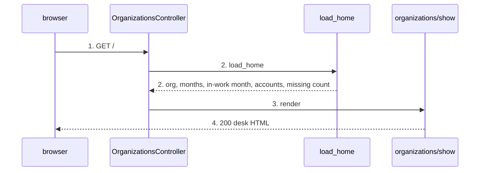
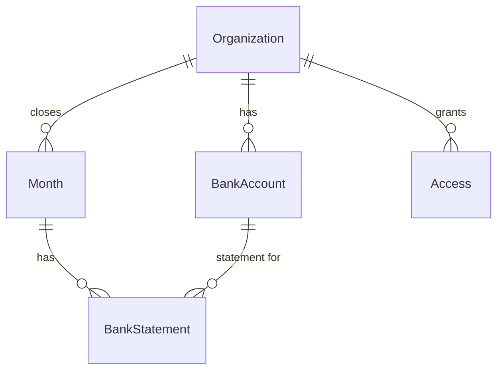
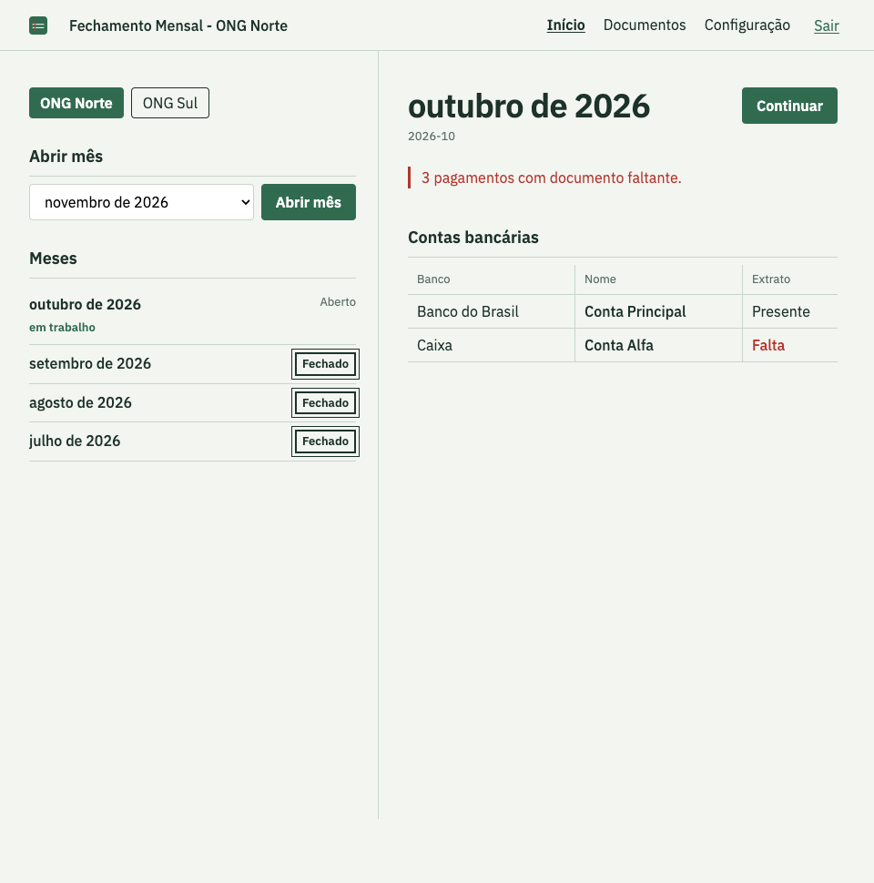

# Home desk

**Approved**: 2026-11-18 - user: "Certo, agora defina esta interface."

## Problem

Coordinator `GET /` stacks five equal chapters: a full Organizações section (even for one organization, whose name the header already shows), an `Início` title the nav already named, then Abrir o fechamento mensal above the month list the coordinator actually came to continue, then Pessoas and convites. Few accounts have more than one organization. The evidence is the live `app/views/organizations/show.html.erb` and the request: the page “está muito mal construído” and “não priorize a escolha da organizaçao”. The cost is scan time: the month in work and what still blocks it sit below chrome that is rarely used.

When this ships, a coordinator with one organization lands on a two-pane desk: open or pick a month on the left, see that month’s missing documents and which accounts still lack a statement on the right, and Continuar. Organization switching appears only when there is more than one.

## Shape

Reuses `GET /`, `OrganizationsController#show`, `load_home`, `POST /months`, `POST /focus`, and the month-page rules for missing-document copy and statement Presente/Falta. The right pane is a summary of the in-work open month, not a second month overview; Continuar and each month row still go to `GET /months/:year_month`. Counts and Extrato state are decided in `load_home` (exists), in a layer request specs already reach — not in the view.

1. Coordinator `GET /` -> `OrganizationsController#show` (exists) - calls `load_home`
2. `load_home` (exists) - loads focused organization, focusable organizations, months `year_month` desc, accesses, invites, the in-work open month (newest `year_month` that is not closed), its active bank accounts, statements by account, and missing-document payment count with the same Presente/Falta and documento-faltante rules as month show
3. `organizations/show` (exists) - coordinator: two-pane desk as in `captures/coordinator-home.png`; submitter: Documentos sentence, plus org chips only when more than one
4. out: `200` HTML; `POST /months` and `POST /focus` (exist) keep their contracts

**Changes underneath**

| Front | What changes |
| --- | --- |
| domain | none - Aberto/Fechado, Presente/Falta, documento faltante keep their month-page meaning |
| stored data | nothing to migrate |
| readers | coordinator `GET /`; header current-page on principal nav; specs in `organizations_spec` / `layout_spec` / `focus_spec` / `screens_spec` that pin `h1` Início, `Organizações`, and `Abrir o fechamento mensal` |

New: nothing - read only.

## Surface

None - nothing consumed outside. `GET /`, `POST /months`, `POST /focus` keep method, params, status, and who may call.

## Landing

| One-way door | Literal shape | Alternative rejected |
| --- | --- | --- |
| Coordinator home is a two-pane desk | `main` is a two-column grid; first column `26rem`; left is org chips (if more than one), Abrir mês, Meses; right is the in-work month summary | Single stacked column with Organizações first — that is the page the user rejected |

- Nothing else in this change is hard to reverse: nav current, collapsed Pessoas, and the Extrato column are view decisions.

## Criteria

### S1: The desk matches the capture (P1)

A coordinator with more than one organization and an open month sees the first viewport the capture draws.

**Acceptance Criteria**

1. WHEN a coordinator focused on ONG Norte, who also has ONG Sul, with open month `2026-10` that still has missing documents and one account without a statement, GETs `/` THEN the system SHALL show the coordinator home in `.specs/features/home-desk/captures/coordinator-home.png` (`.specs/features/home-desk/captures/coordinator-home.html`) (AC 1)
2. WHEN that coordinator GETs `/` THEN the header link `Início` SHALL have `aria-current="page"` and SHALL be the only principal nav link in that state (AC 2)
3. WHEN that coordinator GETs `/supporting_documents` THEN `Documentos` SHALL have `aria-current="page"` and `Início` SHALL not (AC 3)
4. WHEN that coordinator GETs `/setup` THEN `Configuração` SHALL have `aria-current="page"` (AC 4)

### S2: Organization is quiet (P1)

**Acceptance Criteria**

5. WHILE the account has exactly one organization, WHEN the coordinator GETs `/` THEN the system SHALL not render `nav[aria-label="Organizações"]` and SHALL not include a heading `Organizações`; the organization name SHALL appear in the header (AC 5)
6. WHILE the account has two organizations, WHEN the coordinator GETs `/` THEN the left column SHALL include `role="group"` `aria-label="Organização"` with one button per organization, the focused one `aria-current="true"` (AC 6)
7. WHEN the coordinator submits the unfocused organization’s button THEN the system SHALL `POST /focus` with that `organization_id` and the next `GET /` SHALL be that organization’s desk (AC 7)

### S3: Left column opens and lists months (P1)

**Acceptance Criteria**

8. WHEN the coordinator GETs `/` THEN Abrir mês SHALL be a `<label for="year_month">Abrir mês</label>`, a `select#year_month` and submit `Abrir mês` on one row, above the Meses list, posting `year_month` to `/months` (AC 8)
9. The picker options, selected previous calendar month, and 25-month window SHALL stay as today’s `GET / picker` specs (AC 9)
10. WHEN `POST /months` succeeds THEN the system SHALL keep today’s redirect and toast (AC 10)
11. WHEN there are no months THEN Meses SHALL include `Nenhum mês aberto` and the right column SHALL not include Continuar (AC 11)
12. WHEN an open month and a closed month exist THEN the open row SHALL include `em trabalho` and `Aberto`, the closed row SHALL include the stamp `Fechado`, order SHALL be `year_month` desc, and each month title SHALL link to `/months/:year_month` (AC 12)
13. WHEN a never-sent month is listed THEN that row SHALL still include `Excluir` (AC 13)

### S4: Right column summarizes the in-work month (P1)

The in-work month is the newest open month (`year_month` desc, not closed). Closed months are not summarized on the right; they are reached by the left-row link.

**Acceptance Criteria**

14. WHEN the in-work month is `2026-10` THEN the right column `<h1>` SHALL be that month’s `month_title`, the body SHALL include `2026-10`, and Continuar SHALL be a link to `/months/2026-10` (AC 14)
15. WHILE that month has accounts confirmed and 3 payments missing a document, the right column SHALL include exactly one missing-document sentence `3 pagamentos com documento faltante.` in `margem`, and SHALL not include `Falta o extrato` in that sentence (AC 15)
16. WHILE that month has accounts confirmed and 1 payment missing a document, the sentence SHALL be `1 pagamento com documento faltante.` (AC 16)
17. WHILE that month has accounts confirmed and 0 payments missing a document, the sentence SHALL be `Nenhum documento faltante.` and SHALL not use `margem` for that sentence (AC 17)
18. WHILE that month is not accounts-confirmed, the right column SHALL not include `documento faltante` (AC 18)
19. WHEN the in-work month has two active accounts, one with a statement and one without, THEN Contas bancárias SHALL be a ruled sheet with heads `Banco`, `Nome`, `Extrato`; the row with a statement SHALL include `Presente`; the row without SHALL include `Falta` in `margem` (AC 19)
20. WHEN there is no in-work open month THEN the right column SHALL not include Continuar and SHALL not include Contas bancárias (AC 20)

### S5: People stay, collapsed; submitter is not this desk (P1)

**Acceptance Criteria**

21. WHEN a coordinator GETs `/` THEN Pessoas and Convites pendentes SHALL be inside a closed `
` whose summary is `Pessoas`, below the two panes, and today’s invite / revoke / list behaviour SHALL remain (AC 21)
22. WHEN a submitter GETs `/` THEN the system SHALL include `<h1>` `Início`, the Documentos sentence, SHALL not include Abrir mês, Continuar, Contas bancárias, or Convidar coordenador, and SHALL show org chips only when the account has more than one organization (AC 22)

## Out of scope

| Excluded | Why |
| --- | --- |
| In-place preview of a closed month on the right | capture shows Continuar on the in-work open month; closed months stay a navigation to `/months/:year_month` |
| Changing month overview, matching, close-for-send, setup | home only |
| Moving Pessoas to Configuração | user: they stay on Início, collapsed |
| Submitter close ritual | submitter still cannot open months |
| New routes | `GET /` is the desk |
| Replacing DESIGN.md | established Livro-caixa; this is composition |

## Assumptions

| Assumption | Chosen default | Rationale | Confirmed? |
| --- | --- | --- | --- |
| In-work month | newest open month by `year_month` desc | capture shows one live month; multiple open months are rare | n |
| Missing-document copy | same singular/plural strings as the month page, one sentence, no extrato clause | user: “apenas 1 linha informando quantos faltam” | y |
| Extrato column | `Presente` / `Falta` as on the month Contas sheet, head `Extrato` not `Situação` | user: “Mude a coluna Situacao para Extrato” | y |
| Org chips | only when `focusable_organizations.size > 1`; 1 org = header name only | user: “apenas permitir trocar quando houver mais de 1 organizacao” | y |
| Abrir mês one row | select and submit `nowrap` on one flex row | user: “o botao poderia ficar ao lado da selecao” | y |
| Header current | `aria-current="page"` plus semibold and underline on the matching principal link | user: “item do cabecalho selecionado com um bold” | y |
| Pessoas | closed `
` below the desk | user: “home-hidden” | y |
| Excluir | remains on never-sent month rows | existing ritual; user did not ask to remove it | y |
| Nav current on Documentos and Configuração | same treatment on those routes | user named the selected header item, not only Início | n |

**Open questions:** none - remaining `n` rows are builder-safe defaults.

## Differences from the source

| Source shows | Product shows | Confirmed |
| --- | --- | --- |
| HTML mock loads Google Fonts | Self-hosted IBM Plex from DESIGN.md; no `fonts.googleapis.com` | y - AD-0012 |
| No Excluir on month rows | Excluir on a never-sent month | y - AD-0012 |
| Two organizations always | Chips omitted when the account has one organization | y - AD-0012 |
| No Pessoas | Pessoas in a closed details below the desk | y - AD-0012 |

## Sources

- GitHub [#167](https://github.com/gutors/ai-accounting-assistant/issues/167) (Part of #75)
- conversation (2026-11-18) - binding - Mesa em dois painéis; org chips only when more than one; Abrir mês one row above the list; header current; right pane accounts with Extrato Presente/Falta; one missing-document sentence
-  - binding - first viewport of coordinator `GET /` with two organizations and an open month
- [coordinator-home.html](captures/coordinator-home.html) - binding - structural capture of that viewport
- `.impeccable/surfaces/app-views-organizations-show-html-erb.md` - binding after write - direction contract
- `DESIGN.md` - established Livro-caixa
- `app/views/organizations/show.html.erb` - incumbent home
- [ADR-0001](../../../docs/adr/0001-rails-8-hotwire.md) - server-rendered HTML
