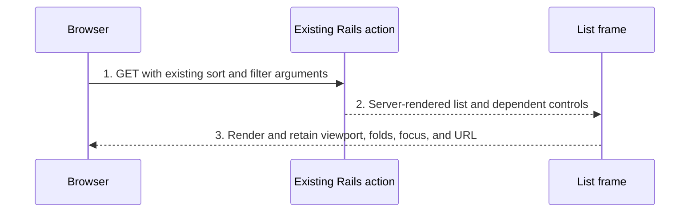

# Preserve scroll position during list updates

**Approved**: 2026-11-23 - user: "PLEASE IMPLEMENT THIS PLAN:"

## Problem

Sorting a list starts a page visit that scrolls to the top. A coordinator or submitter working down a long page must scroll back to the list after each update.

## Shape

Reuse the Rails list queries, sort links, and GET filters. Turbo Frame navigation updates the relevant content and advances browser history. A Stimulus controller preserves the viewport, fold state, and focus during frame rendering.

1. A sort header or filter control sends its existing GET to the month content or Sem mês frame.
2. The existing Rails action evaluates the query and renders the requested frame, including the month actions that depend on the selected bank account.
3. The frame controller restores the viewport, fold state, and focus while Turbo records the URL.

**Changes underneath:** The two list views now expose Turbo Frame boundaries and stable IDs for controls and folds. The existing Rails queries determine row order and scope. The two frame GETs retain the application layout so Turbo can identify the page's tracked assets when restoring history.

Data: none - the existing queries are read-only and require no migration.

## Surface

| Route | In | Out | Status | Who |
| --- | --- | --- | --- | --- |
| `GET /months/:year_month` | Existing bank account filter and per-list sort keys | HTML with month content frame | 200, 302 login redirect, 404 | Coordinator |
| `GET /supporting_documents` | Existing document filters and sort keys | HTML with Sem mês frame | 200, 302 login redirect | Coordinator or submitter |

## Landing

None - the changes are reversible view and browser behavior.

## Criteria

### S1 - Update lists in place (P1)

**Acceptance Criteria**

1. WHEN a coordinator or submitter orders Sem mês by Data or Valor THEN the app SHALL update row order and the URL within 1 px of the previous vertical scroll position and preserve the document inclusion form.
2. WHEN the user applies or clears a Sem mês filter THEN the app SHALL update the results and query and retain vertical scroll within 1 px of the prior offset or the new scroll limit, whichever is lower.
3. WHEN a coordinator orders Pagamentos, Recebimentos, or Documentos sem casamento THEN the app SHALL update the target order and its URL within 1 px of the previous scroll position when reachable and retain existing fold states.
4. WHEN a coordinator selects or clears the bank account filter THEN the app SHALL update the active account, movement rows, and Casar pagamentos URL and retain vertical scroll within 1 px of the prior offset or the new scroll limit, whichever is lower.
5. WHEN an update replaces a keyboard-focused control THEN the app SHALL focus its equivalent without scrolling, or focus Favorecido when Limpar disappears.
6. WHEN the user goes Back, goes Forward, or reloads THEN the app SHALL show list results for the restored URL.
7. IF the session expires before a list request THEN the app SHALL open the full login page.

## Out of scope

Other navigation and write operations retain their existing request flow.

## Assumptions

Scope includes sort headers, document filtering and clearing, and month bank account filtering. These are the controls confirmed by the user. The document inclusion form remains outside the Sem mês frame.

Open questions: none.

## Sources

- [GitHub issue #181](https://github.com/gutors/ai-accounting-assistant/issues/181)
