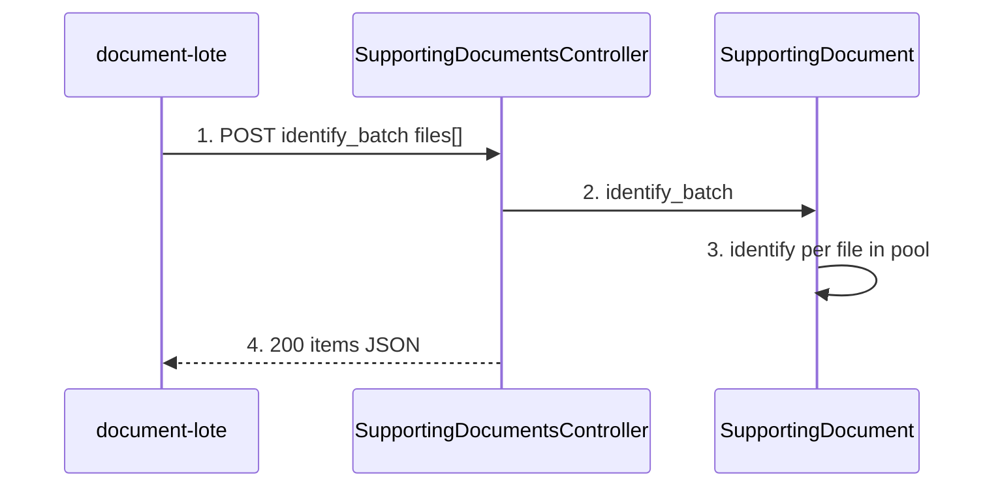

# Lote identify batch

**Approved**: 2026-11-16 - user: "Vamos sem teto. aprove o plano. Vamos seguir o plano com outro agente"

## Problem

A coordinator who drops several supporting-document files into the lote waits on one identify after another even though the browser already fires one `POST /supporting_documents/identify` per file. Puma has three threads and the browser keeps about six HTTP/1.1 connections, so OCR and SEFAZ work occupy those slots and the rest of the app, while rows stay on `Identificando o arquivo…`. The conversation on 2026-11-16 gives no conversion figure; the cost is idle time in the insert ritual the coordinator already uses for a month close.

When this ships, one picker action of several files is one identify request. The server reads those files in a bounded pool inside that request. The lote still does not persist until Incluir. Rows still show `Identificando o arquivo…` until that request returns, then each row is Pronto, Digitar, or Erro as today.

## Shape

Reuses `SupportingDocument.identify` (preview_only, no persist) and the coordinator lote in `document-lote`. Outcome rules stay on `SupportingDocument`, which model and request specs already reach.

1. picker `files[]` -> `document-lote` (exists) - one `FormData` for the files from that change, `POST /supporting_documents/identify_batch`
2. `SupportingDocumentsController` (exists) - coordinator session, slot each upload, call `identify_batch`
3. `SupportingDocument` (exists) - bounded pool, each worker `identify` on one file, same order as `files[]`
4. out: `200` `{ items: [...] }` -> `document-lote` (exists) paints each row; nothing persists

**Changes underneath**

| Front | What changes |
| --- | --- |
| domain | none - identify still means preview_only submit; persist is still `insert` / `insert_batch` |
| stored data | nothing to migrate |
| readers | `document-lote` consume this JSON instead of N turbo identify streams; submitter `POST /supporting_documents/identify` stays |

Data: none - identify_batch does not persist SupportingDocument or blobs.

## Surface

| Route | In | Out | Status | Who |
| --- | --- | --- | --- | --- |
| `POST /supporting_documents/identify_batch` | multipart `files[]`, at most 30 | `{ items: [ { filename, ok, error, arquivo, kind, amount, date, payee, chave, origin, locked } ] }` in `files[]` order; `{ error }` on a rejected request | `200`, `422`, `302`, `404` | coordinator of the focused organization; unauthenticated or no focus `302` `/login`; submitter on focus `404` |

## Landing

| One-way door | Literal shape | Alternative rejected |
| --- | --- | --- |
| New identify-batch HTTP contract | `POST /supporting_documents/identify_batch`; multipart `files[]` (1..30); `200` JSON `items` in request order, one object per file, `ok` true with `arquivo` `Foto` or `XML`, `kind` `nota_fiscal` or `recibo`, `amount` as the book string (e.g. `155,00`), `date` `YYYY-MM-DD`, `payee`, `chave` 44 digits or `""`, `origin` one of `XML autorizado` / `Lido da foto` / `Consulta NFC-e` / `Digitado`, `locked` boolean, `error` `null`; `ok` false with `error` the existing base copy (e.g. `O XML da nota fiscal não pôde ser lido`) and the other book fields empty or omitted; `422` `{ "error": "Envie os arquivos" }` when `files[]` is missing or empty; `422` `{ "error": "No máximo 30 arquivos neste lote" }` when more than 30 | N `POST /identify` plus more Puma threads - HTTP/1.1 still caps ~6 and each identify occupies a Puma slot against close-for-send. Active Job - the lote has no job UI and identify is in-request today. Turbo streams per file inside one response - the coordinator accepted paint-at-end for this option |

- Nothing else in this change is hard to reverse. Pool size, `concurrent-ruby` threads, and the Postgres pool formula stay configuration.

## Criteria

### S1: One POST identifies the picker set (P1)

The coordinator's multi-file pick is one identify round-trip; files are not persisted.

**Acceptance Criteria**

1. WHEN a coordinator POSTs `POST /supporting_documents/identify_batch` with two authorized XML files `proc-nfe-padaria.xml` (`vNF` `155.00`, emit `Padaria Central`, `dhEmi` `2026-05-11`) and `proc-nfe-farmacia.xml` (`vNF` `89.40`, emit `Farmácia São José`) THEN the system SHALL respond `200` with `items` length `2` in that order, `items[0].ok` true, `payee` `Padaria Central`, `amount` `155,00`, `kind` `nota_fiscal`, `locked` true, `origin` `XML autorizado`, and `items[1].payee` `Farmácia São José`, `amount` `89,40`, and SHALL persist `0` SupportingDocument rows
2. WHEN that POST includes JPEG named empty.jpg (photo extract misses) as the only file THEN `items[0].ok` SHALL be true, `kind` `recibo`, `locked` false, `origin` `Digitado`, and amount, date, and payee empty
3. IF that POST includes authorized XML `proc-nfe-padaria.xml` and unreadable XML `nota.xml` (`<nfe/>`) THEN the system SHALL respond `200`, `items[0].ok` true with `payee` `Padaria Central`, `items[1].ok` false with `error` `O XML da nota fiscal não pôde ser lido`, and persist `0` SupportingDocument rows
4. IF `files[]` is missing or empty THEN the system SHALL respond `422` with `{ "error": "Envie os arquivos" }` and persist nothing
5. IF `files[]` has 31 files THEN the system SHALL respond `422` with `{ "error": "No máximo 30 arquivos neste lote" }` and persist nothing
6. IF an unauthenticated client POSTs identify_batch THEN the system SHALL respond `302` to `/login` and persist nothing
7. IF a submitter of the focused organization POSTs identify_batch THEN the system SHALL respond `404` and persist nothing

### S2: Bounded parallel identify (P1)

Workers overlap; the cap is the configured thread count; order stays `files[]`.

**Acceptance Criteria**

8. WHEN `identify_batch` runs two JPEG photos with `IDENTIFY_THREADS` `2` and `PhotoSymbols.current.scan` blocks until both calls have started THEN both scans SHALL be in flight at the same moment and both items SHALL return `ok` true
9. WHEN `identify_batch` runs those two JPEGs with `IDENTIFY_THREADS` `1` THEN the second `scan` SHALL start only after the first `scan` returns
10. The system SHALL clamp `IDENTIFY_THREADS` to the inclusive range `1`..`8`, and an unset variable SHALL use `4`
    - `0` → `1`; `9` → `8`; unset → `4`
11. WHEN `identify_batch` is posted `files[]` named b.jpg then a.jpg THEN `items[0].filename` SHALL be "b.jpg" and `items[1].filename` SHALL be "a.jpg"

### S3: Lote chrome after one picker action (P1)

The sheet still uses today's copy; it waits on the one POST; Incluir persist is unchanged.

**Acceptance Criteria**

12. WHEN a coordinator on `/supporting_documents` attaches those two authorized XMLs in one file picker change THEN the page SHALL send one `POST /supporting_documents/identify_batch` and SHALL not send `POST /supporting_documents/identify`, then SHALL show `Situação`, both filenames, `Padaria Central`, `Farmácia São José`, `R$ 155,00`, `R$ 89,40`, `Pronto` twice, and `Nenhum documento`, with `SupportingDocument.count` `0`
13. WHILE that identify_batch POST has not returned THEN each of those rows SHALL show `Identificando o arquivo…` and the page SHALL not show `#wait` unhidden
14. WHEN a coordinator attaches one authorized XML only THEN after identify_batch returns the heading SHALL be `Incluir documento` and the page SHALL not include `Situação`
15. WHEN a coordinator attaches files named empty.jpg and other.jpg in one change THEN after identify_batch returns those rows SHALL show `Digitar` and `Recibo`
16. WHEN a coordinator attaches `proc-nfe-padaria.xml` and unreadable `nota.xml` in one change THEN after identify_batch returns the page SHALL show `Pronto`, `Erro`, and `O XML da nota fiscal não pôde ser lido`
17. WHEN a coordinator then uses `Incluir prontos` on the two Pronto XML rows THEN the system SHALL persist those two SupportingDocuments through existing `POST /supporting_documents/batch` (photo extract still skipped)

## Out of scope

| Excluded | Why |
| --- | --- |
| Raising Puma `RAILS_MAX_THREADS` | lote option owns parallelism inside one request |
| Client fetch cap in front of N `/identify` | replaced by one POST |
| Streaming items before the POST ends | coordinator chose lote knowing rows paint when the request returns |
| Submitter multi-file lote | submitter insert stays one file and `POST /identify` |
| Changing `insert_batch` persist or skip_photo_extract | already shipped |
| Active Job / Solid Queue for identify | identify stays in the request; timeout budget is already minutes |
| Parallelism inside one file (QR then OCR then SEFAZ) | order inside identify is unchanged |

## Assumptions

| Assumption | Chosen default | Rationale | Confirmed? |
| --- | --- | --- | --- |
| Paint timing | all rows of that picker action update when identify_batch returns; a later picker action is another POST | user chose lote after that wait-all description | y |
| Per-file errors | `200` with mixed `ok` / `error` items, not a failed POST | existing lote: unreadable XML is Erro and leaves other rows | y |
| Pool implementation | in-process threads via `concurrent-ruby` already in Rails; each worker `ActiveRecord::Base.connection_pool.with_connection`; no new gem | OCR waits in `Open3` and releases the GVL; a job would need progress UI | y |
| `IDENTIFY_THREADS` | env, default `4`, clamp `1`..`8` | four Tesseract copies on this M2; eight is the hard cap | y |
| Postgres pool | `max_connections` at least `RAILS_MAX_THREADS + IDENTIFY_THREADS + 3` | inner workers need connections without stealing the other two Puma threads dry | y |
| SEFAZ in the same pool | no extra SEFAZ mutex or cap; at most `IDENTIFY_THREADS` consultas overlap | user: "Vamos sem teto" | y |
| One-file coordinator pick | still `identify_batch` of length 1 so lote JS has one path | submitter keeps `/identify` | y |
| Overlay | lote must not start `wait:start` for identify_batch | existing: identify in flight has no `#wait` | y |

**Open questions:** none - all resolved or logged above.

## Sources

- https://github.com/gutors/ai-accounting-assistant/issues/151 - this cut
- Conversation 2026-11-16 - coordinator asked to parallelize initial lote reading; chose identify em lote over more Puma threads and a client fetch cap
- Existing lote copy and statuses (`Identificando o arquivo…`, `Pronto`, `Digitar`, `Erro`, `O XML da nota fiscal não pôde ser lido`, `No máximo 30 arquivos neste lote`) - this feature reuses them
- `POST /supporting_documents/identify` and `SupportingDocument.identify` - the per-file pipeline this batches
