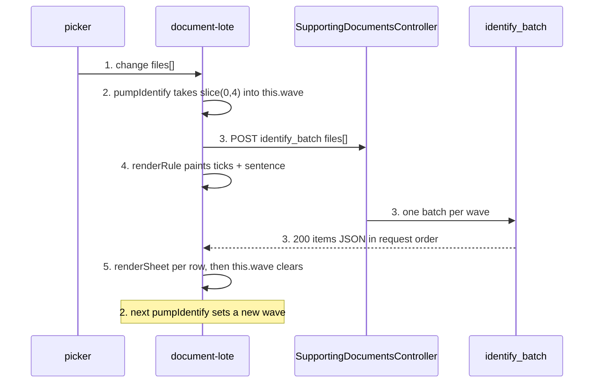
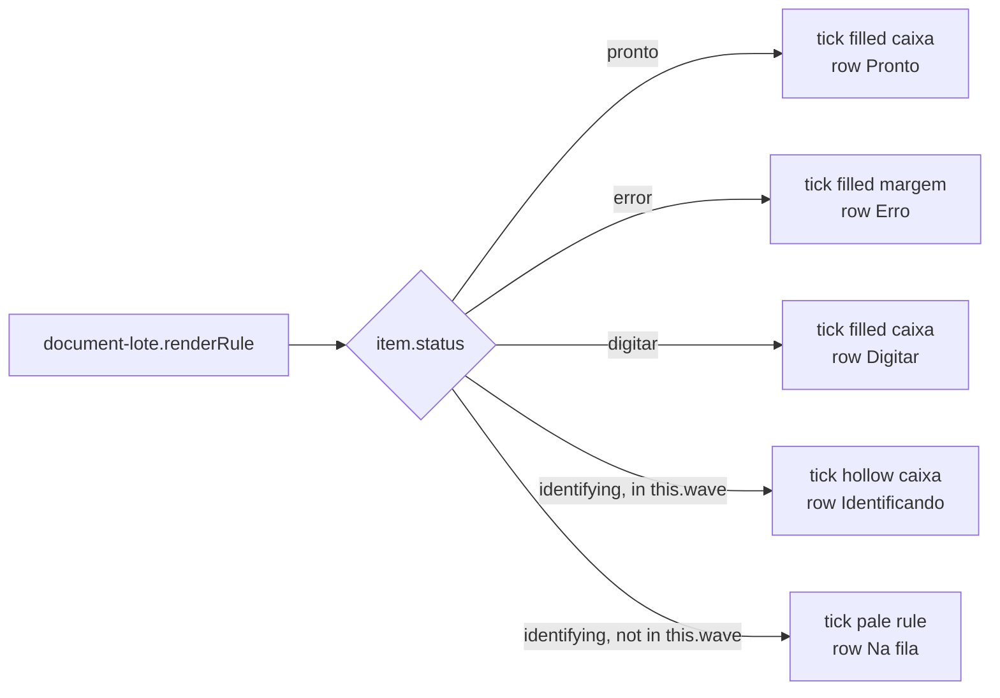
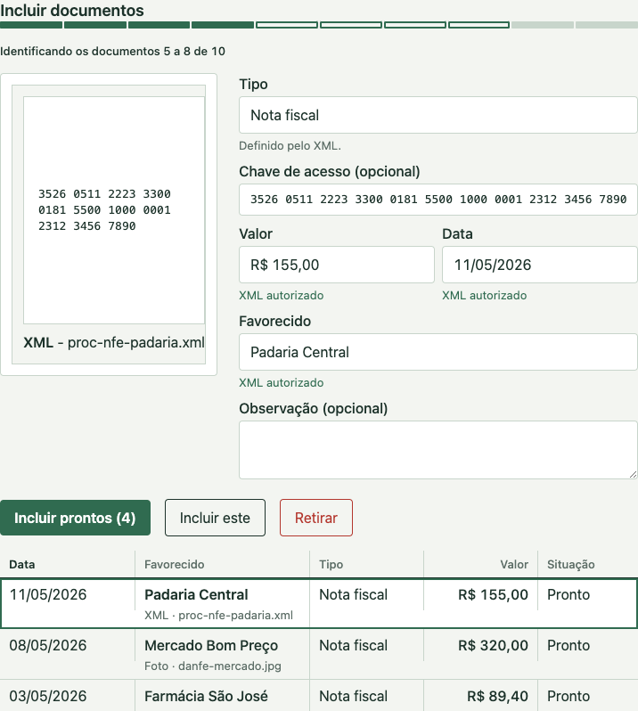

# Lote identify progress

**Approved**: 2026-11-17 - user: "Aprovo o plano"

## Problem

A coordinator who drops more than four files into the lote gets no signal of where the reading has got to. Every waiting row says `Identificando o arquivo…`, including the ones the browser has not sent yet, so the page shows six identical sentences and no total. The only progress signal is the lote sheet itself, which the coordinator has to count. `lote-identify-waves` shipped the waves of four and deliberately left the counter out; the cost of that omission is a coordinator who cannot tell a slow wave from a stuck one, and who cannot see how much of the lote is still ahead.

When this ships, the section heading's rule becomes the measure of the lote: one tick per document, filled for identified, hollow for the four being read now, pale for those still queued. A sentence names the wave in it — `Identificando os documentos 5 a 8 de 10`. Rows in the wave say `Identificando`, rows still waiting say `Na fila`, and the duplicated sentence under the file name is gone.

## Shape

Reuses the existing `document-lote` item array and its `identifying` status; the wave is already known to the controller as the slice it passed to `identifyBatch`. The rule that decides which rows sit in the wave — and therefore what both the ticks and the sentence say — runs in `document_lote_controller.js`, next to `pumpIdentify`, and is reachable from the system specs that already drive the lote.

1. picker `change` -> `document-lote` (exists) - enqueues items with `status: "identifying"`
2. `document-lote` (exists) - `pumpIdentify` takes the first `IDENTIFY_WAVE` pending items; that slice is the wave, kept on the controller as `this.wave`
3. `document-lote` (exists) - `identifyBatch` sends one `POST /supporting_documents/identify_batch`
4. `document-lote` (exists) - `renderRule` paints the ticks and the sentence from `items`, `this.wave` and each item's status
5. `document-lote` (exists) - `renderSheet` writes `Identificando` on wave rows and `Na fila` on queued rows
6. out: the section as drawn in `captures/lote-b-faixa-fila.png`

**Changes underneath**

| Front | What changes |
| --- | --- |
| domain | `identifying` still means "no result yet"; the screen now splits it into in-wave and queued, which is presentation only and not stored |
| stored data | nothing to migrate - the lote is in-memory until Incluir |
| readers | `document-lote` row status copy; `expect_no_situacao_sheet` and the lote system specs that assert `Identificando o arquivo…` |

Data: none - identify_batch still does not persist SupportingDocument or blobs.

## Surface

None - nothing consumed outside the page. The `identify_batch` contract is unchanged.

## Landing

| One-way door | Literal shape | Alternative rejected |
| --- | --- | --- |
| The wave is controller state, not item state | `this.wave` is an `Array<String>` of item ids, set by `pumpIdentify`, cleared in `identifyBatch.finally` before the next `pumpIdentify`; an item never carries `wave` | Adding `item.wave` or a `queued` status to each item - it duplicates what the wave slice already knows and would need clearing in three places (`failIdentify`, `includeReady`, `removeSelected`), where a stale flag would paint a hollow tick over a finished row |

- Nothing else in this change is hard to reverse: the sentence, the tick states and the row copy are all view decisions.

## Criteria

### S1: The rule measures the lote, the sentence names the wave (P1)

The coordinator sees how far the reading has got, and which four documents it is reading.

**Acceptance Criteria**

1. WHILE a wave of four is in flight over ten files, WHEN the coordinator looks at the section, THEN the system SHALL show `Identificando os documentos 5 a 8 de 10` under the rule, the rule SHALL have ten ticks, ticks 1–4 filled `caixa`, ticks 5–8 hollow with a 2px `caixa` outline, ticks 9–10 filled `rule`, as drawn in `.specs/features/lote-identify-progress/captures/lote-b-faixa-fila.png`, whose three tick states the enlarged detail `ruler-states` in `## Sources` fixes at 24px (AC 1)
2. WHEN a wave finishes and the next one starts, THEN the sentence SHALL name that wave's 1-based bounds and total — over ten files: `Identificando os documentos 1 a 4 de 10`, then `5 a 8 de 10`, then `9 a 10 de 10` (AC 2)
   - five files → `Identificando os documentos 1 a 4 de 5`, then `Identificando o documento 5 de 5`; one file in a wave takes the singular `o documento 5 de 5`, never `os documentos 5 de 5` or `5 a 5`
3. WHEN the coordinator attaches four files, a single wave, THEN the system SHALL still show the sentence `Identificando os documentos 1 a 4 de 4` and four ticks (AC 3)
4. WHILE the lote holds one file, WHEN the coordinator looks at the section, THEN the system SHALL show no rule and no sentence, and the proof square SHALL keep `Identificando o arquivo…` (AC 4)
5. WHEN the coordinator attaches five files and the first wave is in flight, THEN rows of the wave SHALL show `Identificando` in Situação, rows 5 SHALL show `Na fila`, and no row SHALL show a second sentence under its file name, as drawn in `.specs/features/lote-identify-progress/captures/lote-b-faixa-fila.png` (AC 5)
   - the sentence under the file name is absent on every row: wave, queued, ready, error
6. IF a document in the wave finishes in error, THEN its tick SHALL be filled `margem` and its row SHALL show `Erro` with the error sentence, per the error state of the detail in `## Sources` (AC 6)
   - unreadable XML `nota.xml` as the first of four → one `margem` tick, three `caixa` ticks, row `Erro` with `O XML da nota fiscal não pôde ser lido`
7. WHEN every file has a result, THEN the rule and the sentence SHALL be absent, and `Incluir prontos (n)` SHALL carry the count (AC 7)
8. WHEN the coordinator removes a file from the lote, THEN the rule SHALL repaint with one tick fewer and the sentence SHALL keep naming the same documents by their new 1-based bounds (AC 8)
9. WHEN the coordinator picks more files while a wave is in flight, THEN the rule SHALL repaint with the new total, the in-flight wave SHALL keep its hollow ticks, and the new files SHALL show `Na fila` (AC 9)
10. WHEN the lote is shown at 390px wide, THEN the rule SHALL fit the content column with no horizontal scroll and ticks SHALL stay at least 8px wide for a 30-file lote (AC 10)

### S2: The lote sheet and the rule agree (P1)

Every row's Situação matches its tick, so the two readings of the lote never contradict.

**Acceptance Criteria**

1. WHEN a row shows `Pronto` or `Digitar`, THEN its tick SHALL be filled `caixa`; WHEN a row shows `Erro`, THEN its tick SHALL be filled `margem`; WHEN a row shows `Identificando`, THEN its tick SHALL be hollow; WHEN a row shows `Na fila`, THEN its tick SHALL be pale `rule` (AC 11)
   - a `Digitar` row (photo read without payee) has a filled `caixa` tick, not an error tick
2. WHEN the coordinator selects a row that is still `Na fila`, THEN the system SHALL show the row in the book with empty fields and no `Identificando o arquivo…` in the proof square (AC 12)
3. WHEN the coordinator uses `Incluir prontos` while a later wave is in flight, THEN the rule SHALL repaint without the included rows and the in-flight wave SHALL keep its hollow ticks (AC 13)

## Out of scope

| Excluded | Why |
| --- | --- |
| A counter on the months page, the close screen, or any screen other than the lote | this cut is the lote only |
| Changing the wave size from four, or coupling it to `IDENTIFY_THREADS` | `lote-identify-waves` settled both; the rule reads the wave, it does not choose it |
| A spinner, a progress ring, a percentage, or an animated tick | the ledger world has no motion the person did not trigger, and a percentage cannot be honest about a wave of four |
| Per-file timing or an estimate of remaining time | identify has no per-file clock the browser can trust |
| Persisting partial results or the wave across a reload | the lote is in-memory until Incluir |
| Reworking the single-file include screen | `documents-insert-refine` settled it; criterion 4 keeps it as it is |
| A `Na fila` state in the submitter flow | the submitter has no lote |

## Assumptions

| Assumption | Chosen default | Rationale | Confirmed? |
| --- | --- | --- | --- |
| Where the measure lives | the section heading's own rule becomes the ticks; the heading border is removed while the rule is shown | user chose "B · a régua mede" over a sentence under the title, on the title line, or in the Situação head | y |
| What the number counts | the wave in reading, named as a 1-based range with the total: `documentos 5 a 8 de 10` | user chose "3 · faixa em leitura"; `4 de 10` alone was ambiguous between already read and being read now | y |
| Single file | no rule and no sentence; the proof square keeps `Identificando o arquivo…` | user: the lote only exists with two or more files | y |
| Small lote | the sentence is shown even when the wave is the whole lote, e.g. `1 a 4 de 4` | user chose "sempre mostra"; one rule for every lote size is simpler to prove than a conditional sentence | y |
| Row copy while reading | `Identificando` in Situação, `Na fila` for queued rows, and the duplicate sentence under the file name removed | user chose "limpo" over keeping the repetition or the longer `Aguardando a próxima leva` | y |
| Error tick | filled `margem`, one tick per document | user chose the red margin over green or pale | y |
| What the outline and fill mean | filled = has a result, hollow = being read now, pale = not sent yet | a lighter tint of green read as "done" in the capture, which fakes completion for the wave | y |
| Tick count above ten | one tick per document up to 30, each at least 8px at 390px | measured: 30 ticks stay 21.9px on desktop and 9.7px at 390px in a 350px column | y |
| Sentence when nothing is in flight | neither the rule nor the sentence is shown; `Incluir prontos (n)` carries the count | the lote has no reading to name once every file has a result | y |
| Accessibility | the rule is `aria-hidden`; the sentence is in a `role="status"` `aria-live="polite"` region that announces each new wave, and is absent (not hidden) when there is no wave | a decorative measure owes no text to a screen reader; the count does | y |

**Open questions:** none - all resolved or logged above.

## Differences from the source

Every tick state, the sentence, the two row words and the absent sub-line are drawn by
`captures/lote-b-faixa-fila.png` and reproduced as they are. Four facts the capture also draws are
out of this cut, accepted by the user (ADR-0011).

| Source shows | Product shows | Confirmed |
| --- | --- | --- |
| proof square of an XML carries the access key in monospace inside the frame | an empty frame — the frame holds a photo, a PDF or nothing (`documents-insert-refine`) | y - AD-0011 |
| green note `Definido pelo XML.` under `Tipo` | no note under `Tipo`; origin notes only under `Valor`, `Data` and `Favorecido` | y - AD-0011 |
| `Valor` field with the currency, `R$ 155,00` | the masked book string, `155,00`; `R$` appears on the lote rows and the month pages | y - AD-0011 |
| access key grouped in fours with spaces | the raw 44-digit value in the editable field; the grouped form belongs where the key is read | y - AD-0011 |

AD-0011 is [ADR-0011](../../../docs/adr/0011-lote-progress-capture-scope.md): these facts belong to
the single-file include screen and the field formats it already ships, not to the lote's measure.

This feature does change behaviour shipped by `lote-identify-waves` (C3 and C4 assert
`Identificando o arquivo…` on every lote row). That is a supersession of an earlier feature, not a
departure from this source; [ADR-0010](../../../docs/adr/0010-lote-wave-progress.md) records the
question, the options and the consequence, and the two checks change in the commit that changes
their copy.

## Sources

-  - binding - form B (rule measures) + number 3 (wave range) + queue split, at 716×798, the size the section renders at 1280px
-  - binding, as a detail of the state above rather than a state of its own - the three tick states enlarged to 24px with `1–4 lido` / `5–8 em leitura` / `9–10 na fila` under them, at 928×74; the shipped ticks are 8px, so C2 proves the three states by measuring the pixels of the same `lote-b-faixa-fila.running.png` state and no second picture is taken
- `.impeccable/mocks/identify-progress.html?v=b&c=faixa&s=1&queue=fila` - binding - the interactive source both captures come from; ten documents, waves of four
- `.specs/features/lote-identify-waves/checks.md` - existing behaviour - the wave size and the one-POST-in-flight rule this builds on
- [ADR-0010](../../../docs/adr/0010-lote-wave-progress.md) - the wave is `this.wave`, not a per-item flag; the row copy supersedes `lote-identify-waves` C3–C4
