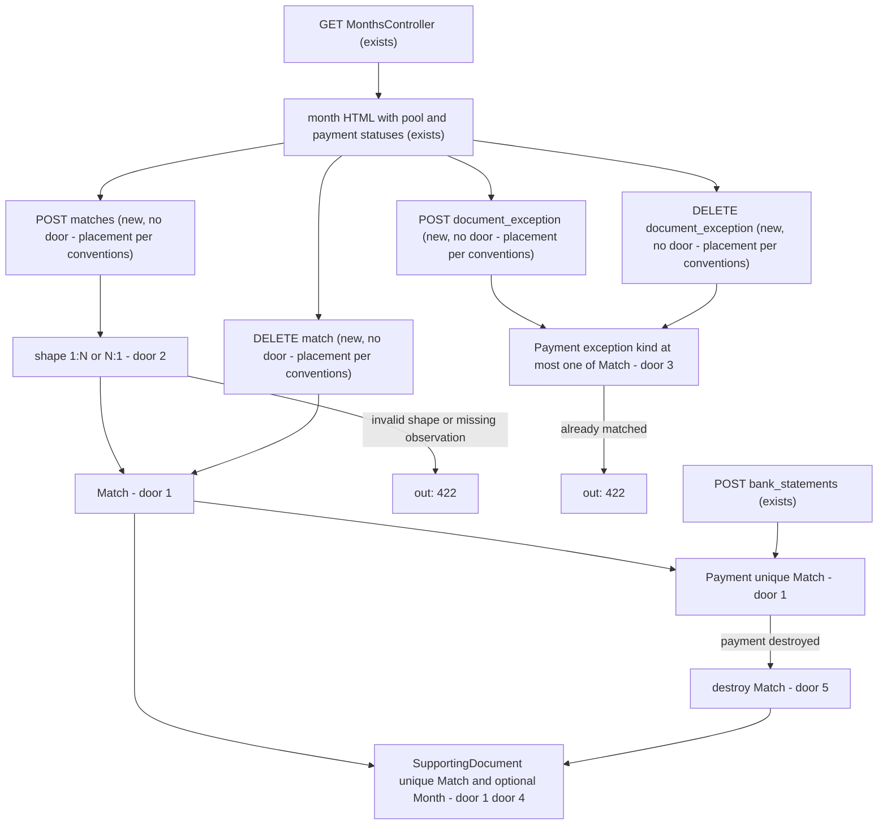
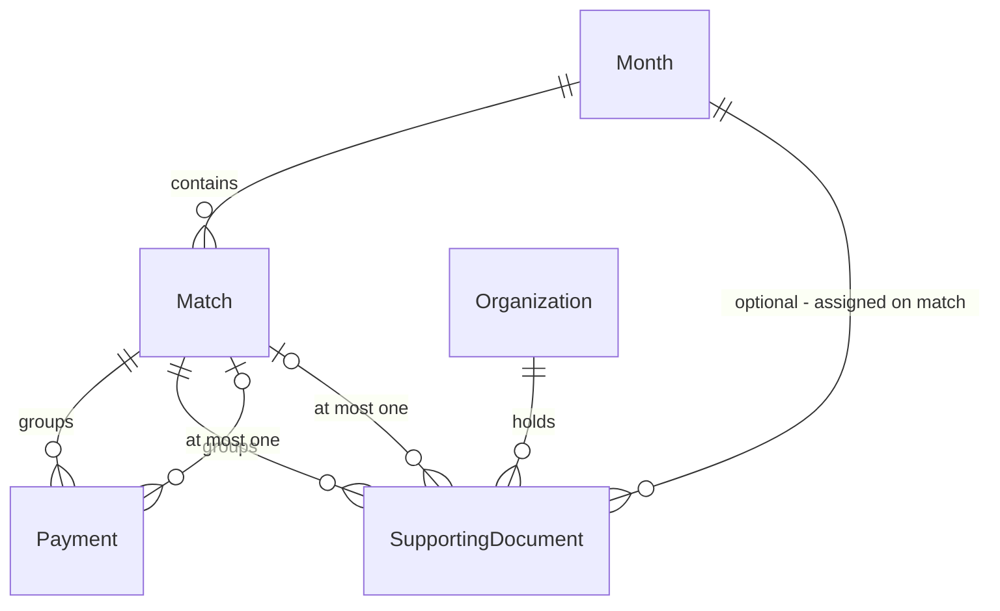

# Match and document exception

Sources:

- https://github.com/gutors/ai-accounting-assistant/issues/33 - this cut: coordinator confirms a match (1:N or N:1) or marks bank fee / accountant’s fee; missing document is the third payment state; no assisted suggestion
- https://github.com/gutors/ai-accounting-assistant/issues/10 - a match is valid because the coordinator confirmed it; shapes are one payment with one or more documents, or more than one payment with a single document; no N×M; documents’ amounts summing to less than the payment(s) requires a match observation
- https://github.com/gutors/ai-accounting-assistant/issues/5 - document exception exists only after the coordinator marks an allowed kind; missing document is neither match nor mark; unmark returns missing document; match on an excepted payment clears the mark
- https://github.com/gutors/ai-accounting-assistant/issues/12 - this cut is the manual confirm path only; what the system would propose is a Suggestion (#37)
- https://github.com/gutors/ai-accounting-assistant/issues/21 - the mark stays the coordinator’s; honorarium suggestion is #37
- https://github.com/gutors/ai-accounting-assistant/issues/20 - a supporting document has no month until a confirmed match (this cut) or unmatched-in-package (#39); leaving a match returns it to no month
- `CONTEXT.md` - Match, Document exception, Missing document, Observation (on a match), Unmatched document, Payment, Supporting document
- [ADR-0001](../../../docs/adr/0001-rails-8-hotwire.md) - Rails 8 + Hotwire; money integer cents

No design source for the screens. Verification stays on project profile `standard` (no binding screen, so not `ui`).

## Problem

A coordinator can import a month’s payments and insert supporting documents, but nothing associates them. Every payment is indistinguishable from every other: there is no confirmed match, no bank-fee or accountant’s-fee mark, and no missing-document state. Close-for-send (#34) has no predicate to refuse a month, and the coordinator cannot record the judgment that #10 made the definition of a match. Issue #33 gives no conversion figure; the cost is that the close ritual stops at two unconnected lists.

When this ships, a coordinator of an open month confirms a 1:N or N:1 match, or marks tarifa bancária / honorário do contador, sees missing document on every payment that is still neither, and can leave a match or unmark. The product still does not suggest pairs, offer extra exception kinds, or close for send.

## Out of scope

| Excluded | Why |
| --- | --- |
| Assisted suggestion of payment(s) + document(s) | #33; #37 |
| Exception suggestion of accountant’s fee from PIX or tax id | #33; #21 / #37 |
| Extra exception kinds | #33; #36 |
| Close-for-send HTTP, closed-month read-only, Drive month folder | #33; #34 |
| Choosing unmatched documents into the package | #39 |
| Submitter access, justification, hiding payments from submitters | #35 |
| Parsing XML, SEFAZ consulta, photo reading | #38 |
| Creating or destroying SupportingDocument rows | insert/edit stay #32; this cut only associates |
| Automatic confirm when amounts or dates agree | #10 / #12: confirm is the coordinator’s |
| Accountant login | accountant is not an operator |

## Assumptions

| Assumption | Chosen default | Rationale | Confirmed? |
| --- | --- | --- | --- |
| Where the UI lives | matching and exception marks on `GET /months/:year_month`; `/supporting_documents` stays insert/edit and gains a matched label | payments already live on the month; documents have no month until confirm, so the pool is shown next to those payments | n |
| Confirm gesture | one `POST /months/:year_month/matches` with `payment_ids[]`, `supporting_document_ids[]`, optional `observation`; the month page may host two forms that post to that route (one payment + N docs; N payments + one doc) | #10’s two shapes are server-validated; two HTML forms are placement | n |
| 1:1 shape | one payment and one document is format 1 (one payment, one or more documents) | #10 lists two formats and forbids only N payments × M documents | n |
| Unmatch and unmark | in this cut; `DELETE` of the match or of the payment’s exception; no confirm dialog | #5: coordinator may unmark; CONTEXT: regroup while the month is open; deactivate/replace already have no confirm | n |
| Exception on a matched payment | `422` until the match is left | dissolving a N:1 match as a side effect of marking one payment would silently return the shared document to no month | n |
| Match on an excepted payment | confirm succeeds and clears the mark(s) | #5: “Se o documento entra e casa, a exceção some” | n |
| Observation bound | trimmed; blank stores none; at most 2000 characters; required only when documents’ cents sum to less than payments’ cents | same bound as observation on a supporting document; #10’s lesser gate | n |
| Amount comparison | integer cents sums at confirm time only; equal and greater do not require observation | AGENTS.md money lock; #10; later PATCH of a document does not unconfirm | n |
| Matched document PATCH | existing `PATCH /supporting_documents/:id` still applies; the match remains | #10: valid because confirmed, not because amounts still agree | n |
| Available documents | only SupportingDocuments of the focused organization that are in no Match | a document belongs to at most one match; other months’ confirmed docs are taken | n |
| Payments in a POST | every id must be a Payment of that Month of the focused organization | a match does not span months or organizations | n |
| Statement replace | destroying a Payment destroys its Match; remaining payments and documents of that Match are released | #26: replace is the same gesture while open; blocking would strand a wrong CSV | n |
| Month on the document | optional `Month` on SupportingDocument, written on confirm, cleared when the Match is destroyed | CONTEXT assigns month at match; #39 will write the same association without a Match | n |
| Close-for-send control | none on the month page | #34 owns that surface; this cut’s observable is the missing-document label | n |
| Exception kinds this cut | persisted values `bank_fee` and `accountant_fee` only; any other string is `422` | #36 adds extras later; stuffing org-specific names into this enum would freeze a catalog #36 must not own | n |
| Empty month | zero Payments means no missing document (the label is absent) | there is no payment that should have a match | n |
| Inflows | unchanged; no match or exception UI | CONTEXT: an inflow does not require a supporting document | n |

**Open questions:** none - all resolved or logged above.

## Criteria

Grouped by slice. Numbering runs across the whole plan.

### S1: Missing document and the unmatched pool (P1)

**Acceptance Criteria**

1. WHEN a coordinator opens `/months/2026-05` that has a Payment of `22000` cents and no Match and no document exception THEN the system SHALL respond `200` and that payment’s row SHALL include the text `Documento faltante`
2. WHEN `/months/2026-05` has zero Payments THEN the page SHALL not include the text `Documento faltante`
3. WHEN `/months/2026-05` renders THEN it SHALL include the heading `Documentos sem casamento`
4. WHEN the focused organization has no SupportingDocument that is out of every Match THEN `/months/2026-05` SHALL include the text `Nenhum documento sem casamento`
5. WHEN the focused organization has an unmatched SupportingDocument whose payee is `Padaria Central` THEN `/months/2026-05` SHALL include `Padaria Central` under `Documentos sem casamento`
6. WHILE focus is organization A, `GET /months/2026-05` SHALL not include payee text that exists only on organization B’s supporting documents
7. WHEN `/supporting_documents` lists that unmatched document THEN it SHALL not include the text `Casado em 2026-05`
8. WHILE `/months/2026-05` lists an Inflow under `Recebimentos` THEN that section SHALL not include `Documento faltante`

**Independent test:** open `2026-05` with one unmatched payment of `R$ 220,00` and one unmatched document `Padaria Central`; see `Documento faltante` and the pool; open a month with no payments (no `Documento faltante`); switch focus and confirm the other org’s payee is absent.

### S2: Confirm 1:N and leave the match (P1)

**Acceptance Criteria**

9. WHEN a coordinator POSTs `payment_ids` of one Payment of `22000` cents and `supporting_document_ids` of two unmatched documents of `10000` and `12000` cents, with observation blank, on `/months/2026-05/matches` THEN the system SHALL persist one Match, respond `302` to `/months/2026-05`, and that page SHALL include `Casado` on that payment and the two payees and SHALL not include `Documento faltante` on that payment
10. WHEN that confirm succeeds THEN `GET /supporting_documents` SHALL include `Casado em 2026-05` for both documents
11. WHEN that confirm succeeds THEN `/months/2026-05` under `Documentos sem casamento` SHALL not include those two payees
12. WHEN a coordinator POSTs one Payment of `22000` cents and one unmatched document of `20000` cents with observation `desconto não documentado` THEN the system SHALL persist the Match, respond `302`, and `/months/2026-05` SHALL include `desconto não documentado`
13. IF a coordinator POSTs one Payment of `22000` cents and one unmatched document of `20000` cents with observation blank THEN the system SHALL persist no Match and respond `422` with the text `Informe a observação do casamento`
14. WHEN a coordinator POSTs one Payment of `22000` cents and one unmatched document of `25000` cents with observation blank THEN the system SHALL persist the Match and respond `302`
15. WHEN a coordinator POSTs one Payment of `22000` cents and one unmatched document of `22000` cents with observation blank THEN the system SHALL persist the Match and respond `302`
16. IF a coordinator POSTs one Payment and zero `supporting_document_ids` THEN the system SHALL persist no Match and respond `422` with the text `Selecione ao menos um documento`
17. WHEN a coordinator DELETEs that Match at `/months/2026-05/matches/:id` THEN the system SHALL persist no Match for those ids, respond `302` to `/months/2026-05`, that payment’s row SHALL include `Documento faltante`, the documents SHALL appear again under `Documentos sem casamento`, and `GET /supporting_documents` SHALL not include `Casado em 2026-05` for them
18. IF a coordinator POSTs a Match for a Payment that already belongs to a Match THEN the system SHALL persist no second Match and respond `422` with the text `Pagamento já está em um casamento`
19. IF a coordinator POSTs a Match that includes a SupportingDocument that already belongs to a Match THEN the system SHALL persist no second Match and respond `422` with the text `Documento já está em um casamento`
20. IF an unauthenticated request POSTs `/months/2026-05/matches` THEN the system SHALL persist no Match and respond `302` to `/login`
21. IF an unauthenticated request DELETEs a Match THEN the system SHALL leave the Match in place and respond `302` to `/login`
22. WHEN a coordinator PATCHes payee `Mercado Silva` on a SupportingDocument that belongs to a Match THEN the Match SHALL remain and `/months/2026-05` SHALL still include `Casado` on that payment

**Independent test:** confirm `R$ 220,00` with two recibos `R$ 100,00` + `R$ 120,00`; see `Casado` and `Casado em 2026-05`; POST lesser without observation (`422`); DELETE the match and see `Documento faltante` and the pool again.

### S3: Confirm N:1; reject N×M (P1)

**Acceptance Criteria**

23. WHEN a coordinator POSTs `payment_ids` of two unmatched Payments of `10000` and `12000` cents and `supporting_document_ids` of one unmatched document of `22000` cents, observation blank, THEN the system SHALL persist one Match, respond `302`, and both payment rows SHALL include `Casado` and SHALL not include `Documento faltante`
24. WHEN a coordinator POSTs three unmatched Payments and one unmatched document whose cents equal the three payments’ sum, observation blank, THEN the system SHALL persist one Match and respond `302`
25. IF a coordinator POSTs two Payments and two SupportingDocuments THEN the system SHALL persist no Match and respond `422` with the text `Casamento é um pagamento com um ou mais documentos, ou vários pagamentos com um documento`
26. IF a coordinator POSTs zero Payments and one SupportingDocument THEN the system SHALL persist no Match and respond `422` with the text `Selecione ao menos um pagamento`

**Independent test:** confirm two payments `R$ 100,00` + `R$ 120,00` with one document `R$ 220,00`; POST two payments and two documents (`422`).

### S4: Mark and unmark document exception (P1)

**Acceptance Criteria**

27. WHEN a coordinator POSTs `kind=bank_fee` to `/months/2026-05/payments/:id/document_exception` for a missing-document Payment THEN the system SHALL persist the mark, respond `302` to `/months/2026-05`, and that payment’s row SHALL include `Tarifa bancária` and SHALL not include `Documento faltante`
28. WHEN a coordinator POSTs `kind=accountant_fee` for a missing-document Payment THEN that payment’s row SHALL include `Honorário do contador` and SHALL not include `Documento faltante`
29. WHEN a coordinator DELETEs `/months/2026-05/payments/:id/document_exception` on a payment marked `bank_fee` THEN the system SHALL persist no mark, respond `302`, and that row SHALL include `Documento faltante` and SHALL not include `Tarifa bancária`
30. IF a coordinator POSTs `kind` that is neither `bank_fee` nor `accountant_fee` THEN the system SHALL persist no mark and respond `422` with the text `Informe se é tarifa bancária ou honorário do contador`
31. IF a coordinator POSTs a document exception on a Payment that belongs to a Match THEN the system SHALL leave the Match in place, persist no mark, and respond `422` with the text `Desfaça o casamento antes de marcar a exceção`
32. WHEN a coordinator POSTs a valid format-1 Match for a Payment marked `bank_fee` THEN the system SHALL persist the Match, persist no `bank_fee` mark on that Payment, and `/months/2026-05` SHALL include `Casado` and SHALL not include `Tarifa bancária` on that payment
33. IF an unauthenticated request POSTs a document exception THEN the system SHALL persist no mark and respond `302` to `/login`
34. IF an unauthenticated request DELETEs a document exception THEN the system SHALL leave the mark in place and respond `302` to `/login`

**Independent test:** mark a missing-document payment `Tarifa bancária`, unmark it (`Documento faltante`); POST `kind=doacao` (`422`); POST exception on a matched payment (`422`); confirm a match on a marked payment and see `Casado` without `Tarifa bancária`.

### S5: Isolation, replace, concurrency (P1)

**Acceptance Criteria**

35. IF a coordinator POSTs a Match with a Payment id that belongs only to organization B WHILE focused on organization A THEN the system SHALL leave organization B unchanged and respond `404`
36. IF a coordinator POSTs a Match with a SupportingDocument id that belongs only to organization B WHILE focused on organization A THEN the system SHALL leave organization B unchanged and respond `404`
37. IF a coordinator POSTs a document exception for a Payment of Month `2026-04` WHILE requesting `/months/2026-05/...` THEN the system SHALL persist no mark and respond `404`
38. IF a coordinator DELETEs a Match id that belongs only to organization B WHILE focused on organization A THEN the system SHALL leave that Match in place and respond `404`
39. WHEN a coordinator replaces the BankStatement whose Payments were the only members of a Match THEN the system SHALL persist no Match for those former payments, and the SupportingDocuments of that Match SHALL appear under `Documentos sem casamento` and SHALL not include `Casado em 2026-05` on `/supporting_documents`
40. IF two concurrent POSTs each try to confirm a Match that includes the same SupportingDocument THEN the system SHALL persist exactly one Match that includes that document
41. IF two concurrent POSTs each try to confirm a Match that includes the same Payment THEN the system SHALL persist exactly one Match that includes that payment
42. WHILE every Payment of `/months/2026-05` belongs to a Match or has a document exception THEN `GET /months/2026-05` SHALL not include `Documento faltante`
43. IF a request DELETEs `/months/2026-05/matches/:id` for an id that does not exist on that Month THEN the system SHALL respond `404`

**Independent test:** POST org B’s payment id from org A (`404`); replace the statement of a matched account and see the documents back in the pool; POST two overlapping matches concurrently (one document, one Match).

## Traceability

| ID | Slice | Criteria | Status |
| --- | --- | --- | --- |
| MATCH-01 | S1 | 1, 2, 3, 4, 5, 6, 7, 8 | In checks |
| MATCH-02 | S2 | 9, 10, 11, 12, 13, 14, 15, 16, 17, 18, 19, 20, 21, 22 | In checks |
| MATCH-03 | S3 | 23, 24, 25, 26 | In checks |
| EXC-01 | S4 | 27, 28, 29, 30, 31, 32, 33, 34 | In checks |
| MATCH-04 | S5 | 35, 36, 37, 38, 39, 40, 41, 42, 43 | In checks |

## Observable

| Surface | Decision | Landing |
| --- | --- | --- |
| screen `/months/:year_month` | empty payments | AC 2 |
| screen `/months/:year_month` | empty unmatched-document pool | AC 4 |
| screen `/months/:year_month` | loading | n/a - Turbo full-page / redirect |
| screen `/months/:year_month` | error state | AC 13, AC 16, AC 18, AC 19, AC 25, AC 26, AC 30, AC 31 |
| screen `/months/:year_month` | unauthorised | AC 20, AC 21, AC 33, AC 34 |
| screen `/months/:year_month` | density and ordering | AC 1, AC 3, AC 5, AC 8 - payments keep date order; new pool heading; inflows unchanged |
| screen `/months/:year_month` | destructive action confirms | n/a - unmatch and unmark submit immediately, same as bank-account deactivate |
| screen `/months/:year_month` | missing-document / matched / excepted labels | AC 1, AC 9, AC 17, AC 27, AC 28, AC 29, AC 42 |
| screen `/supporting_documents` | empty state | existing - `Nenhum documento` when the org has zero rows |
| screen `/supporting_documents` | loading | n/a - Turbo full-page / redirect |
| screen `/supporting_documents` | error / unauthorised | existing - unauthenticated is `302` `/login` |
| screen `/supporting_documents` | density and ordering | AC 7, AC 10 - matched label `Casado em 2026-05`; date order unchanged |
| screen `/supporting_documents` | destructive action confirms | existing - no destroy |
| HTML `GET /months/:year_month` | who may call it | existing - coordinator with focus; `302` `/login` otherwise |
| HTML `GET /months/:year_month` | error shape and codes | existing - `404` invalid or never opened |
| HTML `GET /months/:year_month` | versioning | n/a - HTML surface, no published API version |
| HTML `GET /months/:year_month` | rate limit | n/a - coordinator-only, small operator set |
| HTML `POST /months/:year_month/matches` | who may call it | AC 9, AC 20 |
| HTML `POST /months/:year_month/matches` | error shape and codes | AC 13, AC 16, AC 18, AC 19, AC 20, AC 25, AC 26, AC 35, AC 36 |
| HTML `POST /months/:year_month/matches` | versioning | n/a - first HTML surface for this resource |
| HTML `POST /months/:year_month/matches` | rate limit | n/a - coordinator-only |
| HTML `DELETE /months/:year_month/matches/:id` | who may call it | AC 17, AC 21 |
| HTML `DELETE /months/:year_month/matches/:id` | error shape and codes | AC 21, AC 38, AC 43 |
| HTML `DELETE /months/:year_month/matches/:id` | versioning | n/a - first HTML surface |
| HTML `DELETE /months/:year_month/matches/:id` | rate limit | n/a - coordinator-only |
| HTML `POST /months/:year_month/payments/:id/document_exception` | who may call it | AC 27, AC 33 |
| HTML `POST /months/:year_month/payments/:id/document_exception` | error shape and codes | AC 30, AC 31, AC 33, AC 37 |
| HTML `POST /months/:year_month/payments/:id/document_exception` | versioning | n/a - first HTML surface |
| HTML `POST /months/:year_month/payments/:id/document_exception` | rate limit | n/a - coordinator-only |
| HTML `DELETE /months/:year_month/payments/:id/document_exception` | who may call it | AC 29, AC 34 |
| HTML `DELETE /months/:year_month/payments/:id/document_exception` | error shape and codes | AC 34 |
| HTML `DELETE /months/:year_month/payments/:id/document_exception` | versioning | n/a - first HTML surface |
| HTML `DELETE /months/:year_month/payments/:id/document_exception` | rate limit | n/a - coordinator-only |
| HTML `GET /supporting_documents` | who may call it | existing - coordinator with focus |
| HTML `GET /supporting_documents` | error shape and codes | existing - `302` `/login` |
| HTML `GET /supporting_documents` | versioning | n/a - existing HTML surface; Out gains the matched label |
| HTML `GET /supporting_documents` | rate limit | n/a - coordinator-only |
| HTML `PATCH /supporting_documents/:id` | who may call it | existing - AC 22 uses it on a matched row |
| HTML `PATCH /supporting_documents/:id` | error shape and codes | existing - `404` other org; `422` file rules |
| collection payments on a month | grouping | AC 1, AC 8, AC 9, AC 27 - `Pagamentos` vs `Recebimentos`; status per payment |
| collection payments on a month | naming | AC 1, AC 9, AC 27, AC 28 - `Documento faltante`, `Casado`, `Tarifa bancária`, `Honorário do contador` |
| collection payments on a month | ordering | existing - date ascending, then id |
| collection payments on a month | duplicates | AC 18, AC 41 - a payment belongs to at most one Match |
| collection payments on a month | exception that does not fit | AC 2, AC 4, AC 30 - no payments; empty pool; unknown kind |
| collection unmatched documents | grouping | AC 5, AC 6, AC 11 - focused organization, no Match |
| collection unmatched documents | naming | AC 5 - payee |
| collection unmatched documents | ordering | existing - same date-desc as `/supporting_documents` |
| collection unmatched documents | duplicates | existing - two documents with the same triple both list |
| collection unmatched documents | exception that does not fit | AC 4, AC 11 - empty pool; matched docs leave it |
| collection matches | grouping | AC 9, AC 23 - one Match row per confirm, scoped to the Month |
| collection matches | naming | AC 12 - optional observation text |
| collection matches | ordering | n/a - matches are shown on their payment rows, not as a separate list |
| collection matches | duplicates | AC 18, AC 19, AC 40, AC 41 |
| collection matches | exception that does not fit | AC 13, AC 16, AC 25, AC 26 - lesser without observation; empty side; N×M |

## Flow

This reuses `Month`, `Payment`, `SupportingDocument`, `require_account`, `focused_organization`, and `BankStatement` replace. It does not suggest pairs, parse XML, or close-for-send.

Unauthenticated HTML on the new routes still goes through `ApplicationController` (exists) to `302` `/login`. Confirm that includes an excepted Payment clears that mark (door 3) in the same persist as the Match.

## Relations

One-way constraints: Payment belongs to at most one Match (door 1), SupportingDocument belongs to at most one Match (door 1), a Match is one Payment with one or more SupportingDocuments or at least two Payments with one SupportingDocument (door 2), Payment carries at most one of Match or document-exception kind (door 3), SupportingDocument optional Month written on confirm and cleared when the Match is destroyed (door 4), destroying a Payment destroys its Match (door 5). No columns and no types here.

## Surface

| Route | In | Out | Status |
| --- | --- | --- | --- |
| `GET /months/:year_month` | session · focus | month HTML · payment statuses · unmatched pool · match and exception forms | `200`, `302`, `404` |
| `POST /months/:year_month/matches` | session · focus · `payment_ids[]` · `supporting_document_ids[]` · `observation` | Match · redirect or month HTML | `302`, `422`, `404` |
| `DELETE /months/:year_month/matches/:id` | session · focus · id | none · redirect or empty | `302`, `404` |
| `POST /months/:year_month/payments/:id/document_exception` | session · focus · `kind` | Payment mark · redirect or month HTML | `302`, `422`, `404` |
| `DELETE /months/:year_month/payments/:id/document_exception` | session · focus · id | Payment without mark · redirect or empty | `302`, `404` |
| `GET /supporting_documents` | session · focus | documents HTML · `Casado em YYYY-MM` when matched | `200`, `302` |
| `PATCH /supporting_documents/:id` | session · focus · existing fields | SupportingDocument · Match unchanged | `302`, `422`, `404` |

## Landing

| One-way door | Literal shape | Alternative rejected |
| --- | --- | --- |
| 1. Match is a Month-scoped entity; Payment and SupportingDocument each hold at most one | `Match` belongs to `Month`. `Payment` and `SupportingDocument` belong to `Match` optionally, each with a unique index on `match_id` (NULLs allowed). Identity of a match is that row, not a group id shared without a parent. | HABTM-only join tables with no Match row — observation has nowhere to live, and #37 would invent the parent later. A document or payment in several matches — #10: each enters at most one. |
| 2. Confirm accepts only 1:N or N:1 | Persist only when one Payment and at least one SupportingDocument, or at least two Payments and exactly one SupportingDocument. 1:1 is the first arm. Any other pair of counts is `422` with `Casamento é um pagamento com um ou mais documentos, ou vários pagamentos com um documento`. | An N×M Match — #10 forbids splitting a document across payments in one match. Encoding format-2 as several 1:1 rows — one observation and one leave-match would not apply to the group. |
| 3. Document exception is a kind on Payment, at most one of Match | Optional Rails enum `document_exception_kind` on `Payment` with persisted values `bank_fee` and `accountant_fee`. Database check: not both `match_id` and `document_exception_kind` present. Missing document is both absent. #36 adds extras as a separate association, not as values in this enum. | A `DocumentException` entity — two kinds do not need a row, and extras (#36) are organization catalog names, not a third enum value. Inferring the kind from statement history — #5. |
| 4. SupportingDocument optional Month, written only by match confirm/dissolve this cut | `SupportingDocument` belongs to `Month` optionally. Confirm sets it to the Match’s Month; destroying the Match clears it (return to no month). No operator PATCH of month. | Month only via `document.match.month` — #39 unmatched-in-package assigns a month without a Match and would then grow a second assignment path. Setting Month at insert — already rejected in #32 / #20. |
| 5. Destroying a Payment destroys its Match | `Payment` `belongs_to :match, optional: true`; destroying the payment destroys that `Match`, which nullifies remaining payments’ and documents’ `match_id` and clears those documents’ Month. Statement replace already destroys payments. | Restrict replace while a Match exists — #26 replace is the same gesture; the coordinator would be unable to fix a wrong spreadsheet. Leaving an empty Match row after replace — confirm-time shape would then be untrue on disk. |

- Nothing else in this change is hard to reverse. Copy, the 2000-character observation bound, and which two HTML forms post to `POST /matches` are criteria or placement. Extra kinds, suggestions, and close-for-send stay in later cuts.

Door 3 reaches past this feature: #36 must not add extra names to `document_exception_kind`. Door 4 reaches past this feature: #39 writes the same optional Month without a Match.

## Impact

| Front | What changes |
| --- | --- |
| domain | new term: `Match` — first persisted as the coordinator-confirmed grouping of one payment with one or more documents, or at least two payments with one document, on one Month |
| domain | existing term: `Document exception` — first persisted as `bank_fee` or `accountant_fee` on a Payment; still not an extra kind |
| domain | existing term: `Missing document` — first observable: a Payment with neither Match nor document-exception kind; month page copy `Documento faltante` |
| domain | existing term: `Observation` — still optional on a SupportingDocument; now also required on a Match when documents’ cents sum to less than payments’ cents |
| domain | existing term: `Supporting document` — still organization-scoped; now optionally belongs to a Month and to at most one Match |
| domain | existing term: `Payment` — still a statement debit; now at most one Match or one document-exception kind |
| stored data | existing Payments and SupportingDocuments stay; new FKs and the exception kind are absent (missing document / unmatched). No backfill. Statement replace now also dissolves Matches that pointed at the replaced Payments. Unique `match_id` indexes succeed on current rows because every `match_id` is absent |
