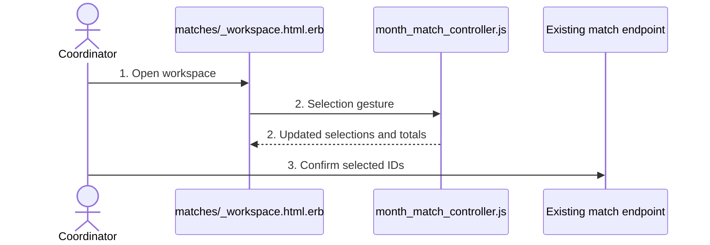
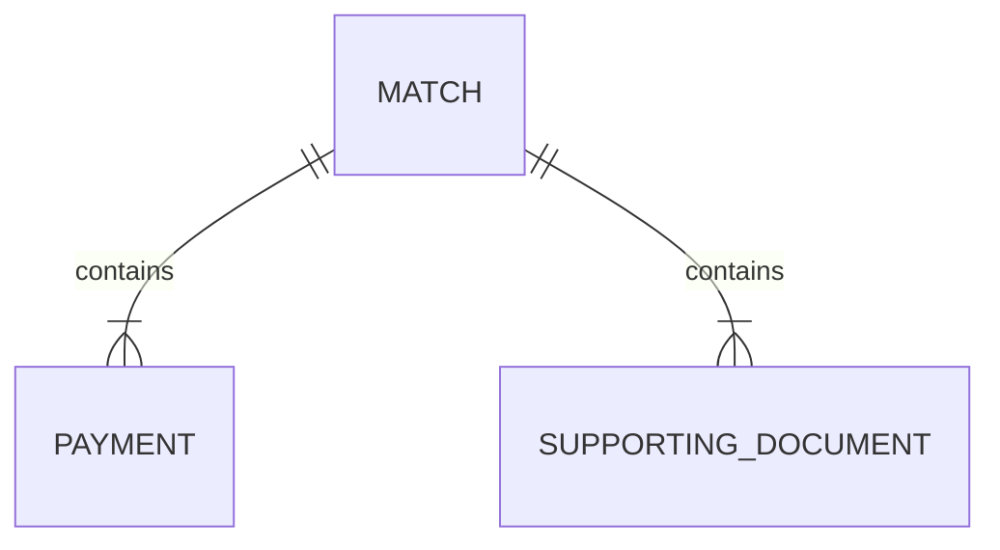
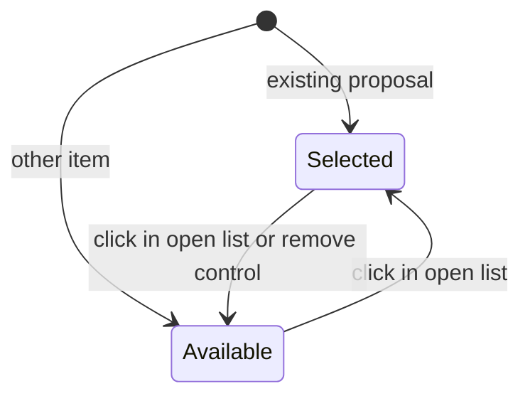

# Quick selection for matches

**Approved**: 2026-11-24 - user: "aprovo"

## Problem

Clicking anywhere on a selected payment or document immediately removes it. The coordinator can accidentally change a match while reviewing it, and adding items requires an extra selection completion step.

The coordinator can review selected items safely and add or remove payments and documents with a single click in an open list.

## Shape

Reuse the existing match form and its Stimulus controller. Selection and totals remain client-side rules exercised through system specifications; the existing server continues to validate and persist a confirmed match.

1. The coordinator opens the match workspace -> `matches/_workspace.html.erb` (exists) renders the selected items and available choices.
2. A selection gesture -> `month_match_controller.js` (exists) updates selection, list visibility and totals in the current form.
3. Confirmation -> the existing match endpoint persists the match using the same submitted payment and document IDs.

**Changes underneath**

| Front | What changes |
| --- | --- |
| domain | Match meaning and validation remain unchanged. |
| stored data | Nothing to migrate. |
| readers | Match workspace presents the changed selection interaction. |

New: nothing - existing relationships remain unchanged.

## Surface

None - the existing route and form contract remain unchanged.

## Landing

None - no schema, dependency or external contract changes.

## Criteria

### S1: Select match members (P1)

The coordinator reviews and adjusts both lists without accidental removal.

**Acceptance Criteria**

1. WHEN the coordinator opens the payment or document list THEN the system SHALL show the available items and identify those already selected.
2. WHEN the coordinator clicks an unselected item in an open list THEN the system SHALL immediately add it to the selected items above the list and update totals.
3. WHEN the coordinator clicks a selected item in an open list THEN the system SHALL immediately remove it from the selected items and update totals.
4. WHEN the coordinator clicks the body of a selected item THEN the system SHALL retain the item; its dedicated removal control SHALL remove it.
5. WHEN the coordinator closes an open list THEN the system SHALL retain the selection without requiring a separate completion action.
6. WHILE either list is open the selected and available rows SHALL use the same available width, as in the approved prototype.
7. IF no documents are selected THEN the system SHALL show the existing empty-selection message and pending total state.
8. WHEN the coordinator chooses an exception THEN the system SHALL preserve the existing exception behavior, including clearing documents and retaining only the current payment.
9. WHEN the coordinator confirms a match THEN the system SHALL submit the currently selected payment and document IDs and retain existing validation, observation and access rules.
10. The workspace SHALL remain usable at phone and desktop widths with keyboard-accessible selection and removal controls.

## Out of scope

| Excluded | Why |
| --- | --- |
| Changes to matching rules or exception types | The request concerns selection interaction. |
| Changes to confirmed-match lists | The approved prototype concerns the active workspace. |

## Assumptions

| Assumption | Chosen default | Rationale | Confirmed? |
| --- | --- | --- | --- |
| Selected-row removal | An explicit × removes the item; clicking the row body does not. | Approved prototype. | y |
| Open-list interaction | Selected and unselected choices remain available to toggle until the list is closed. | Approved prototype. | y |

**Open questions:** none - all resolved or logged above.

## Differences from the source

None - the product matches the source for selection interaction and row sizing. The prototype uses illustrative page chrome, data and nonfunctional exception/confirmation controls; the existing application supplies the real page and behavior.

## Sources

- `.impeccable/mocks/match-quick-selection-prototype.html` - binding - selection interaction and equal-width rows; user: "Perfeito, aprovado".
