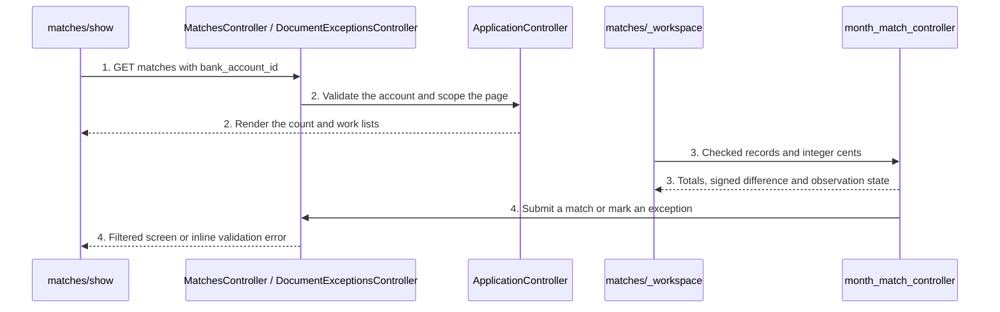
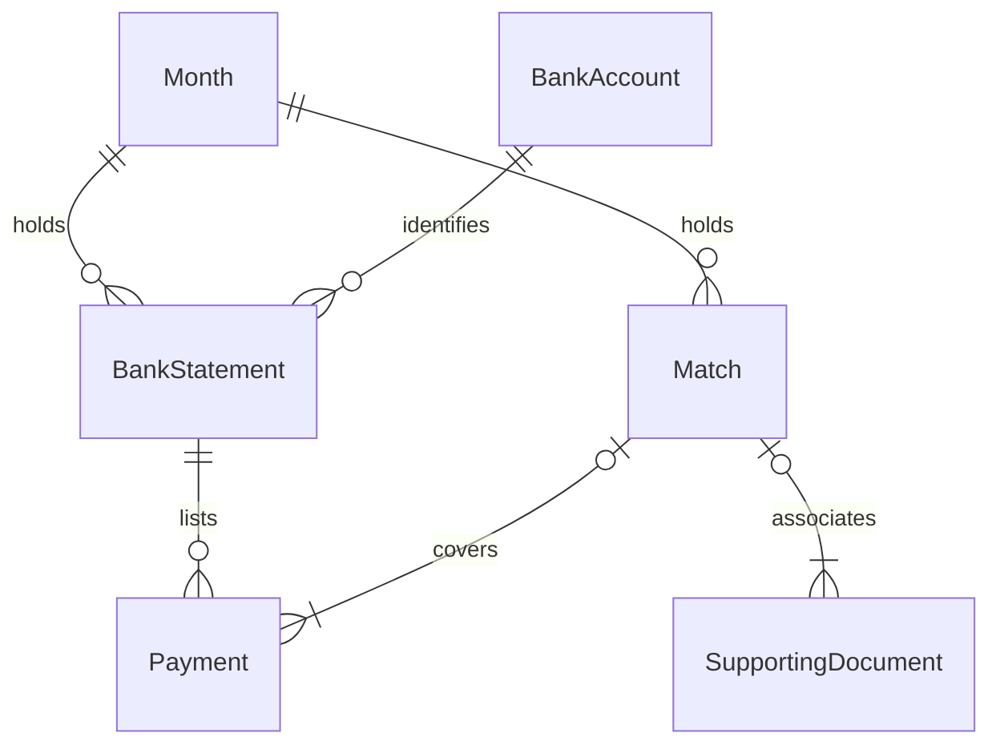
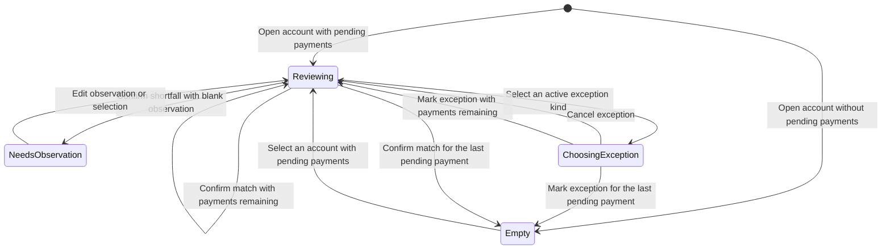
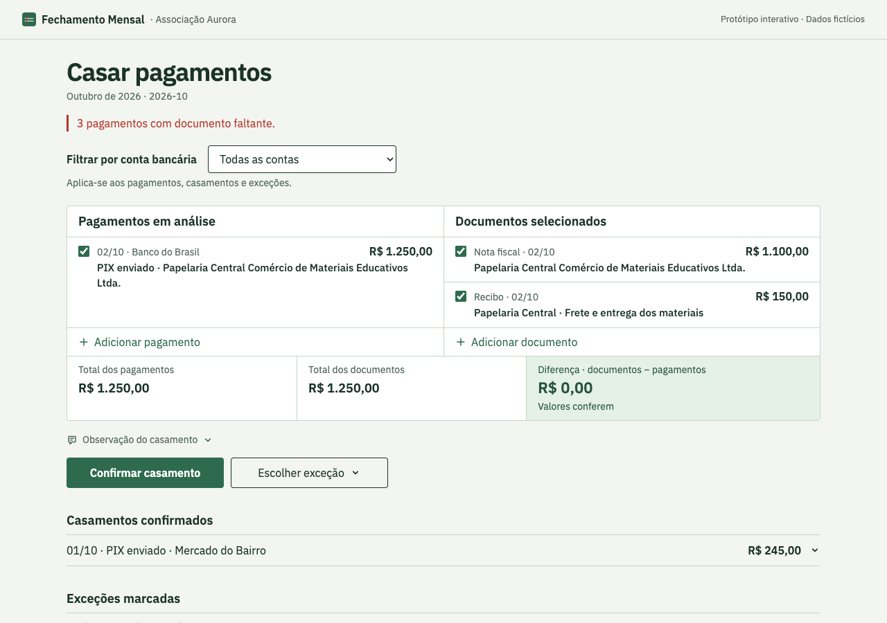
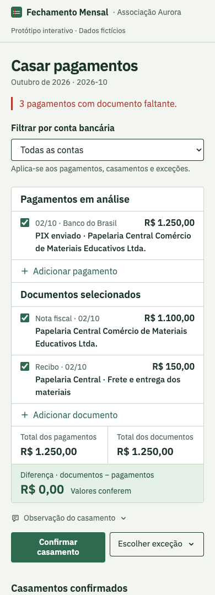

# Matching workspace resolution

**Approved**: 2026-11-24 - user: "Aprovo o plano da nova interface de casamento de pagamentos e confirmo que podemos seguir com a implementação e a verificação independente, conforme o próximo passo descrito neste chat. Na implementação delegada, use o papel worker. Para a verificação independente, use um agente verifier novo."

## Problem

The coordinator switches accounts with a row of links that differs from the month selector.
Missing-document counts and validation errors sit below those links. Amounts take width from
payment histories and payee names, and the workspace gives the same emphasis to the exception
picker and confirmation. The totals show which side is larger without showing the difference.

The coordinator can scan the pending count, compare the full names and amounts, and see how
much the selected documents cover before confirming a match or choosing an exception.

## Shape

Reuse the month account selector styling, the matching screen's scoped data and the existing
match and exception actions. Stimulus calculates the displayed totals from integer cents.
The Rails actions and domain guards remain authoritative for confirmation.

1. `matches/show` (exists) sends the selected `bank_account_id` to `MatchesController` (exists).
2. `MatchesController` (exists) validates account scope through `ApplicationController`
   (exists) and renders the pending count, workspace and history for the account.
3. `matches/_workspace` (exists) sends the checked rows and their integer amounts to
   `month_match_controller` (exists), which updates the comparison and observation state.
4. `month_match_controller` (exists) keeps the existing form actions for
   `MatchesController` and `DocumentExceptionsController` (exists). The actions use the
   existing persistence rules and return the filtered screen or its inline validation error.

**Changes underneath**

| Front | What changes |
| --- | --- |
| Domain | The display compares document and payment sums. Existing match and exception eligibility still applies. |
| Stored data | No migration. Existing actions persist an approved match or exception. |
| Readers | The matching view reads the same scoped records and displays the new form and comparison. |

New: nothing. The existing entities and relations supply the workspace.

## Surface

None. The existing GET and mutation routes, parameters, caller permissions and statuses are reused.

## Landing

None. The redesign uses the existing Rails views, styles, Stimulus controller and storage.

## Criteria

### S1: Match review and resolution (P1)

The coordinator can filter the queue, review the selected records and resolve the current payment.

**Acceptance Criteria**

1. WHEN the coordinator opens `Casar pagamentos` THEN the system SHALL place the missing-document
   count directly below the title and month context, followed by any inline matching error and
   then the bank account selector. The closed month and empty queue SHALL retain the page context
   and omit the match form.
2. WHEN the coordinator changes `Filtrar por conta bancária` THEN the system SHALL refresh the
   page with the corresponding payments, pending count, confirmed matches and marked exceptions,
   and keep the selected account visible. Choosing `Todas as contas` SHALL restore the unfiltered
   view. The document pool SHALL retain its existing organization and month eligibility.
3. WHILE a payment or document is selected or offered for selection THEN the system SHALL place
   the amount on the first line alongside the record metadata and give the full following text
   line to its name. Long names SHALL wrap without truncation.
4. WHEN the coordinator activates `Adicionar pagamento` or `Adicionar documento` THEN the system SHALL reveal eligible checkboxes in that list. Checking an item SHALL
   update the totals immediately. Both add controls SHALL display a plus icon. Activating `Concluir seleção` SHALL collapse unselected
   candidates and keep selected items visible.
5. WHILE the coordinator is reviewing a match THEN the system SHALL show `Total dos pagamentos`,
   `Total dos documentos` and `Diferença · documentos − pagamentos` beneath the two lists. For
   payments of R$ 1.250,00 and documents of R$ 1.250,00, R$ 1.100,00 or R$ 1.430,00, the difference
   SHALL be R$ 0,00 in green with `Valores conferem`, − R$ 150,00 in red with
   `Documentos somam menos`, or + R$ 180,00 in blue with `Documentos somam mais`, respectively.
   With either side empty, the comparison SHALL read `Aguardando seleção` in a neutral treatment.
6. WHEN the coordinator activates the icon-labeled `Observação do casamento` THEN the system SHALL
   expose the text field. A shortfall SHALL mark the observation `Obrigatória`. Confirming a
   shortfall with only blank or whitespace text SHALL show the validation error above the filter
   and open the observation. The Rails confirmation guard SHALL still reject a direct submission
   without a valid observation.
7. WHEN the coordinator opens `Escolher exceção` THEN the system SHALL show the organization's
   active exception kinds in a secondary outlined control with the same resting width and height
   as `Confirmar casamento`. Selecting a kind SHALL keep the current payment, clear the documents
   and switch the primary label to `Marcar exceção`. Canceling SHALL restore match mode. Successful
   match and exception submissions SHALL keep the account filter and refresh the pending queue.
8. WHEN the coordinator opens the balanced workspace on desktop and at 390 CSS pixels wide THEN the system SHALL follow the approved [interactive source](captures/prototype.html) for the changed region as shown in `.specs/features/matches-resolution/captures/balanced-desktop.png` and `.specs/features/matches-resolution/captures/balanced-phone.png`. The two lists SHALL share a ruled sheet on desktop and stack on the phone, where the
   form SHALL fit its viewport without horizontal scrolling.

## Out of scope

| Excluded | Why |
| --- | --- |
| Navigation and completed-history redesign | The seven requested changes cover the heading notices, filter and matching workspace. The existing application header, return link and completed tables provide the surrounding context. |
| Changes to matching, suggestions or exception policy | The prototype exercises the existing workflow with fictional records. |

## Assumptions

| Assumption | Chosen default | Rationale | Confirmed? |
| --- | --- | --- | --- |
| Context outside the changed region | Keep actual shared navigation, the return link and completed tables. | The request changes the review workspace and account filter. | n |
| Error placement | Keep inline matching errors above the filter and retain success toasts. | The request moves error messages. | n |

**Open questions:** none - all resolved or logged above.

## Differences from the source

None within the changed region. The prototype header, sample records and history illustrate the
workspace in context. The implementation displays the application's navigation and real records.

## Sources

- The seven changes requested in chat establish the scope.
-  - binding desktop render of the approved prototype.
-  - binding phone render of the approved prototype.
- [Approved interactive prototype](captures/prototype.html) - binding for the changed region. The user answered “Perfeito” after reviewing the prototype.
- [Issue #185](https://github.com/gutors/ai-accounting-assistant/issues/185) - tracks the seven requested changes.
