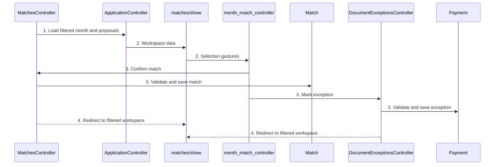
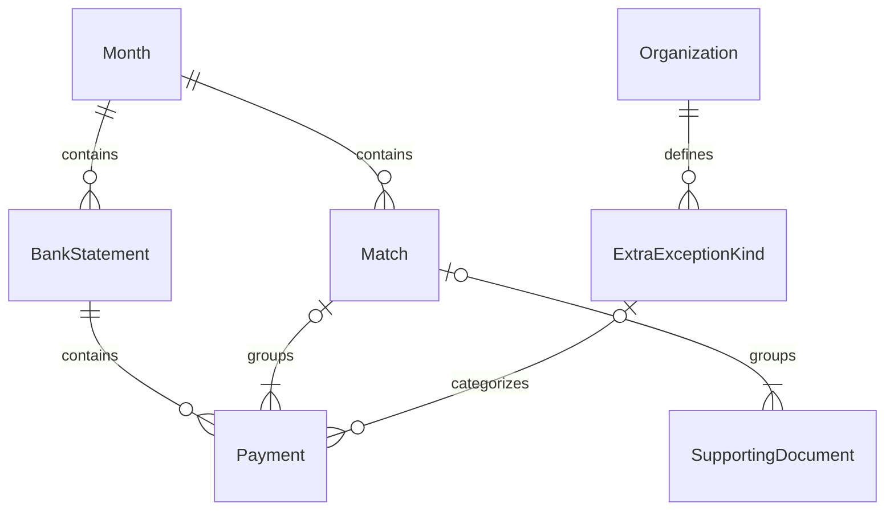

# Matches workspace

**Approved**: 2026-11-23 - user: "Sim, mas siga com outro agente para nao consumir muitos tokens"

## Problem

The coordinator cannot readily identify the matching screen, inspect individual documents in a suggestion, or adjust an equal-value suggestion before it is confirmed. Confirmed matches and exceptions are mixed into the payment ledger, and the observation field and separate exception buttons consume space.

The coordinator can work through the oldest pending payment, adjust a proposed match, mark an exception, and inspect completed work in separate lists.

## Shape

Reuse the existing match and exception records, suggestion assignment, authorization, month state and mutation endpoints. Ordering, eligibility and persistence remain in Rails; the existing Stimulus controller handles temporary selections and their visible totals.

1. `MatchesController` (exists) loads the month and the filtered movements through `ApplicationController` (exists); the latter prepares the oldest pending payment, suggestions, confirmed matches and marked exceptions.
2. `matches/show` (exists) presents the workspace; `month_match_controller` (exists) updates selected members, totals and exception choice without saving.
3. `MatchesController` (exists) passes a confirmed selection to `Match` (exists); `DocumentExceptionsController` (exists) passes the selected exception to `Payment` (exists).
4. `MatchesController` and `DocumentExceptionsController` (exists) return to the filtered screen, where `matches/show` (exists) displays the new state.

**Changes underneath**

| Front | What changes |
| --- | --- |
| domain | A suggestion remains advisory. The oldest pending payment is presented even without a suggestion; equal totals no longer cause automatic confirmation. Existing 1:N and N:1 rules remain. |
| stored data | Nothing to migrate; use existing Match, Payment and SupportingDocument associations and exception fields. |
| readers | The matching screen changes its presentation and selection flow. The month overview, spreadsheet and package continue reading the same stored records. |
| design | Update the matching surface brief and DESIGN.md to reflect the approved two-column workspace and exception selector. |

New: nothing - existing relationships and records are reused.

## Surface

None - existing routes, request parameters, authorization and response statuses remain unchanged.

## Landing

None - no new schema, persisted contract, dependency or external API.

## Criteria

### S1: Work through a payment (P1)

**Acceptance Criteria**

1. WHEN a coordinator opens the matches screen THEN the system SHALL display `Casar pagamentos` and the selected month.
2. WHEN pending payments exist THEN the system SHALL select the payment with the earliest `occurred_on`, breaking ties by ascending id, even when no document suggestion exists.
3. WHILE an account filter is active, WHEN the coordinator opens the screen THEN the system SHALL select the oldest pending payment within that account and keep the filter after a mutation.
4. WHEN the selected payment has a suggestion THEN the system SHALL display each suggested payment and each suggested document separately before confirmation.
5. WHEN the selected payment has no suggestion THEN the system SHALL display the payment and an empty document selection with an action to add eligible unmatched documents.
6. WHEN the coordinator adds or removes an eligible document THEN the system SHALL update the selection and payment and document totals without saving a match.
7. WHEN the coordinator adds another eligible payment THEN the system SHALL support the existing multiple-payments-to-one-document shape and update the totals.
8. IF the coordinator selects multiple payments and multiple documents THEN the system SHALL reject confirmation with the existing match shape error and persist no match.
9. WHEN the coordinator chooses a suggestion with equal totals THEN the system SHALL leave it unconfirmed until `Confirmar casamento` is used.
10. WHEN the coordinator expands `Observação` THEN the system SHALL show an editable observation field; otherwise it SHALL be collapsed.
11. IF documents total less than payments and observation is blank THEN the system SHALL refuse the match and show `Informe a observação do casamento`.
12. WHEN the coordinator submits a valid match THEN the system SHALL save it, show it in `Casamentos confirmados`, and present the next pending payment.
13. IF no pending payments exist in the selected filter THEN the system SHALL show an empty state and continue to display confirmed matches and exceptions.

### S2: Mark an exception and review completed work (P1)

**Acceptance Criteria**

14. WHEN the coordinator opens `Escolher exceção` THEN the system SHALL show the active default and custom exception types in a dropdown following the header organization selector pattern.
15. WHEN the coordinator selects a type THEN the system SHALL display that type, clear selected documents, retain only the current payment, and change the primary action to `Marcar exceção` without persisting.
16. WHEN the coordinator cancels the exception choice THEN the system SHALL restore the match action and allow documents to be selected again.
17. WHEN the coordinator submits `Marcar exceção` THEN the system SHALL mark the selected payment with that active exception, display it in `Exceções marcadas`, and present the next pending payment.
18. IF an exception type is inactive or belongs to another organization THEN the system SHALL reject the request and not mark the payment.
19. WHEN the coordinator opens `Casamentos confirmados` THEN the system SHALL show each Match once in a single summary row including payment date, payment history, total, document summary and document total.
20. WHEN the coordinator expands a confirmed match THEN the system SHALL show every payment and document, their dates and amounts, document types and payees, and any observation.
21. WHEN the coordinator undoes a confirmed match THEN the system SHALL remove its row and return its payments and documents to the eligible pools under existing rules.
22. WHEN the coordinator opens `Exceções marcadas` THEN the system SHALL show one row per marked payment with date, history, account, amount, exception type and unmark action.
23. WHEN the coordinator unmarks an exception THEN the system SHALL remove its row and return the payment to the pending queue.
24. WHILE an account filter is active THEN the system SHALL show matches having at least one payment in the selected account, with all members visible in its details, and exceptions for that account.
25. WHILE a month is closed THEN the system SHALL display its matches and exceptions without selection, confirmation, exception marking, undo or unmark controls.
26. IF a mutation fails validation THEN the system SHALL display the existing error and retain the account filter without persisting an invalid change.
27. WHEN a coordinator views the screen at 375px or 1440px width THEN the system SHALL keep controls usable and allow wide ledgers to scroll horizontally without clipping their contents.
28. WHEN the coordinator operates the exception dropdown by keyboard THEN the system SHALL allow opening, choosing an option and dismissing it with Escape.

## Out of scope

| Excluded | Why |
| --- | --- |
| Changes to suggestion ranking, exception rules, month closing, package or spreadsheet | The request changes the workspace and queue, not underlying domain rules. |
| New exception categories or editing existing categories from this screen | Categories remain managed in organization configuration. |
| Live updates across simultaneous users | Existing request and conflict validation remains authoritative. |

## Assumptions

| Assumption | Chosen default | Rationale | Confirmed? |
| --- | --- | --- | --- |
| Direction | Prototype B: two columns, with confirmed matches followed by marked exceptions | User: `Gostei do B` and `Otimo, vamos seguir assim` | y |
| Multiple payments | Preserve adding payments to one-document matches | User chose the recommended option | y |
| Account filter | Oldest pending payment in the filtered account | User chose the recommended option | y |
| Multiple members in a match | One summary row with expandable complete details | User chose the first option | y |
| Exception selection | Header-style dropdown; choosing a type clears selected documents and switches the primary action | User requested this interaction | y |
| Cancel exception | Cleared documents are not silently restored; coordinator can select them again | Keeps cancellation explicit and avoids stale selections | n |
| Narrow screens | Stack the two workspace columns and horizontally scroll wide ledgers | Preserve usability with the existing ledger vocabulary | n |

**Open questions:** none - decisions above are confirmed or reversible defaults for review.

## Sources

- User request and subsequent answers in this conversation.
- `.impeccable/mocks/matches-prototype.html`, variant B - direction selected by the user; throwaway demonstration, not production code.
- Existing behavior: `app/views/matches/show.html.erb`, `app/models/match.rb`, `app/models/payment.rb`, `app/models/suggestion.rb`.

- GitHub issue creation was requested and approved; automatic approval review rejected the proposed creation command as potential disclosure of internal plan details to an unverified destination. No issue was created.
