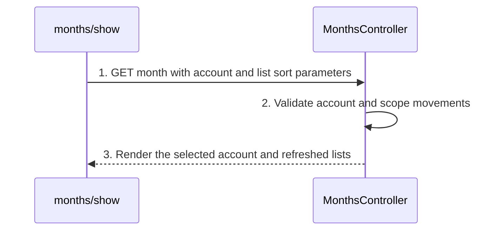
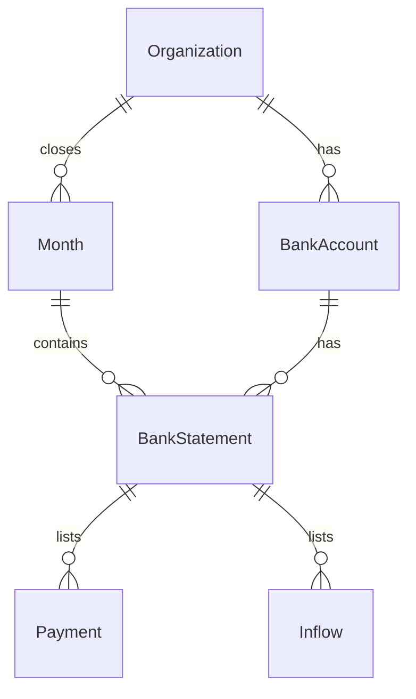
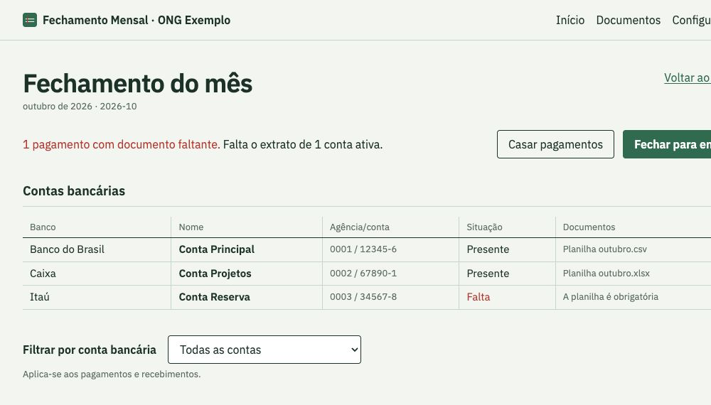

# Month overview account filter

**Approved**: 2026-11-24 - user: "Aprovo o plano."

## Problem

The coordinator sees the month name as the page title and has to find the home link on its own
line above it. Below the bank statements, the "Todas" and account-name links give no visible
indication of which results they affect.

The coordinator can recognize the monthly close page and filter payments and receipts by bank
account from a labeled control.

## Shape

Reuse the month overview GET, its Turbo Frame and existing bank-account authorization and
movement filtering. Keep the month-wide missing-document count available for the close summary
before the account filter narrows the payment and receipt lists.

1. The `months/show` view (exists) sends the selected account and current list sort parameters
   through the month frame.
2. `MonthsController` (exists) validates the selected active account against the focused
   organization and scopes payments and inflows.
3. The `months/show` view (exists) renders the selected option and refreshed lists in the same
   frame. The list-refresh controller (exists) retains scroll, control focus and disclosure state.

**Changes underneath**

| Front | What changes |
| --- | --- |
| Stored data | The selected account stays in the request URL. |
| Readers | The month overview displays the missing-document total for the entire month, including when the movements are filtered. |

New: nothing - read only.

## Surface

None - the existing GET route, query parameter, authorization and response codes stay in place.

## Landing

None - the change uses the existing month and list-refresh contracts.

## Criteria

### S1: Month heading and movement filter (P1)

The coordinator can identify the screen, return home and select the account for the two movement lists.

**Acceptance Criteria**

1. WHEN the coordinator opens the month overview THEN the system SHALL show the title
   `Fechamento do mês`, the month and year-month slug underneath, and `Voltar ao início` on the
   right, with the changed desktop surface laid out as in
   `.specs/features/month-account-filter/captures/option-a.png`.
2. WHEN the coordinator activates `Voltar ao início` THEN the system SHALL open Início at `/`.
3. WHILE the movement lists are available THEN the system SHALL show a native select after
   `Contas bancárias`, labeled `Filtrar por conta bancária` and described by
   `Aplica-se aos pagamentos e recebimentos.`. Its default empty value SHALL display
   `Todas as contas`, followed by the active account names in the existing order.
4. WHILE an open month awaits confirmation of its accounts THEN the system SHALL omit the selector.
5. WHEN the coordinator selects an account THEN the system SHALL immediately show only its
   payments and receipts, keep every bank-statement row and unmatched document visible under
   their respective sections, and show the chosen account in the select. Selecting
   `Todas as contas` SHALL restore payments and receipts across the month.
6. WHEN the selected account has no payments or receipts THEN the system SHALL display
   `Nenhum pagamento nesta conta.` and `Nenhum recebimento nesta conta.` for the respective lists.
7. WHEN the coordinator changes the selected account THEN the system SHALL preserve the
   current list sort settings, open or closed disclosures, focus on the select and scroll position
   where the new page height permits it.
8. WHILE any account is selected THEN the month overview SHALL continue to summarize missing
   documents and missing statements for the entire month.
9. WHEN the overview is 390 CSS pixels wide THEN the system SHALL keep the title, home link
   and labeled selector usable without horizontal scrolling.

## Out of scope

| Excluded | Why |
| --- | --- |
| Matching screen filter redesign | Option A applies to the month overview. Its existing matching link carries the selected account as before. |
| Statement row and ledger changes | The approved prototype uses the surrounding lists as context for the two changed areas. |

## Assumptions

| Assumption | Chosen default | Rationale | Confirmed? |
| --- | --- | --- | --- |
| Filter direction | Option A | User selected "A". | y |
| Summary scope | Monthly totals | The prototype keeps the close summary stable when filtering the movement lists. | n |

**Open questions:** none - all resolved or logged above.

## Differences from the source

None - the product matches the source within the month heading and account selector. The sample
data and surrounding ledger rows supply context.

## Sources

- Option A in `.impeccable/mocks/month-account-filter-prototype.html` - user choice for the month heading and account selector.
-  - binding for the month heading and account selector.
