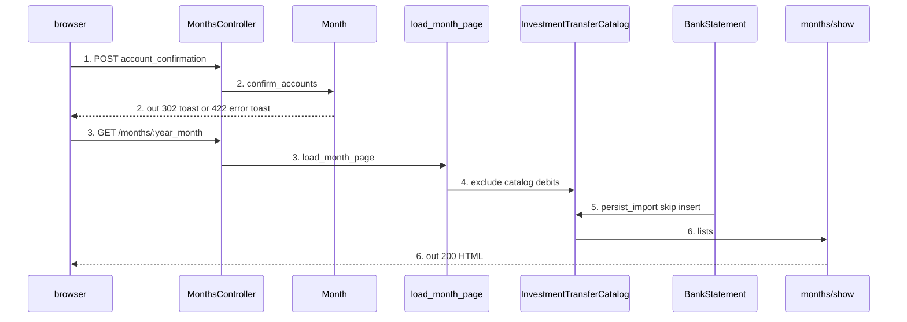
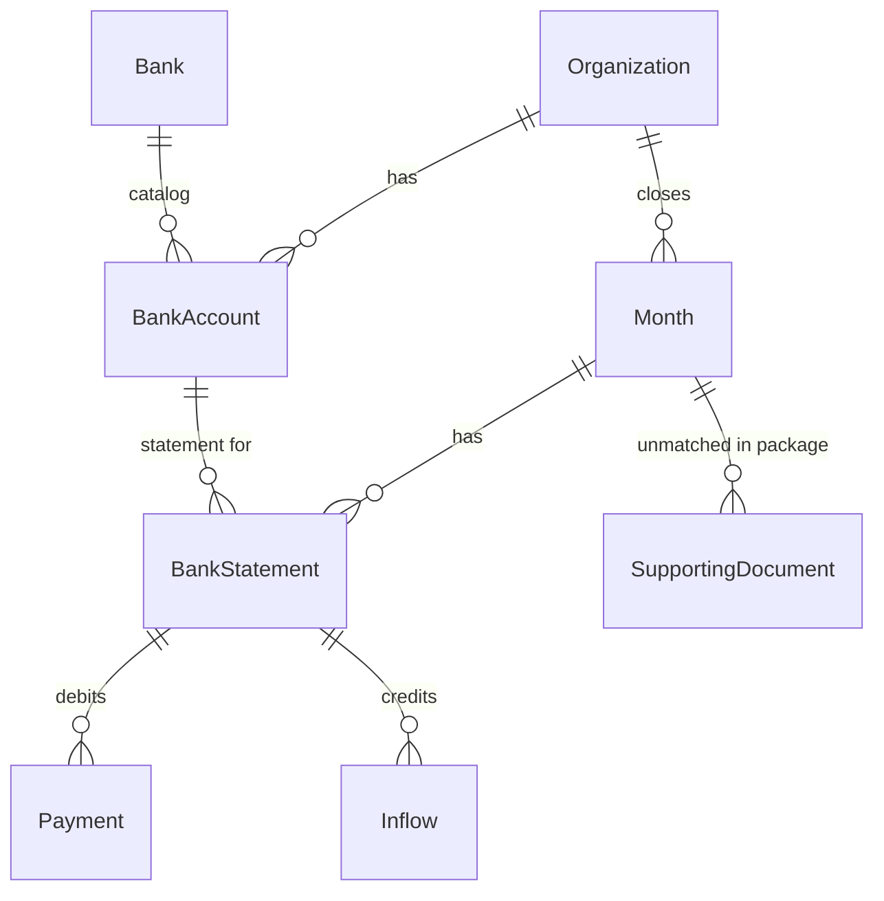
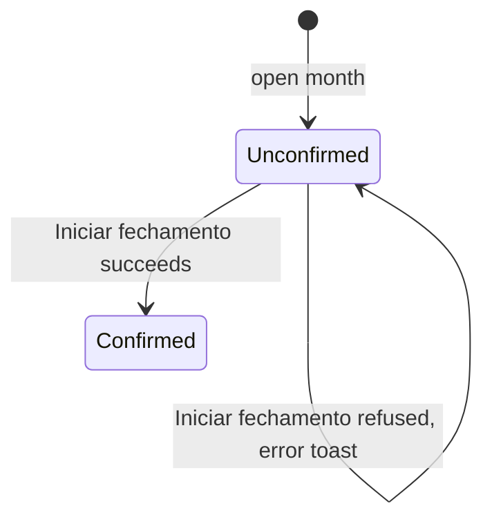

# Month overview lists

**Approved**: 2026-11-19 - user: "plano aprovado"

## Problem

On the month page a coordinator cannot start close when there is no spreadsheet: `Iniciar fechamento` is disabled, so a click does nothing, and a refused `POST /months/:year_month/account_confirmation` re-renders the page without an error toast (other refused month writes already toast). Debits such as Banco do Brasil “rende fácil” land in Pagamentos as missing documents, so the coordinator is asked for a nota on a withdrawal to an investment account. Recebimentos, Pagamentos, and Documentos sem casamento cannot be reordered by the columns the coordinator uses (date, amount, and for the pool also payee). Pagamentos still prints match and exception suggestion lines under Status, which belong on Casar, not on this list. Documentos sem casamento shows a checkbox wired to Fechar para envio and a last column that is empty or Devolver; the coordinator does not use either control here. Evidence: `app/views/months/show.html.erb`, `MonthsController#account_confirmation`, `BankStatement#persist_import`, `Month::CONFIRM_NEEDS_SPREADSHEET`.

When this ships, a click on Iniciar fechamento either confirms accounts or shows an error toast; BB “rende fácil” debits are not payments anywhere in the product; each of the three lists sorts on its own from the column headers; Pagamentos Status is the status words only; the pool is a list of documents with no checkbox and no Devolver column.

## Shape

Reuses `GET /months/:year_month`, `POST /months/:year_month/account_confirmation`, `BankStatement#persist_import`, `Payment.for_month` / `missing_document`, `ApplicationHelper#ledger_sort_cell`, and `months/show`. Catalog membership and list order run in Ruby the request specs already reach, not in the view.

1. Coordinator POST `/months/:year_month/account_confirmation` -> `MonthsController` (exists) -> `Month` (exists) `confirm_accounts`
2. out: `302` success toast, or `422` HTML with error toast `data-toast-kind=error`
3. Coordinator GET `/months/:year_month` with optional `bank_account_id` and per-list `*_sort` / `*_dir` -> `MonthsController` (exists) -> `load_month_page` (exists)
4. `InvestmentTransferCatalog` (new) - COMPE plus transliterated history substring; a debit that matches is not a Payment for lists, matching, missing-document, close, resumo, or import insert
5. `BankStatement` (exists) `persist_import` skips `payments.create!` when the catalog matches that statement’s bank
6. `months/show` (exists) - enabled Iniciar fechamento; sortable heads; Pagamentos Status without Sugestão lines; pool without checkbox or Devolver

**Changes underneath**

| Front | What changes |
| --- | --- |
| domain | A debit whose bank COMPE and history match the catalog is not a Payment: it does not appear in Pagamentos or Casar, does not count as documento faltante, does not block close-for-send, and is omitted from the summary spreadsheet. Payment still means a debit that needs a match or a document exception. Inflow is unchanged. Unmatched-document include-at-close from the month pool UI is removed; `POST /months/:year_month/close` may still accept `supporting_document_ids` if posted. `POST .../return` stays, with no month-page control |
| stored data | nothing to migrate; leftover Payment rows that match the catalog are hidden by the same rule; new imports do not insert them |
| readers | `GET /months/:year_month`; `GET /months/:year_month/matches`; home missing-document sentence; `SummarySpreadsheet`; `ActionToast` import counts; `.specs/features/visual-identity/design.md` section `month` (disabled Iniciar, Sugestão under Status, pool checkbox and Devolver) |

New: nothing - the catalog is code, not a table.

## Surface

| Route | In | Out | Status | Who |
| --- | --- | --- | --- | --- |
| `POST /months/:year_month/account_confirmation` | none | HTML month page or redirect | `302`, `422`, `302` `/login`, `404` | focused coordinator; unsigned `302` `/login`; submitter `404` |
| `GET /months/:year_month` | optional `bank_account_id`; optional `payments_sort` `payments_dir` `inflows_sort` `inflows_dir` `pool_sort` `pool_dir` | HTML month page | `200`, `302` `/login`, `404` | focused coordinator; unsigned `302` `/login`; submitter or unknown month `404` |

`POST /months/:year_month/close` keeps method, `supporting_document_ids`, statuses, and who may call. `POST /months/:year_month/supporting_documents/:id/return` keeps method, statuses, and who may call.

## Landing

| One-way door | Literal shape | Alternative rejected |
| --- | --- | --- |
| In-code catalog, not a table | Banco do Brasil COMPE `001`; debit only; history matches when `I18n.transliterate(history).downcase` includes `rende facil`. Later banks are more rows in that same list. Import does not insert a Payment for a match; every Payment reader uses the same matcher so leftover rows disappear without re-upload | Extra exception kind (still a Payment, still in Pagamentos). User-managed exception list (out of this cut). Persist-only-hide without skipping insert (DB would keep calling them payments) |

- Nothing else in this change is hard to reverse

## Criteria

### S1: Iniciar fechamento toasts when it cannot run (P1)

The submit is always clickable on the confirm step. A refused confirm is an error toast with the server sentence.

**Acceptance Criteria**

1. WHILE an open month has `accounts_confirmed` false and no spreadsheet statement, WHEN a coordinator GETs `/months/2026-05` THEN `Iniciar fechamento` SHALL be present and SHALL not be `disabled`, and `[data-notice="error"]` SHALL be `Inclua o extrato planilha de pelo menos uma conta bancária.`
2. WHEN that coordinator POSTs `/months/2026-05/account_confirmation` THEN the system SHALL respond `422`, SHALL keep `accounts_confirmed` false, and `[data-toast-kind=error]` SHALL be `Inclua o extrato planilha de pelo menos uma conta bancária.`
3. WHEN a coordinator POSTs `/months/2026-05/account_confirmation` for a closed month THEN the system SHALL respond `422` and `[data-toast-kind=error]` SHALL be `Mês fechado`
4. WHEN a coordinator POSTs `/months/2026-05/account_confirmation` on an open month that has a spreadsheet THEN the system SHALL set `accounts_confirmed` true and keep today’s success redirect and toast `Contas de maio de 2026 confirmadas.`
5. WHEN an unauthenticated client POSTs `/months/2026-05/account_confirmation` THEN the system SHALL respond `302` to `/login`
6. WHEN a submitter POSTs `/months/2026-05/account_confirmation` THEN the system SHALL respond `404`

### S2: Catalog debits are not payments (P1)

BB “rende fácil” outflows never appear as payments for a nota.

**Acceptance Criteria**

7. WHEN `BankStatement` import on COMPE `001` includes a debit whose history is `Transferência — BB Rende Fácil` THEN the system SHALL not insert a Payment for that line and SHALL still insert other debits and credits from that file
8. WHILE a Payment row already exists on COMPE `001` with history `Transferência — BB Rende Fácil`, WHEN a coordinator GETs `/months/2026-05` after accounts are confirmed THEN that row SHALL not appear in Pagamentos, SHALL not appear on `GET /months/2026-05/matches`, and the missing-document sentence SHALL not count it
9. WHILE that leftover Payment is the only unmatched debit, WHEN the coordinator POSTs close-for-send with every active account Presente THEN the system SHALL not refuse with `Há documento faltante`
10. WHEN `SummarySpreadsheet` builds for that month THEN it SHALL not include that history in the custos / Pagamentos section
11. WHEN a debit history on COMPE `001` is `RENDE FACIL` or `rende facil` (no accent) THEN the system SHALL treat it as a catalog match the same as `Rende Fácil`
12. WHEN a debit history `Transferência — BB Rende Fácil` belongs to COMPE `033` THEN the system SHALL treat it as a Payment
13. WHEN a credit history on COMPE `001` contains `Rende Fácil` THEN the system SHALL insert and list it as an Inflow
14. WHEN import finishes with one catalog debit and one ordinary debit and one credit THEN the success toast SHALL count `1 recebimento` and `1 pagamento` (the catalog debit is omitted from the payment count)

### S3: Each list sorts on its own (P1)

Default remains date ascending, `id` tie-break. Headers reuse `ledger_sort_cell`. Sorting Pagamentos does not reorder Recebimentos or the pool.

**Acceptance Criteria**

15. WHEN a coordinator GETs `/months/2026-05` with no sort params THEN Pagamentos, Recebimentos, and Documentos sem casamento SHALL be ordered by date ascending then `id` ascending, and each list’s Data header SHALL have `aria-sort="ascending"`
16. WHEN the coordinator uses Pagamentos Valor THEN the next GET SHALL include `payments_sort=amount` and `payments_dir=desc`, Pagamentos SHALL be amount descending then `id` descending, and Recebimentos SHALL stay date ascending
17. WHEN Pagamentos is already `payments_sort=amount` and `payments_dir=desc`, WHEN the coordinator uses Pagamentos Valor again THEN `payments_dir` SHALL be `asc`
18. WHEN the coordinator uses Recebimentos Data while `payments_sort=amount` THEN inflows SHALL sort by date (toggle dir) and Pagamentos SHALL remain amount-sorted
19. WHEN the coordinator uses Documentos sem casamento Favorecido THEN the next GET SHALL include `pool_sort=payee` and the pool SHALL be ordered by `payee` then `id` in the active dir
20. WHEN the coordinator uses Documentos sem casamento Valor THEN the pool SHALL order by `amount_cents` then `id` in the active dir
21. WHILE `bank_account_id` is set, WHEN the coordinator uses a sort header THEN the sort URL SHALL keep `bank_account_id`
22. IF `payments_sort` is not `date` or `amount`, or `pool_sort` is not `date` or `payee` or `amount`, or a `*_dir` is not `asc` or `desc`, THEN that list SHALL use date ascending then `id` ascending
23. WHEN an unauthenticated client GETs `/months/2026-05` THEN the system SHALL respond `302` to `/login`

### S4: Pagamentos Status has no suggestion line (P1)

**Acceptance Criteria**

24. WHILE a missing payment has a document suggestion, WHEN a coordinator GETs `/months/2026-05` THEN that payment’s `[data-cell=status]` SHALL include `Documento faltante` and SHALL not include `Sugestão`
25. WHILE a missing payment has an exception suggestion, WHEN a coordinator GETs `/months/2026-05` THEN that payment’s `[data-cell=status]` SHALL include `Documento faltante` and SHALL not include `Sugestão de exceção`
26. WHILE a missing payment has an exception suggestion, WHEN a coordinator GETs `/months/2026-05/matches` THEN that payment row SHALL still include `Sugestão de exceção`

### S5: Pool has no selector and no last column (P1)

**Acceptance Criteria**

27. WHEN a coordinator GETs `/months/2026-05` with unmatched documents THEN Documentos sem casamento SHALL have head cells `Data`, `Favorecido`, `Tipo`, `Valor`, `Foto` only, SHALL not include `name="supporting_document_ids[]"`, and SHALL not include `Devolver`
28. WHILE an unmatched document has `month_id` equal to this month, WHEN a coordinator GETs `/months/2026-05` THEN that row SHALL still list the payee and SHALL not include `Devolver`
29. WHILE the pool is empty, WHEN a coordinator GETs `/months/2026-05` THEN the fold SHALL include `Nenhum documento sem casamento`

## Out of scope

| Excluded | Why |
| --- | --- |
| Coordinator-managed exception list | user: not now |
| Catalog entries for banks other than BB `rende facil` | first row only; later people add rows in code |
| New month fold for aplicações | user chose omit everywhere |
| Sort on Casar pagamentos | request named the month overview lists |
| Removing `POST .../return` or close `supporting_document_ids` | UI gone; routes stay |
| Changing Fechar para envio toast, restore, reopen | only Iniciar fechamento was named |
| Rewriting DESIGN.md layout besides the month ASCII this supersedes | Livro-caixa sheet stays |

## Assumptions

| Assumption | Chosen default | Rationale | Confirmed? |
| --- | --- | --- | --- |
| Iniciar fechamento | Button enabled without a spreadsheet; POST 422 plus error toast with `Inclua o extrato planilha de pelo menos uma conta bancária.`; GET notice stays | user: enable_toast | y |
| Catalog surface | Omit from Pagamentos, Casar, missing-document, close gate, and resumo; no new list | user: omit_everywhere | y |
| First catalog row | COMPE `001`, debit, substring `rende facil` after transliterate+downcase | user: rende_facil_bb | y |
| Existing rows | Live rule on every Payment reader; re-upload not required | user: live_rule | y |
| Sort | Per-list query params; default date ascending (today’s order); first click on a new column is `desc` like Sem mês | user: per_list | y |
| Pool controls | No checkbox and no Devolver on the month list | user: drop_both | y |
| GET notice | Keep `[data-notice="error"]` on the unconfirmed GET as well as the POST toast | same sentence already on the page; toast is the click feedback | n |
| Closed-month confirm | Toast `Mês fechado` (existing `Month::CLOSED`) | user asked for toast whenever Iniciar cannot run | n |
| Visual identity month ASCII | Amend disabled Iniciar, Sugestão under Status, pool checkbox/Devolver to match this plan | otherwise later features revive the old drawing | n |

**Open questions:** none - remaining `n` rows are builder-safe defaults.

## Sources

- conversation (2026-11-19) - seven month-page changes; answers: enable_toast, omit_everywhere, rende_facil_bb, live_rule, per_list, drop_both
- `app/views/months/show.html.erb` - incumbent lists
- `.specs/features/visual-identity/design.md` section `month` - incumbent ASCII this plan supersedes
- [ADR-0001](../../../docs/adr/0001-rails-8-hotwire.md) - server-rendered HTML
