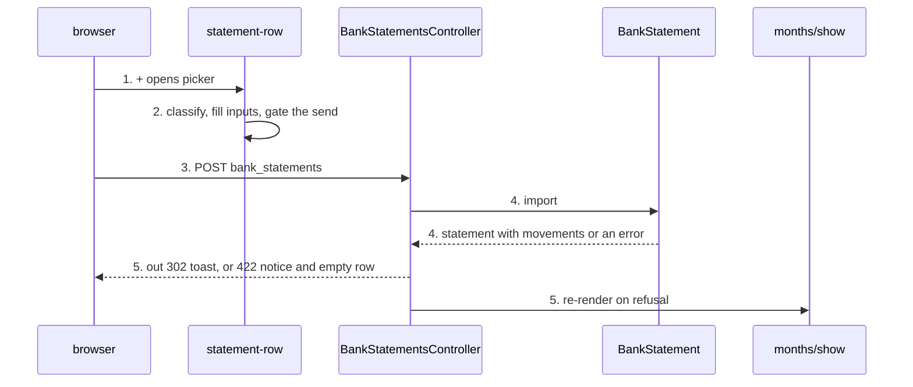
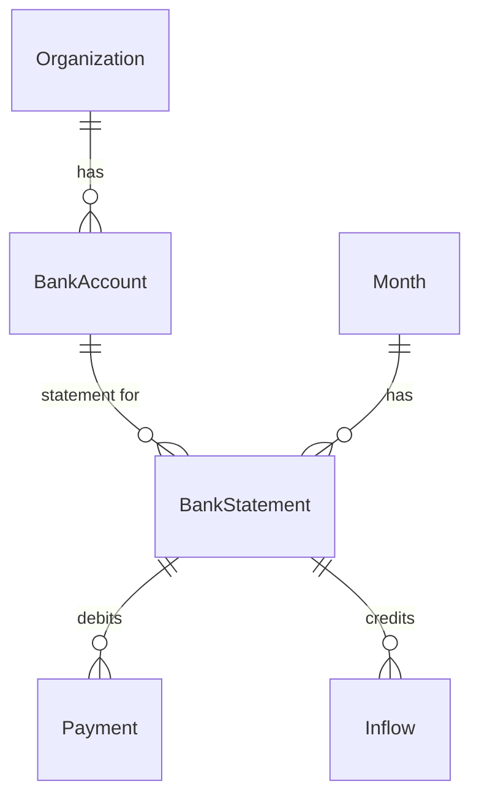

# Month statement row

**Approved**: 2026-11-19 - user: "Aprovado — escreva a linha de aprovação e siga para os checks"

## Problem

On the month page a coordinator attaches an extrato through a `
` whose summary is
`Incluir extrato` / `Substituir extrato`; opened, it prints two full-width file widgets — each a
ruled box with the `Incluir PDF` / `Incluir planilha` green chip — plus an `Enviar extrato` commit,
inside a bordered panel nested under an already ruled sheet. The panel is a second form surface
stacked under the row it belongs to, and the filled chips are the heaviest controls on the page.
The statement is the only thing a coordinator does on this screen before reading the movements, and
it takes three stacked boxes to do it. Evidence: `app/views/months/show.html.erb` lines 101-110,
`app/views/months/_statement_form.html.erb`, `app/views/shared/_file_field.html.erb`.

Pagamentos prints three lines on a matched row whenever the match carries an observation, and
prints the status word beside it, so rows run 49-73px and the list reads as paragraphs where the
coordinator wants to scan. Evidence: `months/show.html.erb` lines 184-215; the observation sentence
is the third line.

When this ships, a coordinator includes or replaces an extrato with one 16px `+` in the row's action
cell and the system picker, sees the chosen files in the Documentos cell, and sends with a `✓` that
only appears once the mandatory spreadsheet is among them; Pagamentos rows are 14px, two lines at
most, and the match observation is read on Casar.

## Shape

Reuses `POST /months/:year_month/bank_statements`, `BankStatement.import`, `months/show`, and the
`.ledger-row` sheet; the two-file choice accumulates in a Stimulus controller before one submit, so
no new route and no new model. Which files are staged, which is the spreadsheet, and whether a send
is allowed run in that controller for the gesture and in `BankStatement#submit` for the verdict the
request specs already reach.

1. Coordinator clicks the row's `+` in the action cell -> `statement-row` (new) opens one
   native file picker that accepts `.pdf`, `.csv` and `.xlsx` together
2. `statement-row` (new) files each choice by extension, names a `.txt`/`.ofx` refusal in the row,
   fills both `file` inputs, and reveals the send control once a spreadsheet is among them
3. Coordinator confirms the send -> `BankStatementsController` (exists) takes `bank_account_id`,
   `pdf` and `spreadsheet` from that row's form
4. `BankStatementsController` (exists) calls `BankStatement.import` (exists), which reads the
   spreadsheet and replaces that account's movements, or refuses with `Envie a planilha` or
   `Não foi possível ler a planilha`
5. out: `302` `/months/2026-05` with the success toast, or `422` `months/show` with the error notice
   and that account's staged files gone

**Changes underneath**

| Front | What changes |
| --- | --- |
| domain | `Incluir extrato` / `Substituir extrato` stop being disclosure summaries and stop existing as visible copy; the statement action is an icon in the row's action cell, and `Substituir extrato` survives only as the pencil's accessible name. Nothing else branches on those strings |
| stored data | nothing to migrate; a send still replaces the account's statement and its movements |
| readers | `GET /months/:year_month` (`months/show`), the statement-upload request specs, `.specs/features/visual-identity/design.md` section `month`, `DESIGN.md` file-field entry |

New: nothing - the staged files live in the DOM until the submit, not in a table.

Nothing here moves through states: `Presente` vs `Falta` is unchanged, and the staged choice is
ephemeral.

## Surface

| Route | In | Out | Status | Who |
| --- | --- | --- | --- | --- |
| `POST /months/:year_month/bank_statements` | `bank_account_id`, `pdf`, `spreadsheet` | HTML month page or redirect | `302` `/months/:year_month`, `422`, `302` `/login`, `404` | focused coordinator; unsigned `302` `/login`; submitter, unknown month, foreign or inactive account `404` |

Method, fields, statuses and who may call are unchanged; only the page that posts them changes.

## Landing

| One-way door | Literal shape | Alternative rejected |
| --- | --- | --- |
| None - the route, its fields and its statuses are untouched; the staging is DOM state, not a schema | - | - |

- Nothing else in this change is hard to reverse

## Criteria

### S1: the extrato action is one icon in its row (P1)

A coordinator attaches a statement without a panel, a chip or a second form surface.

**Acceptance Criteria**

1. WHEN a coordinator opens `GET /months/2026-05` on an open month THEN the system SHALL show
   exactly one statement control per active bank account row, in its action cell, at the same
   1.75rem hit area as `.ledger-action-icon`: a `+` with `aria-label` `Incluir extrato` when the
   account has no statement, the pencil with `aria-label` `Substituir extrato` when it has one
2. WHILE an account has no statement THEN its Documentos cell SHALL show `A planilha é obrigatória`
   in soft ink and SHALL NOT show any file chip
3. WHEN the coordinator uses that control THEN the system SHALL show the page in
   `.specs/features/month-statement-row/captures/statement-row.png`
   (`.specs/features/month-statement-row/captures/statement-row-390.png`)
4. WHEN the coordinator picks a spreadsheet alone THEN the Documentos cell SHALL list `Planilha
   {filename}` and the action cell SHALL show `Enviar extrato` and `Descartar`, with no `+`
5. WHEN the coordinator picks a PDF alone THEN the Documentos cell SHALL list `Pdf {filename}`
   above `A planilha é obrigatória`, and the action cell SHALL show `+` and `Descartar`, with no
   send control
6. WHEN the coordinator picks a PDF and a spreadsheet THEN the Documentos cell SHALL list `Pdf
   {filename}` above `Planilha {filename}` and the action cell SHALL show `Enviar extrato` and
   `Descartar`
7. WHEN the coordinator picks two PDFs and two spreadsheets together THEN the system SHALL stage the
   first PDF and the first spreadsheet and ignore a second file of either kind
8. IF the coordinator picks a file that is neither `.pdf`, `.csv` nor `.xlsx` THEN the system SHALL
   discard that file and show `Só PDF, .csv ou .xlsx` in margem in that account's Documentos cell
   - `nota.txt` → refused, nothing staged; `extrato.ofx` → refused; `.xlsx` after a refusal → staged
     and the sentence gone
9. WHEN the coordinator clicks `Enviar extrato` THEN the system SHALL post `bank_account_id`, `pdf`
   and `spreadsheet` to `POST /months/2026-05/bank_statements` and the page SHALL return to the
   statement's Documentos lines with a `302` toast
10. WHEN the coordinator clicks `Descartar` THEN the Documentos cell SHALL return to the state of
    criterion 1 or 2 for that account and nothing SHALL be posted
11. WHILE the month is closed THEN each account row SHALL show no statement control and the send
    SHALL NOT be reachable from the page

### S2: Pagamentos reads as two lines at 14px (P2)

The coordinator scans the list instead of reading paragraphs.

**Acceptance Criteria**

12. WHEN `GET /months/2026-05` renders Pagamentos THEN each row SHALL be at most 2 lines and at most
    48px tall at 1280px: `14px` / `18px` for the history, the status and the document cell, and
    `13px` / `18px` for the account meta line, as
    `.specs/features/month-statement-row/captures/statement-row.png` shows
13. WHEN a history, a document list or a status word is wider than its column THEN the cell SHALL
    truncate with `…` and carry the full text in `title`, never wrap
14. WHILE a payment is matched and its `Match` carries an observation THEN the Pagamentos row SHALL
    NOT print that observation, and `GET /months/2026-05/matches` SHALL still print it
15. WHEN the page is 390px wide THEN Pagamentos SHALL show date and amount on the first line, the
    truncated history and the status on the second, SHALL hide the Documento cell, and the document
    SHALL be 390px wide with no horizontal scroll, as
    `.specs/features/month-statement-row/captures/statement-row-390.png` shows

## Out of scope

| Excluded | Why |
| --- | --- |
| Deleting a statement | the user kept replacement by re-send, and asked to leave the trash for later |
| Sending PDF and spreadsheet in separate submits | the spreadsheet is mandatory on every import, so a PDF-only submit is always refused |
| Restoring a staged choice after a `422` | files chosen in a file input cannot survive a re-render, and the user chose the refusal sentence over a server round trip |
| Changing `POST /months/:year_month/bank_statements` at all | the two separate fields stay; staging is a DOM concern |

## Assumptions

| Assumption | Chosen default | Rationale | Confirmed? |
| --- | --- | --- | --- |
| Does the white band disappear when replacing too? | no band anywhere; the same icon opens the picker on both states | user chose option 3 for both, "nenhuma faixa" | y |
| How the two files accumulate | pick the spreadsheet, then the PDF (or both at once), see both, then send with `✓` | the spreadsheet is mandatory, so one submit needs both files staged | y |
| Which control opens the picker on an empty row | only the icon in the action cell; Documentos carries the hint | user: "só o ícone na coluna Extrato" | y |
| When `✓` is available | only when a spreadsheet is staged; a PDF alone leaves `+`, `×` and the hint | the spreadsheet is the one file `BankStatement#submit` requires; a PDF-only send is always refused and would lose the files | y |
| Where a wrong-type file is refused | in the row, `Só PDF, .csv ou .xlsx`, not a toast | user chose the in-row sentence | y |
| Where the match observation reads | Casar only, out of the Pagamentos row | user: "sai da lista de Pagamentos" | y |
| The exact `+` hit area | 1.75rem, the same as `.ledger-action-icon` | `DESIGN.md` Ledger row, and the mock matches it | y |
| The dense type step | `14px` / `18px` for row text, `13px` / `18px` for meta | user: "gostei das letras menores" | y |
| The status column width | 10rem, down from 12rem, to pay for the document column | measured in the mock; nothing breaks at `Casado`, `Documento faltante`, `Tarifa bancária` | n |
| Whether the action cell keeps a fixed 11rem track | yes, unchanged | `DESIGN.md` The Shared Track Rule | n |

**Open questions:** none - all resolved or logged above.

## Differences from the source

| Source shows | Product shows | Confirmed |
| --- | --- | --- |
| Option 3 sketch: two controls on an empty row, the `+` in Extrato and `+ Escolher PDF ou planilha` in Documentos | one control, the `+` in the action cell; Documentos carries only the hint | y - AD-0015 |
| Option 3 sketch: `✓` and `×` from the first staged file | `+` and `×` while a PDF is staged alone; `✓` and `×` once a spreadsheet is staged | y - AD-0015 |
| Option 3 sketch: `Escolher PDF ou planilha` as the cell's quiet link | nothing; criterion 2's hint sentence | y - AD-0015 |

## Sources

- `` - binding - the five bank-row states and Pagamentos
  at 14px at 1280px
- `` - binding - the same page at 390px

Both come from `.impeccable/mocks/statement-inline.html`, the option 3 sketch the user chose in this
conversation; `captures/payments-dense.png` and `captures/payments-390.png` are the earlier
`month-statements.html` shots that fixed the dense type step.
