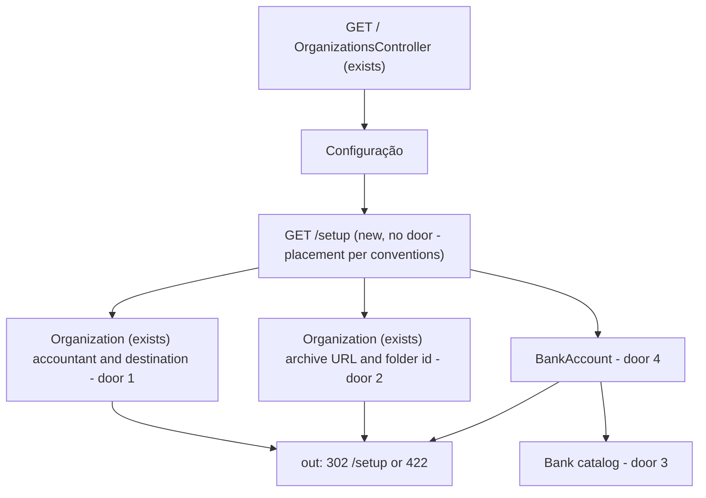
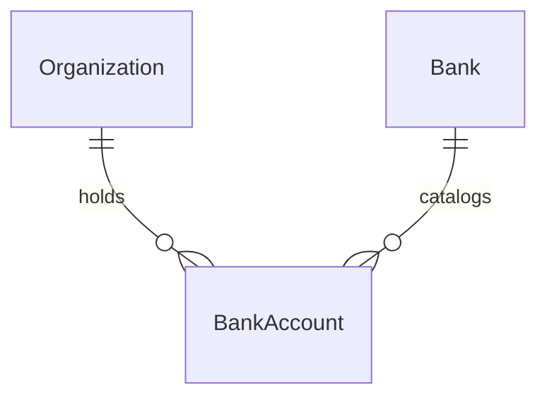

# Organization close setup

Sources:

- https://github.com/gutors/ai-accounting-assistant/issues/30 - this cut: accountant, package destination, package-archive Drive URL, bank catalog, bank accounts (active/inactive, unique name); no statements, SEFAZ, extra exception kinds, or Drive writes
- https://github.com/gutors/ai-accounting-assistant/issues/2 - standing close setup is per organization; several bank accounts, including two at the same bank
- https://github.com/gutors/ai-accounting-assistant/issues/17 - accountant identity (presentation name required; tax id CPF/CNPJ optional; razão social required only for CNPJ; one optional PIX); package destination is that accountant’s email, optional in this version
- https://github.com/gutors/ai-accounting-assistant/issues/23 - coordinator designates an existing Drive folder by URL; product does not create it; bank-account `slug` is the `extrato-{slug}` filename
- https://github.com/gutors/ai-accounting-assistant/issues/26 - bank-account identity (unique name, catalog bank, optional coordinates); never deleted; active/inactive; two names that share a slug do not both count; catalog is product-fixed (no typed `Outro`)
- `CONTEXT.md` - Accountant, Organization, Package destination, Package archive, Bank, Bank account
- [ADR-0001](../../../docs/adr/0001-rails-8-hotwire.md) - Rails 8 + Hotwire; Account ≠ Drive writer

No design source for the screens. Verification stays on project profile `standard` (no binding screen, so not `ui`).

## Problem

A coordinator can sign in and invite other coordinators, but the organization they close still has no accountant, no package destination, no package archive, and no bank accounts. Close-for-send, statements, and the summary spreadsheet have nowhere to read that standing setup from. Issue #30 gives no conversion figure; the cost is that later close features cannot name who the package is for, where the month folder will be written, or which accounts need a statement.

When this ships, a coordinator of the focused organization records that standing setup in the product and can deactivate a bank account without destroying it. The product still does not write to Drive, import a statement, or close a month.

## Out of scope

| Excluded | Why |
| --- | --- |
| Bank statement import, payments, matches | #30; #4 / later spine |
| Close-for-send, month folder `{YYYY-MM}`, writing to Drive | #30; archive is designated, not written |
| Creating the package-archive folder, or changing Drive ACL | #23: coordinator already owns the folder and sharing |
| Verifying the Drive folder via the Drive API | Account ≠ Drive writer; this cut has no writer token |
| SEFAZ certificate | #30 |
| Extra exception kinds | #30 |
| Submitter access | coordinator-only spine; #35 |
| Creating or renaming the organization in the UI | #29 bootstrap; #30 recorte does not include the org presentation name |
| Requiring at least one active bank account, or an archive URL, before setup can be saved | that gate belongs to close-for-send (#26), not this cut |
| Organization PIX keys on a bank account | #26: PIX of the accountant stays on the accountant |
| Typed bank outside the catalog (`Outro`) | #26: missing bank is a product change |
| Accountant login | accountant is not an operator |
| Outbound mail to the package destination | destination is a reminder; dispatch is a later version (#17) |

## Assumptions

| Assumption | Chosen default | Rationale | Confirmed? |
| --- | --- | --- | --- |
| Where setup lives | dedicated `/setup` of the focused organization; organization home (`/`) stays coordinators/invites and gains a `Configuração` link | home is already the access surface from coordinator-access; close setup is a different collection | y |
| Accountant storage | standing fields on `Organization`, not an `Accountant` row and not an `Account` | each organization has one accountant who is not an operator; a separate row implies an entity that could exist without the org | y |
| Package destination | same form as the accountant; the email field on that submit | #17: destination is the accountant’s email, one field | y |
| Drive folder persistence | persist the URL as submitted and the folder id parsed from the `/folders/<id>` path segment; no Drive API call | close-for-send will need the id; this cut cannot prove the writer can see the folder | y |
| Tax id | strip non-digits; 11 = CPF, 14 = CNPJ; validate Receita Federal módulo-11 check digits; store digits only | #17 names CPF or CNPJ; check digits stop a typo reaching the summary spreadsheet | y |
| PIX key | optional; trim; 1–77 characters; no key-type detection | 77 is the BCB PIX key length; #17 does not require classifying email vs EVP vs tax id | y |
| Bank catalog storage | persisted `Bank` rows seeded in the migration with the 12 institutions from #26 | #26: bootstrap from the BCB table; a typed string on the account cannot enforce the catalog | y |
| ISPB values | 8-digit CNPJ roots: `00000000`, `08561701`, `00360305`, `60701190`, `60746948`, `90400888`, `01181521`, `02038232`, `18236120`, `00416968`, `92702067`, `00315557` matching the 12 COMPE codes | live BCB STR CSV was not reachable from this session; ISPB is the first eight CNPJ digits on the BCB COMPE table | y |
| Slug | `ActiveSupport::Inflector.parameterize(name)` (ASCII, lower case, hyphen); stored; unique per organization including inactive rows | #23/#26; `parameterize("BB agência 1234")` is `bb-agencia-1234`; `Café` and `Cafe` collide | y |
| New bank account | starts active | #26: inactive is a later gesture, not the default | y |
| Bank-account list order | ascending unique name | no order was specified; name is the identity the accountant reads | y |
| Bank picker order | COMPE ascending | catalog is product data; COMPE is a stable key | y |
| Deactivate confirmation | none; `Desativar` / `Reativar` submit immediately | deactivate is reversible; there is no delete | y |
| Coordinates and optional accountant fields on PATCH | blank means clear | same as clearing the archive URL; otherwise a coordinator cannot remove a typo | y |
| Incomplete setup | allowed; zero bank accounts, blank accountant, blank archive are all valid | close-for-send will gate later; a new org is empty today | y |

**Open questions:** none - all resolved or logged above.

## Criteria

Grouped by slice. Numbering runs across the whole plan.

### S1: Accountant and package destination (P1)

**Acceptance Criteria**

1. WHEN an unauthenticated request hits `/setup` THEN the system SHALL respond `302` to `/login`
2. IF a signed-in Account with no focused organization requests `/setup` THEN the system SHALL respond `302` to `/login`
3. WHEN a coordinator with a focused organization opens `/` THEN the system SHALL include a link whose text is `Configuração` and whose href is `/setup`
4. WHEN a coordinator with a focused organization opens `/setup` THEN the system SHALL respond `200`, render with default locale `pt-BR`, and include the headings `Contador`, `Arquivo do pacote`, and `Contas bancárias`
5. WHEN the focused organization has no accountant presentation name THEN `/setup` SHALL include the text `Cadastre o contador`
6. WHEN a coordinator submits a non-blank presentation name for the focused organization THEN the system SHALL persist that trimmed name on the organization, respond `302` to `/setup`, and `/setup` SHALL include that name
7. WHEN a coordinator submits presentation name plus a 14-digit CNPJ with valid check digits and a non-blank razão social THEN the system SHALL persist the 14 digits, persist the trimmed razão social, and respond `302` to `/setup`
8. WHEN a coordinator submits presentation name plus an 11-digit CPF with valid check digits and no razão social THEN the system SHALL persist the 11 digits, persist no razão social, and respond `302` to `/setup`
9. WHEN a coordinator submits presentation name plus a well-formed destination email THEN the system SHALL persist the email after `NormalizedEmail.normalize` and respond `302` to `/setup`
10. WHEN a coordinator submits presentation name plus a PIX key of 1 to 77 characters THEN the system SHALL persist that trimmed key and respond `302` to `/setup`
11. WHEN a coordinator who already persisted tax id, razão social, PIX, and destination email submits presentation name with those four fields blank THEN the system SHALL persist no tax id, no razão social, no PIX, and no destination email, and respond `302` to `/setup`
12. IF a coordinator submits tax id, razão social, PIX, or destination email while presentation name is blank THEN the system SHALL persist none of those fields and respond `422`
13. IF a coordinator submits a tax id that is not 11 or 14 digits after stripping non-digits, or whose módulo-11 check digits are invalid, THEN the system SHALL leave the organization unchanged and respond `422`
14. IF a coordinator submits a 14-digit CNPJ and a blank razão social THEN the system SHALL leave the organization unchanged and respond `422`
15. IF a coordinator submits an 11-digit CPF and a non-blank razão social THEN the system SHALL leave the organization unchanged and respond `422`
16. IF a coordinator submits a destination that fails `NormalizedEmail.valid?` THEN the system SHALL leave the destination unchanged and respond `422`
17. IF an unauthenticated request submits accountant fields THEN the system SHALL persist no accountant fields and respond `302` to `/login`
18. WHILE focus is organization A, `/setup` SHALL not include organization B’s accountant presentation name

**Independent test:** sign in as the planted coordinator, open `Configuração`, save presentation name + CNPJ + razão social + destination email, see them on `/setup`; submit a CPF with razão social (`422`); switch focus to a second organization and confirm that name is absent.

### S2: Package archive URL (P1)

**Acceptance Criteria**

19. WHEN the focused organization has no package archive URL THEN `/setup` SHALL include the text `Cole a URL da pasta do Drive`
20. WHEN a coordinator submits `https://drive.google.com/drive/folders/15uNXeRBIhVvZJIhL4yTw4IsStMhUaaxl` THEN the system SHALL persist that URL, persist folder id `15uNXeRBIhVvZJIhL4yTw4IsStMhUaaxl`, respond `302` to `/setup`, and `/setup` SHALL include that URL
21. WHEN a coordinator submits `https://drive.google.com/drive/u/0/folders/15uNXeRBIhVvZJIhL4yTw4IsStMhUaaxl?usp=sharing` THEN the system SHALL persist folder id `15uNXeRBIhVvZJIhL4yTw4IsStMhUaaxl` and respond `302` to `/setup`
22. WHEN a coordinator submits a blank package archive URL THEN the system SHALL persist no URL and no folder id and respond `302` to `/setup`
23. IF a coordinator submits a URL that is not HTTPS on host `drive.google.com` with a `/folders/<id>` path segment THEN the system SHALL leave URL and folder id unchanged and respond `422`
24. IF a coordinator submits `https://drive.google.com/file/d/0B_NiLAzvehC9R2stRmQyM3ZiVjQ/view` THEN the system SHALL leave URL and folder id unchanged and respond `422`
25. IF an unauthenticated request submits a package archive URL THEN the system SHALL persist no URL and respond `302` to `/login`
26. WHILE focus is organization A, `/setup` SHALL not include organization B’s package archive URL

**Independent test:** paste the `/drive/folders/…` URL, see it round-trip; paste the `/file/d/…` URL (`422`); clear the field; confirm the other organization’s archive is unchanged.

### S3: Bank accounts from the catalog (P1)

**Acceptance Criteria**

27. The system SHALL persist a bank catalog of exactly these 12 entries (presentation name · COMPE · ISPB): Banco do Brasil · `001` · `00000000`; PagBank/PagSeguro · `290` · `08561701`; Caixa · `104` · `00360305`; Itaú · `341` · `60701190`; Bradesco · `237` · `60746948`; Santander · `033` · `90400888`; Sicredi · `748` · `01181521`; Sicoob · `756` · `02038232`; Nubank · `260` · `18236120`; Inter · `077` · `00416968`; Banrisul · `041` · `92702067`; Unicred · `136` · `00315557`
28. WHEN `/setup` renders THEN the bank picker SHALL list those 12 presentation names in COMPE ascending order (`001`, `033`, `041`, `077`, `104`, `136`, `237`, `260`, `290`, `341`, `748`, `756`) and SHALL not include `Outro`
29. WHEN the focused organization has zero bank accounts THEN `/setup` SHALL include the text `Nenhuma conta bancária`
30. WHEN a coordinator submits a non-blank name and COMPE `001` THEN the system SHALL persist one active BankAccount on the focused organization for Banco do Brasil, persist slug equal to `ActiveSupport::Inflector.parameterize(name)`, respond `302` to `/setup`, and `/setup` SHALL include that name and `extrato-{slug}`
31. WHEN a coordinator submits name `BB agência 1234` and a catalog COMPE THEN the system SHALL persist slug `bb-agencia-1234` and `/setup` SHALL include `extrato-bb-agencia-1234`
32. WHEN a coordinator submits a second BankAccount with a distinct name and the same COMPE as an existing one THEN the system SHALL persist the second row
33. WHEN a coordinator submits optional coordinates THEN the system SHALL persist the trimmed coordinates and `/setup` SHALL include that text
34. WHEN `/setup` lists two or more BankAccounts THEN their names SHALL appear in ascending order
35. WHEN a coordinator PATCHes a BankAccount of the focused organization to a distinct valid name THEN the system SHALL persist the new name and the new parameterized slug
36. IF a coordinator submits a name that parameterizes to the same slug as another BankAccount of that organization THEN the system SHALL persist no additional BankAccount and respond `422`
37. IF a coordinator submits a name that parameterizes to an empty string THEN the system SHALL persist no BankAccount and respond `422`
38. IF a coordinator submits a COMPE that is not one of the 12 catalog codes THEN the system SHALL persist no BankAccount and respond `422`
39. IF two concurrent BankAccount submissions use the same name and organization THEN the system SHALL persist exactly one BankAccount
40. IF an unauthenticated request submits a BankAccount THEN the system SHALL persist no BankAccount and respond `302` to `/login`

**Independent test:** create `BB agência 1234` at Banco do Brasil and see `extrato-bb-agencia-1234`; create a second account at Banco do Brasil with another name; submit `Café` then `Cafe` (`422`, still one of those slugs).

### S4: Inactive, never deleted, isolation (P1)

**Acceptance Criteria**

41. WHEN a coordinator PATCHes an active BankAccount of the focused organization to inactive THEN the system SHALL keep the row, respond `302` to `/setup`, and `/setup` SHALL still include its name and the text `Inativa`
42. WHEN a coordinator PATCHes that inactive BankAccount to active THEN `/setup` SHALL include its name and SHALL not include `Inativa` on that account’s row
43. WHEN `/setup` lists a BankAccount THEN it SHALL include `Desativar` if the account is active and `Reativar` if it is inactive, and SHALL not include a control that deletes the row
44. IF a request sends `DELETE /bank_accounts/:id` THEN the system SHALL leave the BankAccount row in place and respond `404`
45. IF a coordinator PATCHes a BankAccount that belongs to an organization they are not focused on THEN the system SHALL leave that row unchanged and respond `404`
46. WHILE focus is organization A, `/setup` SHALL not list BankAccount names that belong only to organization B

**Independent test:** deactivate, see `Inativa`, reactivate, send `DELETE` (`404`, row remains); switch focus, the other organization’s names do not appear.

## Traceability

| ID | Slice | Criteria | Status |
| --- | --- | --- | --- |
| ACCT-01 | S1 | 1, 2, 3, 4, 5, 6, 7, 8, 9, 10, 11, 12, 13, 14, 15, 16, 17, 18 | Implementing |
| ARCH-01 | S2 | 19, 20, 21, 22, 23, 24, 25, 26 | Implementing |
| BANK-01 | S3 | 27, 28, 29, 30, 31, 32, 33, 34, 35, 36, 37, 38, 39, 40 | Implementing |
| BANK-02 | S4 | 41, 42, 43, 44, 45, 46 | Implementing |

## Observable

| Surface | Decision | Landing |
| --- | --- | --- |
| screen `/` | empty / loading / density | existing - coordinator-access already owns home empty and invite list |
| screen `/` | error / unauthorised | existing - unauthenticated `/` is `302` `/login` |
| screen `/` | destructive action confirms | existing - revoke still confirms on home |
| screen `/` | setup entry | AC 3 |
| screen `/setup` | empty accountant | AC 5 |
| screen `/setup` | empty archive | AC 19 |
| screen `/setup` | empty bank accounts | AC 29 |
| screen `/setup` | loading | n/a - Turbo full-page / redirect |
| screen `/setup` | error state | AC 12, AC 13, AC 14, AC 15, AC 16, AC 23, AC 24, AC 36, AC 37, AC 38 |
| screen `/setup` | unauthorised | AC 1, AC 2, AC 17, AC 25, AC 40 |
| screen `/setup` | density and ordering | AC 28, AC 34 |
| screen `/setup` | destructive action confirms | n/a - deactivate is reversible; there is no delete |
| HTML `PATCH /accountant` | who may call it | AC 6, AC 17 |
| HTML `PATCH /accountant` | error shape and codes | AC 12, AC 13, AC 14, AC 15, AC 16, AC 17 |
| HTML `PATCH /accountant` | versioning | n/a - first HTML surface, no published API version |
| HTML `PATCH /accountant` | rate limit | n/a - coordinator-only, small operator set |
| HTML `PATCH /package_archive` | who may call it | AC 20, AC 25 |
| HTML `PATCH /package_archive` | error shape and codes | AC 23, AC 24, AC 25 |
| HTML `PATCH /package_archive` | versioning | n/a - first HTML surface |
| HTML `PATCH /package_archive` | rate limit | n/a - coordinator-only, small operator set |
| HTML `POST /bank_accounts` | who may call it | AC 30, AC 40 |
| HTML `POST /bank_accounts` | error shape and codes | AC 36, AC 37, AC 38, AC 40 |
| HTML `POST /bank_accounts` | versioning | n/a - first HTML surface |
| HTML `POST /bank_accounts` | rate limit | n/a - coordinator-only, small operator set |
| HTML `PATCH /bank_accounts/:id` | who may call it | AC 35, AC 41, AC 45 |
| HTML `PATCH /bank_accounts/:id` | error shape and codes | AC 36, AC 45 |
| HTML `PATCH /bank_accounts/:id` | versioning | n/a - first HTML surface |
| HTML `PATCH /bank_accounts/:id` | rate limit | n/a - coordinator-only, small operator set |
| HTML `DELETE /bank_accounts/:id` | who may call it | AC 44 - nobody; always `404` |
| HTML `DELETE /bank_accounts/:id` | error shape and codes | AC 44 |
| HTML `DELETE /bank_accounts/:id` | versioning | n/a - no delete resource |
| HTML `DELETE /bank_accounts/:id` | rate limit | n/a - no successful delete |
| collection banks | grouping | AC 27 - one product catalog, not per organization |
| collection banks | naming | AC 28 - presentation name |
| collection banks | ordering | AC 28 - COMPE ascending |
| collection banks | duplicates | AC 27 - exactly 12, unique COMPE |
| collection banks | exception that does not fit | AC 28, AC 38 - no `Outro` |
| collection bank accounts | grouping | AC 46 - focused organization only |
| collection bank accounts | naming | AC 30, AC 31 - unique name and `extrato-{slug}` |
| collection bank accounts | ordering | AC 34 - ascending name |
| collection bank accounts | duplicates | AC 36, AC 39 |
| collection bank accounts | exception that does not fit | AC 41, AC 43, AC 44 - inactive stays; never deleted |

## Flow

This reuses `require_account`, `focused_organization`, and `NormalizedEmail` from coordinator-access. It does not call Drive and does not duplicate Google OIDC.

Unauthenticated HTML on these routes still goes through `ApplicationController` (exists) to `302` `/login`.

## Relations

One-way constraints: Bank COMPE unique (door 3), Bank ISPB unique (door 3), BankAccount name unique per Organization (door 4), BankAccount slug unique per Organization (door 4), BankAccount is never deleted (door 4). Accountant and package archive are standing fields on Organization (doors 1–2), not separate entities. No columns and no types here.

## Surface

| Route | In | Out | Status |
| --- | --- | --- | --- |
| `GET /` | session · focus | home HTML · `Configuração` | `200`, `302` |
| `GET /setup` | session · focus | setup HTML · `Contador` · `Arquivo do pacote` · `Contas bancárias` | `200`, `302` |
| `PATCH /accountant` | session · focus · presentation name · tax id · razão social · PIX · destination email | Organization standing fields · redirect or setup HTML | `302`, `422` |
| `PATCH /package_archive` | session · focus · url | URL · folder id · redirect or setup HTML | `302`, `422` |
| `POST /bank_accounts` | session · focus · name · COMPE · coordinates | BankAccount · `extrato-{slug}` · redirect or setup HTML | `302`, `422` |
| `PATCH /bank_accounts/:id` | session · focus · name · COMPE · coordinates · active | BankAccount · redirect or setup HTML | `302`, `422`, `404` |
| `DELETE /bank_accounts/:id` | session · id | none | `404` |

## Landing

| One-way door | Literal shape | Alternative rejected |
| --- | --- | --- |
| 1. Accountant and destination on the organization | standing fields on `Organization` (presentation name, tax-id digits, razão social, PIX, destination email). Tax id is digits-only; 11 = CPF, 14 = CNPJ with módulo-11 check digits. Razão social persisted only with CNPJ. Destination email uses `NormalizedEmail`. | `Accountant` as an `Account` — accountant is not an operator (#17). A `has_one :accountant` row — implies an entity that can exist without the organization. |
| 2. Package archive designation | persist the submitted HTTPS URL and the path segment after `/folders/` (stop at `?` or `/`). Accept `/drive/folders/<id>` and `/drive/u/<n>/folders/<id>`. Reject `/file/d/`. No Drive API `files.get`. | URL-only with parse deferred to close-for-send — that feature would re-decide the URL grammar. Calling Drive to prove access — needs the writer account this cut must not attach to operator login. |
| 3. Fixed bank catalog | table `banks`, unique COMPE (3-digit zero-padded), unique ISPB (8-digit); seeded with the 12 rows in AC 27. Coordinator has no create/update/delete on `Bank`. | Free-text bank name on the account — #26 forbids `Outro`. Frozen Ruby hash — BankAccount cannot belong_to a catalog row, and SQL cannot enforce COMPE. |
| 4. Bank account identity, never deleted | `BankAccount` belongs to `Organization` and `Bank`; unique name per organization; unique slug per organization (including inactive); `active` boolean, default true; no `DELETE` that removes the row. | Soft-delete timestamp that hides the unique name — a later reactivate/recreate would collide and #26 says the name is the identity. Physical delete — statements and month-folder slugs later still need the row. |

- Nothing else in this change is hard to reverse. Slug derivation is `parameterize` on the current name (door 4 stores the result); renaming changes the stored slug for the next close-for-send, not already-written Drive files.

## Impact

| Front | What changes |
| --- | --- |
| domain | existing term: `Accountant` — first persisted as organization standing fields (presentation name, optional tax id / razão social / PIX); still not an `Account` |
| domain | existing term: `Package destination` — first persisted as the optional destination email on that standing accountant |
| domain | existing term: `Package archive` — first persisted as a designated Drive folder URL plus extracted folder id; still not written |
| domain | existing term: `Bank` — first persisted as the product catalog of 12 institutions (name, COMPE, ISPB) |
| domain | existing term: `Bank account` — first persisted row; unique name + slug; active/inactive; never deleted |
| stored data | existing `organizations` rows gain nullable standing fields (blank accountant, blank archive). `banks` backfilled by the migration with the 12 catalog rows. No bank-account rows to migrate |
