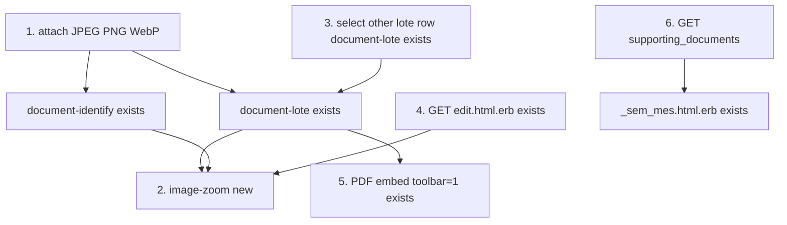

# Proof image zoom

**Approved**: 2026-11-18 - user: "Escreva o plano e crie a issue"

## Problem

On Documentos, a JPEG, PNG or WebP in the proof pane is an ``. The pane cannot enlarge it. A PDF uses `<embed …#toolbar=1&view=Fit>`, so the browser PDF toolbar zooms. Coordinators reading a photo of a DANFE or recibo cannot enlarge printed amounts the way they can on a PDF. Evidence: the live insert and edit panes; no ticket number in the request.

Sem mês also prints the 44-digit chave under Favorecido (`[data-chave]`). That row already carries date, payee, filenames, and observation; the chave duplicates the edit field and clutters the list.

When this ships, a JPEG/PNG/WebP on insert and on Editar starts fitted, with visible `+` / `−`, wheel/pinch zoom, and drag-to-pan when enlarged. Sem mês no longer shows the chave. The chave stays stored, stays on the identify preview, and stays as the raw value of `input#chave` on Editar.

## Shape

Reuses the existing proof panes (`document-lote`, `document-identify`, `edit.html.erb`) and the wrapper that already has `overflow-auto`. Zoom rules run in a new Stimulus `image-zoom` controller, reachable from system specs that attach a real JPEG. Hiding the chave is a view rule in `_sem_mes.html.erb`.

1. attach JPEG/PNG/WebP -> `document-lote` (exists) or `document-identify` (exists) - paints the img object URL in the proof pane
2. `image-zoom` (new) - starts at fit (scale `1`); `Ampliar` / `Reduzir`, wheel/pinch, and pointer-drag act on that img
3. select another lote row -> `document-lote` (exists) `paintProof` - `image-zoom` returns to scale `1`
4. `GET /supporting_documents/:id/edit` of an image photo -> `edit.html.erb` (exists) - same `image-zoom` on the stored photo
5. PDF photo -> `document-lote` (exists) - existing `<embed …#toolbar=1>`, no `Ampliar`/`Reduzir`
6. `GET /supporting_documents` -> `_sem_mes.html.erb` (exists) - omits `[data-chave]`; payee, date, kind, amount, filenames, observation stay
7. out: no persist change; `chave` column unchanged

**Changes underneath**

| Front | What changes |
| --- | --- |
| domain | **Chave de acesso** is still stored and still typed/shown on Editar and on the identify preview; Sem mês no longer displays it. This supersedes the list half of visual-identity AC 33 / C48 (`data-chave` on the document row). The live example `spec/requests/supporting_documents_spec.rb` `chave is displayed in groups of four and kept raw in the edit field` changes in the same commit as the view |
| stored data | nothing to migrate |
| readers | Sem mês list; insert proof (coordinator lote and submitter identify); Editar proof. Month match and month document lists never showed chave |

Data: none - zoom is client-only; chave remains on SupportingDocument.

## Surface

None - nothing consumed outside the page. No new route. `GET /supporting_documents` and `GET /supporting_documents/:id/edit` stay `200` / `302` `/login`.

## Landing

None - a Stimulus controller and a view omission are reversible. No schema, no npm package, no new HTTP contract. Native PDF toolbar stays; we do not replace it with the image zoom.

## Criteria

### S1: Raster proof zooms on insert (P1)

Coordinator lote and submitter one-file insert can enlarge a photo in the proof pane.

**Acceptance Criteria**

1. WHEN a coordinator attaches a JPEG THEN the proof pane SHALL show buttons whose accessible names are `Ampliar` and `Reduzir`, the image SHALL be at scale `1`, and `Reduzir` SHALL be disabled
2. WHEN that coordinator uses `Ampliar` at scale `1` THEN the image scale SHALL be `1.25` and `Reduzir` SHALL be enabled
3. WHEN they use `Ampliar` at scale `4` THEN the scale SHALL stay `4` and `Ampliar` SHALL be disabled
4. WHEN they use `Reduzir` at scale `1.25` THEN the scale SHALL be `1` and `Reduzir` SHALL be disabled
5. WHEN they wheel or pinch over that JPEG proof (wheel `deltaY` `-120`, or `ctrlKey` wheel) at scale `1` THEN the scale SHALL become `1.25`, and SHALL not go below `1` or above `4`
6. WHILE the JPEG is at scale `2`, WHEN they pointer-drag 40px on the image THEN the proof pane's `scrollLeft` or `scrollTop` SHALL change from `0`
7. WHEN they attach a PNG THEN `Ampliar` at scale `1` SHALL set scale `1.25`
8. WHEN they attach a WebP THEN `Ampliar` at scale `1` SHALL set scale `1.25`
9. WHEN the selected proof is a PDF THEN `Ampliar` and `Reduzir` SHALL be absent and the embed `src` SHALL include `#toolbar=1`
10. WHEN the selected proof is XML-only THEN `Ampliar` and `Reduzir` SHALL be absent
11. WHEN they attach two JPEGs and select the second row THEN that image SHALL be at scale `1` even if the first was at `1.25`
12. WHEN a submitter attaches a JPEG on Incluir documento THEN `Ampliar` at scale `1` SHALL set scale `1.25`
13. WHEN the insert proof with a JPEG is shown at `390px` viewport THEN `Ampliar` and `Reduzir` SHALL be visible and `document.documentElement.scrollWidth` SHALL be `<= 390`

### S2: Raster proof zooms on Editar (P1)

The same zoom on a persisted photo.

**Acceptance Criteria**

14. WHEN a coordinator opens Editar of a document whose photo is a JPEG THEN the proof pane SHALL show `Ampliar` and `Reduzir` at scale `1`, and `Ampliar` SHALL set scale `1.25`
15. WHEN Editar's photo is a PDF THEN `Ampliar` and `Reduzir` SHALL be absent and the embed `src` SHALL include `#toolbar=1`
16. WHEN Editar has XML and no photo THEN `Ampliar` and `Reduzir` SHALL be absent

### S3: Sem mês does not show the chave (P1)

The list names the document without the access key.

**Acceptance Criteria**

17. WHEN `GET /supporting_documents` includes a document whose chave is `35240612345678000190550010000012341000012340` THEN `#sem-mes` SHALL not contain `[data-chave]` and SHALL not contain `3524 0612 3456 7800 0190 5500 1000 0012 3410 0001 2340`
18. WHEN `GET /supporting_documents/:id/edit` of that document THEN `input#chave` SHALL have value `35240612345678000190550010000012341000012340`
19. WHEN that document is listed THEN `#sem-mes` SHALL still include its payee, `R$` amount, kind label, and original filename
20. WHEN the submitter identify preview has a chave THEN that preview SHALL still show the grouped chave; only Sem mês omits it

## Out of scope

| Excluded | Why |
| --- | --- |
| Replacing the PDF `<embed>` toolbar with `image-zoom` | PDF zoom already works via the native toolbar |
| Zoom on month match, month document lists, or any screen other than insert and Editar | user chose insert and Editar |
| A lightbox / full-screen viewer | user chose in-pane `+`/`−`, wheel/pinch, and drag |
| A zoom library (medium-zoom, panzoom, pdf.js) | Stimulus only, same as `document-lote` |
| HEIC | already rejected on insert |
| Changing how chave is stored, typed, or consulted | this cut only hides it on Sem mês |
| Hiding chave from the identify preview or from `input#chave` | user named the Sem mês list |
| Keyboard shortcuts beyond the two buttons | `Ampliar` and `Reduzir` are the controls |

## Assumptions

| Assumption | Chosen default | Rationale | Confirmed? |
| --- | --- | --- | --- |
| Gesture | start at fit; visible `+`/`−` (`Ampliar` / `Reduzir`); wheel/pinch; drag pans when enlarged | user chose this over buttons-only, wheel-only, or lightbox | y |
| Surfaces | coordinator lote, submitter Incluir documento, and Editar | user chose insert and Editar | y |
| Scale | min `1`, max `4`, step `0.25` | three clicks of `Ampliar` from fit is `1.75`; enough to read a phone photo of a DANFE without a fourth UI | y |
| Button copy | visible labels `+` and `−`; accessible names `Ampliar` and `Reduzir` | matches the PDF toolbar's +/- without new copy to translate | y |
| Lote row change | scale returns to `1` | a 4× zoom must not carry onto the next receipt | y |
| Pan | existing `overflow-auto` pane (scroll position), not a second overlay | the wrapper already scrolls; zoom only has to enlarge past fit | y |
| Dependency | no new JS package | Stimulus only, same as `document-lote` | y |
| PNG and WebP | same path as JPEG | `imageFile` already lists them | y |
| Test images | existing OCR fixtures such as `spec/fixtures/files/ocr/amount_only.jpg`, not `jpeg-bytes` stubs | Cuprite must decode a real raster for scale and pan | y |

**Open questions:** none - all resolved or logged above.

## Differences from the source

None - no binding capture. Sem mês hiding chave supersedes visual-identity AC 33 / C48 for the list only; that is existing product, not a frame for this cut.

## Sources

- https://github.com/gutors/ai-accounting-assistant/issues/168 - this cut: JPEG/PNG/WebP zoom on the proof pane; hide chave on Sem mês
- Live `/supporting_documents` proof pane (JPEG img vs PDF embed `#toolbar=1`) - existing product - what fails today
- User: in-pane `+`/`−` plus wheel/pinch and drag; insert and Editar
- `app/javascript/controllers/document_lote_controller.js` `paintProof` - image vs PDF split
- visual-identity AC 33 / C48 - existing list display this cut supersedes for Sem mês
