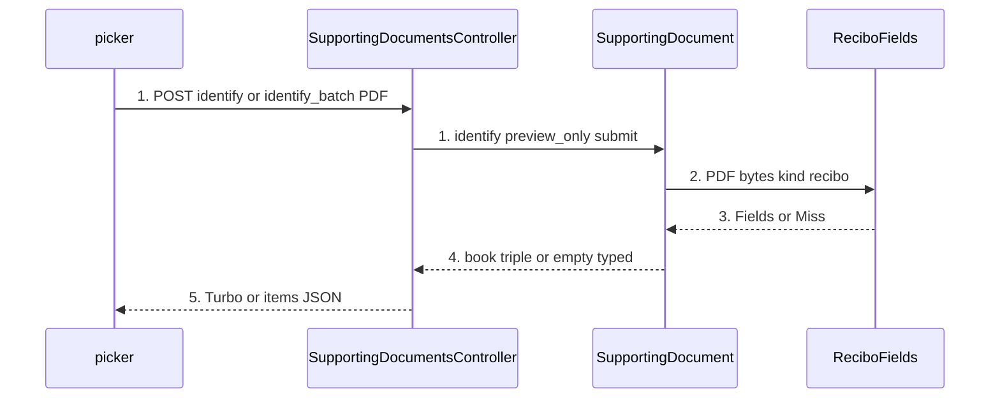
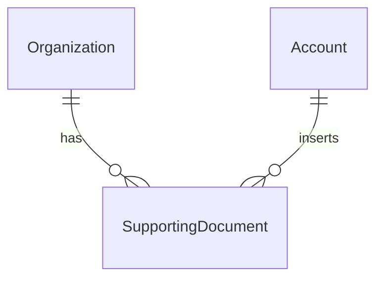
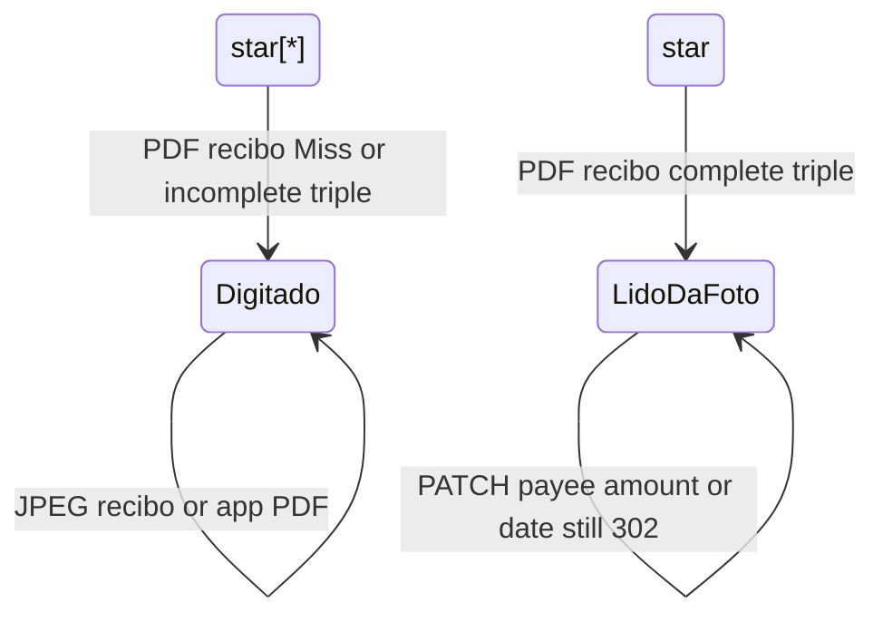

# Recibo PDF fields

**Approved**: 2026-11-18 - user: "Implement the plan as specified, it is attached for your reference."

## Problem

A coordinator or submitter who drops a PDF recibo still types amount, date, and payee even when those three are printed on the page. `GLOSSARY.md` says the recibo photo is not read in this version; `SupportingDocument#submit` forces `fields_origin` `typed` for every recibo and never calls field reading (`insert recibo ignores photo field reading`). Identify of a PDF with no chave paints an empty Recibo book (`POST identify pdf miss is recibo typed empty`). The conversation names two native-text PDFs whose layout already shows who received, the amount, and the date. No conversion figure; the cost is retyping every PDF recibo in the insert ritual.

When this ships, a PDF that the existing classifier treats as recibo and that yields a complete amount/date/payee triple fills those three as correctable `Lido da foto`. A JPEG recibo, an app PDF (Uber and similar), or a PDF that misses any of the three stays typed for all three.

## Shape

Reuses `SupportingDocument.identify` / `submit` (exists), `PhotoPdf` + `PhotoOcr` (exists), and origin stamp `photo` / `Lido da foto` (exists). A new `ReciboFields` port (same Fake/Real shape as `PhotoFields`) runs only when kind is recibo and the photo is a PDF. Outcome rules live on `ReciboFields` and `SupportingDocument`, which model and request specs already reach.

1. PDF photo on identify or POST -> `SupportingDocument.submit` (exists) - posted or inferred kind `recibo` (ADR-0009: XML or PhotoSymbols chave/QR is nota fiscal; otherwise recibo). JPEG recibo does not enter this path.
2. PDF bytes -> `ReciboFields` (new) - native text via Poppler `pdftotext` already in `poppler-utils`; if that text is unusable, existing `pdftoppm` pages then `PhotoOcr`.
3. `ReciboFields` (new) - amount from `R$` (prefer `a quantia de` / `o valor de`); date from `dd/mm/yyyy` with optional spaces around slashes, or `D de <mês> de YYYY`; payee is who received, never the payer after `Recebi de` / `recebido do`.
4. complete triple -> fill amount, date, payee, `fields_origin` `photo`, unlocked; incomplete or Miss -> typed, empty on identify.
5. out: identify Turbo book / `identify_batch` JSON with origin `Lido da foto`, or persist `SupportingDocument` (exists) on Incluir / POST.

**Changes underneath**

| Front | What changes |
| --- | --- |
| domain | Recibo meant typed-only; PDF recibo may now be `Lido da foto`. `GLOSSARY.md` Supporting document and Recibo sentences that say the photo is not read. Who branches: `SupportingDocument#submit` (`next_origin` always typed for recibo; `PhotoFields` only when kind is nota fiscal) |
| stored data | nothing to migrate; existing recibo rows stay `typed` |
| readers | identify Turbo stream, `POST /supporting_documents/identify_batch` JSON, GET edit origin under Valor/Data/Favorecido, lote book (`Pronto` when the triple is filled). Lote `insert_batch` still `skip_photo_extract` (posted values; persisted origin may be `typed`, same as today's photo-filled nota in the lote) |

New: nothing - read only on stored shape. `fields_origin` `photo` already exists.

## Surface

None - nothing consumed outside. Existing identify / identify_batch / POST insert / POST batch keep the same fields and statuses. identify_batch `origin` may now be `Lido da foto` on a recibo row (today that stamp is only for nota fiscal photo fields). Who may call is unchanged: coordinator identify_batch; coordinator or submitter identify and insert.

## Landing

None - nothing here is one-way. No new column, no new HTTP contract, no new gem. `poppler-utils` (includes `pdftotext`) is already on Dockerfile `base` and CI. Fake/Real `ReciboFields` is the same reversible port as `PhotoFields`. ADR-0009 stays: a successful recibo parse must not classify the file as nota fiscal.

## Criteria

### S1: Recibo PDF parser (P1)

The two named layouts yield a complete integer-cents triple; DANFE and app PDFs miss.

**Acceptance Criteria**

1. WHEN `ReciboFields::Real` reads a PDF whose text is `RECIBO DE PAGAMENTO`, `Eu Padaria Central, portador`, `a quantia de R$ 155,00`, `15 de junho de 2026` THEN the system SHALL return `Fields` with `amount_cents` `15500` (Integer, not Float), `document_on` `2026-06-15`, payee `Padaria Central`
2. WHEN it reads a PDF whose text is `RECIBO`, `Recebi de Centro Social da Rua`, `o valor de R$ 295,00`, date `27 / 06 / 2026`, and payee block `Kali Confeitaria` THEN the system SHALL return `amount_cents` `29500`, `document_on` `2026-06-27`, payee `Kali Confeitaria`, and SHALL not return `Centro Social da Rua`
3. IF that PDF has only `R$ 155,00` and no date and no payee THEN the system SHALL return `Miss` (not a partial `Fields` the submit path would apply)
4. IF the PDF text is a DANFE (`EMITENTE`, `VALOR TOTAL DA NOTA`) with no `RECIBO` title THEN the system SHALL return `Miss`
5. IF the PDF text is an app receipt (`Aqui está o recibo da sua entrega`, `Total`, `Preço da viagem`) THEN the system SHALL return `Miss`
6. WHEN `pdftotext` yields a usable triple THEN `PhotoOcr` SHALL not run. WHEN `pdftotext` is empty or unusable and raster OCR of a page yields that Padaria triple THEN the system SHALL return those three values

### S2: Identify fills the book (P1)

Identify and identify_batch paint the triple as Recibo `Lido da foto` without persisting.

**Acceptance Criteria**

7. WHEN a coordinator POSTs `POST /supporting_documents/identify` with that Padaria recibo PDF and no typed fields THEN the system SHALL persist `0` SupportingDocument rows, respond `200`, Arquivo `Foto`, kind `recibo` disabled, Valor `155,00`, Data `2026-06-15`, Favorecido `Padaria Central`, origin under each `Lido da foto`, those three not disabled, chave hidden
8. WHEN a coordinator POSTs `POST /supporting_documents/identify_batch` with that PDF as the only file THEN `items[0].ok` SHALL be true, `kind` `recibo`, `amount` `155,00`, `date` `2026-06-15`, `payee` `Padaria Central`, `origin` `Lido da foto`, `locked` false, and persist `0` rows
9. WHEN a submitter POSTs identify with that PDF THEN the book SHALL fill the same three values and origin `Lido da foto`, persist `0`
10. WHEN identify runs a JPEG named recibo.jpg whose `PhotoFields` stub would return payee `Mercado Silva` THEN kind SHALL be `recibo`, amount/date/payee empty, origin `Digitado`
11. WHEN identify runs the app-receipt PDF THEN kind SHALL be `recibo`, the three fields empty, origin `Digitado`

### S3: Persist, fallback, lock (P1)

Incluir stores the triple as photo origin and keeps it correctable; incomplete and JPEG stay typed.

**Acceptance Criteria**

12. WHEN a coordinator POSTs `POST /supporting_documents` with that Padaria PDF and no typed three THEN the system SHALL persist one SupportingDocument kind `recibo`, `amount_cents` `15500`, `document_on` `2026-06-15`, `payee` `Padaria Central`, `fields_origin` `photo`, no chave, no XML, `302` to `/supporting_documents`, and that page SHALL include `R$ 155,00`, `15/06/2026`, `Padaria Central`
13. WHEN GET edit runs for that document THEN Valor/Data/Favorecido SHALL not be disabled and origin under each SHALL be `Lido da foto`. A later PATCH of payee `Mercado Silva` SHALL respond `302` and persist that payee
14. WHEN that POST also has typed payee `Mercado Silva` and the PDF triple is complete THEN the system SHALL persist `payee` `Padaria Central` (`fields_origin` `photo`)
15. IF the PDF read is incomplete and that POST has typed `100,00` / `2026-05-11` / `Padaria Central` THEN the system SHALL persist `amount_cents` `10000` and `fields_origin` `typed`
16. WHEN a coordinator POSTs `kind=recibo` with JPEG named recibo.jpg and typed `155,00` / `2026-05-11` / `Padaria Central` THEN the system SHALL persist `payee` `Padaria Central` and `fields_origin` `typed` even if `PhotoFields` would return `Mercado Silva`
17. WHEN a coordinator POSTs `kind=nota_fiscal` with a DANFE PDF whose `PhotoFields` read returns the Padaria triple THEN the system SHALL persist kind `nota_fiscal` and SHALL not run `ReciboFields` as the fill source

## Out of scope

| Excluded | Why |
| --- | --- |
| JPEG/PNG recibo photos | user: this cut is PDF only |
| App PDF receipts (Uber and similar) | user |
| Filling a partial triple | user: complete triple or type all three |
| Changing ADR-0009 classification | PhotoSymbols still mean nota fiscal |
| LLM / cloud vision | stack already uses tesseract and Poppler |
| Re-reading the photo inside `insert_batch` | `skip_photo_extract` stays |
| Persisting `fields_origin` `photo` through lote batch skip | same gap as photo-filled nota today |
| SEFAZ, XML, chave on recibo | recibo has none |
| New identify or insert routes | existing routes keep their signatures |
| Binding screen captures | no layout change |

## Assumptions

| Assumption | Chosen default | Rationale | Confirmed? |
| --- | --- | --- | --- |
| Payee | who received, not who paid | user: "quem recebeu" | y |
| File scope | PDF recibo in the style of the two examples | user chose PDF-only; JPEG stays typed | y |
| Incomplete read | complete triple or type all three | user chose the nota-fiscal photo rule | y |
| Origin stamp | reuse `Lido da foto` / `photo`, unlocked | matches nota photo fields | y |
| Text source | text layer first (`pdftotext`), then existing OCR | same Poppler package already required | y |
| Proof PDFs | synthetic fixtures (Padaria / Kali), never the ONG's real files | real files carry PII | y |
| Lote Incluir | still posts the filled values with `skip_photo_extract` | already shipped | y |
| Identify miss | `Digitar`, not Erro; typed remains last fallback | existing lote statuses | y |

**Open questions:** none - all resolved or logged above.

## Differences from the source

None - no binding capture. The two PDFs in the request are examples of layout, not screens to match.

## Sources

- Conversation 2026-11-18 - user asked to interpret PDF recibos; named `recibo-serigrafia-1506.pdf` and `nota-bolobanho-2706.pdf` - non-binding - user: "Por exemplo, temos alguns documentos estilo" - layout examples, not to be committed
- User: scope PDF-only; complete triple or type all three
- `GLOSSARY.md` Supporting document, Recibo - photo not read in this version
- [ADR-0009](../../../docs/adr/0009-insert-kind-from-file.md) - do not use field success as an NF signal
- Existing photo field path: `app/models/photo_fields.rb`, `app/models/supporting_document.rb` `submit` / `identify`
