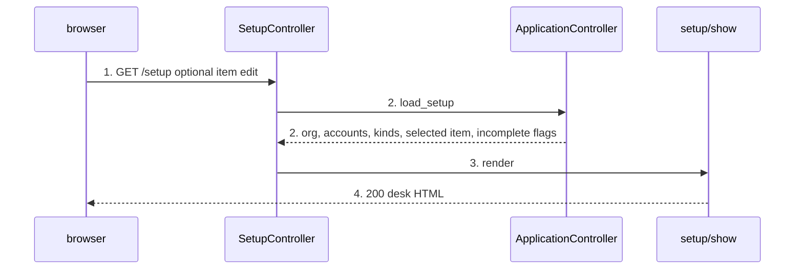
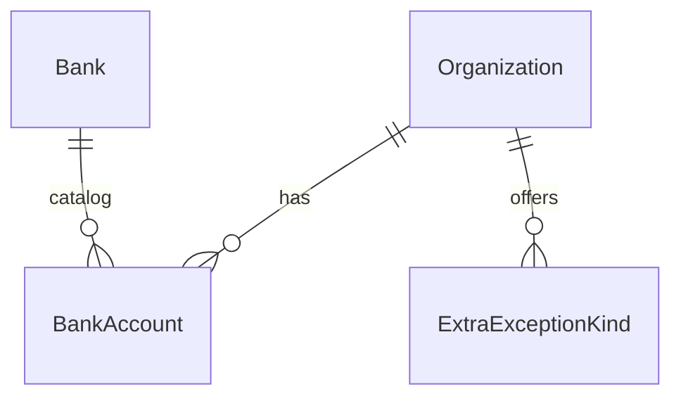
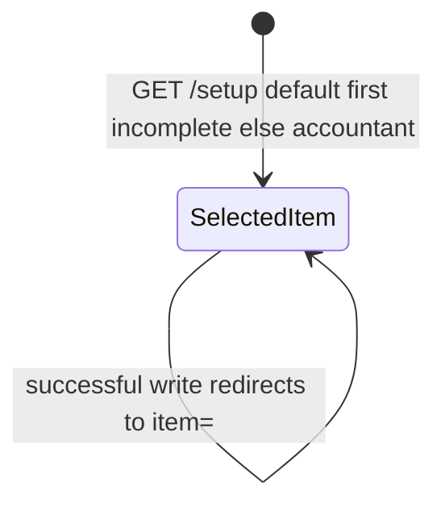
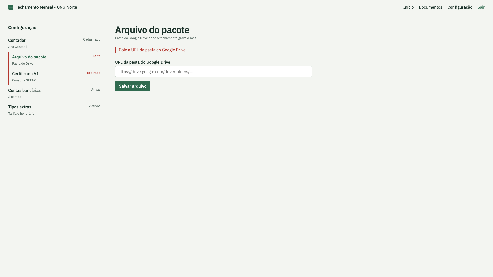

# Setup desk

**Approved**: 2026-11-19 - user: "siga com o plano agora por favor"

## Problem

Coordinator `GET /setup` stacks five equal chapters in a 72rem column: Contador, Armazenamento do pacote mensal, Certificado Digital A1, Contas bancárias, Tipos extras de exceção. Incomplete standing setup (blank Drive folder, missing or expired A1) sits in the middle of that scroll, with the same weight as a complete accountant. The evidence is the live `app/views/setup/show.html.erb` and the request to remodel Configuração like Início: items on the left, the selected item open on the right. The cost is scan time: what still blocks close setup is not visible until the coordinator scrolls.

When this ships, a coordinator opens Configuração on a two-pane desk. The left list names the five standing items and marks incomplete ones with `Falta` / `Expirado` and the red margin. The right pane is the selected item’s current form.

## Shape

Reuses `GET /setup`, `SetupController#show`, `load_setup`, and the existing accountant, package-archive, SEFAZ, bank-account, and extra-exception write routes. Incomplete status and the selected item are decided in `load_setup` (exists), in a layer request specs already reach — not only in the view. Writes keep today’s validation and toasts; the success redirect gains `item=` so the desk stays on the item just saved.

1. Coordinator `GET /setup` with optional `item` and existing `edit` / `bank_account_id` -> `SetupController#show` (exists) - calls `load_setup`
2. `ApplicationController#load_setup` (exists) - loads focused organization, bank catalog, bank accounts, extra exception kinds, editing bank account; decides each item’s complete/incomplete status; selects the item (`item` query when valid, else `edit=`’s item, else the first incomplete in list order, else `accountant`)
3. `setup/show` (exists) - two-pane desk as in `captures/setup-gaps.png`
4. out: `200` HTML; existing POSTs/PATCHes/DELETEs keep method, params, and status; success redirect is `/setup?item=<that item>` (plus today’s `edit=` when the write leaves a form open)

**Changes underneath**

| Front | What changes |
| --- | --- |
| domain | none - accountant, package archive, A1, bank account, extra exception kind keep their meaning |
| stored data | nothing to migrate |
| readers | coordinator `GET /setup`; success redirects from accountant / package-archive / SEFAZ / bank-account / extra-exception writes; specs in `setup_spec` / `setup_*_spec` / `page_helpers` that pin stacked `h2` `Armazenamento do pacote mensal`, `Certificado Digital A1 - Para consulta na SEFAZ`, `Tipos extras de exceção`, and `div.space-y-12`; `DESIGN.md` Two layouts / Desk Rule (setup is no longer a single ledger column) |

New: nothing - read only.

## Surface

| Route | In | Out | Status | Who |
| --- | --- | --- | --- | --- |
| `GET /setup` | optional `item`, optional `edit`, optional `bank_account_id` | HTML desk | `200`, `302` | signed-in coordinator with focused organization; unsigned and no-focus get `302` |

Accountant, package-archive, SEFAZ certificate, bank-account, base-document-exception, and extra-exception-kind writes keep method, params, status, and who may call. Success `Location` includes `item=` for the item just written.

## Landing

None at plan time - optional `item` on `GET /setup` and view composition reusing the home desk. No schema, no new route, no new dependency.

| Door | Decision (literal shape) | Rejected alternative |
| --- | --- | --- |
| Home `aria-current` on 422 | `organizations/show` sets `content_for :home_desk`. `principal_nav_link` treats `/` as current when that flag is set, not whenever `main_class` is present | Sharing `main_class` with Configuração would mark Início current on `GET /setup` |

- Nothing else in this change is hard to reverse

## Criteria

### S1: The desk matches the capture (P1)

A coordinator whose archive is blank and whose A1 is expired sees the first viewport the capture draws.

**Acceptance Criteria**

1. WHEN a coordinator whose organization has accountant `Ana Contábil`, a blank package-archive URL, an expired A1, two bank accounts, and the two base extra kinds active, GETs `/setup` THEN the system SHALL show the setup desk in `.specs/features/setup-desk/captures/setup-gaps.png` (`.specs/features/setup-desk/captures/setup-gaps.html`)
2. WHEN that coordinator GETs `/setup` THEN the header link `Configuração` SHALL have `aria-current="page"`
3. WHEN that coordinator GETs `/` THEN `Início` SHALL have `aria-current="page"` and `Configuração` SHALL not

### S2: The left list is the five standing items (P1)

List order is Contador, Arquivo do pacote, Certificado A1, Contas bancárias, Tipos extras. Incomplete items take the red margin and `Falta` or `Expirado` in `margem`.

**Acceptance Criteria**

4. WHEN a coordinator GETs `/setup` THEN the left column SHALL include heading `Configuração` and a `nav` `aria-label="Itens de configuração"` whose five titles are `Contador`, `Arquivo do pacote`, `Certificado A1`, `Contas bancárias`, `Tipos extras` in that order
5. WHILE the accountant presentation name is present, the Contador row SHALL include that name and `Cadastrado`, and SHALL not take the red margin
6. WHILE the package-archive URL is blank, the Arquivo do pacote row SHALL include `Pasta do Drive` and `Falta` in `margem`, and SHALL take the red margin
7. WHILE an A1 is installed and `sefaz_certificate_expired?`, the Certificado A1 row SHALL include `Consulta SEFAZ` and `Expirado` in `margem`, and SHALL take the red margin
8. WHILE no A1 is installed, the Certificado A1 row SHALL include `Falta` in `margem`, and SHALL take the red margin
9. WHILE an A1 is installed and not expired, the Certificado A1 row SHALL include `Instalado`, and SHALL not take the red margin
10. WHILE two bank accounts exist, the Contas bancárias row SHALL include `2 contas` and `Ativas`, and SHALL not take the red margin
11. WHILE no bank accounts exist, the Contas bancárias row SHALL include `Falta` in `margem`, and SHALL take the red margin
12. WHILE two extra kinds are active, the Tipos extras row SHALL include `2 ativos`, and SHALL not take the red margin
13. The Tipos extras row SHALL never take the red margin

### S3: Selecting an item fills the right desk (P1)

**Acceptance Criteria**

14. WHEN the coordinator uses the Arquivo do pacote row THEN the next request SHALL be `GET /setup?item=archive`
15. WHEN the coordinator GETs `/setup?item=certificate` THEN the Certificado A1 row SHALL be `aria-current="true"`, no other index row SHALL be, and the right column `<h1>` SHALL be `Certificado A1`
16. WHEN the coordinator GETs `/setup?item=accountant` THEN the right column `<h1>` SHALL be `Contador` and SHALL include today’s accountant leitura or cadastro
17. WHEN the coordinator GETs `/setup?item=banks` THEN the right column `<h1>` SHALL be `Contas bancárias` and SHALL include today’s bank-account sheet and Adicionar conta
18. WHEN the coordinator GETs `/setup?item=extras` THEN the right column `<h1>` SHALL be `Tipos extras` and SHALL include today’s extras sheet and Adicionar tipo extra
19. IF `item` is absent, empty, or not one of `accountant` `archive` `certificate` `banks` `extras`, THEN the selected item SHALL be the first incomplete in list order, or `accountant` when none are incomplete
20. WHEN `GET /setup` has no `item` and Contador is complete and Arquivo do pacote is `Falta` THEN the selected item SHALL be `archive` (the capture)
21. WHEN `GET /setup?edit=accountant` THEN the selected item SHALL be `accountant` even if another item is incomplete, and today’s accountant form SHALL be writable
22. WHEN `GET /setup?edit=package_archive` THEN the selected item SHALL be `archive` and today’s archive form SHALL be writable
23. WHEN `GET /setup?edit=bank_account` with a valid `bank_account_id` THEN the selected item SHALL be `banks` and today’s bank-account form SHALL be open for that row

### S4: The right pane is today’s item, not a new form (P1)

Field labels, leitura/cadastro, Instalar certificado, Desativar/Reativar/Excluir, and notices stay as today’s setup. The stacked 72rem chapter page goes away.

**Acceptance Criteria**

24. WHEN Arquivo do pacote is selected and the URL is blank THEN the right column SHALL include `Cole a URL da pasta do Google Drive` in `margem` and submit `Salvar arquivo`
25. WHEN Certificado A1 is selected and none is installed THEN the right column SHALL include `Não há certificado A1 instalado. Use Instalar certificado.`
26. WHEN Contador is selected and presentation name is blank THEN the right column SHALL include `Cadastre o contador` and today’s cadastro form
27. WHEN a write to accountant, package archive, A1, bank account, or extra kind succeeds THEN the redirect SHALL be `/setup?item=` of that item and today’s toast SHALL remain
28. WHEN a coordinator GETs `/setup` THEN the page SHALL not include heading `Armazenamento do pacote mensal`, SHALL not include heading `Certificado Digital A1 - Para consulta na SEFAZ`, SHALL not include heading `Tipos extras de exceção`, and SHALL not stack the five chapters in one scrolling column
29. WHEN a coordinator GETs `/setup` at a viewport below 768px THEN the two panes SHALL stack, as on coordinator Início
30. WHEN an unauthenticated request hits `/setup` THEN the system SHALL respond `302` to `/login`
31. IF a signed-in Account with no focused organization requests `/setup` THEN the system SHALL respond `302` to `/login`
32. WHEN a submitter GETs `/` THEN the header SHALL not include `Configuração`

## Out of scope

| Excluded | Why |
| --- | --- |
| Pin de pendências / Capítulos compositions | user locked Pendências na lista |
| Changing Início, Documentos, month overview, matching, close-for-send, Administração | setup only |
| New write routes or new standing fields | the five items already persist |
| Requiring archive, A1, or a bank account before the page can be saved | close-for-send still gates later |
| Submitter setup | Configuração is coordinator-only |
| Header `max-w-6xl` | existing shell; the capture is a full-bleed desk like Início |

## Assumptions

| Assumption | Chosen default | Rationale | Confirmed? |
| --- | --- | --- | --- |
| Composition | Pendências na lista: left index with red margin on incomplete items; right pane is the selected item | user: “Pendencias na lista ficou muito bom” | y |
| Left titles | `Contador`, `Arquivo do pacote`, `Certificado A1`, `Contas bancárias`, `Tipos extras` | capture; shorter than today’s `h2` | y |
| Incomplete | blank accountant presentation name; blank package-archive URL; missing or expired A1; zero bank accounts | capture marks archive `Falta` and certificate `Expirado`; empty banks is the same block | n |
| Tipos extras never incomplete | no red margin; status is `N ativos` | extras are optional offers, not close setup | n |
| Selected item URL | `GET /setup?item=accountant\|archive\|certificate\|banks\|extras` | shareable and testable, same idea as `year_month` on Início | n |
| Default item | first incomplete in list order, else `accountant` | capture opens Arquivo do pacote because it is the first `Falta` | n |
| `edit=` | still opens that item’s form and selects it | today’s cadastro/leitura must keep working | n |
| Success redirect | `/setup?item=<written item>` | otherwise the desk would jump to the next `Falta` and hide the save | n |
| Capture size | author’s `*.running.png` at 1920×1080 | that is the prototype tab that produced `setup-gaps.png` | n |
| DESIGN.md | Two layouts and the Desk Rule name Configuração as a desk beside Início | durable composition; documents/admin/month stay the 72rem column | n |

**Open questions:** none - remaining `n` rows are builder-safe defaults.

## Differences from the source

| Source shows | Product shows | Confirmed |
| --- | --- | --- |
| HTML mock loads IBM Plex from a relative `@font-face` or Google Fonts | Self-hosted IBM Plex from DESIGN.md; no `fonts.googleapis.com` | y - AD-0014 |
| Prototype scene switcher above the header | omitted | y - AD-0014 |

## Sources

- conversation (2026-11-19) - binding - remodel Configuração like Início; items on the left; open the selected item on the right; user: “Pendencias na lista ficou muito bom”
- `.impeccable/mocks/setup-desk.html` - binding - live prototype, Pendências na lista scene
-  - binding - first viewport: archive selected, archive `Falta`, certificate `Expirado`, both with red margin
- [setup-gaps.html](captures/setup-gaps.html) - binding - structural capture of that viewport
- `DESIGN.md` - established Livro-caixa; Desk Rule today limits the desk to Início
- `app/views/setup/show.html.erb` - incumbent stacked setup
- `.specs/features/home-desk-select/plan.md` - desk pattern to reuse
- [ADR-0001](../../../docs/adr/0001-rails-8-hotwire.md) - server-rendered HTML
