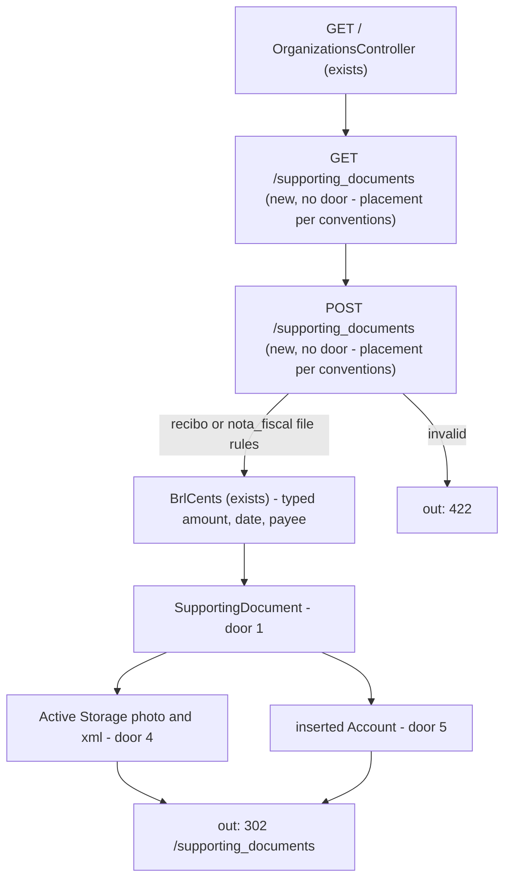
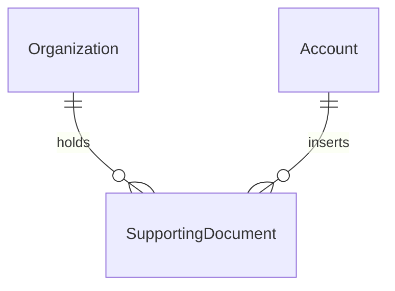

# Supporting document insert

Sources:

- https://github.com/gutors/ai-accounting-assistant/issues/32 - this cut: coordinator inserts photo and/or XML plus typed amount, date, and payee; document has no month until match or close-for-send
- https://github.com/gutors/ai-accounting-assistant/issues/3 - documents enter in the product, not only via WhatsApp/Drive; who inserts types amount, date, and payee; the photo is the proof
- https://github.com/gutors/ai-accounting-assistant/issues/2 - one flow: image photo/PDF and/or authorized XML; recibo is photo-only; image PDF of a DANFE or recibo counts as a photo
- https://github.com/gutors/ai-accounting-assistant/issues/11 - this cut is the typed/manual path only; SEFAZ consulta and photo reading stay out
- https://github.com/gutors/ai-accounting-assistant/issues/9 - authorized XML carries match keys (chave, emitente, dhEmi, vNF); this cut stores XML as an opaque file and does not read those tags
- https://github.com/gutors/ai-accounting-assistant/issues/20 - insert is on the organization at any time, including when no month is open; the coordinator sees no-month documents ordered by the document date
- https://github.com/gutors/ai-accounting-assistant/issues/14 - who inserts declares nota fiscal or recibo; typed fields are the fallback and stay correctable; XML as truth and field lock are #38
- `CONTEXT.md` - Supporting document, Recibo, Nota fiscal, Observation, Unmatched document (no month until match or close-for-send)
- [ADR-0001](../../../docs/adr/0001-rails-8-hotwire.md) - Rails 8 + Hotwire; working files behind the blob interface already chosen as Active Storage on bank-statement-upload

No design source for the screens. Verification stays on project profile `standard` (no binding screen, so not `ui`).

## Problem

A coordinator can open a month and import a bank statement, but payments still have no evidence in the product. Notes and receipts arrive on WhatsApp; the coordinator gathers them locally and later sends them to Drive. Matching, unmatched-in-package, and close-for-send have no Supporting document to read. Issue #32 gives no conversion figure; the cost is that every later close slice that needs a document is blocked.

When this ships, a coordinator of the focused organization inserts a supporting document (declares nota fiscal or recibo, types amount, date, and payee, attaches a photo and/or XML) and sees those no-month documents listed by date. The product still does not extract fields from the photo or XML, consult SEFAZ, confirm a match, or let a submitter in.

## Out of scope

| Excluded | Why |
| --- | --- |
| Submitter access, justification, “own documents” UI | #32; #35 |
| Identified or public SEFAZ consulta | #32; #38 |
| Reading the photo (OCR, barcode, QR, chave capture) | #32; #38 |
| Parsing uploaded XML for amount, date, payee, or chave | #32 typed path; #9 keys are for later extraction |
| Locking typed fields because XML is attached | #14/#38: lock after the file is actually read |
| Match, suggestion, document exception, missing document | #33 |
| Assigning a month, close-for-send, unmatched-in-package | #20 / #34 / #39 |
| Chave de acesso as a stored field | #14/#38 |
| Destroying a supporting document | this cut has no delete; replace files instead |
| Drive writes or reading the package archive | working files are Active Storage; Drive is close-for-send |
| Creating or opening a Month as part of insert | #20: insert does not need a month |
| Accountant login | accountant is not an operator |

## Assumptions

| Assumption | Chosen default | Rationale | Confirmed? |
| --- | --- | --- | --- |
| Where the UI lives | dedicated `/supporting_documents` of the focused organization; home (`/`) gains a `Documentos` link | #20 puts insert on the organization, not on a month; `/setup` already used a dedicated page so home stays access + months | y |
| Kind in this cut | required `nota_fiscal` or `recibo` at insert (and editable later) | CONTEXT and #2: who inserts declares the kind; recibo is photo-only. #38 names declaration as the start of extraction, not as the first time the field exists | y |
| Recibo files | photo required; XML rejected | #2: recibo só no caminho da foto | y |
| Nota fiscal files | at least one of photo or XML; both allowed | #2 / CONTEXT: foto e/ou XML | y |
| Photo formats | `.jpg`, `.jpeg`, `.png`, `.webp`, `.pdf` on the photo attachment; not `.heic` | CONTEXT: image PDF counts as a photo; WhatsApp already converts HEIC; statements already bound by extension | y |
| XML format | `.xml` only; bytes stored opaquely; not schema-validated | this cut does not parse; #38 will fail a bad XML when it reads it | y |
| Typed fields | amount, date, and payee required on every successful insert, including when XML is attached | #32 recorte; without parsing, XML cannot fill the three fields | y |
| Amount parsing | `BrlCents.parse`; persist integer cents; reject blank, unparseable, and `0` | AGENTS.md money lock; a zero-amount document is not evidence of a payment | y |
| Date | calendar date on the document (`YYYY-MM-DD` in); display `dd/mm/YYYY`; it is not a month assignment | CONTEXT: date is a hint | y |
| Payee | trimmed, 1–200 characters | name the coordinator types; a bound stops a paste dump | y |
| Observation | optional; trimmed; blank stores none; at most 2000 characters | CONTEXT: optional on a supporting document; XML-lock later uses it | y |
| File bound | each of photo and XML at most 10 MiB (`10485760` bytes) | same operator bound as statement files | y |
| List order | document date descending, then id descending on a tie | #20: ordered by document date; newest incoming first in the no-month pool | y |
| Duplicates | two documents with the same amount, date, and payee both persist | two receipts of the same purchase are real; there is no natural unique key | y |
| Edit | `PATCH` of kind, amount, date, payee, observation; omitted file keeps the existing blob; a new file replaces that blob | #14: typed path stays correctable; no destroy in this cut | y |
| Kind change to recibo | same PATCH must satisfy recibo file rules (photo present, XML gone). Changing to recibo purges XML | #14: nota→recibo discards XML; a recibo cannot keep XML | y |
| Inserter | persist the current Account; not shown in the UI this cut | #35 will need “own documents”; omitting it forces a backfill of missing authors | y |
| No month column | SupportingDocument belongs to Organization only; no `Month` association in this cut | matching (#33) and close-for-send (#34) own month assignment; an unused FK would sit empty | y |
| Replace confirm | none | statement replace already has no confirm; this is the same operator | y |
| Production Disk | not chosen here; local Disk only, same as statements | container disk is ephemeral; brand is not locked | y |

**Open questions:** none - all resolved or logged above.

## Criteria

Grouped by slice. Numbering runs across the whole plan.

### S1: Documents page (P1)

**Acceptance Criteria**

1. WHEN an unauthenticated request hits `GET /supporting_documents` THEN the system SHALL respond `302` to `/login`
2. IF a signed-in Account with no focused organization requests `GET /supporting_documents` THEN the system SHALL respond `302` to `/login`
3. WHEN a coordinator with a focused organization opens `/` THEN the system SHALL include a link whose text is `Documentos` and whose href is `/supporting_documents`
4. WHEN a coordinator with a focused organization opens `/supporting_documents` THEN the system SHALL respond `200`, render with default locale `pt-BR`, and include the heading `Documentos de suporte`
5. WHEN the focused organization has no SupportingDocument THEN `/supporting_documents` SHALL include the text `Nenhum documento`
6. WHEN the focused organization has no Month THEN `GET /supporting_documents` SHALL respond `200`
7. WHILE focus is organization A, `GET /supporting_documents` SHALL not include payee text that exists only on organization B’s supporting documents

**Independent test:** sign in, open `Documentos` from home with no documents (`Nenhum documento`); open the page with no month opened (`200`); switch focus and confirm the other organization’s payee is absent.

### S2: Recibo insert (P1)

**Acceptance Criteria**

8. WHEN a coordinator POSTs `kind=recibo`, amount `155,00`, date `2026-05-11`, payee `Padaria Central`, a `.jpg` photo, and no XML THEN the system SHALL persist one SupportingDocument for the focused organization, respond `302` to `/supporting_documents`, and that page SHALL include `11/05/2026`, `R$ 155,00`, `Padaria Central`, `Recibo`, and that photo’s original filename
9. The system SHALL persist that amount as integer cents (`15500` for `R$ 155,00`)
10. WHEN that insert succeeds THEN the SupportingDocument SHALL have a photo blob retrievable through Active Storage (not through Drive) and SHALL have no XML blob
11. WHEN that insert succeeds THEN the SupportingDocument SHALL belong to the inserting Account and SHALL belong to no Month
12. IF a coordinator POSTs `kind=recibo` with amount, date, and payee but no photo THEN the system SHALL persist no SupportingDocument and respond `422` with the text `Envie a foto do recibo`
13. IF a coordinator POSTs `kind=recibo` with a photo and an XML file THEN the system SHALL persist no SupportingDocument and respond `422` with the text `Recibo não tem XML`
14. IF an unauthenticated request POSTs a supporting document THEN the system SHALL persist no SupportingDocument and respond `302` to `/login`

**Independent test:** insert a recibo jpeg with `155,00` / `2026-05-11` / `Padaria Central`, see `R$ 155,00` and `Recibo`; POST recibo without photo (`422`); POST recibo with XML (`422`).

### S3: Nota fiscal insert (P1)

**Acceptance Criteria**

15. WHEN a coordinator POSTs `kind=nota_fiscal`, amount `155,00`, date `2026-05-11`, payee `Padaria Central`, a `.jpg` photo, and no XML THEN the system SHALL persist one SupportingDocument with a photo blob, no XML blob, respond `302` to `/supporting_documents`, and that page SHALL include `Nota fiscal` and that photo’s original filename
16. WHEN a coordinator POSTs `kind=nota_fiscal`, the same typed fields, an `.xml` file, and no photo THEN the system SHALL persist one SupportingDocument with an XML blob, no photo blob, and `/supporting_documents` SHALL include that XML’s original filename
17. WHEN a coordinator POSTs `kind=nota_fiscal` with both a photo and an XML file THEN the system SHALL persist one SupportingDocument that has both blobs
18. IF a coordinator POSTs `kind=nota_fiscal` with amount, date, and payee but neither photo nor XML THEN the system SHALL persist no SupportingDocument and respond `422` with the text `Envie a foto e/ou o XML`
19. WHEN a coordinator POSTs `kind=nota_fiscal` with typed amount `155,00` and an XML file whose bytes include `<vNF>100.00</vNF>` THEN the system SHALL persist amount cents `15500`

**Independent test:** insert NF photo-only, XML-only, and both; POST NF with neither file (`422`); POST XML containing `vNF` 100.00 with typed `155,00` and confirm cents `15500`.

### S4: List, edit, isolation, bounds (P1)

**Acceptance Criteria**

20. WHEN a coordinator POSTs a document dated `2026-05-12` after one dated `2026-05-11` THEN `GET /supporting_documents` SHALL include `12/05/2026` before `11/05/2026`
21. WHEN a coordinator POSTs a second document with the same amount, date, and payee as an existing one THEN the system SHALL persist both
22. WHEN a coordinator PATCHes payee `Mercado Silva` on a SupportingDocument of the focused organization THEN the system SHALL persist that payee, respond `302` to `/supporting_documents`, and that page SHALL include `Mercado Silva` and SHALL not include the previous payee
23. WHEN a coordinator PATCHes only payee and omits files THEN the photo and XML blobs SHALL remain
24. WHEN a coordinator PATCHes a new photo onto a document that already has a photo THEN `/supporting_documents` SHALL include the new original filename and SHALL not include the previous photo filename
25. WHEN a coordinator POSTs observation `pago em dinheiro` THEN `/supporting_documents` SHALL include `pago em dinheiro`
26. WHEN a coordinator POSTs with observation blank THEN the system SHALL persist the SupportingDocument and `/supporting_documents` SHALL not require the text `pago em dinheiro`
27. IF a coordinator POSTs amount `0` or a blank amount THEN the system SHALL persist no SupportingDocument and respond `422` with the text `Informe valor, data e favorecido`
28. IF a coordinator POSTs a blank payee THEN the system SHALL persist no SupportingDocument and respond `422` with the text `Informe valor, data e favorecido`
29. IF a coordinator POSTs a date that is not a calendar date THEN the system SHALL persist no SupportingDocument and respond `422` with the text `Informe valor, data e favorecido`
30. IF a coordinator POSTs `kind` that is neither `nota_fiscal` nor `recibo` THEN the system SHALL persist no SupportingDocument and respond `422` with the text `Informe se é nota fiscal ou recibo`
31. IF a coordinator POSTs a photo or XML larger than `10485760` bytes THEN the system SHALL persist no SupportingDocument and respond `422` with the text `Cada arquivo pode ter no máximo 10 MB`
32. IF a coordinator POSTs a photo whose filename extension is not `.jpg`, `.jpeg`, `.png`, `.webp`, or `.pdf` THEN the system SHALL persist no SupportingDocument and respond `422` with the text `A foto deve ser JPEG, PNG, WebP ou PDF`
33. IF a coordinator POSTs an XML whose filename extension is not `.xml` THEN the system SHALL persist no SupportingDocument and respond `422` with the text `O XML deve ser um arquivo .xml`
34. IF a coordinator POSTs a payee longer than 200 characters THEN the system SHALL persist no SupportingDocument and respond `422` with the text `Favorecido pode ter no máximo 200 caracteres`
35. IF a coordinator PATCHes an id that belongs only to organization B WHILE focused on organization A THEN the system SHALL leave organization B unchanged and respond `404`
36. IF a coordinator PATCHes `kind=recibo` on a nota fiscal that has XML and no photo, without attaching a photo THEN the system SHALL leave the document unchanged and respond `422` with the text `Envie a foto do recibo`
37. WHEN a coordinator PATCHes `kind=recibo` together with a photo on a nota fiscal that had an XML blob THEN the SupportingDocument SHALL have kind recibo, SHALL have that photo, and SHALL have no XML blob
38. IF two concurrent POSTs each insert a valid recibo THEN the system SHALL persist two SupportingDocuments
39. IF a request sends `DELETE /supporting_documents/:id` THEN the system SHALL leave the SupportingDocument in place and respond `404`
40. IF an unauthenticated request PATCHes a supporting document THEN the system SHALL leave it unchanged and respond `302` to `/login`

**Independent test:** insert two dates and see newest first; insert a duplicate triple and still have two rows; PATCH payee; POST 10 MiB+1 (`422`); PATCH org B’s id from org A (`404`); DELETE (`404`).

## Traceability

| ID | Slice | Criteria | Status |
| --- | --- | --- | --- |
| DOC-01 | S1 | 1, 2, 3, 4, 5, 6, 7 | Implementing |
| DOC-02 | S2 | 8, 9, 10, 11, 12, 13, 14 | Implementing |
| DOC-03 | S3 | 15, 16, 17, 18, 19 | Implementing |
| DOC-04 | S4 | 20, 21, 22, 23, 24, 25, 26, 27, 28, 29, 30, 31, 32, 33, 34, 35, 36, 37, 38, 39, 40 | Implementing |

## Observable

| Surface | Decision | Landing |
| --- | --- | --- |
| screen `/` | empty state | existing - months empty copy unchanged; this cut only adds the `Documentos` link |
| screen `/` | loading | n/a - Turbo full-page / redirect |
| screen `/` | error / unauthorised | existing - unauthenticated `/` is `302` `/login` |
| screen `/` | destructive action confirms | existing - revoke still confirms on home |
| screen `/` | density and ordering | n/a - one new link, no new collection on home |
| screen `/supporting_documents` | empty state | AC 5 |
| screen `/supporting_documents` | loading | n/a - Turbo full-page / redirect |
| screen `/supporting_documents` | error state | AC 12, AC 13, AC 18, AC 27, AC 28, AC 29, AC 30, AC 31, AC 32, AC 33, AC 34, AC 36 |
| screen `/supporting_documents` | unauthorised | AC 1, AC 2, AC 14, AC 40 |
| screen `/supporting_documents` | density and ordering | AC 8, AC 20 |
| screen `/supporting_documents` | destructive action confirms | n/a - no destroy; file replace is the same PATCH |
| screen `/supporting_documents` | no month opened | AC 6 |
| HTML `GET /supporting_documents` | who may call it | AC 4, AC 1, AC 2 |
| HTML `GET /supporting_documents` | error shape and codes | AC 1, AC 2 |
| HTML `GET /supporting_documents` | versioning | n/a - first HTML surface for this resource, no published API version |
| HTML `GET /supporting_documents` | rate limit | n/a - coordinator-only, small operator set |
| HTML `POST /supporting_documents` | who may call it | AC 8, AC 14 |
| HTML `POST /supporting_documents` | error shape and codes | AC 12, AC 13, AC 14, AC 18, AC 27, AC 28, AC 29, AC 30, AC 31, AC 32, AC 33, AC 34 |
| HTML `POST /supporting_documents` | versioning | n/a - first HTML surface |
| HTML `POST /supporting_documents` | rate limit | n/a - coordinator-only |
| HTML `PATCH /supporting_documents/:id` | who may call it | AC 22, AC 35, AC 40 |
| HTML `PATCH /supporting_documents/:id` | error shape and codes | AC 35, AC 36, AC 40 |
| HTML `PATCH /supporting_documents/:id` | versioning | n/a - first HTML surface |
| HTML `PATCH /supporting_documents/:id` | rate limit | n/a - coordinator-only |
| HTML `DELETE /supporting_documents/:id` | who may call it | AC 39 - nobody; always `404` |
| HTML `DELETE /supporting_documents/:id` | error shape and codes | AC 39 |
| HTML `DELETE /supporting_documents/:id` | versioning | n/a - no delete resource |
| HTML `DELETE /supporting_documents/:id` | rate limit | n/a - no successful delete |
| collection supporting documents | grouping | AC 7, AC 11 - focused organization; no month |
| collection supporting documents | naming | AC 8, AC 15 - payee, kind labels `Recibo` / `Nota fiscal`, original filenames |
| collection supporting documents | ordering | AC 20 |
| collection supporting documents | duplicates | AC 21 |
| collection supporting documents | exception that does not fit | AC 5, AC 12, AC 13, AC 18 - empty list; recibo without photo; recibo with XML; NF with neither file |

## Flow

This reuses `require_account`, `focused_organization`, Active Storage (Disk in development/test), and `BrlCents`. It does not parse XML, call SEFAZ, or assign a Month.

Unauthenticated HTML on these routes still goes through `ApplicationController` (exists) to `302` `/login`. Recibo requires photo and rejects XML; nota fiscal requires photo and/or XML. `PATCH` retraces the same kind rules on an existing row.

## Relations

One-way constraints: kind not null with `nota_fiscal` or `recibo` in the enum (door 2), amount and date and payee always present (door 3), observation optional (door 3), inserted Account required (door 5), no Month association (door 1). No uniqueness on amount, date, or payee. No columns and no types here.

## Surface

| Route | In | Out | Status |
| --- | --- | --- | --- |
| `GET /` | session · focus | home HTML · `Documentos` link | `200`, `302` |
| `GET /supporting_documents` | session · focus | documents HTML · form · list | `200`, `302` |
| `POST /supporting_documents` | session · focus · kind · amount · date · payee · observation · photo · xml | SupportingDocument · redirect or documents HTML | `302`, `422` |
| `PATCH /supporting_documents/:id` | session · focus · same fields as POST | SupportingDocument · redirect or documents HTML | `302`, `422`, `404` |
| `DELETE /supporting_documents/:id` | session · id | none | `404` |

## Landing

| One-way door | Literal shape | Alternative rejected |
| --- | --- | --- |
| 1. SupportingDocument is organization-scoped and has no month | `SupportingDocument` belongs to `Organization`; this cut adds no association to `Month`. Identity is the row itself (append-only collection). | Belonging to a Month at insert — #20: date is not a month assignment, and insert must work with every month closed. A global document not scoped to Organization — files would leak. |
| 2. Kind is an enum of two values | Rails enum `kind` with persisted values `nota_fiscal` and `recibo`, same pattern as `Access.kind`. Required on every row. | A boolean `recibo?` — cannot grow a third kind. Deferring kind to #38 — a recibo could store XML and #38 would have to backfill. |
| 3. Amount, date, and payee are always stored; observation is optional | Amount is integer cents; date is the document calendar date; payee is required text; observation may be absent. This cut always writes the three from the form. | Filling the three by parsing XML in this cut — #32 is typed; #38 owns extraction. Making the three optional when XML is attached — without a parse, the list would have rows with no amount to match on. |
| 4. Photo and XML are Active Storage attachments | `SupportingDocument has_one_attached :photo` and `has_one_attached :xml`; `config.active_storage.service` stays `:test` / `:local` Disk from bank-statement-upload. Drive is not a service. | A second blob port — statements already ship Active Storage. Putting files on Drive at insert — Drive is only the package archive at close-for-send. Required photo in the schema — NF XML-only is valid. |
| 5. Inserter is the operator Account | `SupportingDocument` belongs to `Account` as the inserter; required; destroy of that Account stays restricted. Not shown in this cut’s HTML. | Omitting author until #35 — submitter “own documents” cannot reconstruct who inserted. Storing Access instead of Account — Access can be revoked while the document remains. |

- Nothing else in this change is hard to reverse. File extensions, the 10 MiB bound, and list order are criteria, not doors. Month assignment, XML field lock, and destroy stay in later cuts.

## Impact

| Front | What changes |
| --- | --- |
| domain | existing term: `Supporting document` — first persisted as an organization-level row with kind, typed amount/date/payee, optional observation, and photo and/or XML blobs; still has no month and no match |
| domain | existing term: `Nota fiscal` / `Recibo` — first stored as `kind` on that row |
| domain | existing term: `Observation` — first stored on the supporting document (optional) |
| domain | existing term: `Unmatched document` — every document this cut creates (no match exists yet); not a separate entity |
| stored data | no supporting-document rows to migrate. Organizations, months, and statements unchanged. Active Storage tables already exist from bank-statement-upload |
