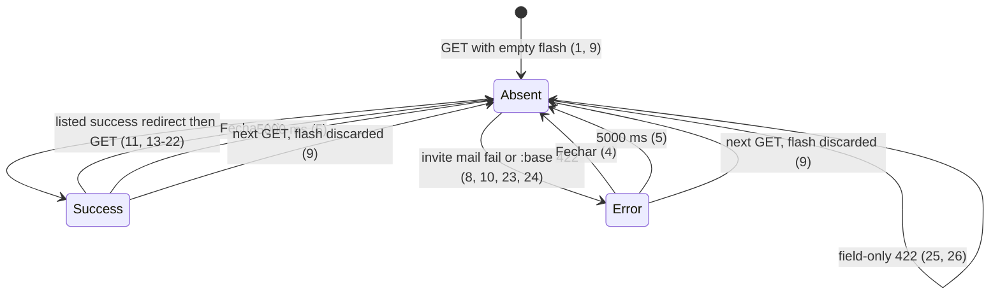

# Action result toast

> Build this with **tlc-implement**. Profile **`ui`**: layout toast plus screens `home`,
> `documents`, `setup`; binding design `.specs/features/visual-identity/design.md`.
> Every criterion below becomes a check with a proof, referenced by its number. Nothing under
> `Unresolved` gets settled while building.

## Intent

A coordinator finishes an action and the page looks the same as before it: invite send, resend,
cancel, open month, focus change, document insert, setup save, and certificate install or remove
all redirect with no sentence. The one exception is worse: `session[:invite_mail_failed]` paints
`O convite foi gravado, mas o e-mail não saiu.` as a `[data-notice="error"]` stuck under `Meses`
until a later send succeeds. Cancel does not clear it. Field `:base` errors already sit as that
notice under the page title; they do not tell the person a one-shot action finished. Issue #76
gives no conversion figure; the cost is a false “nothing happened” on success and a leftover
mail-failure banner that is not about the months list.

When this ships, those action results are a banner toast at the top of the layout: success in
`caixa`, error in `margem`, dismissible, gone after `5000` ms. Field validation stays on the form
and on the existing notice. A `422` that already has a `:base` / notice string also shows that
same string as an error toast. The stuck invite-mail notice under `Meses` is gone; per-invite
email status stays for #78. Screens `home`, `documents`, and `setup` plus the application layout
are binding through the toast section added to `.specs/features/visual-identity/design.md`.

26 criteria in 4 slices · 2 one-way doors · 3 open, of which 0 block

## Criteria

### Toast chrome

1. Given a signed-in coordinator on the focused organization and no toast in `flash`, when `GET /` runs, then the status is `200`, the body has no `[data-toast]`, and it does not include `O convite foi gravado, mas o e-mail não saiu.`
2. When a success toast is present, then the layout renders one `[data-toast][data-toast-kind="success"]` immediately after `header` and before `main`, with `role="status"`, the message text, a `button` whose text is `Fechar`, classes that include `bg-caixa` and `text-white`, and `data-toast-timeout-ms="5000"`. It does not use `[data-notice]`.
3. When an error toast is present, then the layout renders one `[data-toast][data-toast-kind="error"]` in that same place, with `role="alert"`, the message text, a `button` `Fechar`, classes that include `text-margem` and `border-l-[3px]` and `border-margem`, and `data-toast-timeout-ms="5000"`.
4. When `Fechar` on a visible toast is activated, then that `[data-toast]` node is gone before `5000` ms elapse.
5. While a toast is visible and `5000` ms elapse without `Fechar`, that `[data-toast]` node is gone.
6. Always, this task ships no CSS `transition` or `@keyframes` for the toast. `prefers-reduced-motion` does not change the `5000` ms timeout.
7. `.specs/features/visual-identity/design.md` contains a Toast component: position immediately after `header` and before `main`, success colour `caixa`, error colour `margem`, timeout `5000` ms, dismiss `Fechar`; and the Motion bullet no longer claims that `
` opening is the only state change — it names the toast timeout as the other user-triggered result (the action that produced the toast).

### Invite mail is one-shot, not stuck under Meses

8. Given `POST /coordinator_invites` persists the Invite and `deliver_now` raises, then the Invite remains, `session[:invite_mail_failed]` is not `true`, the response is `302` to `/`, and the following `GET /` is `200` with `[data-toast-kind="error"]` text `O convite foi gravado, mas o e-mail não saiu.` and with no `[data-notice="error"]` that text. Delivery still runs after the Invite commit; the error is still rescued.
9. Given that following `GET /` showed the error toast, when a second `GET /` runs with no action in between, then the body has no `[data-toast]` and does not include `O convite foi gravado, mas o e-mail não saiu.`
10. Given a pending Invite, when `POST .../mail` (`Reenviar e-mail`) runs and `deliver_now` raises, then the Invite remains and the following `GET /` matches the toast and notice absences in criterion 8.
11. Given the error toast from criterion 8 would have been the stuck notice, when `DELETE` `Cancelar` deletes that Invite, then the Invite is gone, no message is delivered, and the following `GET /` has `[data-toast-kind="success"]` text `Pronto.` and does not include `O convite foi gravado, mas o e-mail não saiu.`
12. `.design/administration-list.md` section `Screen home invites` no longer says a failed send is a notice under the `Meses` title that `Cancelar` does not clear; it says that failure is the error toast in criteria 8–10 and that per-invite mail status is #78.

### Listed successes

13. Given `POST /coordinator_invites` persists the Invite and delivery succeeds, when the following `GET /` runs, then the body has `[data-toast-kind="success"]` text `Pronto.`, has no `[data-notice="error"]` for that send, and includes the pending email with `Reenviar e-mail` then `Cancelar`.
14. Given `POST /submitter_invites` persists a submitter Invite and delivery succeeds, when the following `GET /` runs, then the body has `[data-toast-kind="success"]` text `Pronto.`
15. Given a pending Invite, when `POST .../mail` delivers, then the following `GET /` has `[data-toast-kind="success"]` text `Pronto.`
16. When `POST /months` with `year_month` `2026-05` persists the Month, then the response is `302` to `/months/2026-05` and the following `GET` has `[data-toast-kind="success"]` text `Pronto.`
17. Given the Account has coordinator Access to `ONG Norte` (focused) and `ONG Sul`, when `POST /focus` with `ONG Sul`’s id runs, then the response is `302` to `/`, the following `GET /` has `[data-toast-kind="success"]` text `Pronto.`, and the `ONG Sul` switcher control has `aria-current="true"`.
18. When `POST /supporting_documents` inserts a recibo with photo and the other required fields, then the response is `302` to `/supporting_documents` and the following `GET` has `[data-toast-kind="success"]` text `Pronto.`
19. When `PATCH /accountant` persists a valid accountant, then the response is `302` to `/setup` and the following `GET` has `[data-toast-kind="success"]` text `Pronto.`
20. When `PATCH /package_archive` persists a Drive folder URL, then the response is `302` to `/setup` and the following `GET` has `[data-toast-kind="success"]` text `Pronto.`
21. When `POST /sefaz_certificate` installs a valid e-CNPJ A1, then the response is `302` to `/setup` and the following `GET` has `[data-toast-kind="success"]` text `Pronto.`
22. Given a certificate is installed, when `DELETE /sefaz_certificate` runs, then the response is `302` to `/setup` and the following `GET` has `[data-toast-kind="success"]` text `Pronto.` and includes `Nenhum certificado`.

### Action 422 keeps the notice and adds a toast; field 422 does not

23. When `POST /supporting_documents` is a recibo without photo, then the status is `422`, `[data-notice="error"]` is `Envie a foto do recibo`, and `[data-toast-kind="error"]` is `Envie a foto do recibo`.
24. When `POST /sefaz_certificate` is rejected as not a vigente e-CNPJ A1, then the status is `422`, `[data-notice="error"]` is `O certificado deve ser e-CNPJ A1 vigente`, and `[data-toast-kind="error"]` is that same string.
25. When `POST /coordinator_invites` submits `nao-e-email`, then the status is `422`, no Invite is written, the body has no `[data-toast]`, and there is no new field notice this task adds.
26. When `PATCH /accountant` without presentation name returns `422`, then no toast is present (`[data-toast]` absent). Existing field behaviour is unchanged.

## States

`session[:invite_mail_failed]` is not a state after this task. Per-invite mail status is unchanged and belongs to #78.

## Out of scope

- Persisted email status on each pending invite row — #78
- Home month-field defaults and the limited month list — #77
- Document insert form layout — #79
- Setup copy, counters, bank accounts, extra exception kinds — #80–#84
- Keeping typed fields on document and A1 `422` — #85
- Administration notices, welcome mail, and `session[:administration_result]` — seller screens keep `[data-notice="error"]`; they do not use this toast
- Login, denied, OIDC, `DELETE /session`
- Month close-for-send, restore, reopen, matches, document exceptions, bank statements, justifications, accesses `Revogar`, extra-kind and bank-account mutations — later children set the same `flash` keys
- Inventing field notices on home invite or accountant `422` where the page has none today (25, 26)
- Per-action success sentences beyond `Pronto.` unless Unresolved 1 overrides it

## Observable

| Surface | Decision | Landing |
| --- | --- | --- |
| layout toast | empty state | 1 — no `[data-toast]` until an action writes `flash` |
| layout toast | loading state | n/a — HTML arrives with the page; no pending spinner |
| layout toast | error state | 3, 8, 10, 23, 24 |
| layout toast | unauthorised | existing — unsigned-in mutations stay `302` `/login`; this task does not toast that |
| layout toast | density and ordering | 2, 3 — one toast, after `header`, before `main`; `Fechar` with the message |
| layout toast | destructive action confirms | existing — `data-turbo-confirm` on `Remover` and `Revogar` is unchanged |
| screen `home` | empty state | existing — `Nenhum mês aberto` and empty pending list stay; toast is not an empty-home sentence |
| screen `home` | error state | 8, 10 — mail failure is the toast, not the notice under `Meses` |
| screen `home` | unauthorised | existing — submitter home has no invite forms |
| screen `documents` | error state | 23 — notice under the title stays; toast is extra |
| screen `setup` | error state | 24 — certificate notice stays; toast is extra |
| document `.specs/features/visual-identity/design.md` | structure, tone, depth, next action | 7 |
| document `.design/administration-list.md` home invites | structure, tone, depth, next action | 12 |
| collection of toasts | grouping, naming, ordering, duplicates | 2, 3 — at most one toast; a later action replaces `flash`; no queue |

## Swept

- validation: 25, 26 — field-only `422` does not toast; 23, 24 toast the existing `:base` string and keep the notice
- failure modes: 8, 10 — SMTP raise after Invite commit; 23, 24 — `:base` `422`
- idempotency and retry: 9 — flash is discarded after the GET that renders it; a second GET has no toast. Resend still delivers again (existing)
- authorization: existing — `require_account`, `require_coordinator_organization`, `require_focused_organization`; `404`/`302` paths do not set a toast
- concurrency and ordering: n/a — one session cookie; two overlapping POSTs leave whichever `flash` was written last; no shared toast store
- data lifecycle: 8, 9 — `session[:invite_mail_failed]` is not kept as the mail-failure channel; leftover true on an old session is not read. Rails `flash` dies with `reset_session` on sign-in (existing `sign_in`)
- external-dependency failure: 8, 10 — invite SMTP; certificate and document `:base` strings stay the product copy (23, 24)
- state transitions: 4, 5, 8, 9, 11
- observability: n/a — the source names no log, metric, or trace; the person sees the toast

## Impact

| Front | What changes |
|---|---|
| domain | no new glossary term — `CONTEXT.md` stays as it is |
| domain | existing term: home invite mail failure — meant a sticky `session[:invite_mail_failed]` boolean rendered as `[data-notice="error"]` under `Meses`. Now a one-request error toast. Callers: `CoordinatorInvitesController`, `SubmitterInvitesController`, `ApplicationController#load_home`, `app/views/organizations/show.html.erb`, `spec/requests/coordinator_invites_spec.rb`, administration-access C42–C47 (historical checks describe the old notice) |
| stored data | nothing to migrate — flash is request-scoped; no column |

## Decided

| Decision | Shape | Alternative rejected |
|---|---|---|
| One-shot channel | Rails `flash[:toast]` is the message string; `flash[:toast_kind]` is `success` or `error`. Redirects use `flash`; `422` re-renders use `flash.now`. The application layout is the only renderer. Later #75 children set these keys; they do not invent a second banner | Keep `session[:invite_mail_failed]`: it sticks across Cancel and unrelated GETs, which #76 replaces. A new session boolean per action would repeat that stickiness |
| Action-result UI | Layout `[data-toast]` after `header`, before `main`; success `caixa` fill; error `margem` rule like `[data-notice="error"]` but not that notice; timeout `5000` ms; dismiss `Fechar`. Stimulus removes the node (browser timer). Design.md Motion lists this timeout as a result of the action that set the toast | Reuse `[data-notice="error"]` under each `h1`: that is the field and `:base` notice #76 keeps, and it has no success colour. A page-local banner under `Meses` is what this slice removes |

## Surface

| Route | In | Out | Status | Criteria |
|---|---|---|---|---|
| layout | `flash[:toast]`, `flash[:toast_kind]` | `[data-toast]` or none | with the page | 1–6, 9 |
| `POST /coordinator_invites` | `email` | redirect or home `422` | `302`, `422` | 8, 13, 25 |
| `POST /submitter_invites` | `email` | redirect or home `422` | `302`, `422` | 14 |
| `POST /coordinator_invites/:id/mail` and submitter equivalent | id | redirect | `302`, `404` | 10, 15 |
| `DELETE /coordinator_invites/:id` and submitter equivalent | id | redirect | `302`, `404` | 11 |
| `POST /months` | `year_month` | redirect or home `422` | `302`, `422` | 16 |
| `POST /focus` | `organization_id` | redirect | `302`, `404` | 17 |
| `POST /supporting_documents` | insert fields | redirect or index `422` | `302`, `422` | 18, 23 |
| `PATCH /accountant` | accountant fields | redirect or setup `422` | `302`, `422` | 19, 26 |
| `PATCH /package_archive` | `url` | redirect or setup `422` | `302`, `422` | 20 |
| `POST /sefaz_certificate` | file, passphrase | redirect or setup `422` | `302`, `422` | 21, 24 |
| `DELETE /sefaz_certificate` | — | redirect | `302` | 22 |

## Sources

- https://github.com/gutors/ai-accounting-assistant/issues/76 — **binding for this slice**: toast at the top, ~5s, dismissible, success and error of the listed actions, field validation stays, `422` `:base`/notice also toasts, replace `session[:invite_mail_failed]`, per-invite status is the invites child, extend visual-identity design, tlc-implement profile `ui`
- https://github.com/gutors/ai-accounting-assistant/issues/75 — parent: toast first; other children consume the helper; toast only for action result; field validation stays on the form; error toast is extra
- `.specs/features/visual-identity/design.md` — **binding for the interface** once criterion 7 lands: tokens `caixa`/`margem`, existing Notice under the title, Motion, `prefers-reduced-motion`. This task adds the Toast component there
- `app/views/shared/_notice.html.erb` — existing error notice: `role="alert"` `data-notice="error"` `border-l-[3px] border-margem pl-3 text-margem`
- `app/views/organizations/show.html.erb` — today’s stuck notice under `Meses` when `@invite_mail_failed`
- `.design/administration-list.md` — today’s home invite mail-failure paragraph that criterion 12 amends
- `app/javascript/controllers/` — Stimulus is already eager-loaded; `hello_controller.js` is unused. Browser timeout and dismiss are Stimulus events (`rails.mdc`)
- Open defaults in Unresolved 1–3 — success copy `Pronto.`, dismiss `Fechar`, timeout `5000` ms, until a human overrides them

This task is the record of decision. If a linked document diverges, ask before building.

## Unresolved

| # | Kind | Question | Until answered |
|---|---|---|---|
| 1 | open | What is the success sentence? #76 lists actions and does not give Portuguese copy. | `Pronto.` on every listed success (11, 13–22) |
| 2 | open | What is the dismiss control’s accessible name? | Button text `Fechar` (2, 3, 4) |
| 3 | open | Exact timeout for “~5s”? | `5000` ms, including under `prefers-reduced-motion` (5, 6) |
