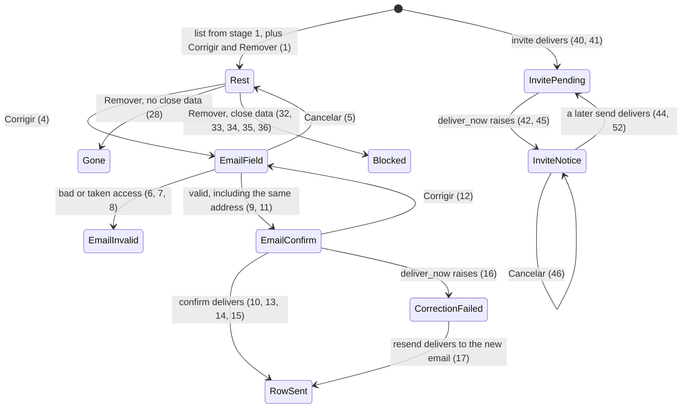

# Administration access

> Build this with **tlc-implement**. Profile **ui** — this task names screens `administration` and `home`.
> Stage 2 of 2. Start only after `.tasks/administration-list.md` is built. Do not redo that stage.
> Every criterion below becomes a check with a proof, referenced by its number. Nothing under
> `Unresolved` gets settled while building.

## Intent

The list shows each coordinator email and can rename the organization, and it still cannot fix a wrong coordinator address or remove an organization that should not have been opened. Pending invites sit on the organization home and are never mailed. The person named by mistake cannot sign in.

When this stage ships, `Corrigir` on one coordinator email moves that Access without rewriting `Account.email`, `Remover` deletes an organization that has no close data, and creating or resending a pending invite mails it. The list, the registration result on the row, the welcome subject, and `Corrigir nome` already exist. Screens `administration` (email correction and removal) and `home` (invites) in `.design/administration-list.md` are binding.

52 criteria in 5 slices · 2 one-way doors · 3 open, of which 0 block · 1 blocks go-live

## Criteria

### Email controls

1. Given the list from `.tasks/administration-list.md` is showing `ONG Norte` with coordinators `ana@exemplo.org` and `zoe@exemplo.org` and a submitter `submitter@exemplo.org`, when `GET /administration` runs, then each email has `Corrigir` (`text-caixa underline underline-offset-2`) and the organization has `Remover` (`text-margem underline underline-offset-2`). `Corrigir nome` is still there. The body does not include `submitter@exemplo.org`. Those actions sit in a `flex-wrap` group inside the `max-w-[28rem]` column. Emails stay ordered by `accounts.email` ascending.
2. Given no signed-in Account, when the request starts or confirms an email correction or removes an organization, then the response is `302` to `/login`, and `Organization.count`, `Account.count`, `Access.count`, `Invite.count`, and `ActionMailer::Base.deliveries` are unchanged.
3. Given a signed-in Account whose email is not the normalized `ADMINISTRATOR_EMAIL`, when the request is any route in criterion 2, then the status is `404`, the body is empty, and the counts and deliveries in criterion 2 are unchanged.

### Email correction

4. Given `ONG Norte` has coordinators `ana@exemplo.org` and `zoe@exemplo.org`, when `Corrigir` is used on `zoe@exemplo.org`, then that address is in one field, the name and `ana@exemplo.org` with its `Corrigir` stay, `Continuar` is `bg-caixa`, `Cancelar` is `text-caixa underline underline-offset-2`, nothing is written, and no message is delivered.
5. Given that field is open with a typed value `novo@exemplo.org`, when `Cancelar` is used, then the row is at rest with `zoe@exemplo.org`, Access and Account rows are unchanged, and no message is delivered.
6. Given the email field is open, when `Continuar` submits `nao-e-email`, then the status is `422`, the notice under the `h1` is `Informe um e-mail válido.`, the field keeps `nao-e-email`, the row does not become a confirmation, and Access rows are unchanged.
7. Given `ana@exemplo.org` already has coordinator Access on `ONG Norte`, when `Continuar` on `zoe@exemplo.org` submits `Ana@Exemplo.ORG`, then the status is `422`, the notice is `Esse e-mail já tem acesso a esta organização.`, the field keeps that value, and Access rows are unchanged.
8. Given `submitter@exemplo.org` has submitter Access on `ONG Norte`, when `Continuar` on the coordinator email submits that address, then the status is `422`, the notice is `Esse e-mail já tem acesso a esta organização.`, and Access rows are unchanged.
9. Given the coordinator being corrected is `coordenador@exemplo.org`, when `Continuar` submits ` Coordenador@Exemplo.ORG `, then the status is `200`, the row shows the stored name and `coordenador@exemplo.org`, the access notice is absent, and nothing is written. Until Unresolved 2 is answered, the access being corrected does not count as a collision with itself.
10. Given that confirmation, when `Confirmar` runs and delivery succeeds, then `Access.count` for that organization is unchanged, that Account's `email` is still `coordenador@exemplo.org`, one `text/plain` welcome is delivered to `coordenador@exemplo.org` with subject `Fechamento Mensal - Cadastro da Organização ONG Norte` and body `A organização ONG Norte está pronta. Entre com o Google usando coordenador@exemplo.org, pelo botão Entrar com Google.`, and the row shows `E-mail enviado para coordenador@exemplo.org.` The existing Access stays because `(account_id, organization_id)` is unique, so a second Access is not inserted. Until Unresolved 2 is answered, this is the write.
11. Given `Continuar` on `zoe@exemplo.org` submitted ` Novo@Exemplo.ORG ` and `ana@exemplo.org` is the other coordinator, when the confirmation is shown, then the status is `200`, it shows the stored name `ONG Norte` and `novo@exemplo.org`, `Confirmar` and `Corrigir`, it does not show `ana@exemplo.org`, and nothing is written.
12. Given that confirmation, when `Corrigir` is used, then the field shows `novo@exemplo.org`, nothing is written, and no message is delivered.
13. Given `ONG Norte` has exactly one coordinator, `coordenador@exemplo.org`, that email's Account has no other Access, `novo@exemplo.org` has no Account, and a pending Invite for `novo@exemplo.org` exists on `ONG Norte` and another on `ONG Sul`, when the email confirmation for ` Novo@Exemplo.ORG ` is confirmed and delivery succeeds, then a new Account `novo@exemplo.org` exists, the old Account's `email` is still `coordenador@exemplo.org`, `ONG Norte` has exactly one coordinator Access and it belongs to `novo@exemplo.org`, the `ONG Norte` Invite for `novo@exemplo.org` is gone, the `ONG Sul` Invite remains, and one `text/plain` message is delivered to `novo@exemplo.org` with subject `Fechamento Mensal - Cadastro da Organização ONG Norte` and body `A organização ONG Norte está pronta. Entre com o Google usando novo@exemplo.org, pelo botão Entrar com Google.` No message contains `Você foi convidado`. The row shows `E-mail enviado para novo@exemplo.org.` The new Access is inserted before the old one is destroyed, in one transaction, which is why `Access#destroy` does not refuse this sole coordinator. Mail runs after that transaction commits.
14. Given `sul@exemplo.org` already has an Account that coordinates `ONG Sul`, and `ONG Norte` has exactly one coordinator `coordenador@exemplo.org`, when the move to `sul@exemplo.org` delivers, then `Account.count` is unchanged, the old Account's `email` is still `coordenador@exemplo.org`, `ONG Norte`'s coordinator Access belongs to that Account, and the delivered body is `A organização ONG Norte foi adicionada à sua conta. Entre com o Google usando sul@exemplo.org, pelo botão Entrar com Google.`
15. Given `ana@exemplo.org` was created before `zoe@exemplo.org` on `ONG Norte`, when `zoe@exemplo.org` is moved to `novo@exemplo.org` and delivery succeeds, then `ana@exemplo.org` still has coordinator Access, `zoe@exemplo.org` does not, and the delivered message's `to` is `novo@exemplo.org`, not `ana@exemplo.org`.
16. Given the move in criterion 13, when `deliver_now` raises, then the new Access and the new Account remain, the old Access is gone, the old Account's `email` is unchanged, the `ONG Norte` Invite for the new email is gone, and the following `GET` shows `[data-notice="error"]` `A correção foi gravada, mas o e-mail não saiu.` and primary `Reenviar e-mail` on that row, and does not include `E-mail enviado para`. The correction remains because delivery runs after the transaction commits and the delivery error is rescued.
17. Given that correction failure, and `ana@exemplo.org` is the other coordinator, when `POST /administration/mail` runs and delivery succeeds, then one more welcome is delivered to `novo@exemplo.org` and not to `ana@exemplo.org`, with subject `Fechamento Mensal - Cadastro da Organização ONG Norte`, and the following `GET` shows `E-mail enviado para novo@exemplo.org.` and no `Reenviar e-mail`.
18. Given that correction failure, when `POST /administration/mail` runs and `deliver_now` raises, then Access rows are unchanged and the following `GET` still shows `A correção foi gravada, mas o e-mail não saiu.`
19. Given a row is showing `O cadastro foi gravado, mas o e-mail não saiu.` from a registration, when `POST /administration/mail` runs and delivery succeeds, then the row shows `E-mail enviado para` that coordinator and does not show `A correção foi gravada, mas o e-mail não saiu.`
20. Given that registration failure, when `POST /administration/mail` runs and `deliver_now` raises, then the row still shows `O cadastro foi gravado, mas o e-mail não saiu.` and does not show `A correção foi gravada, mas o e-mail não saiu.`
21. Given the signed-in Account is the administrator and the new email is that administrator's email, when the email confirmation delivers, then `session[:organization_id]` is that Organization id.
22. Given the new email is not the signed-in administrator, when the email confirmation delivers, then `session[:organization_id]` is unchanged.
23. When an email confirmation is submitted for an organization id that does not exist, then the response is `404`, no Access is written, and no message is delivered.
24. If the email move raises before its transaction commits, then `Access.count` is unchanged, the old Access remains, no new Access exists, a pending Invite for the new email on that organization remains, and no message is delivered. The new Access, the Invite delete, and the old Access destroy share one transaction, and mail runs only after commit.

### One unwritten flow

25. Given the name confirmation `Nenhum e-mail será enviado.` is unwritten, when `Corrigir` starts on a coordinator email, then the stored name is unchanged, the email confirmation is shown, and `Nenhum e-mail será enviado.` is absent.
26. Given an email confirmation for `novo@exemplo.org` is unwritten, when `Corrigir nome` starts or `POST /administration` submits a valid registration, then Access rows are unchanged, the email confirmation is gone, and no welcome is delivered.

### Removal

27. Given the row `ONG Norte`, the `Remover` control carries `data-turbo-confirm` `Remover a organização ONG Norte?`, the same `turbo_confirm` mechanism as `Revogar`.
28. Given `ONG Norte` has one coordinator Access, one submitter Access, one pending Invite, `accountant_presentation_name` set, `package_archive_folder_id` set, and `sefaz_pkcs12_ciphertext` set, and it has no BankAccount, Month, SupportingDocument, Justification, or ExtraExceptionKind, when removal is confirmed, then the response is `302` to `/administration`, that Organization is gone, its Accesses and Invite are gone, both Accounts remain, and the following `GET` does not include `ONG Norte`. The last-coordinator refusal does not veto this delete.
29. Given that removed organization was `session[:organization_id]` and the administrator's only Access, when the following `GET /administration` runs, then the status is `200`, `session[:organization_id]` is still that id, and the header text is `Fechamento mensal`, because `focused_organization` resolves only an organization the Account still has an Access to.
30. Given the administrator is focused on `ONG Sul` and removes `ONG Norte`, which they do not coordinate, then `session[:organization_id]` stays `ONG Sul` and the header still shows `ONG Sul`.
31. Given another organization still has exactly one coordinator, when `DELETE /accesses/:id` runs for that Access, then the response is `422` and the Access remains, because `Access#destroy` adds `:last_coordinator` and returns false. Removal in criterion 28 does not go through that refusal.
32. Given `ONG Norte` has a BankAccount and no Month, SupportingDocument, Justification, or ExtraExceptionKind, when removal is confirmed, then the status is `422`, `[data-notice="error"]` on that row is `Esta organização já tem dados de fechamento e não pode ser removida.`, and Organization, Access, Invite, and BankAccount counts for it are unchanged. The check runs before any delete.
33. Given `ONG Norte` has a Month and none of the other four close-data rows, when removal is confirmed, then the status is `422`, the same notice is on that row, and nothing is deleted.
34. Given `ONG Norte` has a SupportingDocument and none of the other four, when removal is confirmed, then the status is `422`, the same notice is on that row, and nothing is deleted.
35. Given `ONG Norte` has a Justification and none of the other four, when removal is confirmed, then the status is `422`, the same notice is on that row, and nothing is deleted.
36. Given `ONG Norte` has an ExtraExceptionKind and none of the other four, when removal is confirmed, then the status is `422`, the same notice is on that row, and nothing is deleted.
37. When removal is confirmed for an organization id that does not exist, then the response is `404` and every other Organization remains.
38. Given the registration result names `ONG Norte` and that organization is then removed, when `GET /administration` runs, then the status is `200`, the form is shown, and the body does not include a mail sentence or the failure notice for `ONG Norte`.
39. Given the registration result names an organization id that does not exist, when `POST /administration/mail` runs, then the response is `302` to `/administration`, no message is delivered, and no Organization, Account, or Access is written.

### Invite mail

40. Given a coordinator is signed in on `ONG Norte`, when `POST /coordinator_invites` submits ` Pessoa@Exemplo.ORG ` and delivery succeeds, then the response is `302` to `/`, one pending coordinator Invite exists for `pessoa@exemplo.org`, and one `text/plain` message is delivered to that address from `venda@example.com` when `MAIL_FROM` is `venda@example.com`, with subject `Fechamento Mensal - Convite para ONG Norte` and body `Você foi convidado a fechar o mês da organização ONG Norte. Entre com o Google usando pessoa@exemplo.org, pelo botão Entrar com Google.` The following `GET /` has no success sentence and no `[data-notice="error"]`. On that invite, `Reenviar e-mail` (`text-caixa underline underline-offset-2`) appears immediately before `Cancelar` (`text-margem underline underline-offset-2`).
41. Given the same home, when `POST /submitter_invites` submits `docs@exemplo.org` and delivery succeeds, then one pending submitter Invite exists and the delivered body is `Você foi convidado a enviar documentos da organização ONG Norte. Entre com o Google usando docs@exemplo.org, pelo botão Entrar com Google.` The subject is `Fechamento Mensal - Convite para ONG Norte`.
42. Given `POST /coordinator_invites` persists the Invite and `deliver_now` raises, then the Invite remains, and the following `GET /` shows `[data-notice="error"]` `O convite foi gravado, mas o e-mail não saiu.` after the `h1` `Meses` and before the months content. The Invite remains because delivery runs after the Invite commit and the delivery error is rescued.
43. Given a pending Invite that this request did not just create, when `GET /` runs, then `ActionMailer::Base.deliveries` is unchanged.
44. Given the notice from criterion 42 is showing and another pending Invite exists, when `Reenviar e-mail` on that other Invite delivers, then one more message of that Invite's kind is delivered, both Invites remain, the following `GET` does not include `O convite foi gravado, mas o e-mail não saiu.`, and it includes no success sentence.
45. Given a pending Invite, when `Reenviar e-mail` runs and `deliver_now` raises, then the Invite remains and the following `GET` shows `O convite foi gravado, mas o e-mail não saiu.`
46. Given the notice from criterion 42 is showing, when `Cancelar` deletes that Invite, then the Invite is gone, no message is delivered, and the following `GET` still shows `O convite foi gravado, mas o e-mail não saiu.`
47. Given no failure notice is stored, when `Cancelar` deletes a pending Invite, then the Invite is gone, no message is delivered, and the following `GET` does not include `O convite foi gravado, mas o e-mail não saiu.`
48. Given a coordinator is signed in, when `POST /coordinator_invites` or `POST /submitter_invites` submits an email that already has Access on that organization, an email that already has a pending Invite there, or `nao-e-email`, then the status is `422`, no new Invite is persisted, and no message is delivered.
49. When resend is requested for an Invite that is not on the focused organization, then the response is `404`, that Invite remains, and no message is delivered.
50. Given no signed-in Account, when `POST /coordinator_invites`, `POST /submitter_invites`, or an invite resend runs, then the response is `302` to `/login`, no Invite is written, and no message is delivered.
51. Given the signed-in Account is a submitter on the focused organization, when `GET /` runs, then the `h1` is `Início` and the body does not include `Reenviar e-mail` or `O convite foi gravado, mas o e-mail não saiu.`
52. Given the notice from criterion 42 is showing, when a later `POST /coordinator_invites` for a new email delivers, then both Invites remain and the following `GET` does not include that notice.

## States

Signed-out requests still end at `/login` (2, 50). A signed-in non-administrator still gets `404` (3). `DELETE /accesses/:id` of the last coordinator still stays on `422` (31). Name correction and the registration row sentence stay as stage 1 left them (19, 20, 25, 26).

## Out of scope

- Rebuilding the list, the registration flow, the welcome subject, or `Corrigir nome` — those are `.tasks/administration-list.md`. This stage keeps them working (19, 20, 25)
- The buyer form — no purchase record
- Changing `coordinator:bootstrap` or `db/seeds.rb`
- A second administrator — `administrator?` stays the one normalized `ADMINISTRATOR_EMAIL`
- A submitter list on `/administration`
- Accountant, package archive, and certificate screens — they stay on `/setup`. Their columns do not block removal and disappear with the organization row (28)
- The header, the months list, the people lists, and the invite form fields — the home changes on the pending-invite row and on a failed invite send
- Choosing the mailbox, or adding a provider gem — delivery stays `MailerEnvironment` and `MAIL_FROM`
- Closing issue #63 — the code pull request cites `#63` and leaves it open. A real welcome is Unresolved 1
- Rewriting a month folder — rename already does not call the writer
- Rate-limiting mail, and a success sentence for an invite — the design has neither

## Observable

| Surface | Decision | Landing |
| --- | --- | --- |
| screen `administration` | empty state | existing - stage 1 criterion: zero organizations omits `Organizações` |
| screen `administration` | loading | n/a - the design has no waiting state |
| screen `administration` | error state | 6, 7, 8, 16, 32 |
| screen `administration` | unauthorised | 2, 3 |
| screen `administration` | density and ordering | 1 - `Corrigir` per coordinator email, then `Remover` |
| screen `administration` | destructive action confirms | 27 |
| screen `home` invites | empty state | existing - the pending section renders no invite row when there are none, so it has no `Reenviar e-mail` |
| screen `home` invites | loading | n/a - no waiting state |
| screen `home` invites | error state | 42, 45 |
| screen `home` invites | unauthorised | 50 |
| screen `home` invites | density and ordering | 40 - `Reenviar e-mail` immediately before `Cancelar`; invite order stays `order(:email)` |
| screen `home` invites | destructive action confirms | existing - `Cancelar` deletes with no confirm dialog; this stage does not add one (46, 47) |
| screen `home` submitter | unchanged | 51 |
| API | response and error shape | n/a - these are the screens above. Statuses are in Surface |
| command | output, flags, exit codes | n/a - `coordinator:bootstrap` is not run or changed |
| document | structure and next step | n/a - no new reader-facing document |
| collection organizations | grouping | n/a - the flat list is stage 1 |
| collection organizations | duplicates | 7, 8, 9 - an email that already has Access is refused; the Access being corrected does not count |
| collection invites | grouping | n/a - one list, both kinds, as on the home today |
| collection invites | duplicates | existing - unique on organization and email; 13 deletes a pending Invite for the new email on that organization in the same write |
| collection invites | exception | n/a - no invite sits outside that list |

## Swept

- validation: 6, 7, 8, 9, 48
- failure modes: 16, 18, 20, 24, 42, 45 - the write remains and the notice is the failure; a move that raises before commit leaves the old Access (24)
- idempotency and retry: 17, 19, 39, 44 - resend delivers another message; mail for a missing organization writes nothing; a missing organization on removal is 37
- authorization: 2, 3, 49, 50
- concurrency and ordering: email-move overlap is Unresolved 3. Invite-create overlap stays the existing unique index on `invites` `(organization_id, email)`; 48 is the sequential rejection. Name-collision overlap is stage 1
- data lifecycle: 13 - `accounts.email` is not updated; 28 and 32 - removal deletes or deletes nothing
- external-dependency failure: 16, 42 - SMTP `deliver_now` raises, the write remains, the notice shows
- state transitions: States
- observability: n/a - no log, metric, or trace was decided. The notices in the failure-mode criteria are the signal

## Impact

| Front | What changes |
|---|---|
| domain | existing term: `Account.email` — still the Google identity. A correction must not update it. Callers: `OperatorAuthenticator`, Account uniqueness, `administrator?` |
| domain | existing term: `Access` — `destroy` still refuses the last coordinator. Removal must not use that refusal as a veto. Callers: `AccessesController#destroy`, `Revogar` on the home |
| domain | existing term: `Invite` — still pending until accept or cancel. Create and resend now deliver mail. An email correction deletes a pending Invite for the new address on that organization. Callers: `CoordinatorInvitesController`, `SubmitterInvitesController`, the pending list on the home. Accept-on-login is unchanged |
| domain | existing term: `CoordinatorWelcomeMailer` — stage 1 changed the subject. This stage must address the corrected account, not `accesses.coordinator.first` (15, 17) |
| domain | existing term: the registration result from stage 1 — a correction failure uses `A correção foi gravada, mas o e-mail não saiu.` A registration failure keeps `O cadastro foi gravado, mas o e-mail não saiu.` (19, 20). Callers: `AdministrationController#load_registration` |
| stored data | Nothing to migrate. No new column. Existing pending invites are not mailed until someone resends (43) |

## Decided

| Decision | Shape | Alternative rejected |
|---|---|---|
| Email move | For a different normalized email: in one transaction, insert the coordinator Access for that Account (create the Account when missing), delete a pending Invite for that email on that organization, then destroy the old Access. Do not update `accounts.email`. Deliver the welcome after commit | Rewriting `Account.email`. That column is the Google identity `OperatorAuthenticator` looks up; the old address would stop being that Account |
| Removal | No archive column. Delete Accesses (including the last coordinator) and Invites, then the Organization, only when `bank_accounts`, `months`, `supporting_documents`, `justifications`, and `extra_exception_kinds` are all empty. Account rows stay. Accountant, package archive, and certificate columns are on `organizations` and go with the row | An `archived_at` flag. A removed organization would stay readable, which the issue refuses |

## Surface

| Route | In | Out | Status | Criteria |
|---|---|---|---|---|
| `GET /administration` | session | the stage 1 page, plus `Corrigir` and `Remover` | `200`, `302`, `404` | 1, 2, 3 |
| `POST /administration/mail` | session result | redirect, then the registration sentence or the correction sentence | `302`, `404` | 17, 18, 19, 20, 39 |

Email correction, removal, and invite resend are new posts. The source does not name their paths. They follow the existing `/administration` and invite posts. That placement is not a door. Their statuses are in criteria 4–26, 27–37, and 44–49.

| Route | In | Out | Status | Criteria |
|---|---|---|---|---|
| `POST /coordinator_invites` | `email` | redirect, or the home with `422` | `302`, `422`, `404` | 40, 42, 48, 50, 52 |
| `POST /submitter_invites` | `email` | redirect, or the home with `422` | `302`, `422` | 41, 48 |
| `DELETE /coordinator_invites/:id` | id | redirect | `302`, `404` | 46, 47 |
| `DELETE /submitter_invites/:id` | id | redirect | `302`, `404` | 46, 47 |

## Sources

- https://github.com/gutors/ai-accounting-assistant/issues/63 — the email write, the removal guard, the invite words
- `.design/administration-list.md` — **binding for the interface**: email correction, `Remover`, and screen `home` invites
- `.tasks/administration-list.md` — stage 1, already the list, the registration result, the welcome subject, and `Corrigir nome`
- `app/models/access.rb` — `destroy` returns false for the last coordinator. Criterion 13 inserts the new Access first so that refusal does not fire. Criterion 28 must not use it as a veto
- `app/mailers/coordinator_welcome_mailer.rb` — the subject and the two bodies are stage 1. This stage chooses the recipient
- `app/controllers/administration_controller.rb` — `Organization.find` on mail raises if the row is gone; 39 replaces that
- `app/views/organizations/show.html.erb` — `Revogar` uses `turbo_confirm`. Pending invites render `Cancelar` and no resend
- `DESIGN.md` — quiet caixa, quiet margem, and the notice partial `data-notice="error"`

This task is the record of decision. If a linked document diverges, ask before building.

## Unresolved

| # | Kind | Question | Until answered |
|---|---|---|---|
| 1 | blocks go-live | Which mailbox fills `SMTP_ADDRESS`, `SMTP_PORT`, `SMTP_USER_NAME`, `SMTP_PASSWORD`, and `MAIL_FROM`? | Same as stage 1. Tests use the `:test` delivery. #63 stays open until a real welcome arrives. The failure notices (16, 42) are what a missing mailbox shows |
| 2 | open | Confirming a coordinator email that normalizes to the same address: send the welcome, or write nothing? | Criteria 9 and 10. `Continuar` is allowed. `Confirmar` keeps that Access, does not change `accounts.email`, and sends the welcome. The other reading is no message and the row at rest |
| 3 | open | Two overlapping confirms that move the same coordinator Access to two different emails? | No criterion names a winner. Do not add a lock. Criterion 13 is one request: insert the new Access, then destroy the old, in one transaction |
