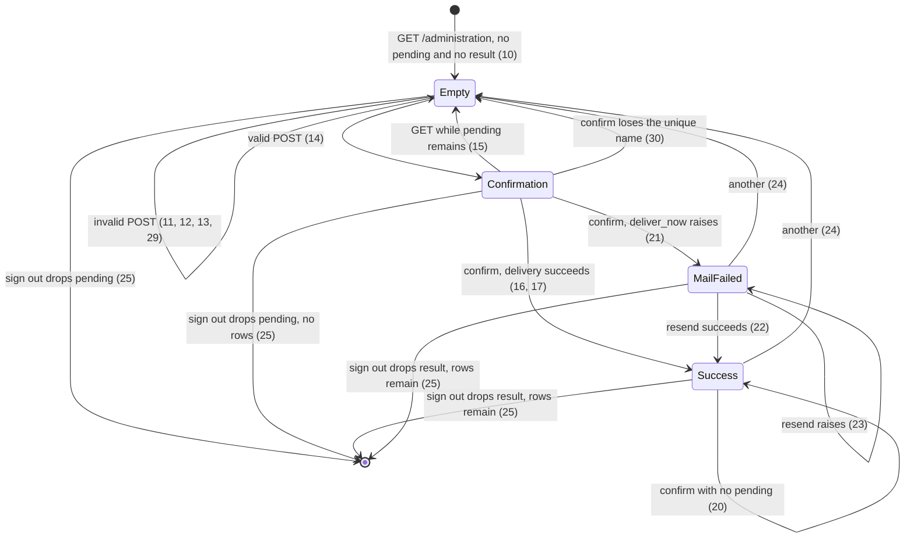
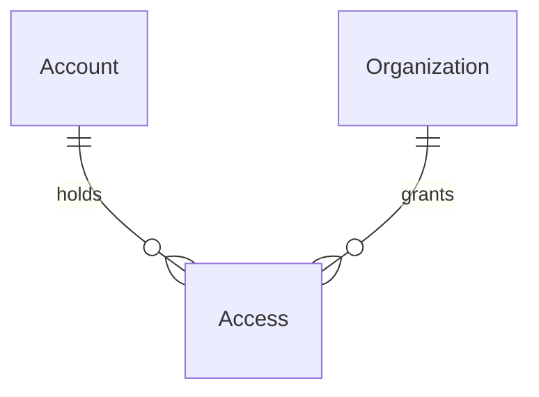

# Administration intake

> Build this with **tlc-implement**.
> Every criterion below becomes a check with a proof, referenced by its number. Nothing under
> `Unresolved` gets settled while building.

## Intent

A sale already knows the organization name and the coordinator email, and the close flow for that pair already exists. What stalls the sale is a console step: `bin/rails coordinator:bootstrap` with `ORGANIZATION_NAME` and `COORDINATOR_EMAIL`. That command persists nothing and exits non-zero when `Account.exists?(email:)`, so a second organization for the same coordinator cannot be opened from it. Sales volume is untracked. The seller pays for every sale with that console step. The form on this screen reverts in an afternoon; the sign-in change does not.

When this ships, one allowlisted Google email opens `/administration`, confirms the name and the coordinator email, and that coordinator signs in with Google and sees the organization. A delivery failure stays on that screen with resend. Nobody runs `coordinator:bootstrap` for that sale. Screen `administration` in `.design/administration-intake.md` is binding.

41 criteria in 6 slices · 3 one-way doors · 3 open, of which 0 block · 1 blocks go-live

## Criteria

### Allowlisted door

1. Given `ADMINISTRATOR_EMAIL` is `seller@example.com`, and a verified Google auth for `seller@example.com` has no Account, no Access, and no Invite, when the callback runs, then one Account exists with email `seller@example.com` and `google_uid` equal to that auth uid, no Organization and no Access exist for it, `session[:account_id]` is that Account, `session[:organization_id]` is nil, and the response is `302` to `/administration`.
2. Given `ADMINISTRATOR_EMAIL` is `seller@example.com` and that email already has an Account with a coordinator Access to Organization `ONG Norte`, when a verified callback for `seller@example.com` runs, then `Account.count` is unchanged, `session[:organization_id]` is `ONG Norte`, and the response is `302` to `/`.
3. Given `ADMINISTRATOR_EMAIL` is `seller@example.com` and a pending coordinator Invite exists for that email and no Account does, when a verified callback runs, then the Invite is accepted (one Account, one coordinator Access, the Invite row is gone) and the response is `302` to `/`.
4. Given `ADMINISTRATOR_EMAIL` is `seller@example.com` and a verified Google auth is `other@example.com` with no Invite and no Access, when the callback runs, then no Account is persisted for `other@example.com` and the response is `302` to `/denied` with body `Você não foi convidado a usar este sistema.`
5. Given `ADMINISTRATOR_EMAIL` is `seller@example.com` and the Google auth for that email is not verified (`email_verified` is not `true` and not `"true"`), when the callback runs, then no Account is persisted and the response is `302` to `/login`.
6. Given `ADMINISTRATOR_EMAIL` is unset or blank, when a verified Google auth with no Invite and no Access runs, then no Account is persisted and the response is `302` to `/denied`.
7. Given a coordinator Access exists for `coordenador@exemplo.org` on Organization `ONG Norte`, when a verified callback for that email runs, then the response is `302` to `/` and the home body includes `ONG Norte` and does not include `Você não foi convidado a usar este sistema.`

### Screen `administration`

8. Given no signed-in Account, when the request is `GET /administration`, `POST /administration`, `POST /administration/confirm`, `POST /administration/mail`, or `POST /administration/another`, then the response is `302` to `/login`.
9. Given a signed-in Account whose email is not the normalized `ADMINISTRATOR_EMAIL`, including when that env is unset or blank, when the request is any route in criterion 8, then the status is `404` and the body is empty.
10. Given the allowlisted Account is signed in, and `session[:administration_pending]` and `session[:administration_result]` are absent, when `GET /administration` runs, then the status is `200`, the `h1` is `Administração`, the body includes `Cadastre a organização e o coordenador que vai fechá-la.`, labels `Nome da organização` and `E-mail do coordenador` in that order with empty fields, a submit button `Continuar`, no error notice, and the form column is capped at `28rem` and left-aligned.
11. Given the allowlisted Account is signed in, when `POST /administration` submits name `   ` and email `coordenador@exemplo.org`, then the status is `422`, the only notice is `Informe o nome da organização.`, the typed values stay in the fields, no Organization, Account, or Access is written, and `session[:administration_pending]` is not set to that submission.
12. Given the allowlisted Account is signed in, when `POST /administration` submits name `ONG Norte` and email `nao-e-email`, then the status is `422`, the only notice is `Informe um e-mail válido.`, the typed values stay in the fields, no Organization, Account, or Access is written, and `session[:administration_pending]` is not set to that submission.
13. Given the allowlisted Account is signed in, when `POST /administration` submits a blank name and email `nao-e-email`, then the status is `422`, the body contains `Informe o nome da organização.` and then `Informe um e-mail válido.`, no Organization, Account, or Access is written, and `session[:administration_pending]` is not set to that submission.
14. Given the allowlisted Account is signed in, when `POST /administration` submits name `  ONG Norte  ` and email ` Coordenador@Exemplo.ORG `, then the status is `200`, the `h1` is `Confirmar cadastro`, the body shows `ONG Norte` and `coordenador@exemplo.org`, the buttons are `Confirmar` and `Corrigir` in one wrapping group, no Organization, Account, or Access is written, and `session[:administration_pending]` is `{ "name" => "ONG Norte", "email" => "coordenador@exemplo.org" }`.
15. Given `session[:administration_pending]` is `{ "name" => "ONG Norte", "email" => "coordenador@exemplo.org" }` and `session[:administration_result]` is absent, when `GET /administration` runs, then the status is `200`, the `h1` is `Administração`, and the fields show `ONG Norte` and `coordenador@exemplo.org`.
16. Given pending `{ "name" => "ONG Norte", "email" => "coordenador@exemplo.org" }` and that email has no Account, when `POST /administration/confirm` runs and delivery succeeds, then the response is `302` to `/administration`, the following `GET` is `200` with `h1` `Administração`, body `E-mail enviado para coordenador@exemplo.org.`, the record `ONG Norte` and `coordenador@exemplo.org`, button `Cadastrar outra organização`, and no error notice. One Organization named `ONG Norte`, one Account `coordenador@exemplo.org`, one Access of kind `coordinator`, and no Invite exist. `session[:administration_pending]` is absent. `session[:administration_result]` is `{ "organization_id" => that id, "mail_sent" => true }`.
17. Given pending for a new organization and an Account that already exists for that email, when `POST /administration/confirm` runs and delivery succeeds, then `Account.count` is unchanged, a new Organization and one coordinator Access exist, no Invite exists, and the following `GET /administration` shows `E-mail enviado para` that email.
18. Given the signed-in Account email equals the pending coordinator email, when confirm succeeds, then `session[:organization_id]` is the new Organization id.
19. Given the signed-in Account email does not equal the pending coordinator email, when confirm succeeds, then `session[:organization_id]` is unchanged.
20. Given `session[:administration_pending]` is absent, when `POST /administration/confirm` runs, then no Organization, Account, or Access is written, an existing `session[:administration_result]` is unchanged, and the response is `302` to `/administration`.
21. Given a pending registration, when `POST /administration/confirm` runs and `deliver_now` raises, then the Organization, Account, and coordinator Access from that transaction remain, no Invite exists, `session[:administration_pending]` is absent, `session[:administration_result]["mail_sent"]` is false, and the following `GET` shows notice `O cadastro foi gravado, mas o e-mail não saiu.`, buttons `Reenviar e-mail` and `Cadastrar outra organização` in one wrapping group, and does not include `E-mail enviado para`. The rows remain because delivery runs after the transaction commits and the delivery error is rescued.
22. Given `session[:administration_result]` has `mail_sent` false for an organization, when `POST /administration/mail` runs and delivery succeeds, then `Organization.count` is unchanged, one more welcome message is delivered, `mail_sent` is true, and the following `GET` includes `E-mail enviado para` that coordinator email.
23. Given `session[:administration_result]` has an organization id, when `POST /administration/mail` runs and `deliver_now` raises, then `Organization.count` is unchanged, `mail_sent` is false, and the following `GET` shows `O cadastro foi gravado, mas o e-mail não saiu.`
24. Given a result is in the session and the Organization row exists, when `POST /administration/another` runs, then `session[:administration_result]` is absent, the following `GET` is the empty form in criterion 10, and that Organization row remains.
25. Given a session holds `administration_pending` or `administration_result`, when `DELETE /session` runs, then the response is `302` to `/login`, the next request has neither key, an unconfirmed pending left no Organization, and a confirmed Organization remains.

### Registration

26. If `Organization.register_coordinator` raises before commit, then `Organization.count`, `Account.count`, and `Access.count` are unchanged from before the call, and no welcome message is delivered, because the Organization, the Account create-when-missing, and the coordinator Access share one transaction and the mail runs only after commit.
27. Given an Organization named `ONG Norte` already exists, when `Organization.register_coordinator` is called with name `ONG Norte` or `ong norte` and a different valid email, then `Organization.count`, `Account.count`, and `Access.count` are unchanged and no welcome message is delivered, because a unique index on `lower(organizations.name)` rejects the insert and the transaction rolls back.
28. After a successful confirm of `ONG Norte` / `coordenador@exemplo.org`, the success and mail-failure screens include no field that edits the name or the email, and that Organization name and Account email stay `ONG Norte` and `coordenador@exemplo.org`.
29. Given an Organization named `ONG Norte` exists and the allowlisted Account is signed in, when `POST /administration` submits name `  ong norte  ` and email `coordenador@exemplo.org`, then the status is `422`, the notice is `Já existe uma organização com esse nome.`, the fields keep those values, no Organization, Account, or Access is written, and `session[:administration_pending]` is not set.
30. Given no Organization named `ONG Norte` yet, when two overlapping `POST /administration/confirm` requests still hold pending names `ONG Norte` and `ong norte` for `coordenador@exemplo.org`, then exactly one Organization exists for that name. The request that loses the insert writes no Account and no Access, sends no mail, leaves `session[:administration_result]` unset, and responds `422` with notice `Já existe uma organização com esse nome.` The unique index on `lower(organizations.name)` is what keeps the second insert from committing.
31. When `bin/rails coordinator:bootstrap` runs with `ORGANIZATION_NAME` `ong norte` while an Organization named `ONG Norte` exists, and a `COORDINATOR_EMAIL` that has no Account, then it persists nothing and exits non-zero. The rake task is not rewritten; the unique index rejects `Organization.create!` inside the transaction it already has.

### Welcome mail

32. When the Account has exactly one coordinator Access, `CoordinatorWelcomeMailer.welcome(organization)` delivers one `text/plain` message whose body is `A organização ONG Norte está pronta. Entre com o Google usando coordenador@exemplo.org, pelo botão Entrar com Google.` and whose from address is `ENV["MAIL_FROM"]` at send time.
33. When that Account already has two or more coordinator Accesses, the `text/plain` body is `A organização ONG Norte foi adicionada à sua conta. Entre com o Google usando coordenador@exemplo.org, pelo botão Entrar com Google.` and the from address is `ENV["MAIL_FROM"]` at send time.

### Header

34. Given an Account is signed in and `session[:organization_id]` is nil, when a page renders, then the header shows `Fechamento mensal` and one `Sair` control that submits `DELETE /session`, and it does not show `Início`, `Documentos`, `Configuração`, or `Administração`.
35. Given the signed-in Account is the allowlisted email and coordinator of the focused Organization, when a page renders, then the header has one ink link `Administração` to `/administration` after the `Configuração` link, and one `Sair`.
36. Given the signed-in Account is a coordinator and is not the allowlisted email, when a page renders, then the header has `Início`, `Documentos`, `Configuração`, and `Sair`, and no `Administração` link.
37. Given the signed-in Account is the allowlisted email and a submitter on the focused Organization, when a page renders, then the header has `Início`, `Documentos`, `Administração` to `/administration` after `Documentos`, and `Sair`, and no `Configuração` link.

### Delivery configuration

38. `config.action_mailer.raise_delivery_errors` is true in development and in production. In test, `delivery_method` is `:test` and `default_url_options` host is `example.com`.
39. In production, when `SMTP_ADDRESS` is present, `smtp_settings` uses `address` `SMTP_ADDRESS`, `port` the integer `SMTP_PORT` (or `587` when `SMTP_PORT` is blank), `user_name` `SMTP_USER_NAME`, `password` `SMTP_PASSWORD`, and `authentication` `:plain`. When `SMTP_ADDRESS` is blank, those settings are not applied.
40. In development and production, `config.action_mailer.default_url_options` host equals `ENV["MAILER_HOST"]`. When `MAILER_HOST` is `fechamento.example`, the host is `fechamento.example`.
41. The setup note in `README.md` includes the strings `ADMINISTRATOR_EMAIL`, `MAIL_FROM`, `MAILER_HOST`, `SMTP_ADDRESS`, `SMTP_PORT`, `SMTP_USER_NAME`, and `SMTP_PASSWORD`.

## States

Google callback, unchanged except the allowlisted zero-Access path: verified with an organization redirects to `/` (2, 3, 7); allowlisted with no organization redirects to `/administration` (1); no Invite and no Access and not allowlisted redirects to `/denied` (4, 6); unverified redirects to `/login` (5).

## Out of scope

- List, correction, and removal of a registration — the review trigger. A saved typo stays (28)
- A buyer-facing form — the product does not record a purchase
- Renaming an Organization
- Editing `coordinator:bootstrap` or `db/seeds.rb` — the rake task stays as it is. A duplicate `ORGANIZATION_NAME` now exits non-zero because of the unique index (31); an existing Account still aborts as today
- Mail for later Invites — Invite delivery stays out of band
- Choosing an SMTP vendor or naming the mailbox account — Unresolved 1
- Accountant, package archive, and SEFAZ certificate — they stay on `/setup` after the coordinator signs in
- An `administrators` table or a flag on Account — one email is the seller
- A new term in `CONTEXT.md`
- `GET /` for a signed-in Account with no focused organization — `require_focused_organization` still redirects to `/login`

## Observable

| Surface | Decision | Landing |
| --- | --- | --- |
| screen `administration` | empty state | 10 |
| screen `administration` | loading state | n/a - no loading drawing; delivery is `deliver_now` in the request |
| screen `administration` | error state | 11, 12, 13, 21, 29, 30 |
| screen `administration` | unauthorised | 8, 9 |
| screen `administration` | density and ordering | 10, 13 - name then email; notices name first; column `28rem` |
| screen `administration` | destructive action confirms | n/a - no delete or rename |
| header | empty state | n/a - not a collection |
| header | loading state | n/a - rendered with the page |
| header | error state | n/a - the route answers 9; the header does not |
| header | unauthorised | 34, 36 - signed-out login keeps today's header with no `Sair` |
| header | density and ordering | 35, 37 - `Administração` after `Configuração` when that link is present, otherwise after `Documentos` |
| header | destructive action confirms | existing - `Sair` submits `DELETE /session` with no extra confirm |
| document welcome mail | structure, tone, depth, next action | 32, 33 - subject is Unresolved 2 |
| document `README.md` setup note | structure, tone, depth, next action | 41 |
| `GET /administration` | response shape | 10, 15, 16 |
| `GET /administration` | error shape and codes | 8 `302`, 9 `404`, 11–13 on `POST` |
| `GET /administration` | who may call it | 8, 9 |
| `GET /administration` | versioning | n/a - session HTML, no versioned API |
| `GET /administration` | rate limit | n/a - the app has no rate limit |
| `POST /administration` | error shape and codes | 11, 12, 13, 29 `422` - same status this app already uses for an invalid HTML re-render |
| `POST /administration/confirm` | error shape and codes | 20, 21, 30 - mail failure is `302` then the failure screen; a taken name is `422` and rolls the write back |
| `POST /administration/mail` | error shape and codes | 22, 23 - missing result is Unresolved 3 |
| `POST /administration/another` | error shape and codes | 24 |
| collection of registrations | grouping, naming, ordering, duplicates | n/a - this screen does not list organizations; a repeated name is rejected (27, 29) |

## Swept

- validation: 11, 12, 13, 29 - blank after `strip`, `NormalizedEmail` rejects the email, a stored name already taken; notices are the Portuguese strings, not ActiveRecord's English defaults
- failure modes: 21, 26, 27
- idempotency and retry: 20 - a confirm with no pending writes nothing; 22 - resend delivers again, it does not dedupe
- authorization: 1, 4, 6, 8, 9 - `administrator?` is the door; other emails stay on `/denied` and persist no Account
- concurrency and ordering: 30 - two overlapping confirms of one name leave one Organization; the unique index is the mechanism, not the session cookie
- data lifecycle: 24, 25, 28 - session keys die with `reset_session`; confirmed rows have no delete or rename here
- external-dependency failure: 21 - SMTP; Google unverified and OmniAuth failure stay on `/login` (5, existing `OmniauthCallbacksController#failure`)
- state transitions: 14, 16, 20, 21, 22, 24, 25, 29, 30
- observability: n/a - the source names no log, metric, or trace; the person sees the notice in 21

## Impact

| Front | What changes |
|---|---|
| domain | no new term — `CONTEXT.md` stays as it is. `administrator?` is a predicate, not a glossary word |
| domain | existing term: `Account` — a signed-in Account may now have zero Access. Today `OperatorAuthenticator` returns `:denied` and creates no Account on that path. `sign_in` is called only from `OmniauthCallbacksController`. `focused_organization` is nil when `session[:organization_id]` is nil, and `require_focused_organization` redirects that request to `/login` |
| domain | existing term: `Organization` — the presentation name was not unique (coordinator-access: two NGOs may share a name). It is now unique on the lowercased stored string. Creators are `coordinator:bootstrap` and `Organization.register_coordinator`. The home switcher lists `current_account.organizations.order(:name)` and does not branch on a duplicate |
| stored data | unique index on `lower(organizations.name)`. No new column and no backfill. The migration requires that no two rows already share a name under `lower`; a duplicate pair fails the index build |

## Decided

| Decision | Shape | Alternative rejected |
|---|---|---|
| Who opens the screen | `administrator?` is true only when `NormalizedEmail.normalize(ENV["ADMINISTRATOR_EMAIL"]) == current_account.email`. Blank or unset env is false | An `administrators` table: a second person who must open the screen without a deploy is the case that would need it, and that person is not the seller today. The later list reuses this predicate |
| Sign-in without Access | A verified email equal to `ADMINISTRATOR_EMAIL`, with zero Access and zero Invites, creates the Account when it is missing, returns `:signed_in` with no organization, and does not create an Organization. `sign_in` stores `session[:organization_id] = organization&.id`. The callback redirects to `/administration` when the result has no organization. Pending Invites for that email still accept first | Requiring a bootstrapped Access before the form: the seller is not a coordinator of the customer organization, and today's callback sends zero Access to `/denied` |
| Organization name | Unique index on `lower((name)::text)`, the same expression as `extra_exception_kinds`. The stored name stays the stripped text the person typed. `ONG Norte` occupies `ong norte` and `  ONG NORTE  `. A taken name on `POST /administration` is `422` with notice `Já existe uma organização com esse nome.` and does not store pending. A confirm that loses the insert rolls the transaction back, sends no mail, and responds `422` with that notice | A case-sensitive index on `organizations.name`: `ONG Norte` and `ong norte` would be two organizations. Leaving the name non-unique, as coordinator-access planned, would let two overlapping confirms insert two rows |

## Relations

`Organization.name` is unique on `lower(name)` (door 3). No new entity.

## Surface

| Route | In | Out | Status | Criteria |
|---|---|---|---|---|
| `GET /administration` | session | form, filled form, or last result | `200`, `302`, `404` | 8, 9, 10, 15, 16, 24 |
| `POST /administration` | session, `name`, `email` | confirmation HTML or the form | `200`, `422`, `302`, `404` | 8, 9, 11, 12, 13, 14, 29 |
| `POST /administration/confirm` | session pending | redirect, then result, or the form when the name is taken | `302`, `422`, `404` | 8, 9, 16, 17, 18, 19, 20, 21, 30 |
| `POST /administration/mail` | session result | redirect, then result | `302`, `404` | 8, 9, 22, 23 |
| `POST /administration/another` | session result | redirect, then empty form | `302`, `404` | 8, 9, 24 |
| `GET /auth/google_oauth2/callback` | Google auth | redirect | `302` | 1, 2, 3, 4, 5, 6, 7 |

## Sources

- `.design/administration-intake.md` — **binding for the interface**: screen `administration`. Literal decisions: `administrator?`, confirm-before-write, `Organization.register_coordinator`, the two welcome sentences, mail failure keeps the rows, `session[:administration_pending]` and `session[:administration_result]`
- Conversation, 22 Sep 2026, as quoted in that design — the sale records the organization name and the coordinator email; the user submits the form; confirm before write; an existing Account gains a new Organization; mail failure keeps the rows and resends from that screen; a saved typo waits for the review
- User, 22 Sep 2026 — unique index on `organizations.name`, and `ONG Norte` and `ong norte` count as the same name. The mailbox account stays out of this task
- `lib/tasks/coordinator.rake` — today's write, and the abort when the Account exists. This task does not change it
- `app/models/operator_authenticator.rb` — zero Access and no Invite returns `:denied` and creates no Account. Criterion 1 is the exception
- `app/controllers/application_controller.rb` — `sign_in` stores `organization.id` today; criterion Decided row 2 changes that to `organization&.id`. Invalid HTML re-renders in this app use `422` (`unprocessable_content`)
- `app/views/shared/_notice.html.erb` — error notice is margem text with a 3px margem left border (`data-notice="error"`)
- `config/environments/production.rb` — commented SMTP example uses port `587` and `authentication: :plain`. That is the blank-`SMTP_PORT` port and the authentication in criterion 39
- `DESIGN.md` — short form capped at `28rem`; primary button caixa fill; secondary button ink border; `Sair` is the quiet caixa action

This task is the record of decision. If a linked document diverges, ask before building.

## Unresolved

| # | Kind | Question | Until answered |
|---|---|---|---|
| 1 | blocks go-live | Which mailbox account fills `SMTP_ADDRESS`, `SMTP_PORT`, `SMTP_USER_NAME`, and `SMTP_PASSWORD`? | No vendor and no mailbox name in the repo. The user left this out on 22 Sep 2026. A missing mailbox is the mail-failure screen (21). Real mail does not leave until the env vars are set outside this task |
| 2 | open | What is the welcome-mail subject? The body sentences are decided; a subject is not. | Subject is `Cadastro da organização {name}` for both sentences |
| 3 | open | What does `POST /administration/mail` do when `session[:administration_result]` is absent? | `302` to `/administration`, no delivery, no new rows — the same shape as confirm with no pending (20) |
