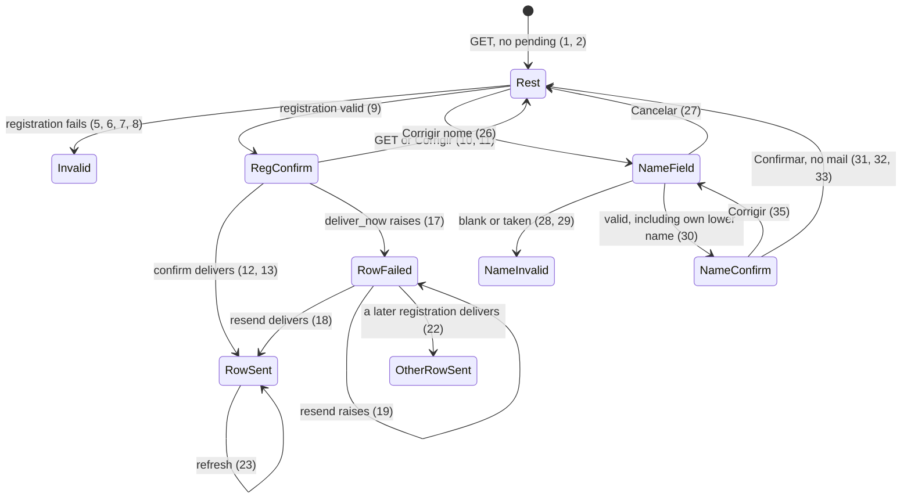

# Administration list

> Build this with **tlc-implement**. Profile **ui** — this task names screen `administration`.
> Stage 1 of 2. Stop when these criteria are proven. Do not implement `.tasks/administration-access.md`.
> Every criterion below becomes a check with a proof, referenced by its number. Nothing under
> `Unresolved` gets settled while building.

## Intent

The intake screen stops on the last registration. A wrong organization name has no correction on that page, and the seller cannot see the organizations already opened. The welcome that does send uses the subject `Cadastro da organização {name}`. The issue gives no count of registrations.

When this stage ships, `/administration` lists every organization, the registration result sits on that organization's row, the welcome subject is `Fechamento Mensal - Cadastro da Organização {name}`, and `Corrigir nome` can change the stored name without sending mail. `Corrigir` on an email, `Remover`, and invite mail are the next stage. Screen `administration` in `.design/administration-list.md` is binding for the form, the list, the registration states, and the name correction. The email-correction, removal, and home-invite drawings in that file are not this stage.

38 criteria in 5 slices · 0 one-way doors · 1 open, of which 0 block · 1 blocks go-live

## Criteria

### Registry

1. Given the allowlisted Account is signed in, no Organization exists, and `session[:administration_pending]` and `session[:administration_result]` are absent, when `GET /administration` runs, then the status is `200`, the `h1` is `Administração`, the body includes `Cadastre a organização e o coordenador que vai fechá-la.`, labels `Nome da organização` and `E-mail do coordenador` with empty fields, a submit `Continuar`, no heading `Organizações`, no `Cadastrar outra organização`, and the column is `max-w-[28rem]`.
2. Given the allowlisted Account `seller@example.com` is signed in, and three organizations exist — `AMA` with coordinator `ana@exemplo.org` (created as `coordinator:bootstrap` creates one: an Organization, an Account, and a coordinator Access, not through this form), `ONG Norte` with coordinators `zoe@exemplo.org` and `ana@exemplo.org` plus a submitter `submitter@exemplo.org`, and `ONG Sul` with coordinator `sul@exemplo.org` — when `GET /administration` runs, then the status is `200`, the form from criterion 1 is still there, a heading `Organizações` follows the form, and the names appear in stored-name order `AMA`, `ONG Norte`, `ONG Sul`. `ONG Norte` shows `Corrigir nome` (`text-caixa underline underline-offset-2`), then `ana@exemplo.org`, then `zoe@exemplo.org`. The body does not include `submitter@exemplo.org`, a `Corrigir` control on an email, or `Remover`. Coordinator emails on a row are ordered by `accounts.email` ascending, the same order as the home. The row sits in a `flex-wrap` group inside the `max-w-[28rem]` column.
3. Given no signed-in Account, when the request is `GET /administration`, `POST /administration`, `POST /administration/confirm`, `POST /administration/mail`, `POST /administration/another`, or a request that starts or confirms a name correction, then the response is `302` to `/login`, and `Organization.count`, `Account.count`, `Access.count`, `Invite.count`, and `ActionMailer::Base.deliveries` are unchanged.
4. Given a signed-in Account whose email is not the normalized `ADMINISTRATOR_EMAIL`, when the request is any route in criterion 3, then the status is `404`, the body is empty, and the counts and deliveries in criterion 3 are unchanged.

### Registration

5. Given `ONG Norte` already exists and the allowlisted Account is signed in, when `POST /administration` submits name `   ` and email `coordenador@exemplo.org`, then the status is `422`, the only notice is `Informe o nome da organização.` in `[data-notice="error"]` under the `h1`, the typed values stay in the fields, `ONG Norte` is still listed, no Organization, Account, or Access is written, and `session[:administration_pending]` is not set.
6. Given the same list, when `POST /administration` submits name `ONG Sul` and email `nao-e-email`, then the status is `422`, the only notice is `Informe um e-mail válido.`, the typed values stay, the list stays, nothing is written, and `session[:administration_pending]` is not set.
7. Given the same list, when `POST /administration` submits a blank name and email `nao-e-email`, then the status is `422`, the notices are `Informe o nome da organização.` and then `Informe um e-mail válido.`, the list stays, and nothing is written.
8. Given an Organization named `ONG Norte` exists, when `POST /administration` submits name `  ong norte  ` and email `coordenador@exemplo.org`, then the status is `422`, the notice is `Já existe uma organização com esse nome.`, the fields keep those values, the list stays, nothing is written, and `session[:administration_pending]` is not set.
9. Given `ONG Sul` is already listed, when `POST /administration` submits name `  ONG Norte  ` and email ` Coordenador@Exemplo.ORG `, then the status is `200`, the `h1` is `Administração`, the body does not include `Confirmar cadastro` or `Cadastre a organização e o coordenador que vai fechá-la.`, it shows `ONG Norte` and `coordenador@exemplo.org` with `Confirmar` (`bg-caixa`) and `Corrigir` (`border-ink`), `ONG Sul` stays at rest with `Corrigir nome`, nothing is written, no message is delivered, and `session[:administration_pending]` is `{ "name" => "ONG Norte", "email" => "coordenador@exemplo.org" }`.
10. Given that pending and no result, when `GET /administration` runs, then the status is `200`, the `h1` is `Administração`, the fields show `ONG Norte` and `coordenador@exemplo.org`, the lead sentence is present, the list stays at rest, and the page is not the confirmation in criterion 9.
11. Given the confirmation in criterion 9, when `Corrigir` is followed, then the form shows `ONG Norte` and `coordenador@exemplo.org`, the list stays at rest, and nothing is written.
12. Given pending `{ "name" => "ONG Norte", "email" => "coordenador@exemplo.org" }` and that email has no Account, when `POST /administration/confirm` runs and delivery succeeds, then the response is `302` to `/administration`. The following `GET` is `200` with an empty form, the lead sentence, and on the `ONG Norte` row the text `E-mail enviado para coordenador@exemplo.org.` which is not `[data-notice="error"]`. That row has no `Reenviar e-mail`. The body has no `Cadastrar outra organização`. One Organization `ONG Norte`, one Account `coordenador@exemplo.org`, one coordinator Access, and no Invite exist. `session[:administration_pending]` is absent. The session records that organization's id and that mail was sent. One message is delivered to `coordenador@exemplo.org` with the subject and body in criterion 24.
13. Given pending for a new organization and an Account that already exists for that email, when confirm runs and delivery succeeds, then `Account.count` is unchanged, a new Organization and one coordinator Access exist, no Invite exists, and the following `GET` shows `E-mail enviado para` that email on that row.
14. Given the signed-in Account email equals the pending coordinator email, when confirm succeeds, then `session[:organization_id]` is the new Organization id and the following `GET /administration` header shows that organization name.
15. Given the signed-in Account email does not equal the pending coordinator email, when confirm succeeds, then `session[:organization_id]` is unchanged.
16. Given `session[:administration_pending]` is absent and a registration result is already stored, when `POST /administration/confirm` runs, then no Organization, Account, or Access is written, no message is delivered, the result is unchanged, and the response is `302` to `/administration`.
17. Given a pending registration for `ONG Norte` and `ONG Sul` already listed, when `POST /administration/confirm` runs and `deliver_now` raises, then the Organization, Account, and coordinator Access remain, no Invite exists, `session[:administration_pending]` is absent, the result records that mail was not sent, and the following `GET` shows `[data-notice="error"]` `O cadastro foi gravado, mas o e-mail não saiu.` on the `ONG Norte` row only, with primary `Reenviar e-mail` (`bg-caixa`, `font-semibold`, `text-white`). The body does not include `E-mail enviado para` or `Cadastrar outra organização`. `ONG Sul` has no `Reenviar e-mail`. The rows remain because delivery runs after the registration transaction commits and the delivery error is rescued.
18. Given that failed result, when `POST /administration/mail` runs and delivery succeeds, then `Organization.count` is unchanged, one more welcome is delivered to that coordinator, the result records that mail was sent, and the following `GET` shows `E-mail enviado para` that email and no `Reenviar e-mail`.
19. Given a failed result, when `POST /administration/mail` runs and `deliver_now` raises, then `Organization.count` is unchanged, the result still records that mail was not sent, and the following `GET` shows `O cadastro foi gravado, mas o e-mail não saiu.` on that row.
20. Given no registration result is stored, when `POST /administration/mail` runs, then the response is `302` to `/administration`, no message is delivered, and no Organization, Account, or Access is written.
21. Given no Organization named `ONG Norte` yet, when two overlapping `POST /administration/confirm` requests still hold pending names `ONG Norte` and `ong norte` for `coordenador@exemplo.org`, then exactly one Organization exists for that name. The request that loses the insert writes no Account and no Access, sends no mail, leaves no registration result, and responds `422` with `Já existe uma organização com esse nome.` The unique index `index_organizations_on_lower_name` is what keeps the second insert from committing.
22. Given `ONG Norte` is showing the failure notice from criterion 17, when a later confirm of `ONG Sul` / `sul@exemplo.org` delivers, then the `ONG Norte` row has neither that notice nor `Reenviar e-mail`, and the `ONG Sul` row shows `E-mail enviado para sul@exemplo.org.`
23. Given the success sentence from criterion 12 is on the row, when `GET /administration` runs again, then that sentence is still on that row.

### Welcome mail

24. When the Account has exactly one coordinator Access, `CoordinatorWelcomeMailer` delivers one `text/plain` message whose body is `A organização ONG Norte está pronta. Entre com o Google usando coordenador@exemplo.org, pelo botão Entrar com Google.`, whose subject is `Fechamento Mensal - Cadastro da Organização ONG Norte`, and whose from address is `venda@example.com` when `MAIL_FROM` is `venda@example.com`.
25. When that Account already has two or more coordinator Accesses, the `text/plain` body is `A organização ONG Norte foi adicionada à sua conta. Entre com o Google usando coordenador@exemplo.org, pelo botão Entrar com Google.`, the subject is `Fechamento Mensal - Cadastro da Organização ONG Norte`, and the from address is `MAIL_FROM` at send time.

### Name correction

26. Given `ONG Norte` has coordinator `coordenador@exemplo.org`, when `Corrigir nome` is used, then that row shows the stored name in one field, `Continuar` (`bg-caixa`), and `Cancelar` (`text-caixa underline underline-offset-2`), the email line stays as text, nothing is written, and no message is delivered.
27. Given that field is open and the typed value is `ONG Norte Nova`, when `Cancelar` is used, then the row is at rest with `ONG Norte`, the name is unchanged, and no message is delivered.
28. Given the name field is open, when `Continuar` submits `   `, then the status is `422`, the notice under the `h1` is `Informe o nome da organização.`, the field keeps what was typed, the row does not become a confirmation, and the stored name stays `ONG Norte`.
29. Given `ONG Sul` exists and the name field is open on `ONG Norte`, when `Continuar` submits `ong sul`, then the status is `422`, the notice is `Já existe uma organização com esse nome.`, the field keeps `ong sul`, the stored name stays `ONG Norte`, and the row does not become a confirmation.
30. Given the stored name is `ONG Norte`, when `Continuar` submits `ong norte`, then the status is `200`, the row is replaced by `ong norte` and the sentence `Nenhum e-mail será enviado.` which is not `[data-notice="error"]`, other rows stay at rest, the collision notice is absent, and nothing is written.
31. Given `ONG Norte` has a closed Month with a `month_folder_id`, and `Continuar` submitted `  ong norte  ` so the confirmation shows `ong norte` (stripped, as registration stores the stripped name), when that confirmation is confirmed, then the stored name is `ong norte`, no message is delivered, `PackageArchiveWriter` is not called, `month_folder_id` is unchanged, the row shows `ong norte`, and the body does not include `Nenhum e-mail será enviado.` The Drive folder name is `year_month`; the spreadsheet title is written only inside close-for-send, which this request does not run.
32. Given `ONG Norte` is showing `O cadastro foi gravado, mas o e-mail não saiu.` and `Reenviar e-mail`, when its name is confirmed as `ONG Norte Nova`, then no message is delivered, the row shows `ONG Norte Nova`, and that same notice and `Reenviar e-mail` are still on that row.
33. Given the failure notice is on `ONG Norte`, when `ONG Sul`'s name is confirmed as `ONG Sul Nova`, then the notice and `Reenviar e-mail` stay on `ONG Norte`, `ONG Sul Nova` has no mail sentence, and no message is delivered.
34. Given `ONG Norte` and `ONG Sul`, when two overlapping name confirms both submit `ONG Iguais`, then one Organization is named `ONG Iguais` and the other keeps its previous name. The loser responds `422` with `Já existe uma organização com esse nome.` and sends no mail. The unique index `index_organizations_on_lower_name` is what rejects the loser.
35. Given the name confirmation is showing `ONG Norte Nova` and `Nenhum e-mail será enviado.`, when `Corrigir` is used, then the field shows `ONG Norte Nova`, nothing is written, and no message is delivered.
36. When a name confirmation is submitted for an organization id that does not exist, then the response is `404`, every Organization name is unchanged, and no message is delivered.

### One unwritten flow

37. Given a registration confirmation is unwritten for `ONG Nova` / `nova@exemplo.org`, when `Corrigir nome` starts on an existing organization, then no Organization named `ONG Nova` exists, the registration form is empty, and the name field is open. The discard writes nothing.
38. Given the name field is open on `ONG Norte` with typed `ONG Norte Nova` and nothing has been confirmed, when `POST /administration` submits a valid new registration, then the stored name is still `ONG Norte`, the registration confirmation is shown, and the name field is not open.

## States

Signed-out requests still end at `/login` (3). A signed-in non-administrator still gets `404` (4).

## Out of scope

- `.tasks/administration-access.md` — `Corrigir` on a coordinator email, `Remover`, and invite mail. This stage does not add those controls
- Changing `Account.email`, moving an Access, or deleting an Organization
- The buyer form — no purchase record
- Changing `coordinator:bootstrap` or `db/seeds.rb` — the command stays as it is
- A second administrator — `administrator?` stays the one normalized `ADMINISTRATOR_EMAIL`
- A submitter list on `/administration` — submitter emails are absent (2)
- Accountant, package archive, and certificate screens — they stay on `/setup`
- The header, the months list, the people lists, and the invite forms
- Choosing the mailbox, or adding a provider gem — delivery stays `MailerEnvironment` and `MAIL_FROM`
- Closing issue #63 — the code pull request cites `#63` and leaves it open. A real welcome is Unresolved 1
- Deleting `POST /administration/another` — the button is absent. The route is not a control and not a door
- Rewriting a month folder on rename — criterion 31 does not call the writer. The next close-for-send is existing

## Observable

| Surface | Decision | Landing |
| --- | --- | --- |
| screen `administration` | empty state | 1 |
| screen `administration` | loading | n/a - the design has no waiting state; the page is the response |
| screen `administration` | error state | 5, 6, 7, 8, 17, 28, 29 |
| screen `administration` | unauthorised | 3, 4 |
| screen `administration` | density and ordering | 2 - form first, organizations by stored name, coordinator emails by `accounts.email`, submitters omitted |
| screen `administration` | destructive action confirms | n/a - `Remover` is the next stage. This stage has no destructive control |
| screen `home` | invites | n/a - invite mail is the next stage. The home is unchanged |
| API | response and error shape | n/a - this is the screen above, not a versioned API. Statuses are in Surface |
| command | output, flags, exit codes | n/a - `coordinator:bootstrap` is not run or changed |
| document | structure and next step | n/a - no new reader-facing document. README already names the SMTP variables |
| collection organizations | grouping | n/a - one flat list |
| collection organizations | naming | 2 - the stored name |
| collection organizations | ordering | 2 |
| collection organizations | duplicates | 8, 29, 30, 34 - `lower(name)`; the organization being corrected does not count |
| collection organizations | exception | 1 - zero organizations omits the section |

## Swept

- validation: 5, 6, 7, 8, 28, 29, 30
- failure modes: 17, 19 - the registration remains and the notice on that row is the failure
- idempotency and retry: 18, 20 - resend delivers another welcome; mail with no result writes nothing
- authorization: 3, 4
- concurrency and ordering: 21 and 34 - unique index `index_organizations_on_lower_name`
- data lifecycle: 31 - rename does not rewrite the month folder. Account email, Access moves, and removal are the next stage
- external-dependency failure: 17 - SMTP `deliver_now` raises, the registration remains, the notice shows. Drive is n/a on rename because 31 does not call the writer
- state transitions: States
- observability: n/a - no log, metric, or trace was decided. The notice in criterion 17 is the signal

## Impact

| Front | What changes |
|---|---|
| domain | existing term: `Organization` — the presentation name, unique on `lower(name)`. It can now be renamed. Callers: the home switcher `order(:name)`, `SummarySpreadsheet` (`Planilha-resumo — #{name}`), `Month#close_for_send` (reads the name when it writes), `coordinator:bootstrap` |
| domain | existing term: `CoordinatorWelcomeMailer` — the subject changes from `Cadastro da organização {name}`. The two bodies stay. Callers: `AdministrationController` confirm and mail |
| domain | existing term: `session[:administration_result]` — today it replaces the form. The sentence now sits on that organization's row. Callers: `AdministrationController#load_registration`, `administration/show.html.erb`. The next stage adds a second failure sentence; this stage only stores the registration result |
| stored data | Nothing to migrate. No new column. Existing organizations show on the list |

## Decided

None — this stage renames through the existing `index_organizations_on_lower_name` index and the existing welcome mailer. The email move and the removal delete are one-way doors in `.tasks/administration-access.md`.

## Surface

| Route | In | Out | Status | Criteria |
|---|---|---|---|---|
| `GET /administration` | session | form and list, confirmation, or row result | `200`, `302`, `404` | 1, 2, 3, 4, 10, 23 |
| `POST /administration` | `name`, `email` | confirmation, or the form with notices | `200`, `422`, `302`, `404` | 3, 4, 5, 6, 7, 8, 9 |
| `POST /administration/confirm` | session pending | redirect, then the row result, or `422` | `302`, `422`, `404` | 12, 13, 16, 17, 21 |
| `POST /administration/mail` | session result | redirect, then the row result | `302`, `404` | 18, 19, 20 |

Name correction is a new post. The source does not name its path. It follows the existing `/administration` posts. That placement is not a door. Its statuses are in criteria 26–36.

## Sources

- https://github.com/gutors/ai-accounting-assistant/issues/63 — the registry, the welcome subject, and the name correction. Email move, removal, and invite mail are the next stage
- `.design/administration-list.md` — **binding for the interface** of this stage: screen `administration`, the form, the list, the registration states, and the name correction. Email correction, `Remover`, and screen `home` invites are `.tasks/administration-access.md`
- `.design/administration-intake.md` — the form, the notices, confirm-before-write, and the session pending / result. Its confirmation `h1` `Confirmar cadastro` and the button `Cadastrar outra organização` do not survive
- `docs/adr/0006-administration-intake.md` — `administrator?` is one normalized env email. `index_organizations_on_lower_name` is the collision rule
- `app/models/month.rb` — `replace_month_folder` is called with `name: year_month`. Criterion 31 does not call the writer
- `app/mailers/coordinator_welcome_mailer.rb` — the two bodies stay; the subject changes
- `app/controllers/administration_controller.rb` — `POST /administration/mail` without a result already responds `302` and writes nothing (20)
- `DESIGN.md` — the `28rem` column, quiet caixa, and the notice partial `data-notice="error"`
- `.tasks/administration-access.md` — stage 2. Do not build it from this task

This task is the record of decision. If a linked document diverges, ask before building.

## Unresolved

| # | Kind | Question | Until answered |
|---|---|---|---|
| 1 | blocks go-live | Which mailbox fills `SMTP_ADDRESS`, `SMTP_PORT`, `SMTP_USER_NAME`, `SMTP_PASSWORD`, and `MAIL_FROM`? | No mailbox name in the repo or in #63. Tests use the `:test` delivery. A green suite does not mean a message left the process. #63 stays open until a real welcome arrives. The failure notice (17) is what a missing mailbox shows |
