# Assisted suggestions

> Build this with **tlc-implement**.
> Every criterion below becomes a check with a proof, referenced by its number. Nothing under
> `Unresolved` gets settled while building.

## Intent

A coordinator can confirm a match and mark honorário by hand, but the product never proposes a pair. After a statement is in, every missing-document payment is indistinguishable from every other: the unmatched pool is a list, and the accountant’s PIX or tax id in the history does not surface. Issues #12, #21 and #37 give no conversion figure; the cost is that the coordinator hunts the pool throughout the open month, and an honorarium debit stays `Documento faltante` (and blocks close-for-send) until they notice.

When this ships, `GET /months/:year_month` of an open month that already has statement payments shows a **suggestion** already linked on the payment — confirm is still `POST /months/:year_month/matches`; until then the payment is still a missing document. A **justification** becomes that kind of suggestion once statements exist. A payment whose history hits the accountant PIX or tax id shows an **exception suggestion** of honorário do contador — confirm is still `POST .../document_exception` with `kind=accountant_fee`; until then it is still a missing document. Bank fee and extra exception kinds stay manual.

67 criteria in 7 slices · 3 one-way doors · 0 open, of which 0 block

## Criteria

### Clear 1:1 candidate is already linked

1. Given open Month `2026-05` has a missing-document Payment of `22000` cents whose history is `Pix enviado — Padaria Central`, and the focused organization has one unmatched SupportingDocument of `22000` cents payee `Padaria Central` in no Justification, when a coordinator GETs `/months/2026-05`, then the response is `200`, that payment’s row includes `Documento faltante`, includes `Sugestão`, and includes `Padaria Central`.
2. When that GET succeeds, then that Payment still has `match_id` nil, `document_exception_kind` nil, and `extra_exception_kind_id` nil, and that SupportingDocument still has `month_id` nil and `match_id` nil.
3. When a coordinator POSTs that Payment id and that SupportingDocument id with observation blank to `/months/2026-05/matches`, then the system persists one Match, responds `302` to `/months/2026-05`, and that page includes `Casado` and `Padaria Central` and does not include `Documento faltante` or `Sugestão` on that payment.
4. When that confirm succeeds, then `GET /supporting_documents` includes `Casado em 2026-05` for that document.
5. Given that Payment and no unmatched SupportingDocument of `22000` cents, when a coordinator GETs `/months/2026-05`, then that payment’s row includes `Documento faltante` and does not include `Sugestão`.
6. When `/months/2026-05` has zero Payments, then the page does not include `Sugestão`.
7. While `/months/2026-05` lists an Inflow under `Recebimentos`, that section does not include `Sugestão` or `Sugestão de exceção`.
8. When the unmatched document is a `recibo` of `22000` cents payee `Padaria Central` and the Payment history contains `Padaria Central`, then that payment’s row includes `Sugestão` and `Padaria Central`.
9. When the unmatched document is a `nota_fiscal` of `22000` cents payee `Padaria Central` with XML attached and the Payment history contains `Padaria Central`, then that payment’s row includes `Sugestão` and `Padaria Central`.
10. While a payment’s row includes `Sugestão` and `Padaria Central`, `Documentos sem casamento` still includes `Padaria Central`.

### Later documents, value ties, open months

11. Given the Payment of `22000` cents already exists, when a coordinator then inserts the unmatched SupportingDocument of `22000` cents payee `Padaria Central`, then `GET /months/2026-05` includes `Sugestão` and `Padaria Central` on that payment.
12. Given two missing-document Payments of `22000` cents whose histories are `Pix enviado — Padaria Central` and `Pix enviado — Mercado Silva`, and one unmatched SupportingDocument of `22000` cents payee `Padaria Central`, then `GET /months/2026-05` includes `Sugestão` and `Padaria Central` on the Padaria payment and does not include `Sugestão` on the Mercado Silva payment.
13. Given two missing-document Payments of `22000` cents that both have history `Pix enviado — Padaria Central`, and one unmatched SupportingDocument of `22000` cents payee `Padaria Central`, then `GET /months/2026-05` includes `Sugestão` on the lower-id payment only.
14. Given two unmatched SupportingDocuments of `22000` cents payees `Padaria Central` and `Mercado Silva`, and one missing-document Payment of `22000` cents whose history is `Pix enviado — Padaria Central`, then that payment’s row includes `Sugestão` and `Padaria Central` and does not include `Mercado Silva`.
15. Given two unmatched SupportingDocuments of `22000` cents payees `Padaria Norte` (lower id) and `Padaria Sul`, and one missing-document Payment of `22000` cents whose history is `Pix`, then that payment’s row includes `Sugestão` and `Padaria Norte` and does not include `Padaria Sul`.
16. Given open Months `2026-05` and `2026-06` each have a missing-document Payment of `22000` cents, May history `Pix enviado — Padaria Central`, June history `Pix enviado — Mercado Silva`, and one unmatched no-month SupportingDocument of `22000` cents payee `Padaria Central`, then `GET /months/2026-05` includes `Sugestão` on May’s payment and `GET /months/2026-06` does not include `Sugestão` on June’s payment.
17. Given those two months’ Payments both have history `Pix` and the document payee is `Padaria Central`, then `GET` of the month that holds the lower-id Payment includes `Sugestão` and the other month’s payment row does not.
18. Given a Payment of `22000` cents on `2026-05-20` whose history contains `Padaria Central`, and an unmatched SupportingDocument of `22000` cents payee `Padaria Central` on `2026-04-30`, then `GET /months/2026-05` includes `Sugestão` and `Padaria Central` on that payment.
19. Given a missing-document Payment of `22000` cents whose history is `Pix enviado — Outro` and the only unmatched SupportingDocument is `22000` cents payee `Padaria Central`, then that payment’s row includes `Sugestão` and `Padaria Central`.
20. Given two missing-document Payments of `22000` cents whose histories are `Pix enviado — JOSE SILVA` and `Pix enviado — Mercado Silva`, and one unmatched SupportingDocument of `22000` cents payee `José Silva`, then `GET /months/2026-05` includes `Sugestão` and `José Silva` on the JOSE SILVA payment and does not include `Sugestão` on the Mercado Silva payment.
21. Always, a Payment belongs to at most one suggestion and a SupportingDocument belongs to at most one suggestion.

### Amount ranking and two-payment format

22. Given a missing-document Payment of `22000` cents whose history is `Pix enviado — Mercado Silva`, an unmatched SupportingDocument of `22000` cents payee `Padaria Central`, and an unmatched SupportingDocument of `25000` cents payee `Mercado Silva`, then that payment’s row includes `Sugestão` and `Padaria Central` and does not include `Mercado Silva`.
23. Given a missing-document Payment of `22000` cents, no unmatched document of `22000` cents, and unmatched documents of `25000` and `20000` cents, then that payment’s row includes `Sugestão` and the `25000`-cent document’s payee and does not include the `20000`-cent document’s payee.
24. Given a missing-document Payment of `22000` cents and the only unmatched SupportingDocument is `20000` cents payee `Padaria Central`, then that payment’s row includes `Sugestão` and `Padaria Central`.
25. If a coordinator POSTs that lesser suggestion with observation blank, then the system persists no Match and responds `422` with `Informe a observação do casamento`.
26. Given unmatched SupportingDocument of `22000` cents payee `Padaria Central`, two missing-document Payments of `10000` and `12000` cents on Month `2026-05`, and no Payment of `22000` cents, then both payment rows include `Sugestão` and `Padaria Central`.
27. When a coordinator POSTs those two Payment ids and that SupportingDocument id with observation blank, then the system persists one Match, both rows include `Casado`, and neither includes `Documento faltante` or `Sugestão`.
28. Given a Payment of `22000` cents and also Payments of `10000` and `12000` cents, and one unmatched SupportingDocument of `22000` cents, then the `22000`-cent payment’s row includes `Sugestão` and that payee, and the `10000`-cent payment’s row does not include `Sugestão`.
29. Given unmatched SupportingDocument of `22000` cents payee `Padaria Central`, Payments of `10000` and `12000` cents whose histories contain `Padaria Central`, and Payments of `10000` and `12000` cents whose histories are `Outro`, then the Padaria pair’s rows include `Sugestão` and `Padaria Central` and the Outro pair’s rows do not.
30. Always, a suggestion is one Payment with one or more SupportingDocuments, or exactly two Payments with one SupportingDocument.
31. Given three missing-document Payments of `7000`, `7000`, and `8000` cents and one unmatched SupportingDocument of `22000` cents, then `GET /months/2026-05` does not include a suggestion that groups all three payments.

### Justification becomes a suggestion

32. Given a Justification of `20000` cents whose members are unmatched SupportingDocuments payees `Padaria Central` (`15500`) and `Mercado Silva` (`4500`), and a missing-document Payment of `20000` cents, when a coordinator GETs `/months/2026-05`, then that payment’s row includes `Sugestão`, `Padaria Central`, and `Mercado Silva`, and includes `Documento faltante`.
33. When a coordinator POSTs that Payment id and both member ids with observation blank, then the system persists one Match, responds `302`, and that row includes `Casado` and both payees and does not include `Documento faltante` or `Sugestão`.
34. While those two documents belong to that Justification of `20000` cents, a missing-document Payment of `15500` cents does not include `Sugestão` of `Padaria Central`.
35. Given that two-document Justification of `20000` cents, two missing-document Payments of `10000` cents, and no Payment of `20000` cents, then `GET /months/2026-05` does not include `Sugestão` on both `10000` payments together (that would be two payments with two documents).
36. Given a Justification of `18000` cents whose members sum to `20000` cents, and a missing-document Payment of `18000` cents, then that payment’s row includes `Sugestão` and both member payees.
37. When a coordinator POSTs that Payment and both members with observation blank, then the Match persists (`20000` greater than `18000`).
38. Given a Justification of `22000` cents whose members sum to `20000` cents, and a missing-document Payment of `22000` cents, then that payment’s row includes `Sugestão` and both member payees.
39. If a coordinator POSTs that Payment and both members with observation blank, then the system persists no Match and responds `422` with `Informe a observação do casamento`.

### Exception suggestion of accountant’s fee

40. Given the focused organization has `accountant_pix_key` `chave-pix` and no `accountant_tax_id`, Month `2026-05` has a missing-document Payment whose history is `Pix enviado chave-pix`, and the organization has no unmatched SupportingDocument, when a coordinator GETs `/months/2026-05`, then that payment’s row includes `Sugestão de exceção` and `Documento faltante` and does not include `Honorário do contador`.
41. When that GET succeeds, then that Payment still has `document_exception_kind` nil.
42. If a coordinator POSTs `/months/2026-05/close` while that exception suggestion is showing, then the month remains not closed and the response is `422` with `Há documento faltante`.
43. When a coordinator POSTs `kind=accountant_fee` on that payment, then the row includes `Honorário do contador` and does not include `Documento faltante` or `Sugestão de exceção`.
44. Given `accountant_tax_id` `39053344705` and blank `accountant_pix_key`, and a missing-document Payment whose history is `Pix 390.533.447-05`, and no unmatched SupportingDocument, then that payment’s row includes `Sugestão de exceção`.
45. Given `accountant_pix_key` `ana@example.com` and a missing-document Payment whose history is `Pix Ana@Example.com`, and no unmatched SupportingDocument, then that payment’s row includes `Sugestão de exceção`.
46. Given `accountant_pix_key` `51999999999` and a missing-document Payment whose history is `Pix +55 51 99999-9999`, and no unmatched SupportingDocument, then that payment’s row includes `Sugestão de exceção`.
47. Given `accountant_pix_key` `f9c8d7e6-1234-4abc-9def-0123456789ab` and a missing-document Payment whose history contains `F9C8D7E6-1234-4ABC-9DEF-0123456789AB`, and no unmatched SupportingDocument, then that payment’s row includes `Sugestão de exceção`.
48. Given two missing-document Payments whose histories both include `chave-pix`, `accountant_pix_key` `chave-pix`, and no unmatched SupportingDocument, then both payment rows include `Sugestão de exceção`.
49. Given `accountant_presentation_name` `Ana Contadora`, blank PIX, blank tax id, and a missing-document Payment whose history is `Pix Ana Contadora`, then that payment’s row does not include `Sugestão de exceção`.
50. Given `accountant_legal_name` `Ana Contabilidade LTDA`, blank PIX, blank tax id, and a missing-document Payment whose history includes that razão social, then that payment’s row does not include `Sugestão de exceção`.
51. Given blank PIX and blank tax id, and a missing-document Payment whose history is `Pix 390.533.447-05`, then that payment’s row does not include `Sugestão de exceção`.
52. Given `accountant_pix_key` `chave-pix`, a missing-document Payment of `22000` cents whose history is `Pix enviado chave-pix — Padaria Central`, and an unmatched SupportingDocument of `22000` cents payee `Padaria Central`, then that payment’s row includes `Sugestão` and `Padaria Central` and does not include `Sugestão de exceção`.
53. Given `accountant_pix_key` `chave-pix`, a missing-document Payment of `50000` cents whose history is `Pix enviado chave-pix`, and the only unmatched SupportingDocument is `20000` cents, then that payment’s row includes `Sugestão` and does not include `Sugestão de exceção`.
54. Given a missing-document Payment whose history is `Tarifa Pacote de Serviços`, blank PIX, blank tax id, then that payment’s row does not include `Sugestão de exceção`.
55. When a coordinator POSTs `kind=bank_fee` on a payment whose row includes `Sugestão de exceção`, then that row includes `Tarifa bancária` and does not include `Sugestão de exceção` or `Documento faltante`.
56. Always, `GET /months/2026-05` does not include `Sugestão de exceção` for an extra exception kind.

### Isolation, closed month, submitter

57. While focus is organization A, `GET /months/2026-05` does not include `Sugestão` of a payee that exists only on organization B’s unmatched SupportingDocument of the same cents.
58. When Month `2026-05` is closed, then `GET /months/2026-05` does not include `Sugestão` or `Sugestão de exceção`.
59. If a submitter GETs `/months/2026-05` of an organization whose payment history is `PIX Isolado` and whose unmatched document payee is `Padaria Central`, then the response is `404` and the body does not include `PIX Isolado`, `Sugestão`, or `Padaria Central`.
60. When a submitter of that organization has inserted unmatched SupportingDocument payee `Padaria Central` of `22000` cents, then a coordinator `GET /months/2026-05` of the payment whose history contains `Padaria Central` and amount `22000` includes `Sugestão` and `Padaria Central`.
61. When a coordinator DELETEs the Match that those ids confirmed, then `GET /months/2026-05` includes `Documento faltante` and `Sugestão` and `Padaria Central` on that payment again.
62. When a coordinator PATCHes that unmatched document’s payee from `Padaria Central` to `Mercado Silva` while two `22000`-cent payments have histories `Pix enviado — Padaria Central` and `Pix enviado — Mercado Silva`, then `GET /months/2026-05` includes `Sugestão` on the Mercado Silva payment and does not include `Sugestão` on the Padaria payment.
63. When a coordinator clears `accountant_pix_key` and `accountant_tax_id`, then `GET /months/2026-05` of the payment whose history still contains `chave-pix` does not include `Sugestão de exceção`.

### Suggested ids are selected on confirm

64. Given the 1:1 of criterion 1, when a coordinator GETs `/months/2026-05`, then that payment’s `POST /months/2026-05/matches` form includes that Payment id and that SupportingDocument id as selected (`checked` checkbox or `type="hidden"` input named `payment_ids[]` / `supporting_document_ids[]`).
65. Given that same 1:1 and a second unmatched SupportingDocument payee `Mercado Silva`, then `Mercado Silva` is not selected on that payment’s match form.
66. Given the format-2 of criterion 26, when a coordinator GETs `/months/2026-05`, then the page includes both Payment ids and that SupportingDocument id as selected toward `POST /months/2026-05/matches`.
67. Given the Justification of criterion 32, when a coordinator GETs `/months/2026-05`, then that payment’s match form includes both member SupportingDocument ids as selected.

## States

```mermaid
stateDiagram-v2
    [*] --> MissingDocument: existing - no Match, no mark
    MissingDocument --> MissingDocument: GET shows Sugestão (1)
    MissingDocument --> MissingDocument: GET shows Sugestão de exceção (40)
    MissingDocument --> Matched: POST matches of the suggestion (3, 27, 33)
    MissingDocument --> AccountantFee: POST kind=accountant_fee (43)
    MissingDocument --> BankFee: POST kind=bank_fee while exception suggestion showing (55)
    MissingDocument --> MissingDocument: lesser POST without observation refused (25, 39)
    Matched --> MissingDocument: existing leave-match; GET may show Sugestão again (61)
    AccountantFee --> AccountantFee: existing - not missing document, no suggestion (43)
    MissingDocument --> MissingDocument: closed GET omits suggestion copy (58)
    MissingDocument --> MissingDocument: existing close refused while missing document (42)
```

## Out of scope

- Automatic confirm when amounts, dates, or names agree — #12 / #10: the system never confirms
- Exception suggestion of tarifa bancária or of any extra exception kind — #21 / #25: those marks stay manual; ADR-0003: do not invent a second extra-kind catalog
- Combining unmatched documents that do not already share a Justification into a 1:N suggestion — user delegated: 1:N grouping only through an existing Justification; the existing 1:N form stays
- Open Finance JSON statement fields as a structured PIX/tax-id column — #21: CSV/XLSX now; JSON when that feature exists
- Parsing XML, identified SEFAZ consulta, reading the photo — #38; this cut uses `amount_cents`, `document_on`, `payee`, and Payment `history` already stored
- Choosing unmatched documents into the package, or suggesting against a month assigned only at close-for-send — #39
- A dismiss / reject control for a suggestion — #12: without confirm it remains missing document; remanejo is the existing match form
- Accountant login, Drive writes, NF-e issuance

## Observable

| Surface | Decision | Landing |
| --- | --- | --- |
| screen `/months/:year_month` | empty payments | 6 |
| screen `/months/:year_month` | empty unmatched pool (no candidate) | 5, 40 - missing document without `Sugestão`; exception suggestion still possible |
| screen `/months/:year_month` | loading | n/a - Turbo full-page / redirect |
| screen `/months/:year_month` | error state | 25, 39, 42 - existing `422` copy |
| screen `/months/:year_month` | unauthorised | 59, existing unauthenticated `302` `/login` |
| screen `/months/:year_month` | density and ordering | 1, 10, 12, 26, 32, 40, 64, 65, 66, 67 - suggestion on the payment row; suggested ids selected on the existing confirm form; unmatched pool still lists the document; payments stay date then id |
| screen `/months/:year_month` | destructive action confirms | n/a - no dismiss; unmatch/unmark remain immediate |
| screen `/supporting_documents` | suggestion copy | n/a - suggestions live on the payment; 4 is the matched label after confirm |
| HTML `GET /months/:year_month` | who may call it | 59, existing coordinator with focus |
| HTML `GET /months/:year_month` | response shape | 1, 26, 32, 40, 64, 66, 67 |
| HTML `GET /months/:year_month` | error shape and codes | existing - `404` invalid or never opened; submitter 59 |
| HTML `GET /months/:year_month` | versioning | n/a - existing HTML surface; body gains suggestion copy |
| HTML `GET /months/:year_month` | rate limit | n/a - coordinator-only, small operator set |
| HTML `POST /months/:year_month/matches` | who may call it | 3, existing unauthenticated `302` `/login` |
| HTML `POST /months/:year_month/matches` | error shape and codes | 25, 39, existing taken/shape |
| HTML `POST /months/:year_month/matches` | versioning | n/a - existing HTML surface; this task posts the same ids |
| HTML `POST /months/:year_month/matches` | rate limit | n/a - coordinator-only |
| HTML `POST /months/:year_month/payments/:id/document_exception` | who may call it | 43, 55 |
| HTML `POST /months/:year_month/payments/:id/document_exception` | error shape and codes | existing - `422` closed / matched / unknown kind |
| HTML `POST /months/:year_month/payments/:id/document_exception` | versioning | n/a - existing HTML surface |
| HTML `POST /months/:year_month/payments/:id/document_exception` | rate limit | n/a - coordinator-only |
| HTML `POST /months/:year_month/close` | error shape and codes | 42 - suggestion is not a mark |
| collection suggestions on a month | grouping | 16, 21, 57 - focused organization, open months, at most one per payment and per document |
| collection suggestions on a month | naming | 1, 40 - `Sugestão`; `Sugestão de exceção` (user delegated) |
| collection suggestions on a month | ordering | 12, 13, 17, 20 - name hit (including `José` / `JOSE`), then lowest Payment id, then lowest SupportingDocument id |
| collection suggestions on a month | duplicates | 12, 13, 14, 21, 28 |
| collection suggestions on a month | exception that does not fit | 5, 6, 30, 31, 35 - no candidate; zero payments; not N×M; not three payments |
| collection exception suggestions | grouping | 48 - every hitting Payment; 52, 53 - suppressed when a match suggestion exists, including lesser 1:1 |
| collection exception suggestions | naming | 40 - `Sugestão de exceção`, still `Documento faltante` |
| collection exception suggestions | ordering | existing - payments stay date then id |
| collection exception suggestions | duplicates | 48 - two hits are two proposals, not one |
| collection exception suggestions | exception that does not fit | 49, 50, 51, 54, 56 - name-only, empty catalog, tarifa text, extra kinds |

## Swept

- validation: 20, 22, 23, 24, 30, 44, 45, 46, 47 - name hit including accent fold; amount rank; match shape; PIX/tax-id normalize
- failure modes: 25, 39, 42, 57, 58, 59
- idempotency and retry: 1, 3 - a second GET still shows the same derived suggestion; a second confirm is existing `422` `Pagamento já está em um casamento`
- authorization: 59, 60
- concurrency and ordering: 13, 16, 17, 20, 21 - assignment is deterministic (name including accent fold, then lowest id); two concurrent confirms of the same ids are existing Match uniqueness
- data lifecycle: 11, 61, 62, 63 - derived at GET; insert, leave-match, payee PATCH, and clearing PIX/tax id change the next GET; nothing to backfill or delete
- external-dependency failure: n/a - no new remote; Drive writer and Google OIDC are unchanged
- state transitions: 1, 3, 27, 33, 40, 43, 55, 61
- observability: n/a - no operator metric or log line is required; Rails request logging already covers HTML

## Impact

| Front | What changes |
|---|---|
| domain | existing term: `Suggestion` - first observable: a derived proposed association of payment(s) and supporting document(s) on an open Month that already has Payments; not a Match. Callers: month page (`app/views/months/show.html.erb`) currently branches only missing / matched / excepted; `Payment#missing_document?` stays true until confirm |
| domain | existing term: `Exception suggestion` - first observable: a derived proposed `accountant_fee` mark on a missing-document Payment with no match suggestion; not a document exception. Same month page; `Month#close_for_send` still sees missing document (42) |
| domain | existing term: `Justification` - still a submitter-declared spent amount plus member documents (`app/models/justification.rb`); this task also uses `amount_cents` as the match amount key and all members as the document side of a suggestion. `/supporting_documents` listing is unchanged |
| domain | existing term: `Missing document` - still Match, base kind, and extra kind all absent; a suggestion does not change it. Callers: `Payment#missing_document?`, `Payment.missing_document`, `Month#close_blocker`, month page copy `Documento faltante` |
| domain | existing term: `Payment` - still `amount_cents`, `occurred_on`, `history` only (no payee/PIX column). Name and PIX/tax-id compares read `history`. Callers: month page, summary spreadsheet, close-for-send |
| stored data | nothing to migrate - suggestions are not rows. Existing Payments, SupportingDocuments, Justifications, and accountant PIX/tax id stay. Unique Match indexes unchanged |

## Decided

| Decision | Shape | Alternative rejected |
|---|---|---|
| 1. Suggestion and exception suggestion are derived at GET, not persisted rows | Identity is the proposed Payment id(s) plus SupportingDocument id(s) (or `accountant_fee` on one Payment) computed when a coordinator GETs an open Month. Confirm writes a `Match` or `document_exception_kind=accountant_fee` through the existing POSTs. No `suggestions` table. | A Suggestion / ExceptionSuggestion row — #12 never confirms by itself, so there is nothing to store until Match or mark; statement replace, document insert/PATCH/withdraw, leave-match, and accountant PIX/tax-id edits would all need rebuild. A new confirm route — the ids already POST to `/matches` and `/document_exception`. |
| 2. Assignment rank is equal, then format-2, then greater, then lesser; at most one suggestion per Payment and per document (or Justification group) | Amount key is `supporting_document.amount_cents` when the document has no Justification; `justification.amount_cents` when it does, and every member document is the document side together. Equal: one missing-document Payment whose cents equal that key (Justification → format 1 with N docs). Else format-2: exactly two missing-document Payments of the **same** Month whose cents sum to the key, and the document side is **one** SupportingDocument (a multi-document Justification never takes this arm — that would be N×M). Else one Payment with document-side cents **greater** than the payment. Else one Payment with document-side cents **lesser**. Within a rank: name hit before no name hit; then lowest Payment id; then lowest SupportingDocument id (or Justification id). Name hit: transliterate both payee and history (Latin accents to base letters, so `José` matches `JOSE`), downcase, collapse whitespace, then either string contains the other. Documents in a Justification are never assigned as individuals (34). Format-2 never uses three or more Payments (31) and never spans Months. Date is not a gate (18). Recibo, nota fiscal, and XML-backed rows share this rank (#12). 1:N of loose unmatched documents is not a rank arm — only an existing Justification groups N docs (32–35). | Auto-confirm on equal — #12. Suggesting three-plus payments — #10: coordinator confirms 3+ by hand. Format-2 for a multi-document Justification — #10 forbids N×M. Combining ungrouped receipts by subset-sum — user delegated: Justification is the group. Ranking by `occurred_on` / `document_on` — #10 date is a hint, not a condition; #12 breaks value ties on name. Equality-only name compare — user delegated: containment after accent fold. A second matcher once Open Finance JSON exists — door 1+2 are the matcher; JSON would add structured fields, not a parallel rank. |
| 3. Exception suggestion is `accountant_fee` only, on a missing-document Payment that has no match suggestion, when `history` hits normalized PIX or tax id | Hit if `accountant_pix_key` is present and matches, **or** `accountant_tax_id` is present and its digit form is a substring of the digit form of `history`. PIX: if `NormalizedEmail.valid?` on the trimmed key, downcased key is a substring of downcased `history`; else if the key has any digit, digit-only key is a substring of digit-only `history`; else case-insensitive substring of the trimmed key in `history`. Tax id uses `BrazilianTaxId.normalize` (already how `accountant_tax_id` is stored). Presentation name and razão social never hit (49, 50). Catalog with neither PIX nor tax id never fires (51). Two hitting Payments each get a proposal (48). A match suggestion on that Payment suppresses it (52, 53), including a lesser 1:1 — user delegated: keep that rule; `Marcar honorário` stays available. Manual `bank_fee` / `accountant_fee` / extra mark still apply. Inflows never receive it (7). | Inferring tarifa from history text — #5 / #21. Suggesting extra kinds — #25 / ADR-0003. Matching presentation name or razão social — #21. A structured Payment PIX column this cut — #8 / current schema: CSV/XLSX persist `history` only. Writing the mark without confirm — #21: without confirm it is still missing document. Letting lesser 1:1 keep showing honorário, or dropping lesser auto-link — user delegated: any match suggestion wins, including lesser. |

- Nothing else in this change is hard to reverse. `Sugestão` / `Sugestão de exceção` and selected ids on the existing `POST /matches` form are criteria (1, 40, 64–67), not doors. Door 1 reaches past this feature: later Open Finance and #39 do not need a suggestion table to exist first. Door 2 reaches past this feature: a JSON counterparty field would join this rank as a name/PIX source, not replace it. Door 3 reaches past this feature: extras stay a catalog the coordinator marks.

## Surface

| Route | In | Out | Status | Criteria |
|---|---|---|---|---|
| `GET /months/:year_month` | session, focus | month HTML, `Sugestão` / `Sugestão de exceção` on payment rows, suggested ids selected on `POST /matches` | `200`, `302`, `404` | 1, 5, 6, 7, 10, 16, 20, 26, 32, 40, 52, 53, 57, 58, 59, 64, 65, 66, 67 |
| `POST /months/:year_month/matches` | session, focus, `payment_ids[]`, `supporting_document_ids[]`, `observation` | Match | `302`, `422`, `404` | 3, 25, 27, 33, 37, 39 |
| `POST /months/:year_month/payments/:id/document_exception` | session, focus, `kind` | Payment mark | `302`, `422`, `404` | 43, 55 |
| `POST /months/:year_month/close` | session, focus | closed month or errors | `302`, `422` | 42 |
| `DELETE /months/:year_month/matches/:id` | session, focus | Match gone | `302`, `404` | 61 |
| `GET /supporting_documents` | session, focus | documents HTML, `Casado em` after confirm | `200`, `302` | 4 |
| `PATCH /supporting_documents/:id` | session, focus, `payee` | SupportingDocument; next GET reassigns | `302`, `404`, `422` | 62 |

## Sources

- https://github.com/gutors/ai-accounting-assistant/issues/37 - this cut: assisted match suggestion after the statement; exception suggestion of honorário from PIX or tax id; task file `.tasks/assisted-suggestions.md`; after the manual match spine
- https://github.com/gutors/ai-accounting-assistant/issues/12#issuecomment-5607855444 - assisted; system never confirms; after statements; recibo / DANFE photo / XML same pipeline; document after statement still suggests while the month is open; a clear candidate is already linked; value tie breaks on payee name, then any; confirm throughout the open month; without confirm it is still missing document
- https://github.com/gutors/ai-accounting-assistant/issues/12#issuecomment-5628194387 / https://github.com/gutors/ai-accounting-assistant/issues/20#issuecomment-5628193823 - document has no month until match; suggestion looks at payments of any open month that already has statements; closed month never
- https://github.com/gutors/ai-accounting-assistant/issues/21#issuecomment-5628538712 - exception suggestion is not a suggestion; honorário only; confirm writes the mark; without confirm still missing document and still blocks close; PIX or tax id normalized in structured field or history; presentation name and razão social out; two hits = two proposals; match suggestion on that payment suppresses it; coordinator only; closed month read-only
- https://github.com/gutors/ai-accounting-assistant/issues/10#issuecomment-5605280962 - format 1 vs format 2; format-2 auto-search is two debits that close the document; suggestion priority equal, then greater, then lesser; lesser confirm needs match observation; justification is a suggestion the coordinator may split or join
- `CONTEXT.md` - Suggestion, Exception suggestion, Justification, Match, Missing document, Document exception
- `.specs/features/match-and-exception/plan.md` - confirm POSTs already exist; this cut must not invent a second Match parent
- [ADR-0003](../docs/adr/0003-extra-exception-kinds.md) - exception suggestion must not invent a second extra-kind catalog
- [ADR-0001](../docs/adr/0001-rails-8-hotwire.md) - Rails 8 + Hotwire; no new runtime
- `.tasks/submitter-access.md` - turning a justification into a suggestion was deferred here
- `.tasks/extra-exception-kinds.md` - extra marks stay manual
- user delegated - name hit is containment after downcase, collapsed whitespace, and Latin accent fold (`José` / `JOSE`); 1:N grouping only through an existing Justification; a lesser 1:1 match suggestion still suppresses exception suggestion (53); copy is `Sugestão` and `Sugestão de exceção`; suggested ids are selected on the existing `POST /matches` form (64–67)

No design source for the screens. Verification stays on project profile `standard`.

This task is the record of decision. If a linked document diverges, ask before building.

## Unresolved

| # | Kind | Question | Until answered |
|---|---|---|---|
| 1 |  | None |  |
