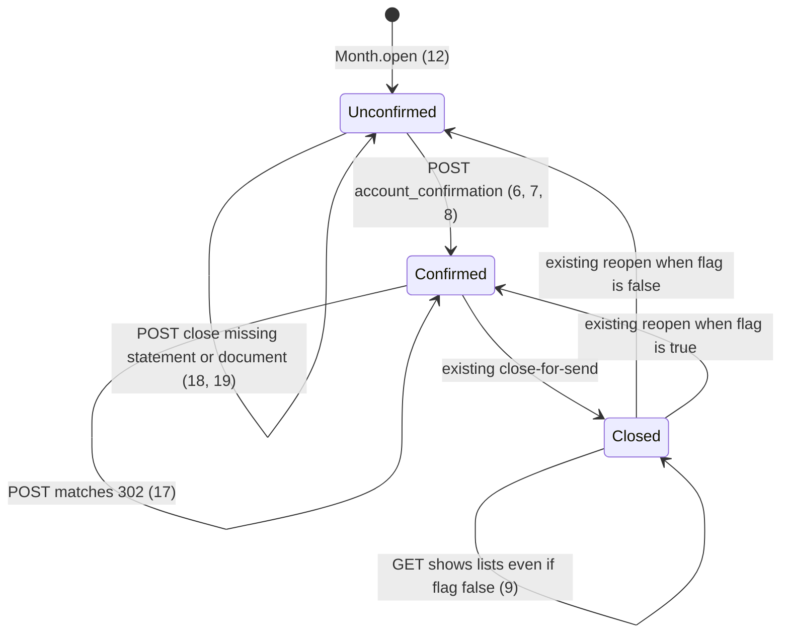
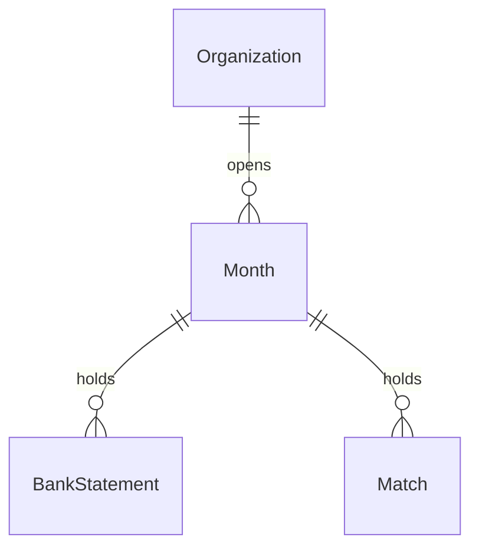

# Confirm accounts before movements

> Build this with **tlc-implement**. Profile **`ui`**: screen `month` is binding through
> `.specs/features/visual-identity/design.md` (criterion 20).
> Every criterion below becomes a check with a proof, referenced by its number. Nothing under
> `Unresolved` gets settled while building.

## Intent

On `GET /months/:year_month`, a coordinator who has just imported a statement already sees
`Recebimentos`, `Pagamentos` (with Resolver, suggestions, and N:1), and `Documentos sem casamento`.
There is no persisted pause between “this account is Presente” and “these are the movements to
match.” Issue #110 gives no conversion figure. The cost is matching (or closing) against a set of
accounts the coordinator has not agreed is complete.

When this ships, that GET is an intermediate step until the coordinator confirms. Upload still
persists the BankStatement (and its Inflows/Payments) immediately; `Falta` / `Presente` on the
account ledger does not change. `Recebimentos`, `Pagamentos`, and `Documentos sem casamento` stay
off the page until confirmation. The agreement is a boolean on `Month`, not the session. Replacing
a statement after confirmation does not hide the lists again. Close-for-send refusals stay
`Importe o extrato de cada conta ativa` and `Há documento faltante`. Binding design: section
`month` in `.specs/features/visual-identity/design.md` (amended).

22 criteria in 5 slices · 3 one-way doors · 2 open, of which 0 block

## Criteria

### Unconfirmed GET hides movements

1. Given a signed-in coordinator of the focused organization, open Month `2026-05` with
   `accounts_confirmed` false, and one active BankAccount `Conta Principal` with no statement, when
   `GET /months/2026-05` runs, then the status is `200`, the body includes `h2` `Contas bancárias`,
   includes `h2` `Confirmar contas para fechamento` after that bank section, includes a submit whose
   text is `Iniciar fechamento` posting to `/months/2026-05/account_confirmation`, includes
   `Insira os extratos das contas bancárias com as quais deseja realizar o fechamento.`, and
   includes neither `h2` `Recebimentos` nor `h2` `Pagamentos` nor `h2` `Documentos sem casamento`.
   There is no `li[data-row="inflow"]`, `li[data-row="payment"]`, or `li[data-row="pool-document"]`.
   The summary does not include `pagamento com documento faltante`.
2. Given that same unconfirmed month, when `POST /months/2026-05/bank_statements` runs with that
   account’s id and the BB May 2026 fixture spreadsheet and no `pdf`, then the status is `302` to
   `/months/2026-05`, one BankStatement persists for that pair, that statement has a Payment of
   `15500` cents (the fixture tarifa), `accounts_confirmed` stays false, and the following GET still
   matches criterion 1’s heading absences and has no payment/inflow/pool rows. That account’s
   Situação text is exactly `Presente`.
3. Given two active accounts `Conta Alfa` (Falta) and `Conta Principal` (Presente), month
   unconfirmed, when `GET /months/2026-05` runs, then the `Confirmar contas para fechamento`
   section includes both names in the same order as the bank ledger (`Conta Alfa` then
   `Conta Principal`), includes `Falta` and `Presente` on those rows, the Falta label in that
   section is `text-margem`, and `Iniciar fechamento` is enabled.
4. Given the organization has no active BankAccount and Month `2026-05` is unconfirmed, when that
   GET runs, then the body includes `Nenhuma conta bancária ativa`, includes `h2`
   `Confirmar contas para fechamento` and `Iniciar fechamento`, and still omits the three
   movement `h2`s.
5. Given criterion 2’s unconfirmed month whose only missing-document Payment is that tarifa, when
   that GET runs, then the summary includes
   `Insira os extratos das contas bancárias com as quais deseja realizar o fechamento.`,
   does not include `1 pagamento com documento faltante`, and there is still no
   `li[data-row="payment"]`.

### Confirmation persists on Month

6. Given criterion 2’s unconfirmed Presente month, when `POST /months/2026-05/account_confirmation`
   runs with no body fields, then the status is `302` to `/months/2026-05`, that Month’s
   `accounts_confirmed` is true, and the following GET is `200` with `[data-toast-kind="success"]`
   text `Pronto.`, with `h2` `Recebimentos`, `Pagamentos`, and `Documentos sem casamento`, with no
   `h2` `Confirmar contas para fechamento`, with summary `1 pagamento com documento faltante` in
   `text-margem`, and with a `li[data-row="payment"]` whose amount is `R$ 155,00`.
7. Given criterion 3’s mixed Presente/Falta unconfirmed month, when that POST runs, then
   `accounts_confirmed` is true, the following GET lists movements from `Conta Principal`, still
   includes `Falta o extrato de 1 conta ativa`, and `Conta Alfa` Situação text is exactly `Falta`.
8. Given `accounts_confirmed` is already true, when that POST runs again, then the status is `302`,
   `accounts_confirmed` stays true, `organization.months.where(year_month: "2026-05").count` stays
   `1`, and the following GET still has the movement `h2`s and `Pronto.`
9. Given Month `2026-05` is closed, `accounts_confirmed` is false, and a Payment exists for it, when
   `GET /months/2026-05` runs, then the status is `200`, `[data-stamp="closed"]` is `Mês fechado`,
   there is no `h2` `Confirmar contas para fechamento`, and a `li[data-row="payment"]` is present.
10. Given that closed month, when `POST /months/2026-05/account_confirmation` runs, then the status
    is `422`, `[data-notice="error"]` is `Mês fechado`, and `accounts_confirmed` stays false.

### Replace after agreement keeps lists

11. Given a confirmed open month whose statement has both PDF and spreadsheet, when
    `POST /months/2026-05/bank_statements` runs with a different valid spreadsheet and without
    `pdf`, then one BankStatement remains, `accounts_confirmed` stays true, and the following GET
    has no `h2` `Confirmar contas para fechamento` and still has `h2` `Pagamentos`.
12. When `Month.open` persists `2026-06` for that organization, then that row’s
    `accounts_confirmed` is false.

### Match gate; close-for-send unchanged

13. Given an unconfirmed month that already has a Payment, when
    `POST /months/2026-05/matches` runs with that `payment_ids[]` and a valid unmatched
    `supporting_document_ids[]`, then the status is `404` and no Match is persisted.
14. Given that Payment, when `POST /months/2026-05/payments/{id}/document_exception` runs with
    `kind` `bank_fee`, then the status is `404` and the Payment is still missing-document.
15. Given an unconfirmed month and a SupportingDocument whose `month_id` is that Month and
    `match_id` is nil, when `POST /months/2026-05/supporting_documents/{id}/return` runs, then the
    status is `404` and `month_id` is unchanged.
16. Given criterion 6’s following GET and that tarifa still missing-document, then that
    `li[data-row="payment"]` includes `Resolver`.
17. Given that confirmed month, an unmatched SupportingDocument, and that tarifa, when
    `POST /months/2026-05/matches` runs with those ids, then the status is `302` and one Match
    persists (existing 1:1 rules).
18. Given an unconfirmed open month with at least one active account Falta, when
    `POST /months/2026-05/close` runs, then the status is `422`, `[data-notice="error"]` is
    `Importe o extrato de cada conta ativa`, and `closed` stays false.
19. Given an unconfirmed open month where every active account is Presente and a Payment is
    missing-document, when `POST /months/2026-05/close` runs, then the status is `422`,
    `[data-notice="error"]` is `Há documento faltante`, and `closed` stays false.

### Binding month wireframe and glossary

20. `.specs/features/visual-identity/design.md` section `month` states: while `accounts_confirmed`
    is false and the month is open, the summary is
    `Insira os extratos das contas bancárias com as quais deseja realizar o fechamento.` (not the
    missing-document count); after Contas bancárias a step `Confirmar contas para fechamento`
    lists each active account’s name with `Presente` or `Falta` (`Falta` in `margem`) in ledger
    name order and submit `Iniciar fechamento`; `Recebimentos`, `Pagamentos`, and
    `Documentos sem casamento` are omitted. After confirmation (or while closed), the missing-
    document summary and those three sections match today’s band; the confirm step is absent.
    `visual-identity` month checks follow this.
21. `GLOSSARY.md` defines **Accounts confirmation**: the coordinator’s persisted agreement on a
    Month that the statement set is ready to work as movements; until then those three lists stay
    off the month page and there is no movement to match; upload still writes the BankStatement;
    replacing a statement does not clear it; not session. Avoid: Presente (per-account file),
    close-for-send.
22. After the migration runs, an existing Month that is `closed` or that already has a
    BankStatement has `accounts_confirmed` true; an existing Month with neither stays false
    (Unresolved 2).

## States

## Out of scope

- Optional PDF, compact include, Documentos column — #108 (shipped)
- PagSeguro parser — #109
- Matching screen (`GET /months/:year_month/matches`), Resolver / N:1 redesign — #111 (that
  screen reads this same Month flag; this cut gates today’s on-page POSTs)
- Month overview: drop Ações, filter, collapse lists, Voltar para Início — #112
- A control that clears `accounts_confirmed` — source only persists the agreement
- Requiring every account Presente before `Iniciar fechamento` — the control stays enabled with Falta; #110 named continue-anyway, the label is `Iniciar fechamento`
- Toast on statement `POST` — existing redirect has none
- Changing `Month#close_blocker` copy or adding a confirmation blocker — close stays the two
  existing refusals (18, 19)
- Open Finance, OFX, inactive accounts on the month list — existing

## Observable

| Surface | Decision | Landing |
| --- | --- | --- |
| screen `month` | empty state | 4 — no active accounts: existing `Nenhuma conta bancária ativa` plus the confirm step; summary is the insert-statements sentence until confirmed |
| screen `month` | loading | n/a — server-rendered GET |
| screen `month` | error state | 10 — closed confirm `422` `Mês fechado` on `[data-notice="error"]`; import `422` existing |
| screen `month` | unauthorised | existing — unauthenticated `302` `/login`; submitter `404` on month and POSTs |
| screen `month` | density and ordering | 1, 3, 20 — accounts ledger then `Confirmar contas para fechamento`; name order; Falta `margem`; movements omitted |
| screen `month` | destructive action confirms | n/a — confirm is not destructive; existing close `turbo_confirm` unchanged |
| HTML `POST /months/:year_month/account_confirmation` | response shape | 6, 8 — `302` show + success toast `Pronto.` |
| HTML `POST /months/:year_month/account_confirmation` | error shape and codes | 10 — `422` HTML show, first `:base` on `[data-notice="error"]`; no JSON |
| HTML `POST /months/:year_month/account_confirmation` | who may call | existing — `require_coordinator_organization`; else `404` / login |
| HTML `POST /months/:year_month/account_confirmation` | versioning | n/a — HTML form POST |
| HTML `POST /months/:year_month/account_confirmation` | rate limit | n/a — no limit in this app |
| HTML `POST /months/:year_month/matches` (and exception, return) | error shape when unconfirmed | 13, 14, 15 — `404`, no persist |
| document visual-identity `month` | structure, tone, next action | 20 |
| collection confirm-step accounts | grouping, naming, ordering, duplicates, exception | 3 — one row per active account, ledger name order, Presente/Falta; Unresolved 1 if two grouped lists are wanted |

## Swept

- validation: 10 — confirm refused when `closed` with existing `Mês fechado`; confirm POST has no input fields
- failure modes: 10, 13–15, 18, 19 — closed confirm; unconfirmed match/exception/return; close blockers unchanged
- idempotency and retry: 8 — a second confirm POST does not insert a Month and leaves `accounts_confirmed` true
- authorization: existing — coordinator + focus; submitter `404`; foreign month `404`
- concurrency and ordering: n/a — overlapping confirms both want true; the write is monotonic. Import does not clear the flag (11). Unique Month `(organization_id, year_month)` is existing
- data lifecycle: 12, 22 — new `Month.open` is false; backfill Unresolved 2
- external-dependency failure: n/a — no Drive/SEFAZ/mail on this path
- state transitions: 2, 6, 7, 9, 11, 12 — unconfirmed / confirmed / closed overlay
- observability: 6, 8 — success toast `Pronto.`; the source names no log or metric

## Impact

| Front | What changes |
|---|---|
| domain | new term: **Accounts confirmation** — persisted coordinator agreement on a Month that movements may be shown and matched; lives on `Month` (`accounts_confirmed`). Glossary: criterion 21 |
| domain | existing term: **Month page** meant import immediately revealed `Recebimentos` / `Pagamentos` / pool. It now reveals those only after confirmation (or while closed). Callers: `app/views/months/show.html.erb`, `ApplicationController#load_month_page`, `MatchesController`, `DocumentExceptionsController`, `MonthReturnsController`, `spec/requests/months_spec.rb`, `spec/requests/bank_statements_spec.rb`, `spec/docs/visual_identity_month_bank_rows_spec.rb`, historical bank-statement-upload C22 and match-and-exception GET examples |
| stored data | add non-null boolean `accounts_confirmed` default false; backfill per 22 / Unresolved 2 before relying on GET lists in production data. Existing request examples that GET lists after import must confirm or set the flag |

## Decided

| Decision | Shape | Alternative rejected |
|---|---|---|
| Agreement is a boolean on `Month` | `months.accounts_confirmed` `boolean` `null: false` `default: false`. `Month.open` leaves the default. Import/replace does not write the column | Session flag — #110. Infer from “every account Presente” — continue-anyway and replace-must-not-hide cannot be expressed. Timestamp — source did not ask when |
| Confirm is `POST /months/:year_month/account_confirmation` | no params; success `302` to show; closed `422` `Mês fechado`. No DELETE | `PATCH` the Month with a body field — this app’s month actions are verb POSTs (`close`, `reopen`, `restore`) |
| Unconfirmed match/exception/return | HTTP `404`, no persist, no new Portuguese `:base` | `422` with a new sentence — #110 says there is no movement to match, which is the existing not-found shape for a payment that is not on the month |

A later matching screen (#111) reads this same column; do not add a second flag there.

## Relations

`accounts_confirmed` is an attribute of `Month`, not a new entity. Cardinality of statements and matches is unchanged.

## Surface

| Route | In | Out | Status | Criteria |
|---|---|---|---|---|
| `GET /months/:year_month` | session, focus | accounts ledger; confirm step or movement sections | `200`, `302`, `404` | 1–7, 9, 11, 16 |
| `POST /months/:year_month/account_confirmation` | session, focus | redirect show or `422` show | `302`, `422`, `404` | 6–8, 10 |
| `POST /months/:year_month/bank_statements` | existing fields | existing; flag unchanged | `302`, `422`, `404` | 2, 11 |
| `POST /months/:year_month/matches` | existing | `404` when unconfirmed | `302`, `422`, `404` | 13, 17 |
| `POST /months/:year_month/payments/:id/document_exception` | existing | `404` when unconfirmed | `302`, `422`, `404` | 14 |
| `POST /months/:year_month/supporting_documents/:id/return` | existing | `404` when unconfirmed | `302`, `422`, `404` | 15 |
| `POST /months/:year_month/close` | existing | existing blockers | `302`, `422` | 18, 19 |

## Sources

- https://github.com/gutors/ai-accounting-assistant/issues/110 — **binding for this slice**: intermediate `GET /months/:year_month`; upload persists immediately (`Falta`/`Presente` continues); hide Recebimentos, Pagamentos, and the matching pool until confirm; while unconfirmed show accounts plus a step listing present vs missing with continue-anyway; agreement on `Month` not session; replace after agreement does not hide lists; same gate when a matching screen exists; close-for-send still refuses active account without statement and payment without document
- https://github.com/gutors/ai-accounting-assistant/issues/75 — parent umbrella; one tlc-plan per child
- https://github.com/gutors/ai-accounting-assistant/issues/76 / `.tasks/action-result-toast.md` — later month actions use success toast `Pronto.`
- https://github.com/gutors/ai-accounting-assistant/issues/108 / `.tasks/statement-optional-pdf.md` — shipped account ledger this cut sits on; #110 named there as out of scope
- https://github.com/gutors/ai-accounting-assistant/issues/111 — future match screen reuses this gate; not built here
- `.specs/features/visual-identity/design.md` section `month` — **binding for the interface** once criterion 20 lands; today’s ASCII still draws Recebimentos/Pagamentos/pool on every GET
- `app/views/months/show.html.erb`, `MonthsController#show`, `ApplicationController#load_month_page` — today’s always-on lists
- `app/models/month.rb` — `close_blocker` already `MISSING_STATEMENT` / `MISSING_DOCUMENT`; no confirmation bit
- Open defaults in Unresolved 1–2

This task is the record of decision. If a linked document diverges, ask before building.

## Unresolved

| # | Kind | Question | Until answered |
|---|---|---|---|
| 1 | open | Exact confirm-step chrome: heading, button, and unconfirmed summary. | Heading `Confirmar contas para fechamento`; one list in ledger name order; `Iniciar fechamento` even when every account is Presente; unconfirmed summary is the insert-statements sentence, not the missing-document count |
| 2 | open | Backfill of rows that already exist: treat in-flight months with a BankStatement (or closed) as already confirmed so production GETs do not hide lists? | `true` if `closed` or a BankStatement exists; else `false` (22). New `Month.open` stays false (12) |
