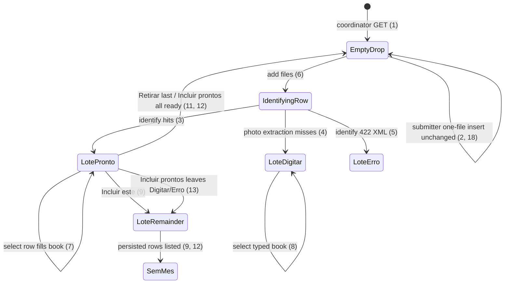

# Coordinator batch document insert

> Build this with **tlc-implement**. Profile **`ui`**: screen `documents` insert for the
> coordinator is binding through `.impeccable/mocks/documents-batch-select.html`.
> Every criterion below becomes a check with a proof, referenced by its number. Nothing under
> `Unresolved` gets settled while building.

## Intent

`GET /supporting_documents` insert is one file at a time: one proof square, one identify, one
`Incluir documento`. The coordinator already arrives with a folder of about 10 to 20 notas and
recibos. The conversation that produced this task gives no conversion figure; the cost is walking
that folder as 14 separate identify-and-include cycles, and losing the rest of the pile if they
navigate away after the first `302`.

When this ships, that GET for a **coordinator** is lote B: `multiple` files, a compact edit split
above the lote sheet (Arquivo under the proof; Valor and Data paired), `Incluir prontos (N)`,
`Incluir este`, and `Retirar`. Each file is still one SupportingDocument (photo XOR XML). Identify
still does not persist. Submitter insert stays the one-file square. Binding mock:
`.impeccable/mocks/documents-batch-select.html`.

22 criteria in 6 slices · 3 one-way doors · 1 open, of which 0 block

## Criteria

### Coordinator empty insert is a lote drop

1. Given a signed-in coordinator of the focused organization with no SupportingDocument, when
   `GET /supporting_documents` runs, then the status is `200`, the insert `h2` is
   `Incluir documentos`, that section has one `input[type=file][multiple]` whose `accept`
   includes `image/*` and `.xml`, there is no lote sheet with heading cells `Situação`, there is
   no `Incluir prontos`, and Sem mês contains `Nenhum documento`.
2. When that GET runs as a submitter with no document of their own, then the insert `h2` is
   `Incluir documento`, the file input is not `multiple`, the wait copy
   `Inclua o documento. Valor, data e favorecido saem do arquivo.` is present, and
   `Incluir prontos` is absent.

### Identify many files without persisting

3. Given two authorized XMLs, `vNF` `155.00` emitente `Padaria Central` `dhEmi` `2026-05-11` file
   `proc-nfe-padaria.xml` and `vNF` `89.40` emitente `Farmácia São José` `dhEmi` `2026-05-03` file
   `proc-nfe-farmacia.xml`, when that coordinator adds both through the insert file control, then
   SupportingDocument count stays `0`, a lote sheet is visible with head cells `Data`,
   `Favorecido`, `Tipo`, `Valor`, `Situação`, two rows include those filenames, after identify
   both rows show Situação `Pronto`, payees `Padaria Central` and `Farmácia São José`, amounts
   `R$ 155,00` and `R$ 89,40`, and Sem mês still contains `Nenhum documento`.
4. Given a `.jpg` whose barcode, chave-digit, identified, public NFC-e, and field reading all
   miss, when that coordinator adds it to the lote, then count stays `0`, that row’s Tipo is
   `Recibo`, Situação is `Digitar`, Valor is `—`, and origin in the book when selected is
   `Digitado`.
5. If the coordinator adds an XML that `AuthorizedNfe.parse` rejects, then count stays `0`, that
   row’s Situação is `Erro`, the row includes `O XML da nota fiscal não pôde ser lido`, and the
   other lote rows are unchanged.
6. While `POST /supporting_documents/identify` for `danfe-mercado.jpg` is in flight, that lote
   row includes `Identificando o arquivo…`.

### Selected row fills the compact book

7. After criterion 3, when the coordinator selects the Padaria row, then that row is
   `aria-selected="true"`, the proof shows `proc-nfe-padaria.xml`, `#arquivo` sits under the
   proof (not in the book column) with value `XML` disabled, the book has Tipo `Nota fiscal`
   disabled, Valor `155,00`, Data `2026-05-11`, Favorecido `Padaria Central`, those three show
   origin `XML autorizado` and are disabled, and Valor and Data share one row (two columns from
   `768px`).
8. After criterion 4, when that Digitar row is selected, then `#arquivo` under the proof is
   `Foto` disabled, Tipo is `Recibo` disabled, Valor, Data, and Favorecido are empty and
   enabled with origin `Digitado`, the toolbar has primary `Incluir prontos (` with a count `)`,
   secondary `Incluir este` (ink border, transparent fill, padding `8px` `16px`), and secondary
   `Retirar` (margem border and text, same padding).

### Incluir este and Retirar

9. After criterion 3 with Padaria selected, when `Incluir este` runs, then one SupportingDocument
   persists for Padaria (`kind` `nota_fiscal`, `amount_cents` `15500`, that XML, no photo), Sem
   mês includes `Padaria Central` and `R$ 155,00`, the lote no longer includes
   `proc-nfe-padaria.xml`, the Farmácia row remains in the lote with its file, and the response
   does not navigate away from `/supporting_documents` (no full-page `302` that drops the lote).
10. When the Digitar row of criterion 4 is selected and Valor, Data, or Favorecido is empty, then
    activating `Incluir este` persists no SupportingDocument.
11. After criterion 3, when `Retirar` runs on the Padaria row, then count stays `0`, that filename
    is gone from the lote, Farmácia remains, and there is no `data-turbo-confirm`.

### Incluir prontos

12. After criterion 3 (both Pronto, Sem mês empty), when `Incluir prontos (2)` runs, then two
    SupportingDocuments persist those two XMLs, the response is `302` to `/supporting_documents`
    or a same-page update that leaves the lote empty, and the following GET Sem mês includes
    `Padaria Central`, `Farmácia São José`, `R$ 155,00`, and `R$ 89,40`.
13. Given lote rows of twelve Pronto plus the Digitar of criterion 4 plus the Erro of criterion
    5, when `Incluir prontos (12)` runs, then twelve SupportingDocuments persist, the Digitar and
    Erro filenames remain in the lote, and Sem mês includes those twelve payees and does not
    include the Digitar filename as a persisted row.
14. If `Incluir prontos` is posted with one of the ready items missing amount, date, or payee,
    then no SupportingDocument from that request persists, status is `422`,
    `[data-notice="error"]` names that filename and `Faltam valor, data ou favorecido.`, and the
    lote still holds every file.
15. While that batch POST is in flight, `Incluir prontos` is disabled.
16. When a submitter POSTs `/supporting_documents/batch`, then no SupportingDocument persists and
    the status is `404`.
17. When an unauthenticated request POSTs `/supporting_documents/batch` with a file, then no
    SupportingDocument persists and the status is `302` to `/login`.

### Unchanged one-file paths

18. When a submitter POSTs `POST /supporting_documents` of authorized XML as today (one file, no
    lote), then one SupportingDocument persists on that Account and the response is `302` to
    `/supporting_documents`.
19. Always, a new SupportingDocument from lote include is still photo XOR XML; posting both on
    one lote item is `422` `Envie a foto ou o XML` and persists no row from that request.
20. Always, `GET /supporting_documents/:id/edit`, Sem mês columns, Justificativas, and submitter
    justify stay as they are after this ships.
21. Unauthenticated `GET /supporting_documents` stays `302` to `/login`.
22. The coordinator insert matches `.impeccable/mocks/documents-batch-select.html`: edit split
    above the lote, Arquivo under the proof, Valor/Data paired, toolbar
    `Incluir prontos` then secondary `Incluir este` then secondary `Retirar`, then the lote
    sheet, then Sem mês.

## States

## Out of scope

- Submitter lote / `multiple` — this round is coordinator laptop only.
- Pairing a photo and an XML of the same nota into one SupportingDocument.
- Several files on one document (gallery).
- Changing PhotoSymbols, PhotoFields, PublicNfceConsulta, or identified SEFAZ consulta.
- Persisting a draft blob before Incluir (identify stays non-persisting).
- Replacing a persisted file in place.
- Justificativas.
- Queue (prototype A) and dump-then-edit (prototype C).

## Observable

| Surface | Decision | Landing |
| --- | --- | --- |
| screen `documents` insert coordinator | empty state | 1 |
| screen `documents` insert coordinator | loading | 6, 15 |
| screen `documents` insert coordinator | error state | 5, 14 |
| screen `documents` insert coordinator | unauthorised | 16, 17, 21 |
| screen `documents` insert coordinator | density and ordering | 7, 8, 22 — edit split above lote; Arquivo under proof; Valor/Data paired; toolbar then sheet then Sem mês |
| screen `documents` insert coordinator | destructive action confirms | 11 — Retirar has no confirm (lote is not persisted) |
| screen `documents` insert submitter | empty / density | 2, 18 — existing one-file square |
| screen `documents` Sem mês | empty / density | existing columns; 1, 9, 12, 13 only add persisted rows |
| screen `documents` edit | empty / error / unauthorised / density / confirm | existing - 20 |
| API `POST /supporting_documents/identify` | who may call | existing — focused Access; still used per lote file |
| API `POST /supporting_documents/identify` | error shape and codes | 5 — `422` existing XML unreadable copy on that row |
| API `POST /supporting_documents/identify` | versioning / rate limit | n/a — same session app |
| API `POST /supporting_documents/batch` | who may call | 16, 17 — coordinator with focus; submitter `404`; unauthenticated `302` `/login` |
| API `POST /supporting_documents/batch` | error shape and codes | 14 — `422` plus `[data-notice="error"]` |
| API `POST /supporting_documents/batch` | versioning / rate limit | n/a — same session app |
| API `POST /supporting_documents` | error shape and codes | 19 — existing xor `422`; 9 uses this path or an equivalent one-document persist that does not drop the lote |

## Swept

- validation: 10, 14, 19 — empty Digitar cannot Incluir este; batch missing amount/date/payee rolls back; xor file
- failure modes: 5, 14 — unreadable XML is Erro on the row; batch `422` persists none of that request
- idempotency and retry: n/a — a second successful batch of the same files creates a second set of documents (existing: no unique chave). 15 only disables the control in flight
- authorization: 2, 16, 17, 18, 21 — submitter keeps one-file create; batch is coordinator; `require_coordinator_organization` pattern (`404`)
- concurrency and ordering: n/a — two coordinators including different files persist two sets; no new uniqueness. Identify order is the drop order (3)
- data lifecycle: n/a — no draft table; Files live in the lote until Incluir; nothing to backfill
- external-dependency failure: 4, 5 — same identify fallbacks as today; miss is Digitar (4), unreadable XML is Erro (5)
- state transitions: States diagram, 9, 11, 12, 13 — Incluir este leaves remainder; Retirar drops one file; Incluir prontos persists Pronto only
- observability: existing `:base` notice plus error toast on `422` (14); no new metric

## Impact

| Front | What changes |
|---|---|
| domain | existing term: insert on `/supporting_documents` meant one identify then one create. For a coordinator it now also means a client lote of N files and `POST /supporting_documents/batch` for the Pronto subset. Submitter create, `SupportingDocument.insert`, Sem mês, and edit callers stay. |
| domain | new term: lote — unpersisted identified files on coordinator insert, not a SupportingDocument, not a Month. Lives in the documents insert Stimulus until Incluir or Retirar. |
| stored data | nothing to migrate. Each Incluir still writes ordinary SupportingDocument rows and blobs. |

## Decided

| Decision | Shape | Alternative rejected |
|---|---|---|
| Lote is not persisted | Identify stays `POST /supporting_documents/identify` (one file, no row). The browser keeps each `File` plus the last identify fields. Refresh of the page drops the lote. | Draft SupportingDocument or object-store stash on drop — file-first already forbade persisting before Incluir; a new draft table would be a second lifecycle for the same evidence. |
| Pronto subset is one transactional POST | `POST /supporting_documents/batch` multipart: repeated `documents[][file]`, `documents[][amount]`, `documents[][date]`, `documents[][payee]`, optional `documents[][chave]`, `documents[][observation]`. Kind inferred as today. All rows in that request persist or none do. Coordinator only (`404` otherwise). | N sequential `POST /supporting_documents` — create `302`s and would destroy leftover File objects. Persist-on-drop — Incluir prontos would disappear. |
| Remainder must survive Incluir este | Incluir este persists one document and must not full-page `302` while other lote Files remain. Surgical update of Sem mês plus removal of that lote row. Incluir prontos may `302` only when no lote row remains; if Digitar/Erro remain, same surgical update as Incluir este. | Always `302` after any include — the leftover recibo File cannot be restored. |

## Surface

| Route | In | Out | Status | Criteria |
|---|---|---|---|---|
| `GET /supporting_documents` | session · focus | coordinator lote insert or submitter one-file insert; Sem mês | `200`, `302` `/login` | 1, 2, 21, 22 |
| `POST /supporting_documents/identify` | one `file` | filled fields for that file; no row | `200`, `422`, `302` `/login` | 3–6 |
| `POST /supporting_documents` | one file + book fields | one row or 422; lote remainder stays when coordinator Incluir este | `200` turbo or `302`, `422` | 9, 10, 18, 19 |
| `POST /supporting_documents/batch` | `documents[]` file + amount + date + payee (+ chave, observation) | N rows or none | `302` or `200` turbo, `422`, `404`, `302` `/login` | 12–17 |

## Sources

- Conversation 2026-10-19 — lote = N documents, one file each; coordinator laptop only; compare A/B/C then lock B with edit above the list, Arquivo under the photo, denser fields, secondary `Incluir este` / `Retirar`. Quote: “Cada arquivo vira um documento. O lote é N linhas”; “B com os dados de edicao acima da lista”; “melhore o visual dos botoes Incluir este e Retirar, use semelhante ao botao secundario”.
- `.impeccable/mocks/documents-batch-select.html` — **binding for the interface**: screen `documents` insert (coordinator lote)
- `.impeccable/surfaces/impeccable-mocks-documents-batch-select-html.md` — direction contract for that mock
- `DESIGN.md` — tokens only (secondary button: transparent, ink, `8px` `16px`, `4px`; margem only on error and Retirar)
- `GLOSSARY.md` Supporting document — photo and/or XML; new writes stay xor from `.tasks/document-file-first-insert.md`
- `.tasks/document-file-first-insert.md` — identify does not persist; kind inferred; one file on create; submitter may still identify and create one file

This task is the record of decision. If a linked document diverges, ask before building.

## Unresolved

| # | Kind | Question | Until answered |
|---|---|---|---|
| 1 | open | Cap on files in one drop | Until answered, a 31st file is not added to the lote and `[data-notice="error"]` is `No máximo 30 arquivos neste lote`. Typical volume in the source is 10–20. |
