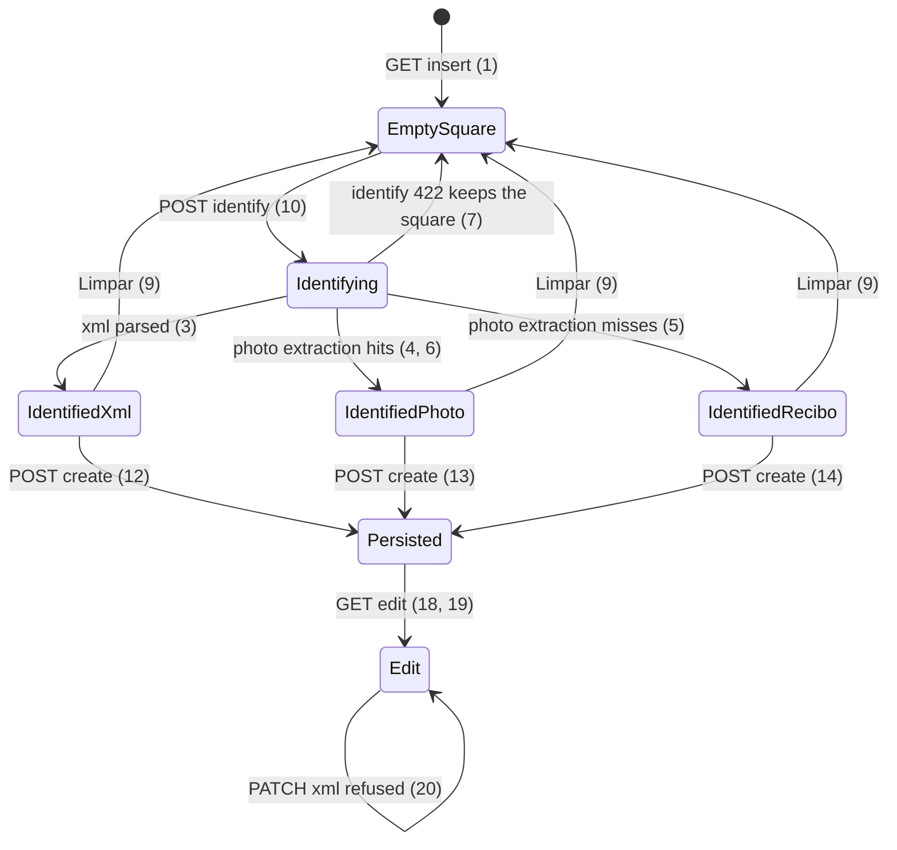

# File-first supporting document insert

> Build this with **tlc-implement**. Profile **`ui`**: screens `documents` insert and
> `documents` edit are binding through `.impeccable/mocks/documents-intake.html`,
> `.impeccable/mocks/document-edit.html`, and `.specs/features/visual-identity/design.md`
> section `documents` (this task already amended that section).
> Every criterion below becomes a check with a proof, referenced by its number. Nothing under
> `Unresolved` gets settled while building.

## Intent

On `GET /supporting_documents` the coordinator and the submitter still fill Tipo, Valor, Data,
and Favorecido before they choose a file. Insert still exposes two pickers, Foto and XML, and
`SupportingDocument::NF_FILES` is `Envie a foto e/ou o XML`. `GET /supporting_documents/:id/edit`
still renders `Incluir XML` under the photo. The conversation that produced this task gives no
conversion figure; the cost is typing values the authorized XML or the photo already carry, and
attaching a second file the product no longer needs.

When this ships, screen `documents` insert is file-first: the proof square is the only file
control; `POST /supporting_documents/identify` fills the book without persisting; Arquivo is Foto
or XML; origin sits under Valor, Data, and Favorecido; Incluir documento is the existing create
POST of exactly one file. Edit has no XML picker. Binding mocks:
`.impeccable/mocks/documents-intake.html` and `.impeccable/mocks/document-edit.html`.

24 criteria in 6 slices · 3 one-way doors · 1 open, of which 0 block

## Criteria

### Empty insert

1. Given a signed-in coordinator of the focused organization with no SupportingDocument, when
   `GET /supporting_documents` runs, then the status is `200`, the first `section` heading is
   `Incluir documento`, that section has no `label[for=photo]` and no `label[for=xml]`, it has
   one `input[type=file]` whose `accept` includes `image/*` and `.xml`, the book contains
   `Inclua o documento. Valor, data e favorecido saem do arquivo.`, `#amount`, `#date`, `#payee`,
   `#kind`, and `#arquivo` are not visible, and Sem mês contains `Nenhum documento`.
2. When that GET runs as a submitter with no document of their own, then the same empty insert
   arrangement as criterion 1 is present (proof square, wait copy, no Foto/XML chips).

### Identify without persisting

3. Given authorized XML of `vNF` `155.00`, emitente `Padaria Central`, `dhEmi` `2026-05-11`,
   chave `43260511222333000181550010000000011123456781`, when that coordinator POSTs
   `POST /supporting_documents/identify` with that file and no other fields, then no
   SupportingDocument is persisted, the status is `200`, the Turbo Stream (or HTML that keeps
   the same file input node) shows Arquivo `XML`, Tipo `Nota fiscal` disabled, Valor `155,00`,
   Data `2026-05-11`, Favorecido `Padaria Central`, that chave, origin text `XML autorizado`
   under Valor, Data, and Favorecido,    those three inputs disabled, preview copy including that XML filename, and a `Limpar`
   control inside the proof square.
4. Given a `.jpg` whose field reading returns `amount_cents` `15500`, `document_on` `2026-05-11`,
   payee `Padaria Central`, and identified and public NFC-e miss, when that coordinator POSTs
   identify with that photo, then no SupportingDocument is persisted, Arquivo is `Foto`, Tipo is
   `Nota fiscal` disabled, Valor/Data/Favorecido match those values and are not disabled, and
   origin under each of the three is `Lido da foto`.
5. Given a `.jpg` whose barcode, chave-digit, identified, public NFC-e, and field reading all
   miss, when that coordinator POSTs identify with that photo, then no SupportingDocument is
   persisted, Arquivo is `Foto`, Tipo is `Recibo` disabled, chave is not visible, Valor, Data,
   and Favorecido are empty and enabled, origin under each is `Digitado`, and
   `Incluir documento` is disabled.
6. Given a `.jpg` whose decode returns chave `43260511222333000181550010000000011123456781` and
   identified consulta returns authorized XML of `vNF` `155.00` emitente `Padaria Central`
   `dhEmi` `2026-05-11`, when that coordinator POSTs identify with that photo, then no
   SupportingDocument is persisted, Tipo is `Nota fiscal`, the three fields show those values
   disabled, and origin under each is `XML autorizado`.
7. If identify is posted an XML that `AuthorizedNfe.parse` rejects, then no SupportingDocument
   is persisted, the status is `422`, `[data-notice="error"]` and the error toast are
   `O XML da nota fiscal não pôde ser lido`, and the proof square's file input node is still
   present (Turbo Stream 422 does not replace the form's file control).
8. If an unauthenticated request POSTs identify with a `.jpg`, then no SupportingDocument is
   persisted and the response is `302` to `/login`.
9. After criterion 3, when `Limpar` runs (no persist), then the square is empty again, the wait
   copy of criterion 1 is visible, `#amount` is not visible, and SupportingDocument count is
   still unchanged.
10. While `POST /supporting_documents/identify` is in flight, the book shows
    `Identificando o arquivo…` (user-triggered; no page-load choreography).

### Kind from the file

11. Always, insert infers kind and does not require `params[:kind]`: a `.xml` file is
    `nota_fiscal`; an image or image-PDF is `nota_fiscal` when identify/submit extraction
    delivers chave, authorized XML, public NFC-e fields, or photo field reading, and `recibo`
    when those all miss.
12. When `POST /supporting_documents` is that authorized XML of criterion 3 and no `kind`, no
    photo, then one SupportingDocument persists `kind` `nota_fiscal`, `fields_origin`
    `uploaded_xml`, that XML blob, no photo blob, `amount_cents` `15500`, and the response is
    `302` to `/supporting_documents`.

### One file on persist

13. When `POST /supporting_documents` is the photo of criterion 4, typed-or-identified values
    matching that reading, and no XML, then one SupportingDocument persists that photo, no XML
    blob, `fields_origin` `photo`, and `302` to `/supporting_documents`.
14. When `POST /supporting_documents` is the miss photo of criterion 5 plus amount `48,90`,
    date `2026-05-12`, payee `Papelaria Lume`, then one SupportingDocument persists `kind`
    `recibo`, that photo, no XML, `chave` `nil`, `fields_origin` `typed`, `amount_cents` `4890`.
15. When `POST /supporting_documents` includes both a `.jpg` photo and an authorized XML, then
    no SupportingDocument is persisted, the status is `422`, and `[data-notice="error"]` is
    `Envie a foto ou o XML`.
16. When `POST /supporting_documents` has neither photo nor XML, then no SupportingDocument is
    persisted, the status is `422`, and `[data-notice="error"]` is `Envie a foto ou o XML`.
17. When a submitter POSTs identify then create as in criterion 12 with XML they uploaded, then
    that document's `account_id` is the submitter, `GET /supporting_documents` is `200` and
    includes `Padaria Central`, and it does not include another organization's documents.

### Edit: no second file

18. Given a persisted nota fiscal with a photo and no XML, when `GET /supporting_documents/:id/edit`
    runs as that coordinator, then the status is `200`, there is no `label[for=xml]` and no
    `input#xml`, Arquivo is visible disabled value `Foto`, Tipo is disabled `Nota fiscal`, the
    proof contains `Foto ·` and that filename, and the lock sentence is
    `O arquivo não pode ser alterado. Exclua o documento e inclua novamente.`
19. Given a persisted nota fiscal with XML and no photo, when that GET edit runs, then Arquivo
    is `XML`, there is no `input#xml`, and the proof shows that XML filename.
20. Given a persisted nota fiscal with a photo and no XML, when `PATCH /supporting_documents/:id`
    includes an XML file, then the document still has no XML blob, the status is `422`, and
    `[data-notice="error"]` is `O XML não pode ser alterado. Exclua o documento e inclua novamente.`
    (`SupportingDocument::XML_LOCKED`).
21. Given a legacy row that already has both photo and XML attached, when GET edit runs, then
    Arquivo is `XML`, there is still no XML picker, the proof may show the photo, and PATCH
    does not purge either blob.

### Origin stamps and binding wire

22. When GET edit runs for a `fields_origin` `uploaded_xml` or `identified` document, then Valor,
    Data, and Favorecido are not editable and each has origin `XML autorizado`. When GET edit
    runs for `fields_origin` `photo`, then those three are editable and each has origin
    `Lido da foto`. When GET edit runs for `fields_origin` `typed` (recibo or typed NF), then
    origin under each is `Digitado`.
23. `.specs/features/visual-identity/design.md` section `documents` describes the proof square
    as the only insert file control, `Limpar` inside the loaded square, Arquivo Foto|XML,
    identify wait copy, edit without XML, and `Envie a foto ou o XML` — the ASCII already
    amended by this task stays that arrangement.
24. Unauthenticated `GET /supporting_documents` and `GET /supporting_documents/:id/edit` stay
    `302` to `/login`; no focused organization stays `302` to `/login`; a submitter GET edit of
    another Account's document stays `404`.

## States

## Out of scope

- Changing how PhotoSymbols, PhotoFields, PublicNfceConsulta, or identified SEFAZ consulta
  read a file - those pipelines already exist; this task only calls them from identify and
  hides kind.
- Justificativas copy, list columns, and the submitter justify form.
- Replacing a persisted file in place - delete and insert remains the path.
- Backfilling or splitting legacy rows that already have both photo and XML.
- Client-side XML parse or OCR in Stimulus.
- Open Finance, NF-e issuance, accountant login.

## Observable

| Surface | Decision | Landing |
| --- | --- | --- |
| screen `documents` insert | empty state | 1, 2 |
| screen `documents` insert | loading | 10 |
| screen `documents` insert | error state | 7, 15, 16 |
| screen `documents` insert | unauthorised | 8, 24 |
| screen `documents` insert | density and ordering | 1, 3, 23 — proof left / book 28rem from 768px; square first below 768px |
| screen `documents` insert | destructive action confirms | n/a — Limpar does not persist; Excluir on the list stays existing Turbo confirm |
| screen `documents` edit | empty / loading | n/a — edit is a persisted row |
| screen `documents` edit | error state | 20 |
| screen `documents` edit | unauthorised | 24 |
| screen `documents` edit | density | 18, 19, 21, 22 — Arquivo, no XML chip, origin under the three |
| screen `documents` edit | destructive action confirms | existing — Excluir keeps `data-turbo-confirm` |
| screen `documents` Sem mês | empty / density | existing — list columns unchanged; 1 only needs `Nenhum documento` |
| API `POST /supporting_documents/identify` | who may call | 8, 24 — focused Access; submitter may identify |
| API `POST /supporting_documents/identify` | error shape and codes | 7 — `422` plus existing `:base` notice and error toast |
| API `POST /supporting_documents/identify` | versioning / rate limit | n/a — same session app as create |
| API `POST /supporting_documents` | error shape and codes | 15, 16 — `422` `Envie a foto ou o XML` |
| API `PATCH /supporting_documents/:id` | error shape and codes | 20 — `422` `XML_LOCKED` |

## Swept

- validation: 11, 15, 16 — xor file; kind inferred; both-files and no-file `422`
- failure modes: 7 — unreadable XML on identify; create still uses existing oversize and type messages
- idempotency and retry: n/a — identify does not persist, so a retried identify cannot create a row; a second create is a second document (existing, no unique chave)
- authorization: 8, 17, 24 — existing focused organization and submitter-own-row rules
- concurrency and ordering: n/a — two identify-then-create sequences persist two rows; no new uniqueness
- data lifecycle: 21 — legacy dual-attachment rows are not migrated or purged
- external-dependency failure: 4, 5, 6 — identify uses the existing identified / public / photo fallbacks; a miss is recibo (5), not a new error
- state transitions: States diagram, 9, 12, 18 — Limpar returns to empty; create persists; edit cannot add XML
- observability: existing — `:base` notice plus error toast on `422`; no new metric

## Impact

| Front | What changes |
|---|---|
| domain | existing term: `SupportingDocument` insert required `kind` and allowed photo and XML together (`NF_FILES` `Envie a foto e/ou o XML`). Insert now infers kind from the file and accepts exactly one of photo or XML. Every `POST /supporting_documents` spec and `SupportingDocument.insert` caller that sent `kind` or both files is a consumer. |
| domain | new term: identify — `POST /supporting_documents/identify` runs the existing extract/parse pipeline and returns filled insert HTML without a SupportingDocument. Lives on `SupportingDocumentsController`. |
| stored data | nothing to migrate. `fields_origin` members unchanged. Legacy rows may still have both blobs; 21. `NF_FILES` and `PHOTO_LOCKED` copy change in the model constants. |

## Decided

| Decision | Shape | Alternative rejected |
|---|---|---|
| Identify does not persist | `POST /supporting_documents/identify` (multipart file). `200` Turbo Stream fills the book and preview and does not replace the file input node. `SupportingDocument` count unchanged. Incluir remains `POST /supporting_documents`. | Persist-on-drop — the list would update before the person confirmed values; Incluir would disappear. Staging blob in the object store — #85 already forbade stashing a failed upload; keeping the File in the input matches that 422 pattern. |
| Kind is inferred from the file | `.xml` → `nota_fiscal`. Image or image-PDF → `nota_fiscal` if extraction delivers, else `recibo`. Tipo is disabled after identify. `params[:kind]` is not required on insert (11, 12). | Ask Tipo after an image, before identify — puts a field back in front of the file. Keep posting kind — the empty square has no Tipo. |
| One file per new document | Create accepts photo XOR XML. Both or neither → `422` `Envie a foto ou o XML`. Edit has no XML control; PATCH of xml → `422` `XML_LOCKED`. | Keep `foto e/ou XML` — the person asked for one file and for Incluir XML on edit to disappear. |

## Surface

| Route | In | Out | Status | Criteria |
|---|---|---|---|---|
| `POST /supporting_documents/identify` | file (photo or xml) | filled insert HTML (Arquivo, Tipo, Valor, Data, Favorecido, Chave, origins); no row | `200`, `422`, `302` `/login` | 3–8, 10 |
| `POST /supporting_documents` | one file, amount, date, payee, optional chave, observation | redirect or 422 | `302`, `422`, `302` `/login` | 11–17 |
| `GET /supporting_documents/:id/edit` | id | Arquivo, no xml input, proof, book | `200`, `302`, `404` | 18, 19, 21, 22, 24 |
| `PATCH /supporting_documents/:id` | amount, date, payee, chave, observation; not a new xml | redirect or 422 | `302`, `422`, `404` | 20 |

## Sources

- Conversation 2026-10-15 (this session) — file first; one file; proof square is the insert control; Limpar in the square; Arquivo Foto\|XML; edit does not attach XML; identify Turbo keep-file; kind inferred. Quote: “todo o quadrado da exibicao do documento como sendo um botao”; “Se o usuario inserir o xml, nao precisa de foto”; “a opcao de incluir XML na tela de edicao vai desaparecer” (user later chose remove).
- `.impeccable/mocks/documents-intake.html` — **binding for the interface**: screen `documents` insert
- `.impeccable/mocks/document-edit.html` — **binding for the interface**: screen `documents` edit
- `.specs/features/visual-identity/design.md` section `documents` — **binding for the interface** after this task's amendment (proof square, xor file, edit without XML)
- `DESIGN.md` — tokens only (ledger paper, caixa, margem, IBM Plex). Insert no longer uses the chip file-field; statements and A1 still do.
- `GLOSSARY.md` Supporting document — photo and/or XML; this task narrows **new** writes to xor; Recibo photo is not read.
- Existing `SupportingDocument#submit` extract order (uploaded XML, identified, public NFC-e, photo fields, typed) — identify reuses it; does not restipulate the decode.

This task is the record of decision. If a linked document diverges, ask before building.

## Unresolved

| # | Kind | Question | Until answered |
|---|---|---|---|
| 1 | open | Origin copy for `fields_origin` `nfc_e_public` on Valor/Data/Favorecido | Criteria 22 do not name that origin. Until answered, render `Consulta NFC-e` (correctable, same as photo). |
