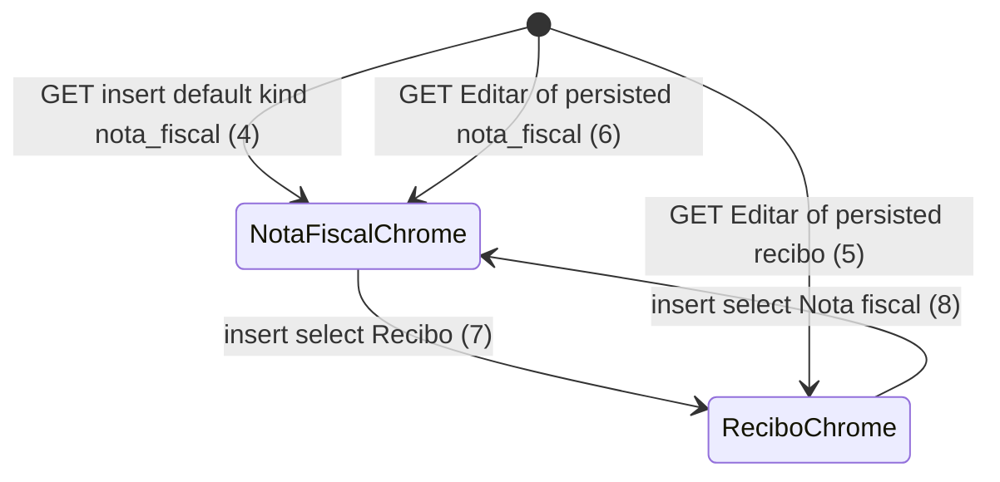

# Document insert form

> Build this with **tlc-implement**. Profile **`ui`**: screen `documents` is binding through
> `.specs/features/visual-identity/design.md` (criterion 13).
> Every criterion below becomes a check with a proof, referenced by its number. Nothing under
> `Unresolved` gets settled while building.

## Intent

The documents insert form posts `date` from `date_field_tag :date, nil`. The native control looks
filled and is empty, so a submit that did not touch Data still 422s `Informe valor, data e
favorecido`. Labels are `Chave de acesso` and `Observação` with no optional mark. Tipo Recibo still
shows chave and XML even though `SupportingDocument` rejects XML (`Recibo não tem XML`) and stores
`chave` `nil`. Issue #79 gives no conversion figure; the cost is a date that looks set and a Recibo
path that invites fields the model will throw away or reject.

When this ships, screen `documents` (`GET /supporting_documents`) insert form has Data as
`Date.current`, labels `Chave de acesso (opcional)` and `Observação (opcional)`, and Recibo hides
chave and the XML control (photo only), via Stimulus on kind. NF chave stays optional; 44 digits
when typed without a photo chave. Success and `:base` 422 toasts stay the #76 helper already on
`POST /supporting_documents`. OCR/chave extraction and keeping values on 422 stay out.

13 criteria in 3 slices · 1 one-way door · 1 open, of which 0 block

## Criteria

### Date default and optional labels

1. Given `Date.current` is `2026-10-05` and a signed-in coordinator of the focused organization,
   when `GET /supporting_documents` runs, then the status is `200`, the insert form (`POST`
   `/supporting_documents`) has `label[for=date]` text `Data`, and `input#date[type=date]` has
   `value` `2026-10-05` (not empty).
2. Given `Date.current` is `2026-10-05` and that organization has a recibo dated `2026-05-11` with
   id `{id}`, when `GET /supporting_documents` runs, then that row’s Editar form has
   `input#date_{id}[type=date]` with `value` `2026-05-11`.
3. When `GET /supporting_documents` runs as in criterion 1, then the insert form has
   `label[for=chave]` whose text is exactly `Chave de acesso (opcional)` and `label[for=observation]`
   whose text is exactly `Observação (opcional)`. That same GET, for the document in criterion 2,
   has Editar `label[for=chave_{id}]` and `label[for=observation_{id}]` with those same two strings.

### Recibo hides chave and XML

4. When `GET /supporting_documents` runs as in criterion 1, then insert `select#kind` has selected
   `value` `nota_fiscal`, and insert `input#chave` and `input#xml` are present, not `disabled`, and
   not `hidden`.
5. Given a persisted recibo with id `{id}` on the focused organization, when `GET /supporting_documents`
   runs, then that Editar form’s `select#kind_{id}` has selected `value` `recibo`, that form’s chave
   and xml controls are `disabled` and not visible, and that form still has a photo file control that
   is visible and not `disabled`.
6. Given a persisted `nota_fiscal` with id `{id}` on the focused organization, when
   `GET /supporting_documents` runs, then that Editar form’s selected kind is `nota_fiscal`, and that
   form’s chave and xml controls are visible and not `disabled`.
7. Given the insert form on that GET with kind `nota_fiscal`, when Tipo is set to Recibo, then insert
   `input#chave` and `input#xml` are not visible and are `disabled`, and insert `input#photo` stays
   visible and not `disabled`.
8. Given the insert form after criterion 7, when Tipo is set to Nota fiscal, then insert
   `input#chave` and `input#xml` are visible and not `disabled`.

### Persist, chave rule, toasts, binding wireframe

9. When `POST /supporting_documents` inserts a recibo with photo and the other required fields and
   no XML, then the response is `302` to `/supporting_documents`, the row has `chave` `nil` and no
   XML blob, and the following `GET` has `[data-toast-kind="success"]` text `Pronto.`
10. When `POST /supporting_documents` is `kind=nota_fiscal`, a photo, typed amount `155,00`, date
    `2026-05-11`, payee `Padaria Central`, and chave `123`, then no SupportingDocument is persisted,
    the status is `422`, `[data-notice="error"]` is `Informe a chave de acesso com 44 dígitos`, and
    `[data-toast-kind="error"]` is that same string.
11. When `POST /supporting_documents` is `kind=recibo` with photo and an XML file, then no
    SupportingDocument is persisted, the status is `422`, `[data-notice="error"]` is
    `Recibo não tem XML`, and `[data-toast-kind="error"]` is that same string.
12. When `POST /supporting_documents` is `kind=nota_fiscal`, a `.jpg` photo, typed `155,00` /
    `2026-05-11` / `Padaria Central`, and chave `43260511222333000181550010000000011123456781`, and
    identified consulta does not deliver, then one SupportingDocument persists with that chave.
13. `.specs/features/visual-identity/design.md` section `documents` — `GET /supporting_documents`
    shows insert Data defaulted to today, labels `Chave de acesso (opcional)` and
    `Observação (opcional)`, and Tipo Recibo hiding chave and XML (photo only).

## States

Document insert/apply/confirm persist is unchanged (existing). This diagram is only the form chrome
for chave and XML.

## Out of scope

- Photo OCR, barcode/QR chave capture, and field extraction — #79
- Echoing typed values or keeping `input type=file` on `422` — #85
- Changing NF chave validation (optional; 44 digits if filled without a photo chave) — 10, 12
- Toast chrome, timeout, `Pronto.`, and `flash[:toast]` keys — #76, already on create
- Success toast on `PATCH` / `DELETE` / `sefaz_confirm` — those actions still `redirect_to` without
  `redirect_success`; not this recorte
- List rows, Editar layout beyond kind chrome and the two labels, Excluir, Usar dados da SEFAZ,
  justificativas
- Default kind other than `nota_fiscal`
- Client-only validation; making Data `required` in HTML
- Setting `config.time_zone` — Unresolved uses `Date.current` as the app already does

## Observable

| Surface | Decision | Landing |
| --- | --- | --- |
| screen `documents` insert form | empty state | existing — `Nenhum documento` when the focused organization has no row; the insert form still renders (1) |
| screen `documents` insert form | loading | n/a — Turbo full-page / redirect; no progress chrome |
| screen `documents` insert form | error state | 10, 11 — existing `:base` notice plus error toast; this cut does not keep typed values (#85) |
| screen `documents` insert form | unauthorised | existing — unauthenticated `GET`/`POST` `302` `/login`; no focused org `302` `/login` |
| screen `documents` insert form | density and ordering | 1, 3, 4 — date filled; optional labels; NF shows chave and XML first |
| screen `documents` insert form | destructive action confirms | existing — insert is not destructive; `Excluir` still Turbo-confirms |
| screen `documents` Editar form | empty / loading | n/a — Editar is per existing row inside `
` |
| screen `documents` Editar form | error state | existing — `PATCH` `422` still `render_document_error`; #85 does not cover edit |
| screen `documents` Editar form | density | 2, 3, 5, 6 — date stays `document_on`; Recibo hides chave and XML |
| HTML `POST /supporting_documents` | who may call it | existing — focused Access (coordinator or submitter) |
| HTML `POST /supporting_documents` | response / error shape and codes | 9, 10, 11, 12 — `302` or `422` with the existing first `:base` string |
| HTML `POST /supporting_documents` | versioning | n/a — existing HTML form; no new resource |
| HTML `POST /supporting_documents` | rate limit | n/a — small operator set |
| HTML `GET /supporting_documents` | who / codes | existing — 1 is a focused `200` |
| document `.specs/features/visual-identity/design.md` | structure, tone, depth, next action | 13 |
| collection supporting documents | grouping, naming, ordering, duplicates, exception | existing — list order and duplicate inserts unchanged; this cut is form chrome |

## Swept

- validation: 10, 12 — typed chave still 44 digits when present without photo chave; blank chave on NF with photo still persists (existing). Observation stays optional. Date still fails insert if the posted value is not a calendar date (existing `Informe valor, data e favorecido`); 1 only defaults the GET control
- failure modes: 10, 11 — invalid chave and recibo+XML stay the same `422` strings and error toast
- idempotency and retry: existing — two valid recibo inserts still persist two rows; `GET` twice still shows `Date.current` (1)
- authorization: existing — `require_focused_organization`; submitter still uses the same insert template; other-organization `404` on mutate
- concurrency and ordering: n/a — chrome is per request HTML plus one browser form; two overlapping POSTs still persist two rows (existing). Disabled Recibo fields are per form, not a shared lock
- data lifecycle: n/a — no new column; no backfill; Recibo still stores `chave` `nil` (9)
- external-dependency failure: n/a — OCR/consulta out of this recorte; 12 does not require identified consulta to deliver
- state transitions: 4, 5, 6, 7, 8 — form chrome for kind; document persist states unchanged
- observability: n/a — the source names no log, metric, or trace; the person sees the form and the existing toast

## Impact

| Front | What changes |
|---|---|
| domain | no new glossary term |
| domain | existing term: Recibo — still photo-only, no chave, no XML on persist. The insert/Editar chrome now hides those controls when kind is Recibo instead of showing fields the model rejects or zeros. Callers: `app/views/supporting_documents/index.html.erb`, `SupportingDocumentsController#create` / `#update` |
| stored data | nothing to migrate |

## Decided

| Decision | Shape | Alternative rejected |
|---|---|---|
| Recibo hides by not showing and not submitting | When kind is Recibo, that form’s chave and xml controls are not visible and are `disabled` (omitted from the payload). Initial state comes from the selected kind in the HTML; Stimulus updates on `change`. Photo stays. | CSS-only hide that still posts XML and 422s `Recibo não tem XML`, which is the UI the model already rejects. A full page reload per kind — #79 names Stimulus |

## Surface

| Route | In | Out | Status | Criteria |
|---|---|---|---|---|
| `GET /supporting_documents` | session, focus | documents HTML, insert form, list | `200`, `302` | 1–8, 13 |
| `POST /supporting_documents` | kind, amount, date, payee, observation, chave, photo, xml | redirect or index `422` | `302`, `422` | 9–12 |

## Sources

- https://github.com/gutors/ai-accounting-assistant/issues/79 — **binding for this slice**: one
  screen, Stimulus for kind; `date_field` value today (`Date.current`), not empty; labels
  `Chave de acesso (opcional)` and `Observação (opcional)`; NF chave rule unchanged; Tipo Recibo
  hides chave and XML (photo only); toasts via #76; OCR out; 422 keep-values is #85
- https://github.com/gutors/ai-accounting-assistant/issues/75 — parent: this child is the documents
  inclusion form; 422 keep-values after documents and A1
- https://github.com/gutors/ai-accounting-assistant/issues/76 — toast helper already on create
  `redirect_success` / `toast_now`
- `.specs/features/visual-identity/design.md` — **binding for the interface** once criterion 13
  lands: screen `documents`
- `app/views/supporting_documents/index.html.erb` — today’s empty date, labels without `(opcional)`,
  chave and XML always in the form
- `SupportingDocument` — `RECIBO_XML`, `CHAVE_DIGITS`, Recibo zeros chave
- Open default in Unresolved 1 — Editar shares hide and optional labels; date default is insert only

This task is the record of decision. If a linked document diverges, ask before building.

## Unresolved

| # | Kind | Question | Until answered |
|---|---|---|---|
| 1 | open | Does Editar share Recibo hide and the two `(opcional)` labels, or only the inclusion form? #79 is titled inclusão; the same screen already has kind, chave, and XML on Editar, and the model zeros chave / rejects XML on apply too. | Editar shares hide and labels (2, 3, 5, 6). Date default is insert only (1 vs 2) |
