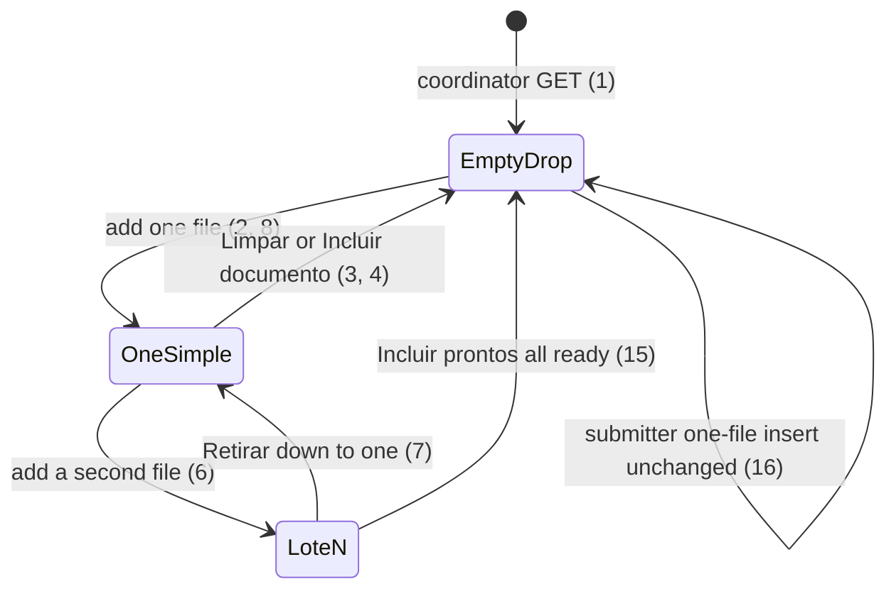

# Documents insert: one-file chrome, proof caption, readonly Tipo

> Build this with **tlc-implement**. Profile **`ui`**: screen `documents` insert for the
> coordinator is binding through `.impeccable/mocks/documents-insert-refine.html` (scenes
> `Um arquivo`, `XML (tipo travado)`, `Lote`). Every criterion below becomes a check with a
> proof, referenced by its number. Nothing under `Unresolved` gets settled while building.

## Intent

Coordinator insert on `GET /supporting_documents` always paints lote chrome after the first
file: primary `Incluir prontos (N)`, secondary `Incluir este`, secondary `Retirar`, and the
Situação sheet, even when N is 1. The proof stacks three lines (`Foto · filename`, Tipo,
`Foto · sem leitura nesta versão`) plus a disabled `#arquivo` field, while Tipo is already
on the book as a grayed `select:disabled`. The conversation that produced this task gives no
conversion figure; the cost is a one-file include that still looks like a pile, and a square
that repeats Arquivo and Tipo.

When this ships, one file in the lote is the simple include: heading `Incluir documento`,
primary `Incluir documento`, `Limpar` in the proof, no `Incluir prontos`, no `Incluir este`,
no Situação sheet. Two or more files keep lote B. The line under the image is
`FOTO - {filename}` or `XML - {filename}` (`FOTO`/`XML` bold 600, uppercase). There is no
`#arquivo` field. After identify, Tipo is a readonly text field, not a disabled select.
Identify still does not persist. Submitter insert and Editar stay as they are.

18 criteria in 3 slices · 0 one-way doors · 0 open, of which 0 block

## Criteria

### One file is the simple include

1. Given a signed-in coordinator of the focused organization with no SupportingDocument and
   no files in the lote, when `GET /supporting_documents` runs, then the status is `200`,
   the insert `h2` is `Incluir documentos`, that section has one
   `input[type=file][multiple]`, there is no lote sheet with heading cells `Situação`, and
   there is no `Incluir prontos`.
2. Given that coordinator adds one authorized XML `proc-nfe-padaria.xml` (`vNF` `155.00`
   emitente `Padaria Central` `dhEmi` `2026-05-11`), when identify finishes, then the insert
   `h2` is `Incluir documento`, there is no lote sheet with heading cells `Situação`, there
   is no `Incluir prontos`, there is no `Incluir este`, there is no `Retirar`, the proof
   includes `Limpar`, and the primary control is `Incluir documento` with class
   `ds-btn-primary` (caixa fill, sheet text, padding `8px` `16px`).
3. When that `Incluir documento` runs, then one SupportingDocument persists for Padaria
   (`kind` `nota_fiscal`, `amount_cents` `15500`, that XML, no photo), Sem mês includes
   `Padaria Central` and `R$ 155,00`, the empty drop is visible again (`h2`
   `Incluir documentos`), and the response does not navigate away from
   `/supporting_documents` as a full-page `302` that would be needed only if lote remainder
   existed.
4. After criterion 2, when `Limpar` runs, then SupportingDocument count stays `0`, the empty
   drop of criterion 1 is visible, and `Limpar` is gone.
5. Given that coordinator adds one `.jpg` whose barcode, chave-digit, identified, public
   NFC-e, and field reading all miss, when Valor, Data, or Favorecido is empty, then
   activating `Incluir documento` persists no SupportingDocument.
6. After criterion 2, when that coordinator adds a second authorized XML
   `proc-nfe-farmacia.xml` (`vNF` `89.40` emitente `Farmácia São José` `dhEmi` `2026-05-03`),
   then the insert `h2` is `Incluir documentos`, a lote sheet is visible with head cells
   `Data`, `Favorecido`, `Tipo`, `Valor`, `Situação` and two rows for those filenames, the
   toolbar is primary `Incluir prontos (` with a count `)` then secondary `Incluir este`
   then secondary `Retirar`, and the proof does not include `Limpar`.
7. After criterion 6 with both Pronto, when `Retirar` runs on the Farmácia row, then one
   file remains, the insert `h2` is `Incluir documento`, there is no lote sheet with heading
   cells `Situação`, there is no `Incluir prontos`, and `Limpar` plus primary
   `Incluir documento` are back.
8. While `POST /supporting_documents/identify` for the only file `danfe-mercado.jpg` is in
   flight, then the page includes `Identificando o arquivo…`, there is no lote sheet with
   heading cells `Situação`, and SupportingDocument count stays `0`.
9. If the only file added is an XML that `AuthorizedNfe.parse` rejects, then count stays
   `0`, `[data-notice="error"]` or the error toast includes
   `O XML da nota fiscal não pôde ser lido`, there is no lote sheet with heading cells
   `Situação`, and `Limpar` is present.

### Proof caption is one line

10. After criterion 5’s Digitar row is on screen (one file), then the proof has no
    `label[for=arquivo]` and no `input#arquivo`, the caption under the image is one line
    whose first word is `FOTO` inside `strong` (computed `font-weight` `600`) followed by
    ` - ` and `empty.jpg` (or that file’s name), and the proof does not contain
    `sem leitura nesta versão` or a separate line whose only text is `Recibo` or
    `Nota fiscal`.
11. After criterion 2, then that caption is `XML` inside `strong` (weight `600`) followed by
    ` - ` and `proc-nfe-padaria.xml`, with no `input#arquivo`.
12. After criterion 6, when the coordinator selects the Padaria row, then criterion 11’s
    caption still holds on the selected proof, the Padaria row is `aria-selected="true"`,
    and the proof `img` is not visible (XML). The object-URL thumb for a selected image or
    PDF stays as `.tasks/lote-insert-proof-and-chave.md` 9–11.

### Tipo is a readonly field after identify

13. After criterion 2, then the book has `label[for=kind]` `Tipo`, `input#kind` with value
    `Nota fiscal` is `readonly` and not `disabled`, there is no visible `select#kind`, and
    `input#chave` is the next named control after `#kind` in document order.
14. After criterion 5, then `input#kind` is `readonly` with value `Recibo`, Valor, Data, and
    Favorecido are empty and enabled with origin `Digitado`, and the chave control is not
    visible.

### Unchanged persist and other roles

15. After criterion 6 (both Pronto), when `Incluir prontos (2)` runs, then two
    SupportingDocuments persist those two XMLs and Sem mês includes `Padaria Central`,
    `Farmácia São José`, `R$ 155,00`, and `R$ 89,40`.
16. When that GET runs as a submitter with no document of their own, then the insert `h2` is
    `Incluir documento`, the file input is not `multiple`, the wait copy
    `Inclua o documento. Valor, data e favorecido saem do arquivo.` is present, and
    `Incluir prontos` is absent.
17. Always, `GET /supporting_documents/:id/edit`, Sem mês columns, Justificativas, and
    submitter justify stay as they are after this ships.
18. Unauthenticated `GET /supporting_documents` stays `302` to `/login`.

## States

## Out of scope

- Submitter one-file insert chrome (caption, Arquivo field, Tipo select) — the source is
  coordinator lote; submitter already has `Incluir documento`.
- `GET /supporting_documents/:id/edit` proof caption and Tipo — different screen; 17 keeps
  it.
- Letting Tipo change after identify — `SupportingDocument::KIND_LOCKED` and infer-on-blank
  stay; this task only changes the locked control from disabled select to readonly input.
- Changing `POST /supporting_documents/batch` shape, the 30-file cap, xor photo/XML, or
  identify-does-not-persist.
- Lote sheet cell copy (Favorecido second line) beyond hiding the sheet when N is 1.
- Queue (A) and dump-then-edit (C).

## Observable

| Surface | Decision | Landing |
| --- | --- | --- |
| screen `documents` insert coordinator | empty state | 1, 4 |
| screen `documents` insert coordinator | loading | 8 |
| screen `documents` insert coordinator | error state | 9 |
| screen `documents` insert coordinator | unauthorised | 18 |
| screen `documents` insert coordinator | density and ordering | 2, 6, 7, 10, 11, 12, 13 — one-file: no sheet, primary Incluir documento, Limpar in proof, caption under image, no `#arquivo`; N≥2: lote B toolbar then sheet; Tipo then chave |
| screen `documents` insert coordinator | destructive action confirms | existing — `Limpar` / `Retirar` have no `data-turbo-confirm` (lote is not persisted); 4, 7 |
| screen `documents` insert submitter | empty / density | 16 — existing one-file square |
| screen `documents` Sem mês | empty / density | existing columns; 3, 15 only add persisted rows |
| screen `documents` edit | empty / error / unauthorised / density / confirm | existing — 17 |
| API `POST /supporting_documents/identify` | who may call / error shape | existing — 8, 9 reuse identify `422` XML unreadable |
| API `POST /supporting_documents/identify` | versioning / rate limit | n/a — same session app |
| API `POST /supporting_documents` | error shape and codes | 5 — empty Digitar persists none (existing Incluir este guard) |
| API `POST /supporting_documents/batch` | who may call / error / versioning | existing — 15 is the N≥2 persist already specified |

## Swept

- validation: 5 — empty Digitar cannot include; xor and batch missing amount/date/payee stay existing
- failure modes: 9 — unreadable XML is the existing notice/toast; no lote sheet when N is 1
- idempotency and retry: n/a — a second successful include of the same file still creates a second document (existing: no unique chave)
- authorization: 16, 18 — submitter keeps one-file create; unauthenticated `302` `/login`; batch stays coordinator
- concurrency and ordering: n/a — chrome only; existing in-flight disable of `Incluir prontos` is unchanged for N≥2
- data lifecycle: n/a — no draft table; Files live in the lote until Incluir, Limpar, or Retirar; nothing to backfill
- external-dependency failure: 8, 9 — same identify as today; in-flight copy; unreadable XML
- state transitions: States diagram, 2, 3, 4, 6, 7, 15 — one file is simple include; two files open lote B; Retirar to one restores simple
- observability: existing `:base` notice plus error toast on identify `422` (9); no new metric

## Impact

| Front | What changes |
|---|---|
| domain | no new term. lote still means unpersisted identified files on coordinator insert. |
| domain | existing term: coordinator insert after the first file meant lote B chrome (toolbar + Situação sheet + `#arquivo` under the proof + `select#kind` disabled). It now means that chrome only when N≥2; N=1 is the simple include. `document_lote_controller.js` `render` / `renderToolbar` / `paintBook` and `spec/system/document_lote_spec.rb` branch on those pixels. |
| stored data | nothing to migrate |

## Decided

None — nothing here is one-way. Same identify, same `POST /supporting_documents/batch`, same xor SupportingDocument. The chrome, caption, and readonly Tipo reverse by restoring the previous markup.

## Surface

| Route | In | Out | Status | Criteria |
|---|---|---|---|---|
| `GET /supporting_documents` | session · focus | coordinator insert (empty drop, one-file simple, or lote N≥2) or submitter one-file | `200`, `302` `/login` | 1, 2, 16, 18 |
| `POST /supporting_documents/identify` | one `file` | filled fields; no row | `200`, `422`, `302` `/login` | 8, 9 |
| `POST /supporting_documents` or `POST /supporting_documents/batch` | one ready file + book fields | one row; empty drop | `200` turbo or `302`, `422` | 3, 5 |
| `POST /supporting_documents/batch` | two ready files | two rows | `302` or `200` turbo | 15 |

## Sources

- Conversation 2026-10-21 — three changes on coordinator documents insert, then caption
  locked. Quote: “Quando for adicionado apenas 1 documento, mostrar tela de inclusao
  simples (sem botao Incluir prontos, apenas 1 botao simples de incluir - pode ser o
  estilo de botoes que existia antes)”; “Reduzir excesso de informacao no quadrado
  esquerdo das imagens… podemos remover o tipo neste quadrado”; “O Tipo deixar readonly
  quando nao puder ser alterado”; “O valor do campo Arquivo pode estar antes do nome do
  documento, abaixo da imagem. Exemplo: Foto - recibo.papelria.jpg. Coloque em maiusculas
  e bold. FOTO”; “Perfeito, tlc-plan por favor”.
- `.impeccable/mocks/documents-insert-refine.html` — **binding for the interface**: screen
  `documents` insert (coordinator). Scenes `Um arquivo` (primary `Incluir documento`,
  `Limpar`, caption `FOTO - recibo-papelaria.jpg`, no `#arquivo`, `select` is not the
  locked Tipo), `XML (tipo travado)` (`input` Tipo `Nota fiscal` readonly, caption
  `XML - proc-nfe-padaria.xml`), `Lote` (`Incluir prontos`, `Incluir este`, `Retirar`,
  Situação sheet, no `Limpar`).
- `.impeccable/surfaces/impeccable-mocks-documents-insert-refine-html.md` — direction
  contract for that mock
- `.tasks/coordinator-batch-document-insert.md` — lote B for N files; C7 `#arquivo` under
  the proof and C8/C22 always-on lote toolbar are superseded for N=1 and for the Arquivo
  field / caption on every N
- `.tasks/lote-insert-proof-and-chave.md` — proof object-URL thumbs; chave immediately
  below Tipo (`#kind` stays the previous named control, now an `input`)
- `DESIGN.md` — primary button caixa / sheet / `8px` `16px` / `4px`; The Sentence Case
  Rule does not apply to the `FOTO`/`XML` stamp the conversation locked
- `GLOSSARY.md` Supporting document — photo XOR XML on new writes

This task is the record of decision. If a linked document diverges, ask before building.

## Unresolved

| # | Kind | Question | Until answered |
|---|---|---|---|
| | | None | |
