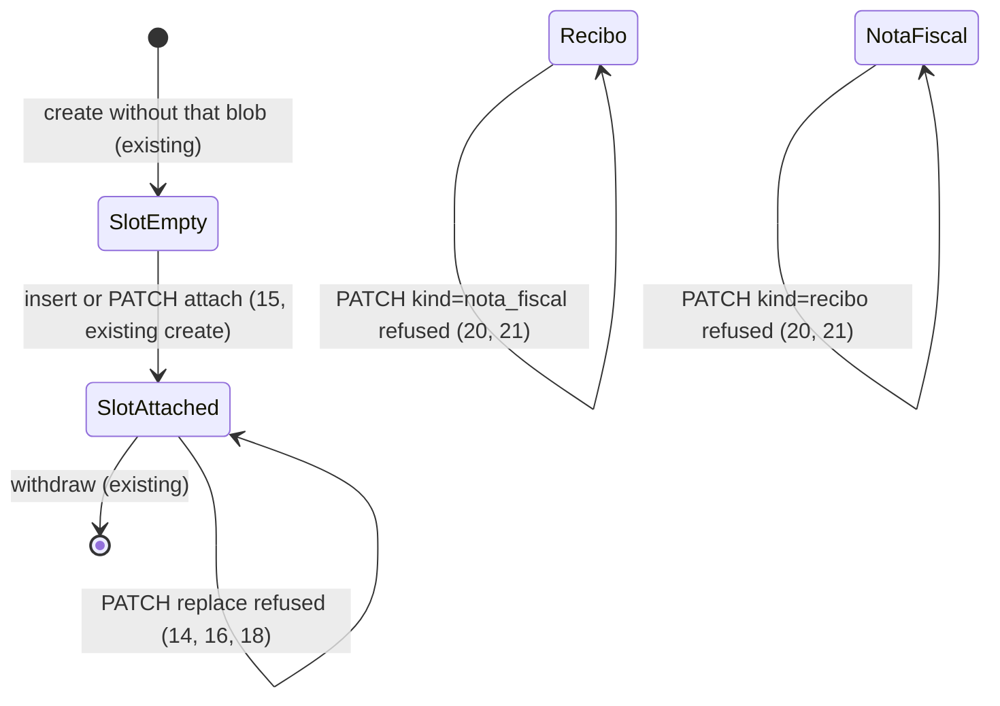

# Documents list mask and actions

> Build this with **tlc-implement**. Profile **`ui`**: screen `documents` is binding through
> `.specs/features/visual-identity/design.md` and `DESIGN.md` (criterion 11).
> Every criterion below becomes a check with a proof, referenced by its number. Nothing under
> `Unresolved` gets settled while building.

## Intent

On `GET /supporting_documents`, Valor is a plain text field (empty on insert) and insert Tipo
defaults to Nota fiscal. Typing `100` posts `100`, and
`BrlCents.parse` stores `10000` cents (R$ 100,00) because a string with no comma is reais, not
centavos. The Sem mês sheet is date | payee+kind+filenames | amount; Tipo is a meta line under
Favorecido; Editar and Excluir share one `
` in that cell. The shipped visual-identity
check C45 asserts that placement. Editar file controls always show `Nenhum arquivo`; PATCH with a
new photo replaces the blob (`PATCH new photo replaces filename`). Editar `select#kind_{id}` can
change Recibo ↔ Nota fiscal; `apply` then purges XML, fires consulta, or unlocks. The
conversation gives no conversion figure; the cost is a wrong amount from ordinary typing, a list
that hides kind and actions, a file the person thought they were editing when the control looked
empty, and a Tipo change that is a different document.

When this ships, screen `documents` (`GET /supporting_documents`) formats Valor as
centavos-first while typing (`1` → `0,01`, `10` → `0,10`, `100` → `1,00`) on document insert/edit
and on justification Valor gasto. Insert Valor (and new-justification Valor gasto) show `0,00` as
format hint; posting `0,00` is still invalid. Insert Tipo has no Recibo/Nota fiscal selected.
Sem mês columns are Data | Favorecido | Tipo | Valor | Ações. The document filename stays under
Favorecido. Ações holds Editar (same `
` panel) and Excluir (list, not inside the panel).
An already-attached photo or XML shows its filename on Editar and cannot be replaced; an empty
slot can still receive a file. Tipo on Editar cannot change; a different tipo is delete and
insert. Binding design: `.specs/features/visual-identity/design.md` section `documents`
(amended) and `DESIGN.md` ledger / file-field rules.

25 criteria in 5 slices · 3 one-way doors · 2 open, of which 0 block

## Criteria

### Centavos-first Valor mask

1. Given a signed-in coordinator of the focused organization on `GET /supporting_documents`, then
   insert `#amount` value is `0,00`. When the person then types `1`, then `0`, then `0` into that
   field, then its value is `0,01`, then `0,10`, then `1,00`.
2. Given a persisted recibo on that organization with `amount_cents` `15500` and id `{id}`, when
   `GET /supporting_documents` runs, then `#amount_{id}` value is `155,00` after the page is
   interactive, with no extra digits typed.
3. Given a signed-in submitter of the focused organization on `GET /supporting_documents`, then
   `#justification_amount` value is `0,00`. When the person then types `1`, then `0`, then `0`
   into that field, then its value is `1,00`. Given that submitter has a justification with
   `amount_cents` `30000` and id `{id}` whose documents all have `month_id` nil, when that GET
   runs, then `#justification_amount_{id}` value is `300,00` after the page is interactive.
4. When `POST /supporting_documents` inserts a recibo with photo, date `2026-05-11`, payee
   `Padaria Central`, and amount `1,00`, then one SupportingDocument persists with `amount_cents`
   `100`.
5. When `GET /supporting_documents` runs as in criterion 1, then insert `#amount` has
   `inputmode` `numeric`. That same GET, for every rendered `#amount_{id}` (when Valor is shown),
   `#justification_amount`, and `#justification_amount_{id}`, also has `inputmode` `numeric`.

### Sem mês Tipo and Ações

6. Given at least one supporting document on the focused organization, when
   `GET /supporting_documents` runs, then `.ledger-head.ledger-doc` has five children whose text
   in order is `Data`, `Favorecido`, `Tipo`, `Valor`, `Ações`.
7. Given a recibo `Padaria Central` with photo filename `foto.jpg` and `amount_cents` `15500`, when
   `GET /supporting_documents` runs, then that `li[data-row="document"]` has a Tipo cell whose
   text is exactly `Recibo`, a Favorecido cell that contains `Padaria Central` and `foto.jpg`, and
   that Favorecido cell’s text does not include `Recibo`.
8. When that GET runs, then that row’s `PATCH /supporting_documents/{id}` form sits inside a
   `
` whose `
` text is `Editar`, and that `
` is not inside the
   Favorecido cell.
9. Given that document has `month_id` nil and the session may delete it (coordinator on focus, or
   submitter who owns the row), when that GET runs, then the row has a `Excluir` control posting
   `DELETE /supporting_documents/{id}` with `data-turbo-confirm` `Excluir este documento?`, that
   control is not inside the Editar `
`, and that `
` contains no `Excluir`
   control.
10. Given that document has `month_id` set, when `GET /supporting_documents` runs, then that row
    still has Editar as in criterion 8 and has no `Excluir` control.
11. `.specs/features/visual-identity/design.md` section `documents` — Sem mês is date | payee
    (filenames, chave, observation, month status as meta under payee) | Tipo | amount | Ações
    (`Editar` disclosure; `Excluir` in Ações, not inside the edit panel). Kind is not a meta line
    under payee. Editar does not offer a control that changes Tipo.

### Attached file locked on Editar

12. Given a recibo with photo filename `foto-antiga.jpg` and id `{id}`, when
    `GET /supporting_documents` runs, then the Editar photo file field shows `foto-antiga.jpg`,
    `#photo_{id}` is `disabled`, and that field has no `Limpar` control.
13. Given a `nota_fiscal` with XML filename `autorizada.xml`, no photo, and id `{id}`, when
    `GET /supporting_documents` runs, then the Editar XML file field shows `autorizada.xml` and
    `#xml_{id}` is `disabled` with no `Limpar` on that field, and the Editar photo field shows
    `Nenhum arquivo`, `#photo_{id}` is not `disabled`, and that photo field has `Incluir foto` and
    `Limpar`.
14. Given the recibo in criterion 12, when `PATCH /supporting_documents/{id}` includes a new
    photo `foto-nova.jpg`, then no blob is replaced, the status is `422`,
    `[data-notice="error"]` and `[data-toast-kind="error"]` are `A foto não pode ser alterada.
    Exclua o documento e inclua novamente.`, and the photo filename is still `foto-antiga.jpg`.
15. Given the xml-only `nota_fiscal` in criterion 13, when `PATCH /supporting_documents/{id}`
    includes photo `recibo-novo.jpg` and does not send a different `kind` (omit `kind`, or send
    `nota_fiscal`), then the status is `302` to `/supporting_documents`, `kind` is still
    `nota_fiscal`, photo filename is `recibo-novo.jpg`, and XML filename is still
    `autorizada.xml`.
16. Given a `nota_fiscal` that already has XML filename `autorizada.xml` and id `{id}`, when
    `PATCH /supporting_documents/{id}` includes a new XML file `outra.xml`, then no blob is
    replaced, the status is `422`, `[data-notice="error"]` and `[data-toast-kind="error"]` are
    `O XML não pode ser alterado. Exclua o documento e inclua novamente.`, and the XML filename
    is still `autorizada.xml`.
17. When `GET /supporting_documents` runs as in criterion 1, then insert `#photo` is not
    `disabled`, its file field shows `Nenhum arquivo`, and it has `Limpar`. Insert XML follows
    criterion 24 (hidden until Tipo is Nota fiscal).
18. Always, `SupportingDocument#apply` (and `submit` on a persisted row) does not attach a new
    photo when `photo` is already attached, and does not attach a new XML when `xml` is already
    attached; the refused call adds the matching `:base` string from criterion 14 or 16. Insert
    of a new row still attaches (4, existing create). Criterion 15 remains the empty-slot attach
    path.

### Tipo locked on Editar

19. Given a persisted recibo with id `{id}` and a persisted `nota_fiscal` with id `{nf_id}`, when
    `GET /supporting_documents` runs, then neither Editar form has an enabled `select#kind_{id}`
    or `select#kind_{nf_id}` (the control is absent, or present and `disabled`). Insert
    `select#kind` stays enabled. Recibo Editar still hides chave and XML; Nota fiscal Editar still
    shows them (existing chrome, from persisted kind).
20. Given a persisted `nota_fiscal` with id `{id}`, when `PATCH /supporting_documents/{id}` is
    `kind=recibo`, then `kind` stays `nota_fiscal`, the status is `422`, `[data-notice="error"]`
    and `[data-toast-kind="error"]` are `O tipo não pode ser alterado. Exclua o documento e
    inclua novamente.` Given a persisted recibo with id `{id}`, when that PATCH is
    `kind=nota_fiscal`, then `kind` stays `recibo`, the status is `422`, and notice and toast are
    that same string.
21. Always, `SupportingDocument#apply` (and `submit` on a persisted row) does not change `kind`;
    if the posted `kind` differs from the persisted value, it adds the `:base` string from
    criterion 20 and does not persist the new kind. Insert of a new row still sets kind (4,
    existing create). Omitting `kind` on PATCH still applies the other attrs (15).

### Insert Valor hint and Tipo choice

22. When `POST /supporting_documents` is `kind=recibo`, photo, date `2026-05-11`, payee
    `Padaria Central`, and amount `0,00`, then no SupportingDocument is persisted, the status is
    `422`, and `[data-notice="error"]` and `[data-toast-kind="error"]` are `Informe valor, data e
    favorecido`.
23. When `GET /supporting_documents` runs as in criterion 1, then insert `select#kind` has no
    option `nota_fiscal` or `recibo` selected (selected value is empty). The control still lists
    `Nota fiscal` (`value` `nota_fiscal`) and `Recibo` (`value` `recibo`).
24. When that GET runs, then insert `#chave` and `#xml` are not visible and are `disabled`, and
    insert `#photo` is visible and not `disabled`. When Tipo is set to Nota fiscal, then `#chave`
    and `#xml` are visible and not `disabled`. When Tipo is then set to Recibo, then `#chave` and
    `#xml` are not visible and are `disabled`.
25. When `POST /supporting_documents` omits `kind` or sends `kind` empty, with amount `155,00`,
    date `2026-05-11`, payee `Padaria Central`, and a photo, then no SupportingDocument is
    persisted, the status is `422`, and `[data-notice="error"]` and `[data-toast-kind="error"]`
    are `Informe se é nota fiscal ou recibo` (`SupportingDocument::BAD_KIND`).

## States

Document month membership and SEFAZ confirm are unchanged (existing). Kind no longer transitions
on `apply`. Insert Tipo starts unselected (23); chave/XML chrome follows 24.

## Out of scope

- Month page pool `Documentos sem casamento`, Devolver, casamento — not this screen
- Changing `BrlCents` or `amount_cents` storage — mask posts a comma string the parser already
  accepts (4)
- Removing a blob while keeping the document — person deletes the document and inserts again
- Replacing an attached file — refused (14, 16, 18)
- Changing Tipo on a persisted document — refused (19–21); person deletes and inserts again
- Treating insert `0,00` as a stored amount — 22; the person must type a non-zero value
- Máscara on any field outside this screen’s document Valor and justification Valor gasto
- New delete authorization — `month_id` nil and coordinator-or-owner stay (9, 10, existing
  `mutate_document` / `withdraw`)

## Observable

| Surface | Decision | Landing |
| --- | --- | --- |
| screen `documents` insert | empty state | existing — `Nenhum documento` when the org has no row; insert form still renders (1, 17, 23) |
| screen `documents` insert | loading | n/a — Turbo full-page; mask runs after paint (1) |
| screen `documents` insert | error state | 22, 25 — `0,00` and missing kind `422` notice and error toast; 4 is a successful persist |
| screen `documents` insert | unauthorised | existing — unauthenticated `302` `/login`; no focus `302` `/login` |
| screen `documents` insert | density and ordering | 1, 5, 17, 19, 23, 24 — `0,00` hint; Tipo unselected; NF fields hidden until Nota fiscal |
| screen `documents` insert | destructive action confirms | n/a — insert is not destructive |
| screen `documents` Sem mês list | empty state | existing — `Nenhum documento`; 6 requires at least one row so the head exists |
| screen `documents` Sem mês list | loading | n/a — Turbo full-page |
| screen `documents` Sem mês list | error state | n/a — list is GET HTML |
| screen `documents` Sem mês list | unauthorised | existing — submitter sees own rows; coordinator sees org rows |
| screen `documents` Sem mês list | density and ordering | 6, 7, 8, 11 — Data, Favorecido, Tipo, Valor, Ações; filenames under payee |
| screen `documents` Sem mês list | destructive action confirms | 9 — `Excluir este documento?` on the list control |
| screen `documents` Editar | empty / loading | n/a — per-row `
` |
| screen `documents` Editar | error state | 14, 16, 20 — `422` notice plus error toast, same helper as today |
| screen `documents` Editar | density | 2, 8, 12, 13, 19 — amount prefill; files locked or empty-slot; Tipo not editable |
| screen `documents` Editar | destructive action confirms | 9 — Excluir is no longer in this panel |
| screen `documents` justificativas | density | 3, 5 — `0,00` hint on new Valor gasto; same mask |
| HTML `PATCH /supporting_documents/:id` | who may call it | existing — `mutate_document` 404; submitter month-locked existing |
| HTML `PATCH /supporting_documents/:id` | response / error shape and codes | 14, 15, 16, 20 — `302` or `422` with the first `:base` string |
| HTML `PATCH /supporting_documents/:id` | versioning | n/a — existing HTML form |
| HTML `PATCH /supporting_documents/:id` | rate limit | n/a — small operator set |
| HTML `POST /supporting_documents` | who / codes | 4, 22, 25 — masked `1,00` stores 100 cents; `0,00` and blank kind `422` |
| HTML `DELETE /supporting_documents/:id` | who / codes | existing — `withdraw`; 9 only moves the control |
| document `.specs/features/visual-identity/design.md` | structure, tone, depth, next action | 11 |
| collection supporting documents | grouping, naming, ordering, duplicates, exception | existing — `document_on` desc, `id` desc; heading Sem mês unchanged; duplicates still two rows |

## Swept

- validation: 14, 16, 18, 20, 21, 22, 25 — replace of an attached photo or XML is refused with those `:base` strings; a posted `kind` that differs from the persisted value is refused with criterion 20’s string; insert `0,00` is `MISSING_FIELDS`; blank insert kind is `BAD_KIND`; empty-slot attach still validates through existing submit (15)
- failure modes: 14, 16, 20, 22, 25 — `422` notice and error toast; filename and kind unchanged on refused PATCH
- idempotency and retry: 14, 16, 20, 22, 25 — a second PATCH with a new file on an attached slot, or with a different kind, is still `422` (18 and 21 are the mechanism); a second POST of `0,00` or blank kind is still `422` and still zero rows
- authorization: existing — `require_focused_organization` and `mutate_document`; 9/10 do not widen who may delete
- concurrency and ordering: n/a — two overlapping PATCHes to an empty slot still race as today’s attach does; a replace or kind-change attempt is refused per request (14, 20) and does not observe lock order between two browsers
- data lifecycle: 14, 16, 18, 20, 21 — refused replace does not purge the existing blob; refused kind change does not rewrite `kind`; no new column; no backfill
- external-dependency failure: n/a — no new SEFAZ, Drive, or mail call; PATCH that used to change kind to `nota_fiscal` and fire consulta no longer does (20)
- state transitions: 12–16, 18–25 — file slot empty vs attached; kind no longer transitions on `apply`; insert Tipo unselected until chosen (23, 24)
- observability: n/a — the source names no log, metric, or trace; the person sees the field, the list, and the existing toast

## Impact

| Front | What changes |
|---|---|
| domain | no new glossary term |
| domain | existing term: SupportingDocument apply — meant PATCH may `photo.attach` / `xml.attach` when a file is posted, replacing the blob, and may change `kind` (purge XML, consulta, unlock). Now apply on a persisted row refuses a new photo if photo is already attached, a new XML if XML is already attached (18), and a `kind` different from the persisted value (21). Callers: `SupportingDocumentsController#update`; specs `PATCH new photo replaces filename`, `PATCH kind recibo with photo purges xml`, `PATCH kind recibo on xml-only nota_fiscal without photo returns 422 Envie a foto do recibo`, `PATCH kind recibo on locked nota discards xml chave and unlocks`, `PATCH kind nota_fiscal on recibo fires consulta and locks`, `PATCH kind nota_fiscal on recibo reads existing photo chave`, `PATCH kind recibo on photo-filled nota drops chave and unlocks` |
| domain | existing term: documents list Ações — visual-identity AC 31 / C45 meant Excluir sits inside Editar. Now Excluir is a list control in Ações (9). Callers: `spec/requests/supporting_documents_spec.rb` `"Excluir sits inside Editar"`, `.specs/features/visual-identity/checks.md` C45, `design.md` documents wire |
| domain | existing term: Editar Tipo — document-insert-form C5/C6 meant `select#kind_{id}` selected and enabled enough to show Recibo vs NF chrome. Now that select is absent or `disabled` (19). Callers: `.tasks/document-insert-form.md` C5/C6, `.checks/document-insert-form.md` C5, `spec/requests/supporting_documents_spec.rb` `select#kind_{id}` |
| domain | existing term: insert Tipo — document-insert-form C4 and `"GET insert kind nota_fiscal shows chave and xml"` meant `select#kind` selected `nota_fiscal` with chave and XML visible. Now GET has no kind selected and hides those controls until Nota fiscal (23, 24). Callers: `.tasks/document-insert-form.md` C4, `.checks/document-insert-form.md` C4, that request spec |
| domain | existing term: insert Valor — `#amount` was empty (`params[:amount]`). Now GET shows `0,00` as format hint and POST `0,00` still 422s `MISSING_FIELDS` (1, 22) |
| stored data | nothing to migrate |

## Decided

| Decision | Shape | Alternative rejected |
|---|---|---|
| Centavos-first mask is a Stimulus controller on the existing `text` Valor fields | Digits only; display `0,01` / `0,10` / `1,00` (thousands `.` as in `format_reais` without `R$`); posted value is that comma string; `inputmode` `numeric`; eager-loaded like other controllers. Prefill parses the comma string as reais-and-centavos, not as a digit tape (2, 3) | `type=number` cannot step `100` → `1,00`. Leaving `BrlCents.parse("100")` as R$ 100,00, which is the bug. A shared Ruby formatter in the browser via a new gem — the repo has no money-mask dependency and Rails 8 already uses Stimulus for kind/file |
| Replace of an attached blob is refused in `apply`/`submit` on a persisted row | If `photo` is already attached, an incoming photo is not attached and `:base` is criterion 14’s string. Same for XML and criterion 16. Empty slot still attaches. HTTP `update` surfaces that `:base` as today’s `422` | Controller omitting the param and returning `302` — silent no-op. Controller-only refuse — `apply` remains the domain write and still replaces if called (close_spec / summary already call `apply` without files) |
| Kind is immutable after persist | `apply`/`submit` on a persisted row ignores a new `kind` and adds criterion 20’s `:base` when the posted value differs. Insert still chooses kind. Empty-slot photo attach does not convert NF to Recibo (15) | Keep PATCH kind conversions (consulta, XML purge) — that is a different document, which the person does by delete and insert |
| Insert Tipo starts unselected | `select#kind` selected value empty; `nota_fiscal` and `recibo` remain options; chave/XML chrome only when selected kind is `nota_fiscal` (23, 24). Blank POST uses existing `BAD_KIND` (25) | Keep default `nota_fiscal` (document-insert-form C4) — the person must pick the kind that matches the document |
| Insert Valor `0,00` is a hint, not a persistable amount | GET `#amount` (and new `#justification_amount`) value `0,00`; first typed digit moves the mask (`1` → `0,01`); POST `0,00` is existing `MISSING_FIELDS` (1, 3, 22) | Empty field until the first digit — the person would not see the `0,00` format |

## Surface

| Route | In | Out | Status | Criteria |
|---|---|---|---|---|
| `GET /supporting_documents` | session, focus | documents HTML, insert, Sem mês, justificativas | `200`, `302` | 1–3, 5–13, 17, 19, 23, 24 |
| `POST /supporting_documents` | kind, amount, date, payee, photo, … | redirect or index `422` | `302`, `422` | 4, 22, 25 |
| `PATCH /supporting_documents/:id` | kind, amount, date, payee, observation, chave, photo, xml | redirect or index `422` | `302`, `422` | 14–16, 18, 20, 21 |

## Sources

- https://github.com/gutors/ai-accounting-assistant/issues/103 — GitHub child of #75 for this recorte
- Conversation 2026-10-08 — **binding for this slice**: Valor centavos-first (`100` → `0,01` / `0,10` / `1,00`); insert Valor shows `0,00` as format hint, not a valid persist; insert Tipo has no initial selection; Sem mês columns Tipo after Favorecido and Ações (Editar and Excluir) at the end; filename stays under Favorecido; Excluir leaves the edit panel; Editar file field shows the attached name and must not replace it (delete and insert again); empty file slot still allows Incluir on edit (`lock_attached_only`); mask also on justificativa Valor gasto on this screen (`documents_and_justifications`); Editar must not change Tipo; no GitHub issue
- Cursor plan `documentos_lista_e_máscara` — same recorte except Tipo lock, which this file records; month pool out; `BrlCents` unchanged; Turbo confirm kept
- `.specs/features/visual-identity/design.md` — **binding for the interface** once criterion 11 lands: screen `documents` (this task amends the Sem mês wire and C45)
- `DESIGN.md` — ledger: status and each action in their own columns; file field empty copy `Nenhum arquivo`; disabled 50% opacity / no pointer; quiet `Excluir` margem underline
- `app/views/supporting_documents/index.html.erb` — today’s three-track `.ledger-doc`, kind under payee, Excluir inside Editar, empty file fields on edit, enabled `select#kind_{id}`
- `SupportingDocumentsController#update` — posts photo/xml into `apply` when present; posts `kind` when the select is submitted
- `SupportingDocument#apply` / `#submit` / `persist_document` — `attach` if a file is passed; `kind` may change on persist
- Open defaults in Unresolved 2–3; Unresolved 1 closed (`0,00` hint)

This task is the record of decision. If a linked document diverges, ask before building.

## Unresolved

| # | Kind | Question | Until answered |
|---|---|---|---|
| 2 | open | Exact `422` copy for a refused photo vs XML replace? The conversation required refuse-and-delete, not the sentence. | 14 and 16 as written; 18 uses those same `:base` strings |
| 3 | open | Exact `422` copy for a refused kind change? Same shape as Unresolved 2. | 20 and 21 as written |
