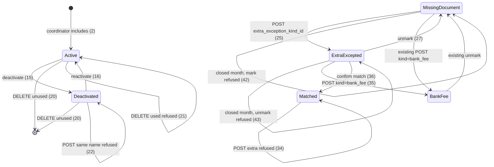
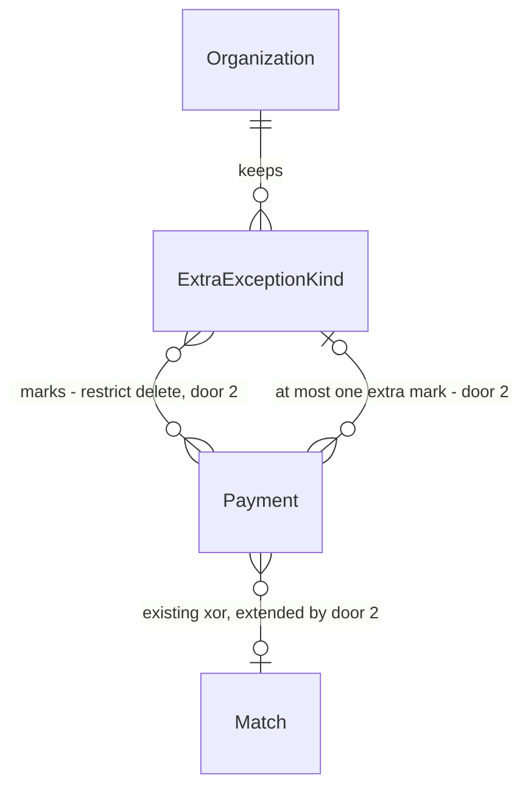

# Extra exception kinds

> Build this with **tlc-implement**.
> Every criterion below becomes a check with a proof, referenced by its number. Nothing under
> `Unresolved` gets settled while building.

## Intent

A coordinator can mark a payment as tarifa bancária or honorário do contador, but an organization cannot keep any other name. `Payment.document_exception_kind` is those two enum values; any other `kind` is `422` with `Informe se é tarifa bancária ou honorário do contador`. The month page’s non-`bank_fee` branch always prints `Honorário do contador`. Close-for-send treats only those two labels in the spreadsheet Exceção column. Issues #36 and #25 give no conversion figure; the cost is that a real exception the organization names itself still looks like a missing document (and blocks close) or is mis-marked as a bank or accountant fee.

When this ships, a coordinator of the focused organization includes extra exception kinds by name on `/setup`, deactivates or reactivates them, and removes a kind that no payment currently carries. On an open month they mark a missing-document payment with an active extra kind; that payment is a document exception under that name, including after the kind is deactivated and on the summary spreadsheet. Submitters still never see the list or mark exceptions. Suggestions of extra kinds stay #37.

50 criteria in 4 slices · 2 one-way doors · 0 open, of which 0 block

## Criteria

### Include extra exception kinds

1. When a coordinator of the focused organization opens `/setup` while that organization has zero extra exception kinds, then the response is `200` and includes the heading `Tipos extras de exceção` and the text `Nenhum tipo extra`.
2. When a coordinator submits name `Doação` as an extra exception kind, then the system persists one active ExtraExceptionKind named `Doação` on the focused organization, responds `302` to `/setup`, and that page includes `Doação`.
3. When a coordinator submits name `  Doação  `, then the persisted name is `Doação`.
4. When organization B already has extra exception kind `Doação` and a coordinator of organization A submits `Doação`, then the system persists `Doação` on A and leaves B’s kind in place.
5. If a coordinator submits name `Doação` while that organization already has `Doação`, then the system persists no additional ExtraExceptionKind and responds `422`.
6. If a coordinator submits name `doação` while that organization already has `Doação`, then the system persists no additional ExtraExceptionKind and responds `422`.
7. If a coordinator submits name `Tarifa bancária`, then the system persists no ExtraExceptionKind and responds `422`.
8. If a coordinator submits name `honorário do contador`, then the system persists no ExtraExceptionKind and responds `422`.
9. If a coordinator submits a blank name, then the system persists no ExtraExceptionKind and responds `422`.
10. If an unauthenticated request submits an extra exception kind, then the system persists none and responds `302` to `/login`.
11. When `/setup` lists extra exception kinds `Zeta` and `Alfa`, then `Alfa` appears before `Zeta`.
12. When `/setup` lists an extra exception kind, then it does not include a control that submits a new name for that kind.
13. If a coordinator PATCHes `name=Outro` on extra exception kind `Doação`, then the persisted name remains `Doação`.
14. Always, `/setup` does not list `Tarifa bancária` or `Honorário do contador` as extra exception kinds.

### Deactivate, reactivate, remove unused

15. When a coordinator PATCHes an active extra exception kind `Doação` to inactive, then the row remains, the response is `302` to `/setup`, and `/setup` includes `Doação` and `Desativado`.
16. When a coordinator PATCHes that deactivated kind to active, then `/setup` includes `Doação` and does not include `Desativado` on that kind’s row.
17. When `/setup` lists an active extra exception kind, then it includes `Desativar`; when it lists a deactivated one, then it includes `Reativar`.
18. When `/setup` lists extra exception kind `Folha` that no Payment references, then it includes `Excluir` for that kind.
19. While every extra exception kind of the focused organization is referenced by a Payment, `/setup` does not include `Excluir`.
20. When a coordinator DELETEs extra exception kind `Folha` that no Payment references, then that row is gone, the response is `302` to `/setup`, and `/setup` does not include `Folha`.
21. If a coordinator DELETEs extra exception kind `Doação` that a Payment of any month currently references, then the row remains and the response is `422`.
22. If a coordinator submits name `Doação` while a deactivated `Doação` exists on that organization, then the system persists no additional row, the existing row stays deactivated, and the response is `422`.
23. If a request DELETEs an extra exception kind that belongs only to another organization, then that row remains and the response is `404`.
24. If a request PATCHes an extra exception kind that belongs only to another organization, then that row remains unchanged and the response is `404`.

### Mark an extra kind on a payment

25. Given the focused organization has active extra exception kind `Doação`, when a coordinator POSTs `extra_exception_kind_id` of that kind on a missing-document Payment of `/months/2026-05`, then the system persists that mark, `document_exception_kind` on that payment is nil, the response is `302` to `/months/2026-05`, and that payment’s row includes `Doação` and does not include `Documento faltante`.
26. Always, `Payment.document_exception_kinds` keys and values are exactly `bank_fee` and `accountant_fee`.
27. When a coordinator DELETEs the document exception on a payment marked with `Doação`, then `extra_exception_kind_id` is nil, the response is `302`, and that row includes `Documento faltante` and does not include `Doação`.
28. When a coordinator has just persisted extra exception kind `Doação`, then `GET /months/2026-05` of an open month includes `Doação` as a mark choice on a missing-document payment.
29. While extra exception kind `Doação` is deactivated, `GET /months/2026-05` of an open month does not include a mark control that submits that kind’s id, and a payment already marked with it still includes `Doação` and does not include `Documento faltante`.
30. If a coordinator POSTs `extra_exception_kind_id` of a deactivated kind, then the system persists no mark and responds `422` with `Informe um tipo de exceção permitido`.
31. If a coordinator POSTs `kind=doacao` and no `extra_exception_kind_id`, then the system persists no mark and responds `422` with `Informe um tipo de exceção permitido`.
32. If a coordinator POSTs both `kind=bank_fee` and an `extra_exception_kind_id`, then the system persists no mark and responds `422` with `Informe um tipo de exceção permitido`.
33. If a coordinator POSTs `extra_exception_kind_id` of another organization’s kind, then the system persists no mark and responds `404`.
34. If a coordinator POSTs `extra_exception_kind_id` on a Payment that belongs to a Match, then the Match stays, no extra mark is persisted, and the response is `422` with `Desfaça o casamento antes de marcar a exceção`.
35. When a coordinator POSTs `kind=bank_fee` on a payment marked with `Doação`, then that payment is `bank_fee`, `extra_exception_kind_id` is nil, and the row includes `Tarifa bancária` and does not include `Doação`.
36. When a coordinator POSTs a valid format-1 Match for a payment marked with `Doação`, then the Match persists, `extra_exception_kind_id` is nil, and the row includes `Casado` and does not include `Doação`.
37. While every Payment of `/months/2026-05` is marked with extra exception kind `Doação`, `GET /months/2026-05` does not include `Documento faltante`.
38. When the month’s only Payment is marked with extra exception kind `Doação`, then `Month#close_for_send` does not add `Há documento faltante` to errors.
39. When a Payment is marked with extra exception kind `Doação`, then that payment’s Custos/Despesas Exceção cell in the summary spreadsheet is `Doação`.

### Isolation, closed month, submitter, concurrency

40. While focus is organization A, `/setup` and `GET /months/2026-05` do not include extra exception kind names that belong only to organization B.
41. When Month `2026-05` is closed, a coordinator POST of extra exception kind `Doação` still persists the kind and responds `302` to `/setup`.
42. If a coordinator POSTs `extra_exception_kind_id` while the Month is closed, then no mark is persisted and the response is `422` with `Mês fechado`.
43. If a coordinator DELETEs a document exception marked with an extra kind while the Month is closed, then the mark remains and the response is `422` with `Mês fechado`.
44. When Month `2026-05` is closed and a payment is marked with deactivated `Doação`, then `GET /months/2026-05` includes `Doação` and does not include `Documento faltante` or `Desmarcar exceção` for that payment.
45. If two concurrent POSTs submit extra exception kind name `Doação` on the same organization, then the system persists exactly one ExtraExceptionKind.
46. If a DELETE of unused extra exception kind `Folha` runs concurrently with a POST that marks a payment with that kind, then the system persists either the kind plus the mark, or neither a mark nor that kind row, and never a Payment whose `extra_exception_kind_id` points at a missing ExtraExceptionKind.
47. If a submitter POSTs an extra exception kind, then the system persists none and responds `404`.
48. If a submitter PATCHes an extra exception kind, then that row remains unchanged and the response is `404`.
49. If a submitter DELETEs an extra exception kind, then that row remains and the response is `404`.
50. If a submitter POSTs `extra_exception_kind_id` as a document exception, then the system persists no mark and responds `404`.

## States

## Out of scope

- Exception suggestion of accountant’s fee or of any extra kind — #21 / #37; #25: extra mark stays manual, no PIX, no history rule
- Renaming an extra exception kind — #25: deactivate and include another name
- Deactivating or listing tarifa bancária / honorário do contador as extra kinds — #25: the base is not this list
- Copying extra kinds from one organization onto another — #25: two organizations may share a name; they are not copied
- Description, slug, or any field besides the name and active/inactive — #25
- Accountant login, Drive writes, Open Finance, SEFAZ, NF-e issuance
- Changing closed-month read-only for payments, matches, or statements — existing #34; this task only allows catalog edits while a month is closed

## Observable

| Surface | Decision | Landing |
| --- | --- | --- |
| screen `/setup` | empty extra kinds | 1 |
| screen `/setup` | loading | n/a - Turbo full-page / redirect |
| screen `/setup` | error state | 5, 6, 7, 8, 9, 21, 22 - HTTP `422`; no new setup banner (existing accountant/bank-account `422` also re-renders without a page-level error string) |
| screen `/setup` | unauthorised | 10, 47, 48, 49 |
| screen `/setup` | density and ordering | 11, 14, 17, 18, 19 |
| screen `/setup` | destructive action confirms | n/a - deactivate and unused DELETE submit immediately, same as bank-account deactivate |
| screen `/months/:year_month` | empty extra kinds | existing - two base mark controls remain; empty extras add no third name (28 is the non-empty counterpart) |
| screen `/months/:year_month` | loading | n/a - Turbo full-page / redirect |
| screen `/months/:year_month` | error state | 30, 31, 32, 34, 42, 43 |
| screen `/months/:year_month` | unauthorised | existing - unauthenticated document-exception POST is `302` `/login`; submitter is 50 |
| screen `/months/:year_month` | density and ordering | 25, 28, 29, 37, 44 - extra name on the payment row; active extras as mark choices; deactivated extras not offered |
| screen `/months/:year_month` | destructive action confirms | existing - unmark submits immediately |
| HTML `GET /setup` | who may call it | existing - coordinator with focus; submitter `404`; unauthenticated `302` `/login` |
| HTML `GET /setup` | error shape and codes | existing - `302` `/login` |
| HTML `GET /setup` | versioning | n/a - existing HTML surface; this task adds a section |
| HTML `GET /setup` | rate limit | n/a - coordinator-only, small operator set |
| HTML `POST /extra_exception_kinds` | who may call it | 2, 10, 47 |
| HTML `POST /extra_exception_kinds` | error shape and codes | 5, 6, 7, 8, 9, 10, 22, 47 |
| HTML `POST /extra_exception_kinds` | versioning | n/a - first HTML surface for this resource |
| HTML `POST /extra_exception_kinds` | rate limit | n/a - coordinator-only |
| HTML `PATCH /extra_exception_kinds/:id` | who may call it | 15, 24, 48 |
| HTML `PATCH /extra_exception_kinds/:id` | error shape and codes | 13, 24, 48 |
| HTML `PATCH /extra_exception_kinds/:id` | versioning | n/a - first HTML surface |
| HTML `PATCH /extra_exception_kinds/:id` | rate limit | n/a - coordinator-only |
| HTML `DELETE /extra_exception_kinds/:id` | who may call it | 20, 23, 49 |
| HTML `DELETE /extra_exception_kinds/:id` | error shape and codes | 21, 23, 49 |
| HTML `DELETE /extra_exception_kinds/:id` | versioning | n/a - first HTML surface |
| HTML `DELETE /extra_exception_kinds/:id` | rate limit | n/a - coordinator-only |
| HTML `POST /months/:year_month/payments/:id/document_exception` | who may call it | 25, 50 |
| HTML `POST /months/:year_month/payments/:id/document_exception` | error shape and codes | 30, 31, 32, 33, 34, 42, 50 |
| HTML `POST /months/:year_month/payments/:id/document_exception` | versioning | n/a - existing HTML surface; body gains `extra_exception_kind_id` |
| HTML `POST /months/:year_month/payments/:id/document_exception` | rate limit | n/a - coordinator-only |
| HTML `DELETE /months/:year_month/payments/:id/document_exception` | who may call it | 27 |
| HTML `DELETE /months/:year_month/payments/:id/document_exception` | error shape and codes | 43, existing unauthenticated `302` `/login` |
| HTML `DELETE /months/:year_month/payments/:id/document_exception` | versioning | n/a - existing HTML surface |
| HTML `DELETE /months/:year_month/payments/:id/document_exception` | rate limit | n/a - coordinator-only |
| HTML `GET /months/:year_month` | who may call it | existing - coordinator with focus |
| HTML `GET /months/:year_month` | error shape and codes | existing - `404` invalid or never opened |
| HTML `GET /months/:year_month` | versioning | n/a - existing HTML surface |
| HTML `GET /months/:year_month` | rate limit | n/a - coordinator-only |
| collection extra exception kinds | grouping | 4, 40 - focused organization only |
| collection extra exception kinds | naming | 2, 3 - trimmed unique name |
| collection extra exception kinds | ordering | 11 - ascending name |
| collection extra exception kinds | duplicates | 5, 6, 22, 45 |
| collection extra exception kinds | exception that does not fit | 1, 7, 8, 14, 18, 20, 21 - empty list; base names; unused may leave; used may not |
| collection payment exception marks | grouping | 25, 37 - per payment per month |
| collection payment exception marks | naming | 25, 35, 39 - extra name; base copy unchanged |
| collection payment exception marks | ordering | existing - payments stay date then id |
| collection payment exception marks | duplicates | 25, 32, 35 - at most one of Match, base kind, extra kind |
| collection payment exception marks | exception that does not fit | 29, 30, 31 - deactivated not offered; unknown `kind` |

## Swept

- validation: 3, 5, 6, 7, 8, 9, 22, 30, 31, 32
- failure modes: 21, 23, 24, 30, 33, 34, 42, 43
- idempotency and retry: 5, 22 - a second include of the same name does not create a second row; deactivated name stays occupied
- authorization: 10, 23, 24, 33, 40, 47, 48, 49, 50
- concurrency and ordering: 45, 46
- data lifecycle: 15, 16, 20, 21 - deactivate keeps the row and the unique name; unused DELETE removes the row; used DELETE is refused because a Payment still references it
- external-dependency failure: n/a - no new remote; Drive writer and Google OIDC are unchanged
- state transitions: 2, 15, 16, 20, 25, 27, 29, 35, 36
- observability: n/a - no operator metric or log line is required; Rails request logging already covers HTML

## Impact

| Front | What changes |
|---|---|
| domain | new term: `Extra exception kind` - a name the organization keeps, besides bank fee and accountant’s fee, for marking a document exception; unique in that organization and distinct from the two base names; lives as `ExtraExceptionKind` on the organization (`CONTEXT.md` already has the glossary row) |
| domain | existing term: `Document exception` meant a Payment with `document_exception_kind` `bank_fee` or `accountant_fee`; now it is also a Payment with `extra_exception_kind_id` set. Callers: `Payment#missing_document?` and `Payment.missing_document` (`app/models/payment.rb`), month page (`app/views/months/show.html.erb` — the `else` of `bank_fee?` currently prints `Honorário do contador` for every non-bank-fee exception), `Month#close_blocker` (`app/models/month.rb`), `Match.confirm` which currently nulls only `document_exception_kind` (`app/models/match.rb`), `SummarySpreadsheet::EXCEPTION_COPY` (`app/models/summary_spreadsheet.rb`) |
| domain | existing term: `Missing document` meant match nil and `document_exception_kind` nil; now extra_exception_kind_id must also be nil. Same callers as Document exception |
| domain | existing term: `Organization` standing close setup already lists extra exception kinds in `CONTEXT.md`; `/setup` today has accountant, archive, and bank accounts only (`app/views/setup/show.html.erb`) |
| stored data | add `extra_exception_kinds` (none exist to backfill). Add nullable `payments.extra_exception_kind_id`. Existing payments have no extra mark (`NULL`); unique and check constraints succeed on current rows. Replace `payments_match_xor_document_exception` so at most one of `match_id`, `document_exception_kind`, `extra_exception_kind_id` is present. `Payment.document_exception_kind` enum members stay `bank_fee` / `accountant_fee` — no data rewrite of those values |
| stored data | existing `spec/requests/setup_spec.rb` asserts the whole `/setup` body does not include `Excluir` to prove bank accounts are never deleted; unused extra kinds add `Excluir` on that same page. Bank accounts still have no delete; that proof must target the bank-account row, not the page string |

## Decided

| Decision | Shape | Alternative rejected |
|---|---|---|
| 1. Extra exception kind is an organization catalog row, not an enum value | `ExtraExceptionKind` belongs to `Organization`. Identity is the trimmed name, unique per organization including deactivated rows, compared case-insensitively (`Doação` occupies `doação`). Distinct from presentation names `Tarifa bancária` and `Honorário do contador` (same case-insensitive compare). Active boolean, default true. No rename. Unused row (no Payment currently references it) may be DELETEd; used row is `restrict`. `Payment.document_exception_kind` enum stays `{ bank_fee, accountant_fee }`. | Adding extra names to `document_exception_kind` — match-and-exception door 3 and #36: extras are organization catalog names, not a third enum value. A string column of free text on Payment — #25 uniqueness, deactivate, and unused-remove live on the catalog, not on each mark. Never-delete like `BankAccount` — #25 unused may leave. |
| 2. Document exception extra mark is an optional Payment association, xor Match and xor base kind | `Payment` belongs to `ExtraExceptionKind` optionally (`extra_exception_kind_id`). Database check: at most one of `match_id`, `document_exception_kind`, `extra_exception_kind_id` is non-null. Missing document is all three absent. Mark POST accepts `kind=bank_fee` or `kind=accountant_fee` (unchanged) **or** `extra_exception_kind_id` of an **active** ExtraExceptionKind of the focused organization — not both. Confirming a Match still clears the extra FK. FK `ON DELETE restrict` is the unused-remove mechanism. | A `DocumentException` row — match-and-exception already rejected it for the two base kinds; extras do not need a second payment-level entity once the catalog row exists. Storing the extra name as text on Payment — deactivate would rename the mark or orphan the label; #25 the deactivated kind remains on payments already marked. `kind=<name>` in the POST — a coordinator could include an extra named `bank_fee`, which is not a base presentation name, and collide with the enum. |

- Nothing else in this change is hard to reverse. `/setup` as the screen, button copy (`Desativar` / `Reativar` / `Excluir`), and one mark control per active extra on the month page are criteria or placement. Door 1 uniqueness including deactivated is what forbids create-instead-of-reactivate. Door 2 restrict is what forbids DELETE while a closed (or open) month still carries the mark.

Door 1 reaches past this feature: later exception-suggestion (#37) must not invent a second extra-kind catalog. Door 2 reaches past this feature: close-for-send and the spreadsheet read the association, not a new column on the workbook.

## Relations

One-way constraints: ExtraExceptionKind name unique per Organization case-insensitively including deactivated (door 1), Payment at most one of Match / base `document_exception_kind` / ExtraExceptionKind (door 2), ExtraExceptionKind DELETE restricted while any Payment references it (door 2). No columns and no types here.

## Surface

| Route | In | Out | Status | Criteria |
|---|---|---|---|---|
| `GET /setup` | session, focus | setup HTML, extra-kind section | `200`, `302`, `404` | 1, 2, 11, 12, 14, 17, 18, 19, 40 |
| `POST /extra_exception_kinds` | session, focus, `name` | ExtraExceptionKind | `302`, `422`, `404` | 2, 3, 4, 5, 6, 7, 8, 9, 10, 22, 41, 45, 47 |
| `PATCH /extra_exception_kinds/:id` | session, focus, `active` | ExtraExceptionKind active/inactive | `302`, `422`, `404` | 13, 15, 16, 24, 48 |
| `DELETE /extra_exception_kinds/:id` | session, focus | none | `302`, `422`, `404` | 20, 21, 23, 46, 49 |
| `POST /months/:year_month/payments/:id/document_exception` | session, focus, `kind` or `extra_exception_kind_id` | Payment mark | `302`, `422`, `404` | 25, 30, 31, 32, 33, 34, 35, 42, 46, 50 |
| `DELETE /months/:year_month/payments/:id/document_exception` | session, focus | Payment without mark | `302`, `422`, `404` | 27, 43 |
| `GET /months/:year_month` | session, focus | month HTML, extra names on rows and as mark choices | `200`, `302`, `404` | 25, 28, 29, 37, 40, 44 |

## Sources

- https://github.com/gutors/ai-accounting-assistant/issues/36 - this cut: unique name in the organization, distinct from the base; include / deactivate / reactivate; no rename; task file `.tasks/extra-exception-kinds.md`; after the match and document-exception spine
- https://github.com/gutors/ai-accounting-assistant/issues/25#issuecomment-5639146328 - extra exception kind is an organization name besides tarifa bancária and honorário do contador; unique in it and distinct from the two base names; empty list is valid; two organizations may share a name and do not copy; no description, PIX, or history rule; any coordinator includes or changes at any time (open or closed month); new kind is choosable immediately; submitter does not see the list and does not mark; deactivate removes from new marks and keeps existing marks as document exception; reactivate returns it to the choice; deactivated name stays occupied; no rename; unused (in no month) may leave; base kinds are not this list and do not deactivate
- `CONTEXT.md` - Extra exception kind, Document exception, Missing document, Organization
- `.specs/features/match-and-exception/plan.md` Landing door 3 - extras are a separate association, not values in `document_exception_kind`
- https://github.com/gutors/ai-accounting-assistant/issues/5 - document exception exists only after the coordinator marks an allowed kind
- [ADR-0001](../docs/adr/0001-rails-8-hotwire.md) - Rails 8 + Hotwire; no new runtime
- user delegated - unused for DELETE is no Payment currently referencing the kind (open or closed month); unmark or statement replace that destroys the payment makes DELETE legal; no once-used flag
- user delegated - setup heading `Tipos extras de exceção`, empty `Nenhum tipo extra`, deactivated `Desativado`, unused-remove `Excluir`; unknown-kind `422` is `Informe um tipo de exceção permitido`

No design source for the screens. Verification stays on project profile `standard`.

This task is the record of decision. If a linked document diverges, ask before building.

## Unresolved

| # | Kind | Question | Until answered |
|---|---|---|---|
| 1 |  | None |  |
