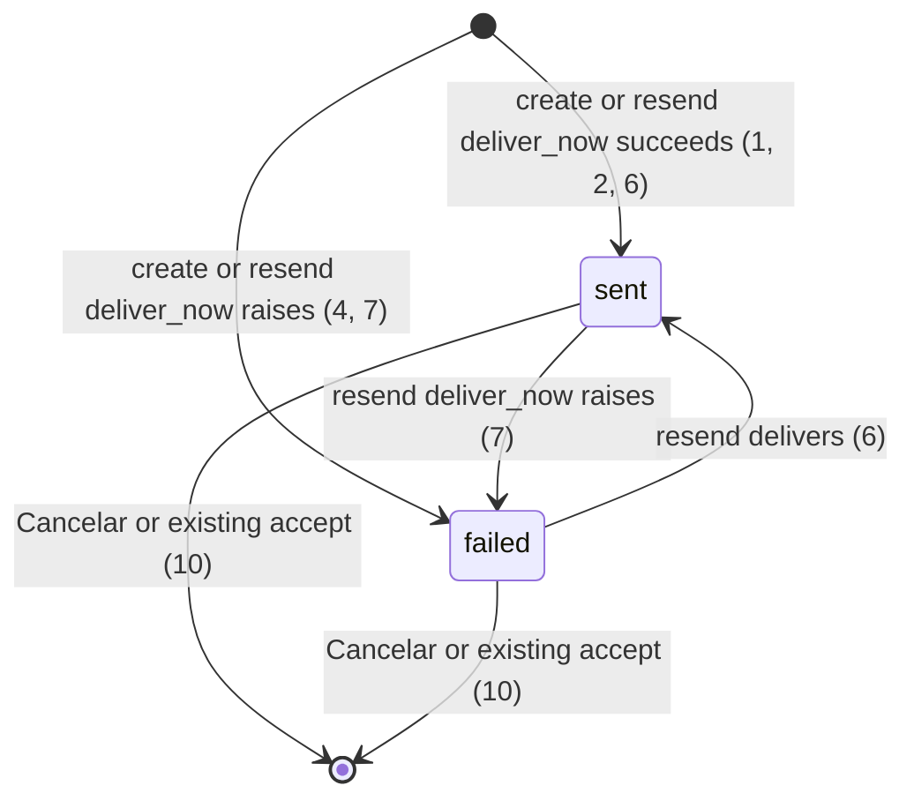

# Invite kind and mail status

> Build this with **tlc-implement**. Profile **`ui`**: screen `home`; binding design
> `.specs/features/visual-identity/design.md`.
> Every criterion below becomes a check with a proof, referenced by its number. Nothing under
> `Unresolved` gets settled while building.

## Intent

A coordinator looking at `Convites pendentes` on `GET /` sees only the email. Kind lives on
`Invite` (`coordinator` / `submitter`) and never on that row, so a mixed list does not say which
grant it is. Last mail outcome is also missing: #76 already replaced `session[:invite_mail_failed]`
with a one-shot error toast, so a later `GET /` makes a failed invite look the same as a sent one.
Issue #78 gives no conversion figure; the cost it names is that a global flag (and now a toast that
dies) lies when invite A fails and invite B sends.

When this ships, each pending row on coordinator home shows `Coordenador` or `Submitter` and
`enviado` or `falhou envio do e-mail` from that Invite’s last delivery. Resend overwrites that
status. The error toast from #76 stays; the notice under `Meses` stays gone. Screens
`.specs/features/visual-identity/design.md` (`home`) and `.design/administration-list.md`
(`Screen home invites`) are binding for that row.

14 criteria in 3 slices · 1 one-way door · 1 open, of which 0 block

## Criteria

### Kind on each pending row

1. Given `POST /coordinator_invites` persists Invite `pessoa@exemplo.org` and delivery succeeds, when the following `GET /` runs, then the pending item whose text includes `pessoa@exemplo.org` includes `Coordenador`, includes `enviado`, does not include `Submitter`, and still has `Reenviar e-mail` before `Cancelar`.
2. Given `POST /submitter_invites` persists Invite `docs@exemplo.org` and delivery succeeds, when the following `GET /` runs, then the pending item whose text includes `docs@exemplo.org` includes `Submitter`, includes `enviado`, and does not include `Coordenador`.
3. Given pending Invites `ana@exemplo.org` (`coordinator`) and `zoe@exemplo.org` (`submitter`) on the focused organization, when `GET /` runs, then `ana@exemplo.org` appears before `zoe@exemplo.org`, the `ana@exemplo.org` item includes `Coordenador` and does not include `Submitter`, and the `zoe@exemplo.org` item includes `Submitter` and does not include `Coordenador`.

### Last delivery is the row, not the session

4. Given `POST /coordinator_invites` persists the Invite and `deliver_now` raises, then that Invite remains, its last delivery is `failed`, the response is `302` to `/`, and the following `GET /` is `200` with `[data-toast-kind="error"]` text `O convite foi gravado, mas o e-mail não saiu.`, with no `[data-notice="error"]` that text, and with that pending item including `falhou envio do e-mail` and not `enviado`. Delivery still runs after the Invite commit; the error is still rescued.
5. Given that failed Invite `pessoa@exemplo.org` still pending, when `POST /coordinator_invites` for `nova@exemplo.org` delivers, then both Invites remain, the following `GET /` has `[data-toast-kind="success"]` text `Pronto.`, has no `[data-notice="error"]` text `O convite foi gravado, mas o e-mail não saiu.`, the `pessoa@exemplo.org` item includes `falhou envio do e-mail` and not `enviado`, and the `nova@exemplo.org` item includes `enviado` and not `falhou envio do e-mail`.
6. Given a pending Invite whose last delivery is `failed`, when `POST .../mail` (`Reenviar e-mail`) delivers, then the following `GET /` has that item including `enviado` and not `falhou envio do e-mail`.
7. Given a pending Invite whose last delivery is `sent`, when `POST .../mail` and `deliver_now` raises, then the Invite remains and the following `GET /` has that item including `falhou envio do e-mail` and not `enviado`.
8. Given the `GET /` after criterion 4, when a second `GET /` runs with no action in between, then the body has no `[data-toast]`, does not include `O convite foi gravado, mas o e-mail não saiu.`, and that pending item still includes `falhou envio do e-mail`.
9. Always, a pending Invite stores last delivery as exactly `sent` or `failed`, and its home item includes exactly one of `enviado` or `falhou envio do e-mail`.
10. When `DELETE` `Cancelar` deletes a pending Invite, then that Invite is gone, no message is delivered, and the following `GET /` does not include that email.
11. Given `session[:invite_mail_failed]` is `true` and `flash` has no toast, when `GET /` runs, then the status is `200`, the body has no `[data-toast]`, and it does not include `O convite foi gravado, mas o e-mail não saiu.` as `[data-notice="error"]` or under `Meses`.
12. If `POST` resend targets an Invite that belongs only to another organization, then the response is `404`, no message is delivered, and that Invite’s last delivery is unchanged.

### Binding docs name the row

13. `.specs/features/visual-identity/design.md` screen `home` (coordinator) `Convites pendentes` line includes email, `Coordenador` or `Submitter`, `enviado` or `falhou envio do e-mail`, and `Reenviar e-mail` immediately before `Cancelar`.
14. `.design/administration-list.md` section `Screen home invites` shows that per-invite copy on the row; the `Invite resend` Decisions row no longer says the failure notice sits under `Meses`.

## States

Pending Invite still exists only until accept or cancel (existing). Last delivery is on that row while it exists.

## Out of scope

- New invite create/resend/cancel flow, SMTP body, or `MAIL_FROM` — #78; existing controllers and `InviteMailer`
- Toast chrome, timeout, and `Pronto.` / mail-failure toast copy — #76, already shipped
- Home month list defaults — #77
- Administration welcome/invite mail — seller screens
- A third last-delivery value (`unsent` / null in the product copy) — #78 names only `sent` / `failed`
- Submitter home, standing Access lists, revoke — unchanged
- Magic-link proof of mailbox ownership

## Observable

| Surface | Decision | Landing |
| --- | --- | --- |
| screen `home` coordinator `Convites pendentes` | empty | existing — heading with no items when `@invites` is empty (`organizations_spec` lists no guest email) |
| screen `home` coordinator `Convites pendentes` | loading | n/a — Turbo full-page / redirect |
| screen `home` coordinator `Convites pendentes` | error | 4, 7 — row `falhou envio do e-mail` plus existing error toast |
| screen `home` coordinator `Convites pendentes` | unauthorised | existing — `require_coordinator_organization`; submitter `GET /` has no `Convites pendentes` |
| screen `home` coordinator `Convites pendentes` | density and ordering | 1, 2, 3 — email, kind label, status copy; `Reenviar e-mail` before `Cancelar`; `Invite.order(:email)` |
| screen `home` coordinator `Convites pendentes` | destructive action confirms | existing — `Cancelar` has no `data-turbo-confirm` today |
| screen `home` submitter | empty / invites | existing — `Início`; no pending list |
| layout toast | error / success | existing #76 — 4, 5, 8 do not replace the toast |
| document `.specs/features/visual-identity/design.md` `home` | structure, tone, depth, next action | 13 |
| document `.design/administration-list.md` `Screen home invites` | structure, tone, depth, next action | 14 |
| HTML `POST /coordinator_invites` | who may call it | existing — coordinator session; unauthenticated `302` `/login` |
| HTML `POST /coordinator_invites` | error shape and codes | existing `422` on bad email; 4 is SMTP after persist (`302` + toast + row) |
| HTML `POST /coordinator_invites` | versioning | n/a — HTML, no published API version |
| HTML `POST /coordinator_invites` | rate limit | n/a — coordinator-only, small operator set |
| HTML `POST /submitter_invites` | who / errors | existing; 2 |
| HTML `POST .../mail` | who / errors | 6, 7, 12 |
| HTML `DELETE` invite | who / errors | 10; existing other-org `404` |
| collection pending Invites | grouping | 3 — one list, both kinds |
| collection pending Invites | naming | 1, 2, 9 — email, `Coordenador`/`Submitter`, `enviado`/`falhou envio do e-mail` |
| collection pending Invites | ordering | 3 — existing `order(:email)` |
| collection pending Invites | duplicates | existing — unique pending Invite per organization per email |
| collection pending Invites | exception that does not fit | 5 — one row failed and one sent at the same time |

## Swept

- validation: existing — well-formed email, uniqueness, standing Access; 9 — last delivery is only `sent` or `failed`
- failure modes: 4, 7 — SMTP raise after persist; 12 — foreign Invite
- idempotency and retry: 6 — resend delivers again and overwrites last delivery; 8 — flash dies, row status remains
- authorization: existing `require_coordinator_organization`; 12 — other-organization resend `404`
- concurrency and ordering: n/a — one session writes one Invite row; two overlapping resends leave the last write; unique email is existing
- data lifecycle: 10 — Cancelar deletes the Invite and its last delivery; existing `accept!` also destroys the row
- external-dependency failure: 4, 7 — `deliver_now` still rescued; last delivery becomes `failed`
- state transitions: 4, 6, 7, 10
- observability: n/a — the source names no log, metric, or trace; the person reads the row

## Impact

| Front | What changes |
|---|---|
| domain | no new glossary term — `CONTEXT.md` Invite stays a pending grant |
| domain | existing term: `Invite` — still pending coordinator or submitter grant; now also the last mail attempt for that row. Callers: `ApplicationController#deliver_invite` / `redirect_after_invite_mail`, `CoordinatorInvitesController`, `SubmitterInvitesController`, `app/views/organizations/show.html.erb` (`Convites pendentes`), `spec/requests/coordinator_invites_spec.rb` (including “a later invite send clears the failure notice”), `spec/requests/organizations_spec.rb` and `spec/system/screens_spec.rb` that `Invite.create!` then `GET /` |
| stored data | NOT NULL last delivery `sent`/`failed` on `invites`. Existing pending rows have no recorded attempt; they take Unresolved 1 (`sent`) so the migration can run. `create_pending` / `Invite.create!` without a delivery write show that default until create/resend runs `deliver_now` |

## Decided

| Decision | Shape | Alternative rejected |
|---|---|---|
| Last delivery lives on the Invite | Each pending Invite stores the last `deliver_now` this app ran for that row as `sent` or `failed` (NOT NULL, those two values only). Create and resend both write it before the redirect. Accept and Cancelar still destroy the row | Keep status only in `flash` / toast: a later `GET /` makes A look like B, which is the lie #78 names. A third `unsent` value: #78 copy is only `enviado` / `falhou envio do e-mail`. Revive `session[:invite_mail_failed]`: one boolean for every Invite |

- Nothing else in this change is hard to reverse (column name, row layout, `data-row` hook)

## Surface

| Route | In | Out | Status | Criteria |
|---|---|---|---|---|
| `GET /` | session, focus | pending item: email, kind label, last-delivery copy | `200` | 1–9, 11, 13 |
| `POST /coordinator_invites` | `email` | Invite, last delivery, toast | `302`, `422` | 1, 4, 5 |
| `POST /submitter_invites` | `email` | Invite, last delivery, toast | `302`, `422` | 2 |
| `POST /coordinator_invites/:id/mail` and submitter equivalent | id | last delivery, toast | `302`, `404` | 6, 7, 12 |
| `DELETE /coordinator_invites/:id` and submitter equivalent | id | Invite gone | `302`, `404` | 10 |

## Sources

- https://github.com/gutors/ai-accounting-assistant/issues/78 — **binding for this slice**: pending row shows Coordenador or Submitter; persist `sent` / `failed` on Invite; row text `enviado` / `falhou envio do e-mail`; resend updates status; remove notice under Meses; toast is the #76 child; out: new invite flow
- https://github.com/gutors/ai-accounting-assistant/issues/75 — parent: invites after toast; type Coordenador/Submitter; persisted email status enviado / falhou envio
- https://github.com/gutors/ai-accounting-assistant/issues/76 — closed; toast helper and mail-failure sentence this task must not put back under `Meses`
- `.specs/features/visual-identity/design.md` — **binding for the interface**: screen `home`; criterion 13 amends `Convites pendentes`
- `.design/administration-list.md` — **binding** `Screen home invites`; criterion 14 amends the stale `Invite resend` Decisions row (still says the failure notice sits under `Meses`)
- `app/views/organizations/show.html.erb` — today’s pending row is email + `Reenviar e-mail` + `Cancelar`; `Invite.kind` is unused in the list
- `app/controllers/application_controller.rb` `#deliver_invite` / `#redirect_after_invite_mail` — SMTP rescue true/false; writes toast, not Invite
- `CONTEXT.md` — Invite, Coordinator, Submitter
- Open default in Unresolved 1 — existing pending rows show `enviado` until a delivery write runs

This task is the record of decision. If a linked document diverges, ask before building.

## Unresolved

| # | Kind | Question | Until answered |
|---|---|---|---|
| 1 | open | What last delivery do pending Invites that never ran this task’s `deliver_now` show (`Invite.create!`, `create_pending` in seeds/specs, rows already in Postgres)? | NOT NULL default `sent`; those rows show `enviado` until create or resend writes after SMTP |
