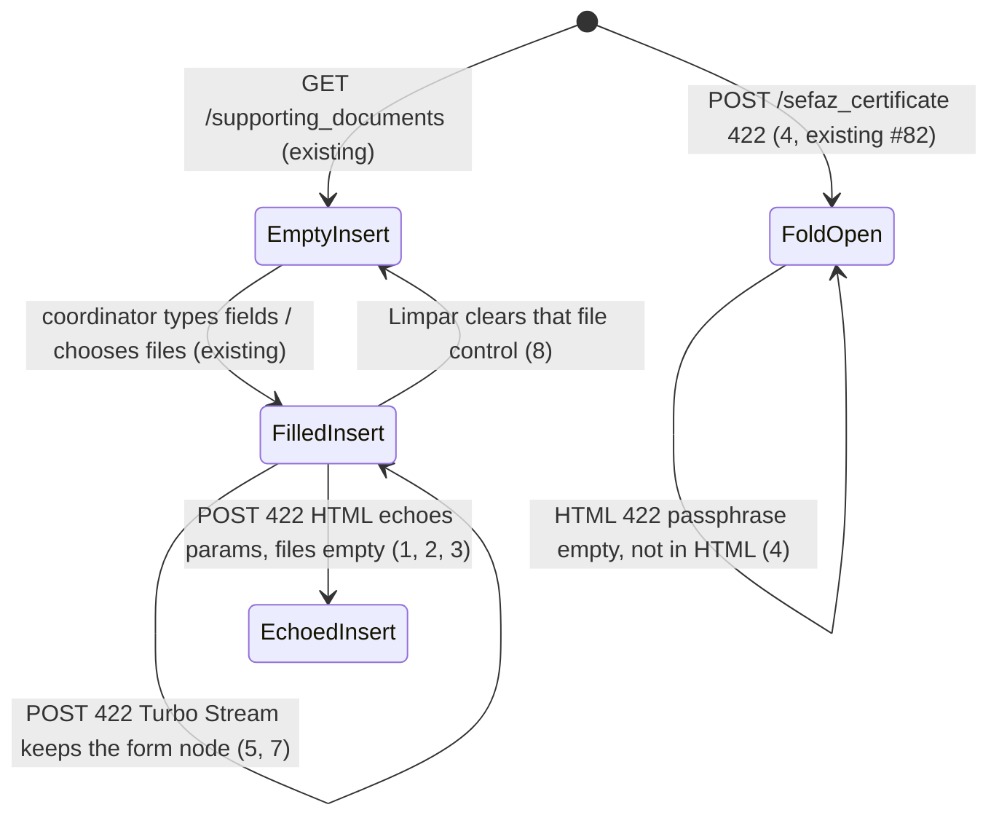

# Keep form on 422 (document and A1)

> Build this with **tlc-implement**. Profile **`ui`**: screens `documents` and `setup` are binding
> through `.specs/features/visual-identity/design.md` (criterion 11).
> Every criterion below becomes a check with a proof, referenced by its number. Nothing under
> `Unresolved` gets settled while building.

## Intent

`POST /supporting_documents` already responds `422` and `render :index`, and
`POST /sefaz_certificate` already `render`s `setup/show`, but the insert fields are born
`text_field_tag :amount, nil` (Data falls back to `Date.current`, not the posted date) and the
A1 passphrase is empty by design. A Turbo Drive `422` replaces the form node, so the browser
cannot keep a chosen Foto / XML / Arquivo. Issue #85 gives no conversion figure; the cost is
retyping tipo, valor, data, favorecido, chave, and observação after a refusal the person already
filled, and choosing the files again. The source forbids stashing a failed upload in the object
store or session (A1 is a secret; container disk is ephemeral). The browser will not let the
server fill `input type=file`.

When this ships, those two POSTs keep the insert / install form on `422`. A Turbo Stream `422`
updates only the existing `:base` notice and the existing error toast, so the form node — and a
chosen file — stay. HTML `422` without that stream is the fallback: document tipo, valor, data,
favorecido, chave, and observação come back from the params; A1 senha is not in the HTML.
`Limpar` next to Foto, XML, and Arquivo do A1 clears that file control without a submit. Proofs
named by #85: NF without a file, recibo with XML, invalid chave, A1 wrong passphrase. Binding
design: `.specs/features/visual-identity/design.md` sections `documents` and `setup`.

11 criteria in 5 slices · 1 one-way door · 1 open, of which 0 block

## Criteria

### HTML 422 echoes document params

1. Given a signed-in coordinator of the focused organization, when `POST /supporting_documents`
   is `kind=nota_fiscal`, amount `155,00`, date `2026-05-11`, payee `Padaria Central`, observation
   `pago em dinheiro`, and neither photo nor XML, then no SupportingDocument is persisted, the
   status is `422`, `[data-notice="error"]` and `[data-toast-kind="error"]` are `Envie a foto e/ou
   o XML`, insert `#kind` selected is `nota_fiscal`, `#amount` value is `155,00`, `#date` value is
   `2026-05-11`, `#payee` value is `Padaria Central`, `#observation` value is `pago em dinheiro`,
   and `#photo` / `#xml` are `input type=file` with no server-filled value.
2. When `POST /supporting_documents` is `kind=recibo`, those same amount / date / payee /
   observation values, a photo, and an XML file, then no SupportingDocument is persisted, no new
   `ActiveStorage::Blob` is created, the status is `422`, `[data-notice="error"]` and
   `[data-toast-kind="error"]` are `Recibo não tem XML`, insert `#kind` selected is `recibo`, the
   four text values match criterion 1, and `#xml` is `input type=file` with no server-filled
   value.
3. When `POST /supporting_documents` is `kind=nota_fiscal`, a `.jpg` photo, amount `155,00`, date
   `2026-05-11`, payee `Padaria Central`, and chave `123`, then no SupportingDocument is persisted,
   the status is `422`, `[data-notice="error"]` and `[data-toast-kind="error"]` are `Informe a
   chave de acesso com 44 dígitos`, and insert `#chave` value is `123` with the same four text
   values as criterion 1.

### HTML 422 does not echo the A1 passphrase

4. Given no certificate, when `POST /sefaz_certificate` is a valid `.pfx` and passphrase `errada`,
   then no certificate is persisted, the status is `422`, `[data-notice="error"]` and
   `[data-toast-kind="error"]` are `Não foi possível abrir o certificado com essa senha`, the
   Arquivo/Senha `
` has the `open` attribute, `#certificate` is `input type=file` with no
   server-filled value, `#passphrase` value is `""`, and the body does not include `errada`.

### Turbo Stream 422 does not replace the form node

5. When `POST /supporting_documents` repeats criterion 1 with `Accept` including
   `text/vnd.turbo-stream.html`, then the status is `422`, the response media type includes
   `text/vnd.turbo-stream.html`, the streams put `Envie a foto e/ou o XML` on `[data-notice=error]`
   and `[data-toast-kind=error]`, and the response body does not include
   `form[action="/supporting_documents"]`.
6. When `POST /sefaz_certificate` repeats criterion 4 with that same `Accept`, then the status is
   `422`, the media type includes `text/vnd.turbo-stream.html`, the streams put `Não foi possível
   abrir o certificado com essa senha` on `[data-notice=error]` and `[data-toast-kind=error]`, the
   body does not include `errada`, and the body does not include `form[action="/sefaz_certificate"]`.
7. Given the insert form in the browser with Tipo Recibo, a chosen XML file whose filename is
   `nota.xml`, and the typed fields from criterion 2, when Incluir documento runs, then the status
   the person sees is the `Recibo não tem XML` notice (and error toast), `#kind` stays `recibo`,
   those typed fields stay filled, and `#xml` still has `nota.xml`.

### Limpar clears a file without submit

8. When `GET /supporting_documents` runs as in criterion 1’s actor, then the insert form has a
   `button type=button` whose text is `Limpar` next to `#photo` and another next to `#xml`. After a
   file is chosen on `#photo`, activating that button leaves `#photo` with no file and does not
   `POST /supporting_documents`.
9. When `GET /setup` runs as that coordinator, then `form[action="/sefaz_certificate"]` has a
   `button type=button` whose text is `Limpar` next to `#certificate`. After a file is chosen on
   `#certificate`, activating that button leaves `#certificate` with no file and does not
   `POST /sefaz_certificate`.

### No failed-upload stash

10. Always, after the `422`s in criteria 1–4, `ActiveStorage::Blob.count` is unchanged, the
    organization’s A1 columns are unchanged, and `session` values do not include passphrase
    `errada` or the PKCS12 bytes.

### Binding wireframes

11. `.specs/features/visual-identity/design.md` sections `documents` and `setup` — insert Foto and
    XML each have `Limpar` beside the file control; setup Arquivo has `Limpar` beside the file
    control; HTML `422` fallback echoes the document fields in criteria 1–3; A1 senha is not
    written into the HTML on `422`.

## States

Insert persist on `302` and A1 persist on `302` are unchanged (existing).

## Out of scope

- Stash of a pending blob or `.pfx` in session, object store, or container disk — #85 / #75
- Editing a document already saved (`PATCH /supporting_documents/:id` `422`) — #85
- Client-only validation — #85
- Restoring `input type=file` by setting a value from the server — browser limitation; #75
- Echoing the A1 passphrase in HTML — #75 / #82 criterion 6; this task keeps that (4, 6, 10)
- Changing insert or A1 decision tables or `:base` copy — existing #51 / #38 / #79 / #82
- Justificativa `422`, other setup `422`s, bank-statement uploads — not on #85
- Toast chrome, timeout, `Pronto.` — #76 already on these `422`s
- Recibo chrome (hide chave/XML) and Data default on GET — #79, already shipped
- A1 fold heading / empty line / details `open` on HTML `422` — #82, already shipped

## Observable

| Surface | Decision | Landing |
| --- | --- | --- |
| screen `documents` insert | empty state | existing — `Nenhum documento` when there is no row; insert form still renders (#79) |
| screen `documents` insert | loading | n/a — no progress chrome; Turbo Stream `422` is the error path (5) |
| screen `documents` insert | error state | 1, 2, 3, 5, 7 — notice + error toast; HTML echoes params; Stream keeps the form node |
| screen `documents` insert | unauthorised | existing — unauthenticated `GET`/`POST` `302` `/login`; no focused org `302` `/login` |
| screen `documents` insert | density and ordering | 8, 11 — `Limpar` next to Foto and XML; field order unchanged |
| screen `documents` insert | destructive action confirms | n/a — `Limpar` only clears a local file control; `Excluir` still Turbo-confirms |
| screen `documents` Editar | error state | n/a — #85 excludes edit of a saved document |
| screen `setup` certificate | empty state | existing — empty line and closed fold on GET (#82) |
| screen `setup` certificate | loading | n/a — no pending chrome |
| screen `setup` certificate | error state | 4, 6 — HTML `422` details `open`, passphrase empty; Stream does not replace the form |
| screen `setup` certificate | unauthorised | existing — `require_coordinator_organization`; submitter `404` |
| screen `setup` certificate | density and ordering | 9, 11 — `Limpar` next to Arquivo; fold otherwise #82 |
| screen `setup` certificate | destructive action confirms | existing — certificate `Remover` still Turbo-confirms `Remover o certificado SEFAZ?`; `Limpar` does not |
| HTML `POST /supporting_documents` | response / error shape and codes | 1, 2, 3 — `422` + existing `:base` strings; 5 — Turbo Stream `422` |
| HTML `POST /supporting_documents` | who may call it | existing — focused Access (coordinator or submitter) |
| HTML `POST /supporting_documents` | versioning | n/a — existing HTML form; Stream is the same POST |
| HTML `POST /supporting_documents` | rate limit | n/a — small operator set |
| HTML `POST /sefaz_certificate` | response / error shape and codes | 4, 6 — `422` + existing open-failed string |
| HTML `POST /sefaz_certificate` | who may call it | existing — coordinator of the focused organization |
| HTML `POST /sefaz_certificate` | versioning | n/a — existing HTML form |
| HTML `POST /sefaz_certificate` | rate limit | n/a — coordinator-only |
| document `.specs/features/visual-identity/design.md` | structure, tone, depth, next action | 11 |
| collection insert files | grouping / naming / ordering / duplicates / exception | n/a — no catalog; each control is one file; `Limpar` is the exception that drops the choice (8, 9) |

## Swept

- validation: existing — the four `:base` strings in 1–4; this cut does not add a rule
- failure modes: 1, 2, 3, 4, 5, 6, 7 — `422` keeps typed document fields; A1 passphrase stays out of HTML; Stream does not replace the form; HTML file inputs stay empty
- idempotency and retry: 1, 5 — a second `422` with different params echoes that later payload (HTML) or leaves the live form (Stream); two valid inserts still persist two rows (existing)
- authorization: existing — `require_focused_organization` on documents; `require_coordinator_organization` on A1; submitter still uses the same insert template
- concurrency and ordering: n/a — each `422` is one form in one tab; two overlapping POSTs still do not share a form node; #38 still leaves one A1 slot
- data lifecycle: 2, 10 — no new Blob on refused insert; no failed `.pfx` in session or A1 columns; no backfill
- external-dependency failure: n/a — these `422`s are local validation / PKCS12 open; wrap-key `422` copy stays #71 / #82
- state transitions: 5, 7, 8, 9 and States — Stream keeps the filled form; `Limpar` returns that file control to empty without a submit
- observability: 4, 6, 10 — passphrase `errada` is absent from HTML and from `session` values; the source names no log, metric, or trace (`filter_parameters` already covers passphrase)

## Impact

| Front | What changes |
|---|---|
| domain | no new glossary term |
| domain | existing term: **Supporting document** insert — still the same `SupportingDocument.insert` refusals; callers `SupportingDocumentsController#create` and `app/views/supporting_documents/index.html.erb`. What changes is that a `422` no longer blanks the insert controls |
| domain | existing term: **SEFAZ certificate** install — still `Organization#install_sefaz_certificate`; callers `SefazCertificatesController#create` and `app/views/setup/show.html.erb`. HTML `422` still does not echo senha (#82); Stream `422` no longer replaces the install form |
| stored data | nothing to migrate — no schema change; refused uploads must not become blobs (10) |

Request examples that already assert these four `422` strings (`spec/requests/supporting_documents_spec.rb`, `spec/requests/sefaz_certificates_spec.rb`) must also assert the echoed values / empty passphrase / Stream body once this ships.

## Decided

| Decision | Shape | Alternative rejected |
|---|---|---|
| First Turbo Stream `422` in this app, only on these two POSTs | `POST /supporting_documents` and `POST /sefaz_certificate`, when `Accept` includes `text/vnd.turbo-stream.html`, respond `422` `text/vnd.turbo-stream.html` whose streams update the existing `[data-notice=error]` and `[data-toast-kind=error]` only. They do not replace `form[action="/supporting_documents"]` or `form[action="/sefaz_certificate"]`. Without that Accept, `422` is still the full page HTML with echoed document params (1–3) and empty A1 passphrase (4). | Full-page HTML only — Turbo Drive replaces the form node, so files cannot survive, which #85 forbids. Site-wide morph / `turbo-refresh` — a new default for every form, which #75 did not ask. Stashing the upload in session or the object store — #75 / #85, A1 is a secret, container disk is ephemeral |

`Limpar` is Stimulus clearing `input type=file` (browser API), the same class of controller as `document-kind`. It is not a new transport.

## Surface

| Route | In | Out | Status | Criteria |
|---|---|---|---|---|
| `POST /supporting_documents` | kind, amount, date, payee, observation, chave, photo, xml | index HTML `422` with echoed fields, or Turbo Stream `422` of notice + toast | `422` | 1, 2, 3, 5, 7, 10 |
| `POST /sefaz_certificate` | certificate, passphrase | setup HTML `422` with empty passphrase, or Turbo Stream `422` of notice + toast | `422` | 4, 6, 10 |
| `GET /supporting_documents` | session, focus | insert form with `Limpar` on Foto and XML | `200` | 8, 11 |
| `GET /setup` | session, focus | A1 form with `Limpar` on Arquivo | `200` | 9, 11 |

Successful `302` on those POSTs is unchanged (existing).

## Sources

- https://github.com/gutors/ai-accounting-assistant/issues/85 — **binding for this slice**: keep document insert and A1 install on `422`; echo document tipo, valor, data, favorecido, chave, observação; do not echo A1 senha; files only if `422` does not replace the form node; `Limpar` next to Foto / XML / Arquivo do A1 without submit; no failed-upload stash; proofs NF without file, recibo with XML, invalid chave, A1 wrong passphrase; out: blob stash, edit of a saved document, client-only validation
- https://github.com/gutors/ai-accounting-assistant/issues/75 — parent: `422` must not wipe what was filled; `input type=file` does not round-trip in HTML; no failed upload or `.pfx` in session; this child after #79 and #82 (both closed)
- https://github.com/gutors/ai-accounting-assistant/issues/79 — insert chrome already shipped; echoing on `422` was deferred here
- https://github.com/gutors/ai-accounting-assistant/issues/82 — A1 fold and HTML `422` passphrase empty already shipped; Stream / keep file deferred here
- https://github.com/gutors/ai-accounting-assistant/issues/76 — `:base` `422` still has the error toast; Stream must keep that extra (5, 6)
- `.specs/features/visual-identity/design.md` — **binding for the interface** once criterion 11 lands: screens `documents` and `setup`
- `app/views/supporting_documents/index.html.erb` — today’s `nil` insert values; no `Limpar`
- `app/views/setup/show.html.erb` — today’s empty passphrase on every render; no `Limpar`
- Open default in Unresolved 1 — control text `Limpar` (not `Remover`, which is already certificate delete)

This task is the record of decision. If a linked document diverges, ask before building.

## Unresolved

| # | Kind | Question | Until answered |
|---|---|---|---|
| 1 | open | Exact label on the file-clear control? #85 says a button next to Foto / XML / Arquivo do A1 that zeros that input without submit, and does not name the string. `Remover` on this screen already deletes the installed A1. | Criteria 8, 9, 11 use `Limpar` |
