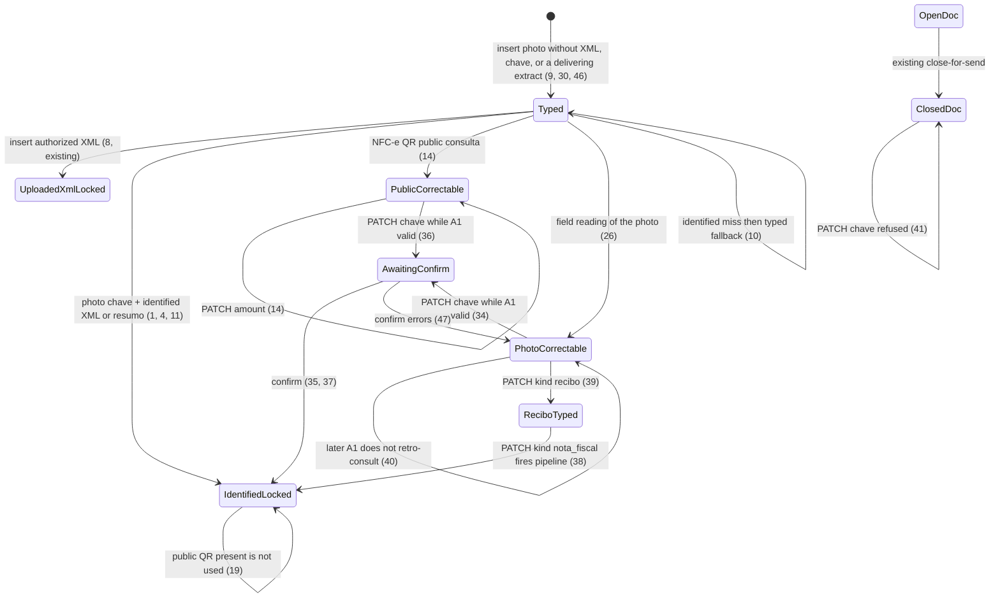

# NF-e photo extraction

> Build this with **tlc-implement**.
> Every criterion below becomes a check with a proof, referenced by its number. Nothing under
> `Unresolved` gets settled while building.

## Intent

A coordinator or submitter can insert a nota fiscal photo, but the bytes are never read. `SupportingDocument#submit` attaches the image and then fills amount, date, and payee from uploaded XML, identified consulta on a **typed** chave, or the form (`app/models/supporting_document.rb`). `photo_jpg` in specs is the literal bytes `jpeg-bytes`; there is no barcode, QR, or field reading. Without a typed chave, identified consulta never starts, and there is no consumer NFC-e lookup. Issue #51 gives no conversion figure; the cost is retyping the DANFE, and the chave printed on the paper does not start consulta unless someone types it.

When this ships, `POST /supporting_documents` of a nota fiscal photo without a typed chave still obtains the 44 digits from the code on the photo (QR or CODE-128, else the printed digits), then the existing identified pipeline. If identified does not deliver and the photo’s NFC-e QR is a consumer URL, that page fills the three fields as correctable and stores no XML. If that does not deliver, the photo’s amount, date, and emitente fill as correctable. Typed remains the last fallback. Recibo is still typed and the photo is not read.

47 criteria in 4 slices · 3 one-way doors · 1 open, of which 0 block

## Criteria

### Chave from the photo

1. Given a `.jpg` photo whose barcode/QR decode returns chave `43260511222333000181550010000000011123456781`, the focused organization has a valid A1, and identified consulta for that chave returns authorized XML with `vNF` `155.00`, emitente `Padaria Central`, `dhEmi` `2026-05-11T10:00:00-03:00`, when a coordinator POSTs `kind=nota_fiscal`, that photo, and no typed chave, amount, date, payee, or XML, then the system persists `amount_cents` `15500`, `document_on` `2026-05-11`, `payee` `Padaria Central`, chave that value, attaches that XML, responds `302` to `/supporting_documents`, and that page includes `R$ 155,00`, `11/05/2026`, `Padaria Central`, and that chave.
2. When a submitter POSTs that same insert, then the system persists the same fields and XML, `GET /supporting_documents` is `200` and includes `R$ 155,00`, and that page does not include `11.222.333/0001-81`, `Válido até`, or `passphrase-secreta`.
3. When that photo is a `.pdf` whose decode returns the same chave and identified consulta returns that XML, then the system persists those fields, that chave, and the XML, and responds `302`.
4. Given barcode/QR decode misses and chave-digit reading of the photo returns `43260511222333000181550010000000011123456781`, with a valid A1 and that identified XML, when a coordinator POSTs the photo and no typed chave, then the system persists that chave, `amount_cents` `15500`, and the XML.
5. Given barcode/QR decode returns chave `43260511222333000181550010000000011123456781` and the POST also has typed chave `43260511222333000181550010000000021987654321`, with identified XML for the first chave, then the system persists chave `43260511222333000181550010000000011123456781` and `amount_cents` `15500`.
6. Given barcode/QR decode returns a value that is not 44 digits after stripping non-digits, chave-digit reading misses, and the POST has typed chave `43260511222333000181550010000000011123456781` with a valid A1 and that identified XML, then the system persists that typed chave and the XML.
7. When a coordinator POSTs `kind=recibo` with a photo whose decode would return that chave, and typed `155,00` / `2026-05-11` / `Padaria Central`, then the system persists kind recibo, stores no chave, attaches no XML, and a later PATCH of payee `Mercado Silva` responds `302`.
8. When a coordinator POSTs authorized XML of `vNF` `155.00` chave `43260511222333000181550010000000011123456781` together with a photo whose decode returns chave `43260511222333000181550010000000021987654321`, then the system persists `amount_cents` `15500` and chave `43260511222333000181550010000000011123456781`.
9. When the organization has no certificate and a coordinator POSTs a photo whose decode returns that chave, plus typed `155,00` / `2026-05-11` / `Padaria Central`, then the system persists that chave and `amount_cents` `15500`, and a later PATCH of payee `Mercado Silva` responds `302`.
10. If identified consulta errors or times out and that POST has the photo-obtained chave and those typed fields, then the system persists the typed fields and a later PATCH of payee `Mercado Silva` responds `302`.
11. Given identified consulta returns only a resumo (`vNF` `155.00`, emitente `Padaria Central`, `dhEmi` `2026-05-11`) for the photo-obtained chave, when a coordinator POSTs the photo and no typed fields, then the system persists those three fields, the photo remains, XML is not attached, and a PATCH of amount responds `422` with `Valor, data e favorecido vêm da nota e não podem ser alterados`.
12. When the production CODE-128 decoder is given a PNG of a CODE-128 that encodes `43260511222333000181550010000000011123456781`, then it returns that chave.
13. When the production QR decoder is given a PNG of a QR whose payload is `https://www.sefaz.rs.gov.br/NFCE/NFCE-COM.aspx?p=43260511222333000181650010000000011123456781|2|1|1`, then it returns chave `43260511222333000181650010000000011123456781` and that URL.

### Public NFC-e consulta

14. Given the organization has no certificate, a photo whose QR decode returns URL `https://www.sefaz.rs.gov.br/NFCE/NFCE-COM.aspx?p=43260511222333000181650010000000011123456781|2|1|1` and chave `43260511222333000181650010000000011123456781`, and public consulta of that URL returns `vNF` `155.00`, emitente `Padaria Central`, date `2026-05-11`, when a coordinator POSTs `kind=nota_fiscal`, that photo, and no typed amount, date, or payee, then the system persists `amount_cents` `15500`, `document_on` `2026-05-11`, `payee` `Padaria Central`, that chave, attaches no XML, responds `302` to `/supporting_documents`, that page includes `R$ 155,00`, `11/05/2026`, `Padaria Central`, and that chave, and a later PATCH of amount `200,00` responds `302` and persists `amount_cents` `20000`.
15. While the wrapping-key process environment is blank, when that same public QR insert runs, then the system persists `amount_cents` `15500` and a later PATCH of amount `200,00` responds `302`.
16. While the installed certificate is expired, when that same public QR insert runs, then the system persists `amount_cents` `15500` and a later PATCH of amount `200,00` responds `302`.
17. If identified consulta errors or times out and that QR photo is posted with no typed fields, and public consulta returns those three values, then the system persists `amount_cents` `15500` and a later PATCH of amount `200,00` responds `302`.
18. If identified consulta returns not found or window-expired and that QR photo is posted with no typed fields, and public consulta returns those three values, then the system persists `amount_cents` `15500` and a later PATCH of amount `200,00` responds `302`.
19. Given identified consulta returns authorized XML of `vNF` `155.00` for that NFC-e chave and the photo also has that QR URL, when a coordinator POSTs the photo and no typed fields, then the system persists `amount_cents` `15500`, attaches XML, and a PATCH of amount responds `422` with `Valor, data e favorecido vêm da nota e não podem ser alterados`.
20. Given a photo whose decode returns only CODE-128 chave `43260511222333000181550010000000011123456781` (no QR URL), no certificate, typed `155,00` / `2026-05-11` / `Padaria Central`, and public consulta would return payee `Mercado Silva` for any URL, then the system persists `payee` `Padaria Central`.
21. If the QR URL is `http://127.0.0.1/nfce`, field reading misses, and the POST has typed `155,00` / `2026-05-11` / `Padaria Central`, then the system persists `payee` `Padaria Central` and attaches no XML.
22. If the QR URL is `https://example.com/nfce`, field reading misses, and the POST has those typed fields, then the system persists `payee` `Padaria Central` and attaches no XML.
23. If public consulta errors or times out, field reading misses, and the POST has those typed fields, then the system persists `payee` `Padaria Central`.
24. If public consulta returns only `vNF` `155.00` and not date or payee, field reading misses, and the POST has those typed fields, then the system persists `payee` `Padaria Central`.
25. When public consulta returns emitente `Padaria Central` and destinatário `ONG Destinataria`, then the system persists `payee` `Padaria Central` and does not persist `ONG Destinataria`.

### Reading amount, date, and payee from the photo

26. Given barcode/QR and chave-digit reading miss, no certificate, and field reading of the photo returns `amount_cents` `15500`, `document_on` `2026-05-11`, payee `Padaria Central` (emitente; the photo also shows destinatário `ONG Destinataria`), when a coordinator POSTs `kind=nota_fiscal`, that photo, and no typed amount, date, or payee, then the system persists those three values, responds `302`, that page includes `R$ 155,00` and `Padaria Central` and does not include `ONG Destinataria`, and a later PATCH of payee `Mercado Silva` responds `302`.
27. If identified consulta errors or times out for a CODE-128 chave from the photo, there is no QR URL, and field reading returns those three values with no typed fields, then the system persists `amount_cents` `15500` and a later PATCH of payee `Mercado Silva` responds `302`.
28. If public consulta errors or times out for an NFC-e QR photo and field reading returns those three values with no typed fields, then the system persists `amount_cents` `15500` and a later PATCH of payee `Mercado Silva` responds `302`.
29. If field reading returns only `amount_cents` `15500` and the POST has typed `100,00` / `2026-05-11` / `Padaria Central`, then the system persists `amount_cents` `10000` and `payee` `Padaria Central`.
30. If field reading misses and the POST has a nota fiscal photo and no typed amount, date, or payee, then the system persists no SupportingDocument and responds `422` with `Informe valor, data e favorecido`.
31. When a coordinator POSTs `kind=recibo` with a photo whose field reading would return payee `Mercado Silva`, and typed `155,00` / `2026-05-11` / `Padaria Central`, then the system persists `payee` `Padaria Central`.
32. Given field reading returns payee `Padaria Central` and the POST also has typed payee `Mercado Silva` (and typed amount `155,00`, date `2026-05-11`), with no chave path, then the system persists `payee` `Padaria Central`.
33. If a coordinator POSTs a file that is not well-formed XML together with a photo whose field reading would return those three values, then the system persists no SupportingDocument and responds `422` with `O XML da nota fiscal não pôde ser lido`.

### Relançamento, confirm, and fallbacks

34. Given a SupportingDocument filled from photo field reading (`amount_cents` `15500`, payee `Padaria Central`) and a valid A1 whose consulta for chave `43260511222333000181550010000000011123456781` returns `vNF` `100.00`, when a coordinator PATCHes that chave, then `amount_cents` stays `15500`, the response is `302`, and `/supporting_documents` includes `Usar dados da SEFAZ`.
35. When a coordinator confirms identified SEFAZ on that document, then the system persists `amount_cents` `10000`, a later PATCH of amount responds `422` with `Valor, data e favorecido vêm da nota e não podem ser alterados`, the response is `302` to `/supporting_documents`, and that page includes `R$ 100,00` and does not include `R$ 155,00`.
36. Given a SupportingDocument filled from public NFC-e consulta (`amount_cents` `15500`) and that same valid A1, when a coordinator PATCHes that chave, then `amount_cents` stays `15500`, the response is `302`, and the page includes `Usar dados da SEFAZ`.
37. When a coordinator confirms identified SEFAZ on that public-filled document, then the system persists `amount_cents` `10000` and a later PATCH of amount responds `422` with `Valor, data e favorecido vêm da nota e não podem ser alterados`.
38. When a coordinator PATCHes `kind=nota_fiscal` on a recibo that already has a photo whose decode returns chave `43260511222333000181550010000000011123456781`, while the organization has a valid A1 and consulta returns full XML of `vNF` `100.00` emitente `Mercado Silva` `dhEmi` `2026-05-12`, then the system persists `amount_cents` `10000`, `payee` `Mercado Silva`, `document_on` `2026-05-12`, attaches that XML, and a later PATCH of amount responds `422`.
39. When a coordinator PATCHes `kind=recibo` together with the existing photo on a photo-filled nota fiscal that has a chave, then the SupportingDocument is recibo, has no chave, keeps amount, date, and payee, and a later PATCH of payee `Mercado Silva` responds `302`.
40. When a coordinator installs a valid A1 after a photo-filled nota fiscal already exists with a chave, then that document’s amount stays as stored and a PATCH of payee `Mercado Silva` still responds `302`.
41. If a coordinator PATCHes chave while Month `2026-05` is closed and that photo-filled document belongs to it, then the chave is unchanged and the response is `422` with `Mês fechado`.
42. If an unauthenticated request POSTs a nota fiscal photo whose decode would fill fields, then the system persists no SupportingDocument and responds `302` to `/login`.
43. If a submitter PATCHes chave on a photo-filled SupportingDocument of another Account, then the system persists no change and the response is `404`.
44. When two POSTs insert nota fiscal photos whose decode returns the same 44-digit chave, then the system persists two SupportingDocuments.
45. Always, amount from public consulta or field reading is integer cents (`15500` for `155.00`), never a `Float` domain amount.
46. When a coordinator POSTs a nota fiscal photo, no typed three fields, barcode/QR miss, chave-digit miss, field reading miss, then the response is `422` with `Informe valor, data e favorecido` and the include form still has fields `amount`, `date`, `payee`, `chave`, and `photo`.
47. If that confirm in 35 runs while identified consulta errors, then the system persists no change to amount, the three fields stay editable, and the response is `422` with `Não foi possível consultar a SEFAZ`.

## States

## Out of scope

- Typed chave and identified consulta (A1, mTLS, lock, confirm control) — already #38; this cut feeds that pipeline a photo-obtained chave
- Public chave HTML form with captcha — #14 / #13
- Reading a recibo photo, or running SEFAZ on a recibo — #14 this version
- Sending photo bytes to a third-party OCR or vision API — Decided 2
- Re-parsing XML blobs already stored by #32 — #38 criterion 31
- Changing close-for-send, matches, or suggestions beyond reading the already-stored three fields — #34 / #37
- HEIC and other types outside JPEG, PNG, WebP, PDF — existing `PHOTO_TYPE`
- NF-e issuance, organization CNPJ as a setup field, accountant login — AGENTS.md
- Persisting the QR URL after extract
- Client-side barcode decode in Stimulus

## Observable

| Surface | Decision | Landing |
| --- | --- | --- |
| screen `/supporting_documents` include | empty amount/date/payee | 1, 14, 26, 46 - submit without the three; `422` `Informe valor, data e favorecido` when nothing delivers |
| screen `/supporting_documents` include | loading | n/a - Turbo full-page / redirect; 1 is in-request (302 already includes `R$ 155,00`) |
| screen `/supporting_documents` include | error state | 30, 33, 46 |
| screen `/supporting_documents` include | unauthorised | 2, 42 |
| screen `/supporting_documents` include | density and ordering | 1, 14 - filled amount, date, payee, chave digits on the existing date-desc list; no origin badge |
| screen `/supporting_documents` include | destructive action confirms | existing - document DELETE still Turbo-confirms; this task does not change that |
| screen `/supporting_documents` row | empty chave | n/a - chave stays optional when decode misses; 26 is insert without it |
| screen `/supporting_documents` row | loading | n/a - Turbo full-page / redirect |
| screen `/supporting_documents` row | error state | 35, 41, 47 |
| screen `/supporting_documents` row | unauthorised | 43 |
| screen `/supporting_documents` row | density and ordering | 14, 34, 36 - chave digits and `Usar dados da SEFAZ` on public/photo rows |
| screen `/supporting_documents` row | destructive action confirms | existing - DELETE |
| HTML `POST /supporting_documents` | who may call it | existing - focused Access; 1, 2 |
| HTML `POST /supporting_documents` | error shape and codes | 30, 33, 42, 46 |
| HTML `POST /supporting_documents` | versioning | n/a - existing HTML surface; photo bytes are now read |
| HTML `POST /supporting_documents` | rate limit | n/a - small operator set |
| HTML `PATCH /supporting_documents/:id` | who may call it | existing - coordinator or inserting submitter; 43 |
| HTML `PATCH /supporting_documents/:id` | error shape and codes | 11, 19, 41, 43 |
| HTML `PATCH /supporting_documents/:id` | versioning | n/a - existing HTML surface |
| HTML `PATCH /supporting_documents/:id` | rate limit | n/a - small operator set |
| HTML confirm identified SEFAZ | who may call it | 35, 37 |
| HTML confirm identified SEFAZ | error shape and codes | 47 |
| HTML confirm identified SEFAZ | versioning | n/a - existing HTML surface |
| HTML confirm identified SEFAZ | rate limit | n/a - small operator set |
| outbound public NFC-e GET | who may call it | n/a - server-only; not an inbound API |
| outbound public NFC-e GET | error shape and codes | 21, 22, 23 - miss then next pipeline step; never captcha form |
| outbound public NFC-e GET | versioning | n/a - consumer HTML has no published schema (#13) |
| outbound public NFC-e GET | rate limit | n/a - one GET per insert that reaches that step |
| collection supporting documents | grouping | existing - focused organization; submitter own rows |
| collection supporting documents | naming | 1, 14, 26 - amount, date, payee, chave digits |
| collection supporting documents | ordering | existing - `#32` date desc, id desc |
| collection supporting documents | duplicates | 44 - same chave may persist twice |
| collection supporting documents | exception that does not fit | 7, 31 - recibo ignores photo decode and field reading |

## Swept

- validation: 6, 24, 29, 30, 33 - non-44 photo decode is a miss not `422`; public or field reading that lacks all three is a miss; unreadable XML still `422` and does not fall through
- failure modes: 10, 15, 21, 23, 30, 47 - identified miss, blank wrap key, SSRF URL, public error, and field miss fall through or `422`; confirm does not lock on error
- idempotency and retry: 35, 44 - a second confirm is existing #38-58 behaviour on the locked row; a retried POST creates a second document (no unique chave)
- authorization: 2, 42, 43
- concurrency and ordering: n/a - no one-slot resource on the document; two in-flight inserts do not share writable state beyond creating two rows (44)
- data lifecycle: 39, 40 - nota→recibo drops chave and unlocks as typed; a later A1 does not re-read stored photos
- external-dependency failure: 10, 17, 18, 23, 28 - identified error/timeout/not found/window-expired and public error/timeout fall through to the next step
- state transitions: 1, 11, 14, 19, 26, 34, 35, 38, 39
- observability: existing - `filter_parameters` already covers certificate/passphrase; no new operator metric; photo bytes are not a log field this task adds

## Impact

| Front | What changes |
|---|---|
| domain | existing term: `Chave de acesso` - may now be obtained from the photo (QR, CODE-128, or printed digits) on insert and on recibo→nota, not only typed or taken from uploaded XML. Callers: `SupportingDocument#submit` currently reads `attrs[:chave]` or `AuthorizedNfe` |
| domain | existing term: `SEFAZ consulta` - consumer consult of an NFC-e QR URL first runs on the server when identified does not deliver; still not the captcha chave form. Identified consult is unchanged (#38 port) |
| domain | existing term: `Supporting document` - amount, date, and payee may now be filled from public NFC-e HTML or from reading the photo, both correctable. Suggestions (#37) still read `amount_cents`, `document_on`, `payee` and do not gain a matching key. `MonthPackage` still copies the photo blob |
| domain | existing term: `Observation` - still optional and still the only extra note while XML/identified lock the three; public and photo origins keep the three editable |
| domain | existing term: `Nota fiscal` / `Recibo` - recibo still does not read the photo (7, 31); recibo→nota fires the new steps (38); nota→recibo still drops chave and consulta XML (39) |
| stored data | add allowed `fields_origin` values `photo` and `nfc_e_public` on the existing string; existing rows stay typed-equivalent; do not backfill by re-reading stored photos. No unique index on chave (44). No QR URL column |

## Decided

| Decision | Shape | Alternative rejected |
|---|---|---|
| 1. Public and photo origins are persisted; lock is still derived | `fields_origin` values `photo` and `nfc_e_public`. `fields_locked?` stays true only for `uploaded_xml` and `identified`. PATCH of the three succeeds on `photo` and `nfc_e_public`. Nil origin remains typed-equivalent (#38-31). | Reuse `typed` for both — #38 door 2 already named photo and NFC-e-public as distinct correctable origins; confirm still needs them not to be `identified`. Lock whenever a chave exists — would lock typed and public rows #14 says any operator may correct. |
| 2. Photo capture and public consulta are server ports; photo bytes stay in-process; public GET is allowlisted | Three ports with test fakes and no network in submit specs, same `current`/`Fake`/`Real` shape as `SefazConsulta`: (a) symbols from the photo (QR URL and/or 44-digit chave from QR, CODE-128, or printed digits), (b) amount/date/payee from the photo, (c) public consulta given a URL → the three fields, miss, or error. Production `build` is in-process Real. Photo bytes are not sent to a third-party OCR or vision API. Public HTTP GET runs only when the URL host is an NFC-e consumer portal published for the QR (NT 2015/002 and updates); `127.0.0.1` and `example.com` are not fetched. Real CODE-128 and QR decoders are proven from fixture PNGs (12, 13). Consumer URLs are produção pages of authorized notes. | Browser zxing before POST — image PDF would not decode; submitter insert must match coordinator; rails.mdc keeps SEFAZ work on the server. Cloud Vision / Textract — AGENTS.md does not pick a cloud vendor inside a feature; photos are working files with financial data; #38 already fakes the external consult. Fetch any QR URL — a photo-supplied URL is attacker-controlled (SSRF). Public chave+captcha HTML — #14. Homologação consumer pages — coordinators consult authorized production notes. |
| 3. Extraction order is #14, with all-three-or-miss at public and photo-reading | On nota fiscal without a readable uploaded XML: obtain chave from QR, else CODE-128, else printed digits, else typed; then identified if the A1 can run; then public consulta only if an NFC-e QR URL decoded and identified did not deliver; then field reading; then typed. A step that cannot yield all three of amount, date, and payee is a miss. Unreadable uploaded XML is `422` and does not fall through (33). QR wins over CODE-128 when both decode (QR is the public URL). Photo-obtained 44-digit chave is a chave for identified (1), not a separate path that skips #38. | Typed chave wins over a decoded chave — #14 obtains the chave from the photo first. Partial public/OCR fill mixed with typed — would split origin across columns. Using the QR payload `vNF` without HTML — #9 offline QR can carry `vNF` but not emitente name; #14 fills from the consumer page. |

- Nothing else in this change is hard to reverse. Route names, which gem decodes CODE-128, and the HTML selectors of one UF consumer page are placement. Door 1 reaches past this feature: suggestions keep reading the three columns; they must not treat `photo` or `nfc_e_public` as locked. Door 2 reaches past this feature: a later fetch of a user-supplied URL copies the consumer-portal allowlist, not “GET whatever the file contains”; a later read of a working-file image copies in-process ports with fakes, not a cloud vision vendor. Door 3 reaches past this feature: identified still runs before public; public still does not store XML.

## Surface

| Route | In | Out | Status | Criteria |
|---|---|---|---|---|
| `GET /supporting_documents` | session, focus | include form, list with amount, date, payee, chave, `Usar dados da SEFAZ` | `200`, `302` | 1, 14, 34, 46 |
| `POST /supporting_documents` | session, focus, existing insert fields, photo bytes now read | SupportingDocument, maybe XML from identified, maybe chave from photo | `302`, `422` | 1, 2, 3, 4, 5, 7, 8, 9, 10, 11, 14, 20, 26, 30, 33, 42, 44, 46 |
| `PATCH /supporting_documents/:id` | session, focus, kind, amount, date, payee, observation, chave, files | updated document | `302`, `404`, `422` | 14, 34, 36, 38, 39, 41, 43 |
| `POST /supporting_documents/:id/sefaz_confirm` | session, focus, document | locked fields from identified consulta | `302`, `422` | 35, 37, 47 |

## Sources

- https://github.com/gutors/ai-accounting-assistant/issues/51 - this cut: chave from barcode/QR on the photo; NFC-e public consulta of the QR URL (consumer channel, no certificate, no XML); reading amount, date, and payee from the photo; typed chave and identified consulta stay #38. The issue line “when the chave was not typed” underspecifies: a photo-obtained chave still feeds identified (#14 steps 1–2). Task file `.tasks/nfe-photo-extraction.md`
- https://github.com/gutors/ai-accounting-assistant/issues/14#issuecomment-5611316484 - declare nota fiscal vs recibo; extraction fills; typed is fallback; chave optional (barcode/QR, else printed digits, else typed); identified then public NFC-e QR then photo fields then typed; public origin correctable, no XML, no captcha form; NF-e 55 without QR does not use that page; recibo this version typed only; after insert any operator may correct chave and kind; recibo→nota fires the pipeline; nota→recibo discards chave/consulta-XML and unlocks as typed; identified that arrives later only replaces correctable fields if the person confirms; payee is emitente
- user delegated - include printed-digit chave OCR in this cut, after barcode/QR miss and before typed
- https://github.com/gutors/ai-accounting-assistant/issues/13#issuecomment-5587570133 - public chave+captcha HTML is not a structured API; identified `consChNFe` stays #38; this cut does not use that form
- https://github.com/gutors/ai-accounting-assistant/issues/9#issuecomment-5545690456 - CODE-128 is modelo 55 chave; NFC-e QR is the consult URL (offline QR may also carry `vNF`); recibo has no official barcode/QR
- `.tasks/sefaz-certificate-and-consulta.md` - identified port, origins, lock, confirm `Usar dados da SEFAZ`, XML paths, no unique chave; door 4 said #51 falls through this port’s miss into steps 3–5 of #14
- `CONTEXT.md` - Supporting document, Chave de acesso, SEFAZ consulta, Nota fiscal, Recibo; image PDF counts as a photo
- `AGENTS.md` / `.cursor/rules/rails.mdc` - identified mTLS on the server; working files are the blob interface; do not pick a cloud vendor inside a feature
- [ADR-0004](../docs/adr/0004-sefaz-certificate-in-postgres.md) - A1 unwrap stays on the server; blank wrap key skips identified and does not stop the rest of the app (15)

No design source for the screens. Verification stays on project profile `standard` (no binding screen, so not `ui`).

This task is the record of decision. If a linked document diverges, ask before building.

## Unresolved

| # | Kind | Question | Until answered |
|---|---|---|---|
| 1 | open | Does replacing the photo on PATCH re-run extraction? | No. Extraction runs on insert of nota fiscal and on recibo→nota (38). A later `photo` file on PATCH is stored and does not change amount, date, payee, or chave by itself. |
