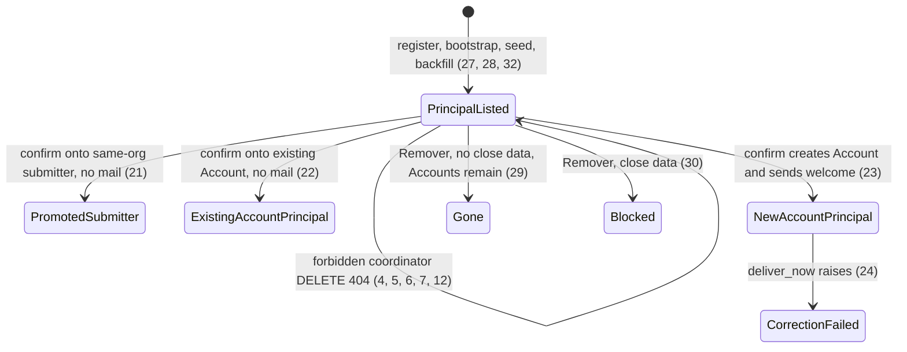
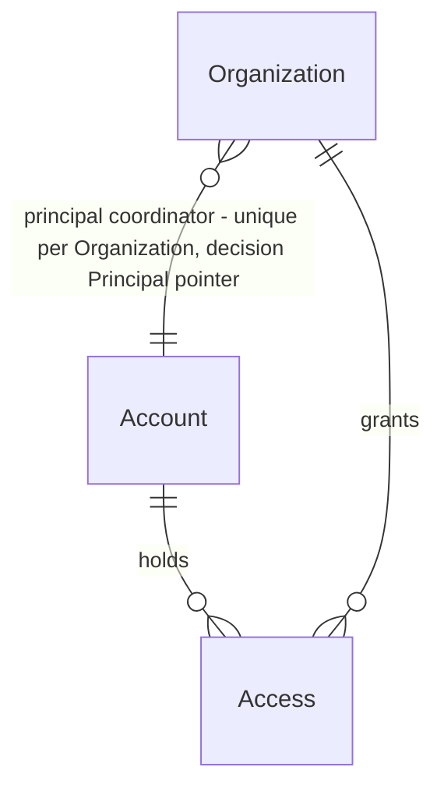

# Principal coordinator

> Build this with **tlc-implement**. Profile **ui** — this task names screens `administration`, `administration/:id/edit`, and `home`.
> Every criterion below becomes a check with a proof, referenced by its number. Nothing under
> `Unresolved` gets settled while building.

## Intent

The registry column `Email coordenador` is whoever sorts first on `accounts.email`, and any coordinator can revoke any other coordinator, including themselves. The address named at sale is not what the seller reads back, a later invite can steal the column, and a peer can remove the person the sale named. Correcting the column onto a submitter of the same organization answers `Esse e-mail já tem acesso a esta organização.` The issue gives no count of wrong rows.

When this ships, that column and `Ativa` / `Pendente` follow the principal coordinator — the Account `organizations.principal_coordinator_account_id` points at, set at sale or by this screen's email correction. Only that email has `Corrigir`. On `home`, that person is the first coordinator row and is the only person who sees `Revogar` on other coordinator rows. No coordinator row has `Revogar` for the signed-in person's own Access. Any coordinator still invites coordinators and submitters and still revokes submitters. A principal-email confirm that lands on a submitter of the same organization promotes that Access. A confirm onto an Account that already exists sends no welcome. Removal stays as ADR-0007: Accesses and Invites go, Account rows stay. Screens `administration`, `administration/:id/edit`, and `home` people in `.design/administration-list.md` are binding.

32 criteria in 4 slices · 2 one-way doors · 2 open, of which 0 block · 1 blocks go-live

## Criteria

### Home

1. Given `ONG Norte` has principal coordinator `zoe@exemplo.org`, coordinator `ana@exemplo.org`, and submitter `submitter@exemplo.org`, when `zoe@exemplo.org` is signed in on that organization and `GET /` runs, then under `Coordenadores` the emails appear in order `zoe@exemplo.org` then `ana@exemplo.org`. The `zoe@exemplo.org` row has no `Revogar`. The `ana@exemplo.org` row has `Revogar` with `data-turbo-confirm` `Revogar o acesso deste coordenador?`. The submitter row has `Revogar` with `data-turbo-confirm` `Revogar o acesso deste submitter?`. The body includes `Convidar coordenador` and `Convidar submitter`.
2. Given the same people, when `ana@exemplo.org` is signed in as coordinator on `ONG Norte` and `GET /` runs, then the coordinator emails are still `zoe@exemplo.org` then `ana@exemplo.org`. No coordinator row has `Revogar`. The submitter row still has `Revogar` with `data-turbo-confirm` `Revogar o acesso deste submitter?`. `Convidar coordenador` and `Convidar submitter` are present.
3. Given that home as `zoe@exemplo.org`, when `DELETE /accesses/:id` runs for `ana@exemplo.org`'s coordinator Access, then the status is `302` to `/`, that Access is gone, `zoe@exemplo.org` still has coordinator Access, and `principal_coordinator_account_id` is still that Account.
4. Given that home as `zoe@exemplo.org`, when `DELETE /accesses/:id` runs for `zoe@exemplo.org`'s coordinator Access, then the status is `404`, the body is empty, that Access remains, and `principal_coordinator_account_id` is unchanged.
5. Given that home as `ana@exemplo.org`, when `DELETE /accesses/:id` runs for `zoe@exemplo.org`'s coordinator Access, then the status is `404`, the body is empty, and that Access remains.
6. Given `ONG Norte` also has coordinator `bia@exemplo.org` who is not principal, when `ana@exemplo.org` sends `DELETE /accesses/:id` for `bia@exemplo.org`'s coordinator Access, then the status is `404` and that Access remains.
7. Given that home as `ana@exemplo.org`, when `DELETE /accesses/:id` runs for `ana@exemplo.org`'s coordinator Access, then the status is `404`, the body is empty, and that Access remains. `zoe@exemplo.org` remains principal.
8. Given that home as `ana@exemplo.org`, when `DELETE /accesses/:id` runs for the submitter Access, then the status is `302` to `/` and that Access is gone.
9. Given a submitter is signed in on `ONG Norte`, when `GET /` runs, then the `h1` is `Início` and the body does not include `Revogar` or `Convidar coordenador`.
10. Given no signed-in Account, when `DELETE /accesses/:id` runs, then the response is `302` to `/login` and Access rows are unchanged.
11. Always, `Access#destroy` of the last coordinator Access returns false, adds `:last_coordinator`, and leaves the row.
12. Given two coordinator Accesses on one organization, when each signed-in Account concurrently sends `DELETE /accesses/:id` for its own Access, then both Accesses remain and both statuses are `404`. Neither request calls `Access#destroy`.

### Administration list and edit

13. Given the allowlisted Account is signed in, `ONG Norte`'s principal is `zoe@exemplo.org` with no `google_uid`, `ana@exemplo.org` is a coordinator with `google_uid` set, and a submitter exists, when `GET /administration` runs, then that row's `Email coordenador` cell is `zoe@exemplo.org` and not `ana@exemplo.org`, Status is `Pendente`, and that row's cells do not include `ana@exemplo.org` or the submitter email.
14. Given that principal Account has `google_uid` set, when `GET /administration` runs, then Status on that row is `Ativa`.
15. Given `GET /administration/:id/edit` for that `ONG Norte`, then the page includes `zoe@exemplo.org` with `Corrigir` (`text-caixa underline underline-offset-2`), includes `ana@exemplo.org` as text with no `Corrigir` control for that address, includes `Corrigir nome` and `Remover` (`text-margem underline underline-offset-2`) with `data-turbo-confirm` `Remover a organização ONG Norte?`, and does not include the submitter email.
16. When `POST /administration/email` names `ana@exemplo.org` on `ONG Norte`, then the status is `404`, Access rows are unchanged, and the response is not the email field for that address.
17. Given no signed-in Account, when `POST /administration/email`, `POST /administration/email/confirm`, or `DELETE /administration` runs, then the response is `302` to `/login`, and `Organization.count`, `Account.count`, `Access.count`, `Invite.count`, and `ActionMailer::Base.deliveries` are unchanged.
18. Given a signed-in Account whose email is not the normalized `ADMINISTRATOR_EMAIL`, when the request is any route in criterion 17, then the status is `404`, the body is empty, and those counts and deliveries are unchanged.

### Principal email write

19. Given the principal email field is open on `ONG Norte`, when `Continuar` submits `nao-e-email`, then the status is `422`, the notice under the `h1` is `Informe um e-mail válido.`, the field keeps `nao-e-email`, and Access rows are unchanged.
20. Given `ana@exemplo.org` already has coordinator Access on `ONG Norte` and is not principal, when `Continuar` on the principal email submits `Ana@Exemplo.ORG`, then the status is `422`, the notice is `Esse e-mail já tem acesso a esta organização.`, the field keeps that value, and Access rows are unchanged.
21. Given `ONG Norte` principal `coordenador@exemplo.org` and submitter `submitter@exemplo.org`, when the principal email confirmation for ` Submitter@Exemplo.ORG ` is confirmed, then that Account's Access `kind` is `coordinator`, `principal_coordinator_account_id` is that Account, the old principal Access is gone, `Account.count` is unchanged, a pending Invite for `submitter@exemplo.org` on `ONG Norte` is gone, `ActionMailer::Base.deliveries` is empty, and the following `GET /administration` shows `submitter@exemplo.org` as `Email coordenador` with no `E-mail enviado para` and no `A correção foi gravada, mas o e-mail não saiu.` The kind change exists before the old principal Access is destroyed, in one transaction, which is why `Access#destroy` does not refuse a sole remaining coordinator.
22. Given `sul@exemplo.org` already has an Account that coordinates `ONG Sul` and has no Access on `ONG Norte`, when the principal email confirmation to that address is confirmed, then `Account.count` is unchanged, `ONG Norte`'s `principal_coordinator_account_id` is that Account, that Account has coordinator Access there, the old principal Access is gone, and no message is delivered. The following `GET /administration` shows `sul@exemplo.org` as `Email coordenador` and no mail sentence.
23. Given the principal is `coordenador@exemplo.org`, that Account has no other Access, `novo@exemplo.org` has no Account, and a pending Invite for `novo@exemplo.org` exists on `ONG Norte`, when the principal email confirmation for ` Novo@Exemplo.ORG ` is confirmed and delivery succeeds, then a new Account `novo@exemplo.org` exists, it is principal, the old principal Access is gone, the `ONG Norte` Invite for that email is gone, one `text/plain` welcome is delivered to `novo@exemplo.org` with subject `Fechamento Mensal - Cadastro da Organização ONG Norte` and body `A organização ONG Norte está pronta. Entre com o Google usando novo@exemplo.org, pelo botão Entrar com Google.`, and the row shows `E-mail enviado para novo@exemplo.org.`
24. Given that new-Account confirmation, when `deliver_now` raises, then the new Access and the new Account remain, the old principal Access is gone, the Invite for the new email on `ONG Norte` is gone, no `accounts.email` is rewritten, and the following `GET` shows `[data-notice="error"]` `A correção foi gravada, mas o e-mail não saiu.` and primary `Reenviar e-mail` on that row. Delivery runs after the transaction commits and the error is rescued.
25. Given `Continuar` on the principal submits ` Coordenador@Exemplo.ORG ` and that is already the principal Account email, when `Confirmar` runs, then Access rows are unchanged, no message is delivered, and the following `GET` shows `coordenador@exemplo.org` with no new mail sentence.
26. If the principal email write raises before its transaction commits, then `principal_coordinator_account_id` and Access rows are unchanged, a pending Invite for the new email on that organization remains, and no message is delivered. The new coordinator Access, the Invite delete, the old principal destroy, and the FK write share one transaction, and mail runs only after commit.
27. When `Organization.register_coordinator` writes `ONG Norte` / `coordenador@exemplo.org`, then `principal_coordinator_account_id` is that Account. Given that organization then has a pending coordinator Invite for `ana@exemplo.org`, when `Invite#accept!` runs for that Invite, then a coordinator Access exists for `ana@exemplo.org`, the Invite is gone, and `principal_coordinator_account_id` is still the Account for `coordenador@exemplo.org`. The list column and the first `home` coordinator row stay `coordenador@exemplo.org`. `ana@exemplo.org` is a peer coordinator, not the principal.
28. When `coordinator:bootstrap` or `DevelopmentCoordinatorSeed.plant!` writes its Organization, Account, and coordinator Access, then `principal_coordinator_account_id` is that Account. The command still aborts when the email already has an Account.

### Removal

29. Given `ONG Norte` has a principal coordinator whose Account has no other Access, another coordinator who also coordinates `ONG Sul`, a submitter whose Account has no other Access, one pending Invite, `accountant_presentation_name` set, and no BankAccount, Month, SupportingDocument, Justification, or ExtraExceptionKind, when removal is confirmed, then the response is `302` to `/administration`, `ONG Norte` is gone, its Accesses and Invites are gone, both Accounts that only stood on `ONG Norte` remain, the extra coordinator Account remains with Access on `ONG Sul`, and the following `GET` does not include `ONG Norte`. The last-coordinator refusal does not veto this delete. Account rows stay, as ADR-0007.
30. Given `ONG Norte` has a BankAccount and none of the other four close-data rows, when removal is confirmed, then the status is `422`, `[data-notice="error"]` is `Esta organização já tem dados de fechamento e não pode ser removida.`, and Organization, Access, Invite, Account, and BankAccount counts for it are unchanged. The check runs before any delete.
31. When removal is confirmed for an organization id that does not exist, then the response is `404` and every other Organization and Account remains.
32. Given an existing organization whose coordinator Accesses were planted without a stored principal, when the migration runs, then `principal_coordinator_account_id` is the Account of the coordinator Access with the earliest `created_at`, ties broken by earliest `id`. After that, the column is not null.

## States

`Access#destroy` of the last coordinator still returns false (11). Signed-out administration writes still end at `/login` (17). A signed-in non-administrator still gets `404` (18).

## Out of scope

- Rebuilding registration, name correction, invite mail copy, or the welcome subject — those stay as `.tasks/administration-list.md` and `.tasks/administration-access.md` left them (23, 24)
- Sending no welcome on `register_coordinator` when the Account already exists — #66 item 5 is the principal-email correction, not the sale
- A badge or the words `coordenador principal` on `home` or `/administration` — order and `Email coordenador` are the signal (1, 13)
- Restricting who may invite a coordinator — any coordinator still can (1, 2)
- Deleting Account rows on `Remover` — #66 asked to drop Accounts with no Access left. This task keeps ADR-0007: Account rows stay (29). Sources: user delegated
- A submitter list on `/administration` (13, 15)
- Rewriting `Account.email` — still the Google identity
- Changing `Access#destroy` `:last_coordinator` (11)
- Changing `coordinator:bootstrap` abort when the email already has an Account (28)
- A second administrator
- Closing issue #63 — a real mailbox is Unresolved 1
- Rate-limiting mail

## Observable

| Surface | Decision | Landing |
| --- | --- | --- |
| screen `home` people | empty state | n/a - an organization always has a principal coordinator (27, 32) |
| screen `home` people | loading | n/a - no waiting state |
| screen `home` people | error state | n/a - forbidden coordinator revoke is `404` with an empty body (4, 5, 6, 7, 12), not a notice |
| screen `home` people | unauthorised | 9, 10 |
| screen `home` people | density and ordering | 1, 2 - principal first, then `accounts.email` ascending; no badge |
| screen `home` people | destructive action confirms | 1, 2 - coordinator `Revogar` only on peers, and only when the signed-in Account is principal; submitter `Revogar` stays for any coordinator |
| screen `administration` list | empty state | existing - zero organizations omits the table |
| screen `administration` list | loading | n/a - no waiting state |
| screen `administration` list | error state | 30 |
| screen `administration` list | unauthorised | 17, 18 |
| screen `administration` list | density and ordering | 13, 14 - one principal email, Status from that Account's `google_uid` |
| screen `administration/:id/edit` | empty state | n/a - edit is one existing organization |
| screen `administration/:id/edit` | loading | n/a |
| screen `administration/:id/edit` | error state | 19, 20, 24, 30 |
| screen `administration/:id/edit` | unauthorised | 16, 17, 18 |
| screen `administration/:id/edit` | density and ordering | 15 - `Corrigir` only on the principal email; other coordinators as text |
| screen `administration/:id/edit` | destructive action confirms | 15 - `Remover a organização ONG Norte?` |
| API | response and error shape | n/a - these are the screens above. Statuses are in Surface |
| command `coordinator:bootstrap` | output, flags, exit codes | 28 - abort-on-existing-Account unchanged; the write now sets the FK |
| document `CONTEXT.md` | structure and next step | existing after the plan amendment - term `Principal coordinator` |
| collection coordinators | grouping | n/a - one list, two kinds on `home` as today |
| collection coordinators | naming | 13 - `Email coordenador` is the principal |
| collection coordinators | ordering | 1, 13 |
| collection coordinators | duplicates | 20 - another coordinator on that organization is still refused |
| collection coordinators | exception | 21 - a submitter on that organization is promoted |

## Swept

- validation: 19, 20
- failure modes: 24, 26, 30 - a mail failure keeps the write; a write that raises before commit leaves the old principal; close data deletes nothing
- idempotency and retry: 25 - confirming the current principal email writes nothing and sends nothing. Resend of a new-Account failure stays the existing `/administration/mail` path (24)
- authorization: 4, 5, 6, 7, 9, 10, 16, 17, 18
- concurrency and ordering: 12 - overlapping self-DELETE leaves both coordinator Accesses. Overlapping principal-email confirms are Unresolved 2
- data lifecycle: 29, 32 - removal still leaves Account rows (ADR-0007); existing organizations get a principal before the column is not null
- external-dependency failure: 24 - SMTP `deliver_now` raises only on the path that sends; 21 and 22 send nothing so a down mailbox does not fail them
- state transitions: States
- observability: n/a - no log, metric, or trace was decided. The notices in 19, 20, 24, 30 are the signal

## Impact

| Front | What changes |
|---|---|
| domain | new term: `Principal coordinator` - the one Account an organization names at sale or on `/administration` edit. Lives on `Organization` as `principal_coordinator_account_id`. Glossary: `CONTEXT.md` |
| domain | existing term: `listed_coordinator_account` - meant first `accounts.email`. Now must be the principal Account. Callers: `administration/_organization_row.html.erb` (`Email coordenador`, `Ativa` / `Pendente`), `Organization#listed_coordinator_signed_in?` |
| domain | existing term: `Access` - `kind` may change from `submitter` to `coordinator` on the same row (21). `destroy` still refuses the last coordinator. Callers: `AccessesController#destroy`, `Organization#replace_coordinator`, `Invite#accept!` |
| domain | existing term: `CoordinatorWelcomeMailer` - still the two bodies. Principal-email confirm calls it only when this write created the Account (22 vs 23). Callers: `AdministrationController` email confirm and mail |
| stored data | Backfill now: every `organizations` row gets `principal_coordinator_account_id` from the earliest coordinator Access (`created_at`, then `id`), then the column is `NOT NULL`. Existing Account rows are not rewritten. `Remover` does not delete Account rows |

## Decided

| Decision | Shape | Alternative rejected |
|---|---|---|
| Principal pointer | `organizations.principal_coordinator_account_id` `bigint NOT NULL`, FK to `accounts(id)`, `ON DELETE RESTRICT`. One principal per organization by being a single column. `Invite#accept!` creates a coordinator Access and does not write this column. `register_coordinator`, bootstrap, and the development seed set it to the Account they create | A `principal` boolean on `accesses`. Two coordinator rows could both be true unless a partial unique index existed, and the sale identity would still be inferred from Access rather than from the organization the seller edits. Treating the newly accepted invite as principal, which would let a later invite steal `Email coordenador` |
| Email write | For a different normalized email: in one transaction, grant coordinator Access to that Account (create the Account when missing; if that Account already has submitter Access on this organization, `update!` `kind` to `coordinator`), delete a pending Invite for that email on that organization, point `principal_coordinator_account_id` at that Account, then destroy the old principal Access. Do not update `accounts.email`. Deliver the welcome after commit only when this transaction created the Account | Always sending the welcome. #66 says an email that already exists in the system is not mailed. Leaving the old principal as a peer. The issue is a correction of the sale email, which is the existing move |
| Removal | Unchanged from ADR-0007: after the close-data guard, delete Accesses (including the last coordinator) and Invites, then the Organization. Account rows stay | Deleting Accounts with no Access left. #66 asked for that; this task keeps ADR-0007. Sources: user delegated |

## Relations

## Surface

| Route | In | Out | Status | Criteria |
|---|---|---|---|---|
| `GET /` | session | coordinator list, `Revogar` presence | `200`, `302` | 1, 2, 9 |
| `DELETE /accesses/:id` | Access id | redirect or empty | `302`, `404` | 3, 4, 5, 6, 7, 8, 10, 12 |
| `GET /administration` | session | list column and Status | `200`, `302`, `404` | 13, 14, 17, 18 |
| `GET /administration/:id/edit` | id | principal `Corrigir`, other emails as text, `Remover` | `200`, `302`, `404` | 15, 17, 18 |
| `POST /administration/email` | `organization_id`, `email` | field or empty | `200`, `404` | 16, 17, 18 |
| `POST /administration/email/confirm` | session pending | redirect, then list | `302`, `404` | 21, 22, 23, 24, 25, 26 |
| `DELETE /administration` | `organization_id` | redirect or edit with notice | `302`, `422`, `404` | 29, 30, 31 |

Email continue validation statuses are in 19 and 20. Paths follow the existing administration posts. That placement is not a door.

## Sources

- https://github.com/gutors/ai-accounting-assistant/issues/66 — principal identity, home revoke rules, list column, edit-only principal, submitter promotion, skip mail when the Account exists. Item 4 (delete Accounts with no Access) is out of this task
- `.design/administration-list.md` — **binding for the interface**: screens `administration`, `administration/:id/edit`, `home` people. Invite mail drawings are unchanged
- `CONTEXT.md` — term `Principal coordinator`
- `.tasks/administration-access.md` — the move that does not rewrite `Account.email`, the close-data removal guard, last-coordinator `destroy`, welcome on a new Account
- `docs/adr/0007-administration-access.md` — Account rows stay on remove
- `app/models/invite.rb` — `accept!` creates Access and destroys the Invite; it does not write `principal_coordinator_account_id` (27)
- `app/models/access.rb` — uniqueness on `(account_id, organization_id)` is why a submitter is `update!` `kind`, not a second Access
- `app/controllers/accesses_controller.rb` — other-organization DELETE is already `404`; forbidden coordinator revoke uses that status
- `DESIGN.md` — quiet caixa, quiet margem, notice partial `data-notice="error"`
- Conversation, this session — non-principal cannot revoke self (2, 7). Removal keeps Account rows (29). Sources: user delegated

This task is the record of decision. If a linked document diverges, ask before building.

## Unresolved

| # | Kind | Question | Until answered |
|---|---|---|---|
| 1 | blocks go-live | Which mailbox fills `SMTP_ADDRESS`, `SMTP_PORT`, `SMTP_USER_NAME`, `SMTP_PASSWORD`, and `MAIL_FROM`? | Same as #63. Tests use the `:test` delivery. Criterion 23 still sends when this write creates the Account. 21 and 22 do not |
| 2 | open | Two overlapping confirms that move the same principal Access to two different emails? | No criterion names a winner. Do not add a lock. Criterion 21 is one request: grant the new coordinator Access, then destroy the old principal, in one transaction |
