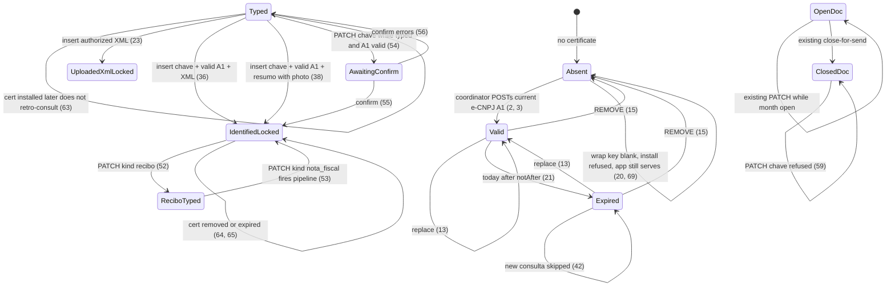
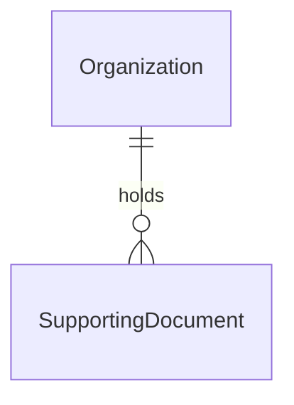

# SEFAZ certificate and identified consulta

> Build this with **tlc-implement**.
> Every criterion below becomes a check with a proof, referenced by its number. Nothing under
> `Unresolved` gets settled while building.

## Intent

A coordinator can insert a supporting document, but amount, date, and payee are always typed. Uploaded XML is stored opaquely: `SupportingDocument.submit` writes the form values even when the bytes contain `<vNF>100.00</vNF>` (`spec/models/supporting_document_spec.rb` “insert ignores xml vNF”; request spec POST typed `155,00`). There is no place on `Organization` or `/setup` to install an A1, so identified SEFAZ consulta cannot run — including when a submitter inserts unattended. Issue #38 gives no conversion figure; the cost is that every nota fiscal is retyped from a DANFE, the typed path can disagree with the authorized XML, and the optional certificate in CONTEXT never enters.

When this ships, a coordinator of the focused organization installs, replaces, or removes one optional A1 e-CNPJ on `/setup`. Inserting a nota fiscal fills amount, date, and payee from uploaded authorized XML or from identified consulta on a typed chave (payee is the emitente), and those three cannot be edited — only observation. Recibo stays typed. A submitter insert runs the same consulta and never sees the certificate. Typed remains the fallback when there is no XML and consulta does not deliver. Photo barcode/QR, NFC-e public consulta, and field OCR are #51.

69 criteria in 4 slices · 4 one-way doors · 0 open, of which 0 block

## Criteria

### Certificate slot

1. When a coordinator of the focused organization opens `/setup` while that organization has no SEFAZ certificate, then the response is `200` and includes the heading `Certificado SEFAZ` and the text `Nenhum certificado`.
2. When a coordinator POSTs a PKCS#12 `.pfx` whose leaf titular is CNPJ `11222333000181`, notAfter `2027-09-18`, and passphrase `passphrase-secreta`, then the system persists that certificate on the focused organization, responds `302` to `/setup`, and that page includes `11.222.333/0001-81` and `Válido até 18/09/2027` and does not include `Nenhum certificado` or `passphrase-secreta`.
3. When a coordinator POSTs the same titular as a `.p12` with a correct passphrase, then the response is `302` to `/setup` and that page includes `11.222.333/0001-81`.
4. If a request sends `GET /sefaz_certificate` after that install, then the response is `404` and the body does not include the PKCS#12 bytes.
5. If a coordinator POSTs that `.pfx` with passphrase `errada`, then the system persists no certificate and responds `422` with `Não foi possível abrir o certificado com essa senha`, and `/setup` still includes `Nenhum certificado`.
6. If a coordinator POSTs a PKCS#12 whose leaf titular is CPF `39053344705`, then the system persists no certificate and responds `422` with `O certificado deve ser e-CNPJ A1 vigente`.
7. If a coordinator POSTs a PKCS#12 whose leaf notAfter is `2026-05-10` while today is `2026-05-11`, then the system persists no certificate and responds `422` with `O certificado deve ser e-CNPJ A1 vigente`.
8. If a coordinator POSTs a `.txt` file as the certificate, then the system persists no certificate and responds `422` with `O certificado deve ser e-CNPJ A1 vigente`.
9. If a coordinator POSTs a PKCS#12 larger than `1048576` bytes, then the system persists no certificate and responds `422`.
10. If an unauthenticated request POSTs a valid PKCS#12, then the system persists no certificate and responds `302` to `/login`.
11. If a submitter POSTs a valid PKCS#12, then the system persists no certificate and responds `404`.
12. While a submitter is focused on an organization that has titular `11222333000181` installed, `GET /setup` responds `404` and the body does not include `11.222.333/0001-81` or `Válido até`.
13. When a coordinator POSTs a second valid e-CNPJ A1 whose titular is `12345678000101` over the first, then `/setup` includes `12.345.678/0001-01` and does not include `11.222.333/0001-81`.
14. When `/setup` lists a certificate, then it includes `Remover` and that control uses Turbo confirm `Remover o certificado SEFAZ?`.
15. When a coordinator DELETEs the focused organization’s certificate, then the system persists no certificate, responds `302` to `/setup`, and that page includes `Nenhum certificado` and does not include `11.222.333/0001-81`.
16. If an unauthenticated request DELETEs the certificate, then the certificate remains and the response is `302` to `/login`.
17. If a submitter DELETEs the certificate, then the certificate remains and the response is `404`.
18. While focus is organization A, `/setup` does not include a titular CNPJ that exists only on organization B’s certificate.
19. When two concurrent POSTs install different valid A1s on the same organization, then that organization has exactly one certificate and the stored passphrase opens the stored PKCS#12.
20. If the wrapping-key process environment is blank, then a POST of a valid A1 persists no certificate and responds `422` with `O certificado não pôde ser guardado`.
21. Given installed notAfter `2026-05-11`, while today is `2026-05-12`, `/setup` includes `Expirado em 11/05/2026` and does not include `Válido até`.
22. When Month `2026-05` is closed, a coordinator POST of a valid A1 still persists the certificate and responds `302` to `/setup`.

### Uploaded XML is truth

23. When a coordinator POSTs `kind=nota_fiscal`, an authorized XML whose `infNFe/total/ICMSTot/vNF` is `155.00`, `infNFe/emit/xNome` is `Padaria Central`, `infNFe/ide/dhEmi` is `2026-05-11T10:00:00-03:00`, `infNFe/dest/xNome` is `ONG Destinataria`, `infNFe/@Id` is `NFe43260511222333000181550010000000011123456781`, and no typed amount, date, or payee, then the system persists `amount_cents` `15500`, `document_on` `2026-05-11`, `payee` `Padaria Central`, responds `302` to `/supporting_documents`, and that page includes `R$ 155,00`, `11/05/2026`, `Padaria Central`, and `43260511222333000181550010000000011123456781` and does not include `ONG Destinataria`.
24. When a coordinator POSTs that XML together with typed amount `100,00`, then the system persists `amount_cents` `15500`.
25. If a coordinator PATCHes amount `200,00` on that document, then the system persists no change and responds `422` with `Valor, data e favorecido vêm da nota e não podem ser alterados`.
26. If a coordinator PATCHes payee `Mercado Silva` on that document, then the system persists no change and responds `422` with `Valor, data e favorecido vêm da nota e não podem ser alterados`.
27. If a coordinator PATCHes date `2026-06-01` on that document, then the system persists no change and responds `422` with `Valor, data e favorecido vêm da nota e não podem ser alterados`.
28. When a coordinator PATCHes observation `pago em dinheiro` on that document, then the system persists that observation, responds `302` to `/supporting_documents`, and that page includes `pago em dinheiro`.
29. If a coordinator POSTs `kind=nota_fiscal` with a file that is not well-formed XML, then the system persists no SupportingDocument and responds `422` with `O XML da nota fiscal não pôde ser lido`, even when typed amount, date, and payee are present.
30. If a coordinator POSTs well-formed XML that has no `infNFe/total/ICMSTot/vNF`, then the system persists no SupportingDocument and responds `422` with `O XML da nota fiscal não pôde ser lido`.
31. Given a SupportingDocument that already has an XML blob containing `vNF` `100.00` and `amount_cents` `15500` from before this task (no field origin of uploaded XML), when a coordinator PATCHes payee `Mercado Silva`, then the system persists that payee, `amount_cents` stays `15500`, and the response is `302`.
32. When a coordinator POSTs `kind=recibo` with a photo, typed `155,00` / `2026-05-11` / `Padaria Central`, then the system persists those typed fields and a later PATCH of payee `Mercado Silva` responds `302` and persists that payee.
33. If a coordinator POSTs `kind=recibo` with a photo and an XML file, then the system persists no SupportingDocument and responds `422` with `Recibo não tem XML`.
34. When a coordinator POSTs `kind=nota_fiscal` with a photo, typed `155,00` / `2026-05-11` / `Padaria Central`, and no XML and no chave, then the system persists `amount_cents` `15500` and a later PATCH of payee `Mercado Silva` responds `302`.
35. When `dhEmi` is `2026-05-11T23:30:00-03:00`, then `document_on` is `2026-05-11`.

### Identified consulta on insert

36. Given the focused organization has a valid A1 and identified consulta for chave `43260511222333000181550010000000011123456781` returns authorized XML with `vNF` `155.00`, emitente `Padaria Central`, `dhEmi` `2026-05-11T10:00:00-03:00`, when a coordinator POSTs `kind=nota_fiscal`, a `.jpg` photo, that chave, and no typed amount, date, or payee, then the system persists `amount_cents` `15500`, `document_on` `2026-05-11`, `payee` `Padaria Central`, attaches that XML on the SupportingDocument, responds `302` to `/supporting_documents`, and that page includes `R$ 155,00`, `11/05/2026`, `Padaria Central`, and that chave.
37. When a submitter POSTs that same insert, then the system persists the same fields and XML, `GET /supporting_documents` is `200` and includes `R$ 155,00`, and that page does not include `11.222.333/0001-81`, `Válido até`, or `passphrase-secreta`.
38. Given identified consulta returns only a resumo (`vNF` `155.00`, emitente `Padaria Central`, `dhEmi` `2026-05-11`) and not full XML, when a coordinator POSTs photo plus that chave and no typed fields, then the system persists those three fields, the photo remains, XML is not attached, and a PATCH of amount responds `422` with `Valor, data e favorecido vêm da nota e não podem ser alterados`.
39. If identified consulta returns only a resumo and the POST has that chave and neither photo nor XML, then the system persists no SupportingDocument and responds `422` with `Envie a foto e/ou o XML`.
40. When identified consulta returns full XML and the POST has that chave and neither photo nor XML and no typed fields, then the system persists the XML attachment and those three fields and responds `302`.
41. When the organization has no certificate and a coordinator POSTs photo, that chave, and typed `155,00` / `2026-05-11` / `Padaria Central`, then the system persists `amount_cents` `15500` and a later PATCH of payee `Mercado Silva` responds `302`.
42. While the installed certificate is expired, when a coordinator POSTs photo, that chave, and those typed fields, then the system persists the typed fields and a later PATCH of payee `Mercado Silva` responds `302`.
43. After the certificate is removed, when a coordinator POSTs photo, that chave, and those typed fields, then the system persists the typed fields and a later PATCH of payee `Mercado Silva` responds `302`.
44. If identified consulta errors or times out and the POST has photo, that chave, and those typed fields, then the system persists the typed fields and a later PATCH of payee `Mercado Silva` responds `302`.
45. If identified consulta errors or times out and the POST has photo, that chave, and no typed amount, date, or payee, then the system persists no SupportingDocument and responds `422` with `Informe valor, data e favorecido`.
46. If identified consulta returns not found or window-expired and the POST has photo, that chave, and those typed fields, then the system persists the typed fields and a later PATCH of payee `Mercado Silva` responds `302`.
47. When a coordinator POSTs chave `4326.0511.2223.3300.0181.5500.1000.0000.0111.2345.6781` with a valid A1 and consulta XML for the 44-digit form, then the system persists chave `43260511222333000181550010000000011123456781` and the XML fields.
48. If a coordinator POSTs a chave that is not 44 digits after stripping non-digits, then the system persists no SupportingDocument and responds `422` with `Informe a chave de acesso com 44 dígitos`.
49. When two POSTs insert nota fiscal with the same 44-digit chave, then the system persists two SupportingDocuments.
50. When a coordinator POSTs `kind=recibo` with a photo, typed fields, and that chave, then the system persists kind recibo, attaches no XML, stores no chave, and a later PATCH of payee `Mercado Silva` responds `302`.
51. When a coordinator POSTs an uploaded XML of `vNF` `155.00` together with that chave while consulta would return `vNF` `100.00`, then the system persists `amount_cents` `15500`.

### Relançamento, isolation, close

52. When a coordinator PATCHes `kind=recibo` together with the existing photo on a locked nota fiscal that has XML and chave, then the SupportingDocument is recibo, has no XML, has no chave, keeps amount, date, and payee, and a later PATCH of payee `Mercado Silva` responds `302`.
53. When a coordinator PATCHes `kind=nota_fiscal` and that chave on a recibo while the organization has a valid A1 and consulta returns full XML of `vNF` `100.00` emitente `Mercado Silva` `dhEmi` `2026-05-12`, then the system persists `amount_cents` `10000`, `payee` `Mercado Silva`, `document_on` `2026-05-12`, attaches that XML, and a later PATCH of amount responds `422`.
54. Given a typed nota fiscal of `amount_cents` `15500` payee `Padaria Central` and a valid A1 whose consulta for that chave returns `vNF` `100.00`, when a coordinator PATCHes that chave, then `amount_cents` stays `15500`, the response is `302`, and `/supporting_documents` includes `Usar dados da SEFAZ`.
55. When a coordinator confirms identified SEFAZ on that document, then the system persists `amount_cents` `10000`, locks the three fields, responds `302` to `/supporting_documents`, and that page includes `R$ 100,00` and does not include `R$ 155,00`.
56. If that confirm runs while identified consulta errors, then the system persists no change to amount, the three fields stay editable, and the response is `422`.
57. When a coordinator PATCHes that chave on a typed nota fiscal and the organization has no certificate, then the system persists the chave, `amount_cents` stays `15500`, and the page does not include `Usar dados da SEFAZ`.
58. When a coordinator confirms identified SEFAZ on a document already filled from identified consulta, then the response is `302` and amount, date, and payee stay the values already stored.
59. If a coordinator PATCHes chave while Month `2026-05` is closed and that document belongs to it, then the chave is unchanged and the response is `422` with `Mês fechado`.
60. When a submitter PATCHes chave on their own no-month typed nota fiscal, then the system persists that chave and responds `302`.
61. If a submitter PATCHes chave on a SupportingDocument of another Account, then the system persists no change and responds `404`.
62. If a submitter PATCHes chave on their own SupportingDocument that belongs to a Month, then the system persists no change and responds `422` with `Documento já pertence a um mês`.
63. When a coordinator installs a valid A1 after a typed nota fiscal already exists with a chave, then that document’s amount stays typed and a PATCH of payee `Mercado Silva` still responds `302`.
64. When a coordinator DELETEs the certificate, a document already filled from identified consulta still responds `422` to a PATCH of amount.
65. While the certificate is expired, a document already filled from identified consulta still responds `422` to a PATCH of amount.
66. When the organization has no certificate and Month `2026-05` has no missing document, then `POST /months/2026-05/close` responds `302` and that month is closed.
67. When the organization has an expired certificate and Month `2026-05` has no missing document, then `POST /months/2026-05/close` responds `302` and that month is closed.
68. Always, amount from `vNF` is integer cents (`15500` for `155.00`), never a `Float` domain amount.
69. While the wrapping-key process environment is blank and the organization has no certificate, `GET /setup` responds `200` and includes `Nenhum certificado`, and when Month `2026-05` has no missing document, `POST /months/2026-05/close` responds `302` and that month is closed.

## States

## Out of scope

- Chave from barcode/QR on the photo, NFC-e consumer consulta of the QR URL, and reading amount/date/payee from the photo — #51; typed chave is this cut
- Matching the titular CNPJ to an organization tax id — #27 this version has no organization tax id; any current e-CNPJ A1 is accepted
- A3 tokens, e-CPF as this certificate, accountant login, NF-e issuance, public chave HTML form (captcha) — #27 / #14
- Open Finance, Drive writes, wrapping-key rotation, storing the PKCS#12 in Active Storage or the object store
- Re-parsing XML blobs already stored by #32 — 31; origin stays typed until a new upload or consulta
- Changing close-for-send, matches, or suggestions beyond reading the already-stored three fields — #34 / #37
- Destroy rules for SupportingDocument — existing #35

## Observable

| Surface | Decision | Landing |
| --- | --- | --- |
| screen `/setup` | empty certificate | 1 |
| screen `/setup` | loading | n/a - Turbo full-page / redirect |
| screen `/setup` | error state | 5, 6, 7, 8, 9, 20 |
| screen `/setup` | unauthorised | 10, 11, 12, 16, 17 |
| screen `/setup` | density and ordering | 2, 14, 21 - one slot; CNPJ and validity; `Remover` |
| screen `/setup` | destructive action confirms | 14 |
| screen `/supporting_documents` | empty chave | n/a - chave is optional; 34 is insert without it |
| screen `/supporting_documents` | loading | n/a - Turbo full-page / redirect; 36 is in-request (302 already includes `R$ 155,00`) |
| screen `/supporting_documents` | error state | 25, 26, 27, 29, 30, 39, 45, 48, 56 |
| screen `/supporting_documents` | unauthorised | 37, 61, 62 |
| screen `/supporting_documents` | density and ordering | 23, 36, 54 - chave digits and SEFAZ confirm on the existing date-desc list |
| screen `/supporting_documents` | destructive action confirms | existing - document DELETE still Turbo-confirms; this task does not change that |
| HTML `POST /sefaz_certificate` | who may call it | 2, 10, 11 |
| HTML `POST /sefaz_certificate` | error shape and codes | 5, 6, 7, 8, 9, 10, 11, 20 |
| HTML `POST /sefaz_certificate` | versioning | n/a - first HTML surface for this resource |
| HTML `POST /sefaz_certificate` | rate limit | n/a - coordinator-only, small operator set |
| HTML `DELETE /sefaz_certificate` | who may call it | 15, 16, 17 |
| HTML `DELETE /sefaz_certificate` | error shape and codes | 16, 17 |
| HTML `DELETE /sefaz_certificate` | versioning | n/a - first HTML surface |
| HTML `DELETE /sefaz_certificate` | rate limit | n/a - coordinator-only |
| HTML `GET /sefaz_certificate` | who may call it | 4 - nobody; always `404` |
| HTML `GET /sefaz_certificate` | error shape and codes | 4 |
| HTML `POST /supporting_documents` | who may call it | existing - focused Access; 36, 37 |
| HTML `POST /supporting_documents` | error shape and codes | 29, 30, 33, 39, 45, 48 |
| HTML `POST /supporting_documents` | versioning | n/a - existing HTML surface; body gains `chave` |
| HTML `POST /supporting_documents` | rate limit | n/a - small operator set |
| HTML `PATCH /supporting_documents/:id` | who may call it | existing - coordinator or inserting submitter; 60, 61 |
| HTML `PATCH /supporting_documents/:id` | error shape and codes | 25, 26, 27, 59, 61, 62 |
| HTML `PATCH /supporting_documents/:id` | versioning | n/a - existing HTML surface |
| HTML `PATCH /supporting_documents/:id` | rate limit | n/a - small operator set |
| HTML confirm identified SEFAZ | who may call it | 55, 58 |
| HTML confirm identified SEFAZ | error shape and codes | 56 |
| HTML confirm identified SEFAZ | versioning | n/a - first HTML surface |
| HTML confirm identified SEFAZ | rate limit | n/a - small operator set |
| collection certificate (one slot) | grouping | 18 - focused organization |
| collection certificate (one slot) | naming | 2, 21 - formatted titular CNPJ and valid-until / expired-on date |
| collection certificate (one slot) | ordering | n/a - one slot |
| collection certificate (one slot) | duplicates | 13, 19 - replace; concurrent POSTs leave one consistent pair |
| collection certificate (one slot) | exception that does not fit | 1, 6, 7, 15, 21 - absent; e-CPF; already expired; removed; expired display |
| collection supporting documents | grouping | existing - focused organization; submitter own rows |
| collection supporting documents | naming | 23, 36 - amount, date, payee, chave digits |
| collection supporting documents | ordering | existing - `#32` date desc, id desc |
| collection supporting documents | duplicates | 49 - same chave may persist twice |
| collection supporting documents | exception that does not fit | 31, 32, 34, 50 - pre-task XML stays typed; recibo typed; NF without chave/XML typed |

## Swept

- validation: 5, 6, 7, 8, 9, 23, 29, 30, 48
- failure modes: 20, 25, 39, 42, 44, 45, 56, 59, 69 - blank wrap key refuses install and skips identified consulta; setup and close-for-send still succeed
- idempotency and retry: 13, 58 - a second install overwrites the one slot; a second confirm does not change already-locked fields
- authorization: 10, 11, 12, 16, 17, 37, 61, 62
- concurrency and ordering: 19 - two installs leave one PKCS#12 that the stored passphrase opens (not a mix of A’s file and B’s passphrase)
- data lifecycle: 15, 31, 63, 64 - remove nulls the slot; existing XML rows are not backfilled; later install does not retro-consult; identified lock survives remove
- external-dependency failure: 44, 45, 46, 56 - consulta error, timeout, not found, and window-expired fall through to typed or `422` when the three fields are missing; confirm does not lock on error
- state transitions: 2, 13, 15, 21, 23, 36, 52, 53, 54, 55
- observability: existing - `filter_parameters` already includes `:passw` and `:certificate`; no new operator metric is required

## Impact

| Front | What changes |
|---|---|
| domain | existing term: `SEFAZ certificate` - first persisted as the organization’s optional one-slot A1 (file + passphrase ciphertext, titular CNPJ, notAfter). `/setup` today has accountant, archive, bank accounts, extra exception kinds only (`app/views/setup/show.html.erb`). Submitter `/setup` stays `404` (`require_coordinator_organization`) |
| domain | existing term: `SEFAZ consulta` - first executed on insert (and on recibo→nota / confirm) as identified consulta on the server; CONTEXT already distinguishes it from issuance |
| domain | existing term: `Supporting document` - amount, date, and payee may now be filled from authorized XML or identified consulta and then not edited; chave de acesso becomes an optional stored field on nota fiscal. Callers: `SupportingDocument#submit` (`app/models/supporting_document.rb`) currently always writes the three from the form; `SupportingDocumentsController` passes no chave; suggestions (#37) already read `amount_cents`, `document_on`, `payee` and do not need a new matching key; `MonthPackage` still copies photo/XML blobs when attached |
| domain | existing term: `Observation` - still optional; first time it is the only mutable note while the three fields are locked (CONTEXT already said that for XML / identified consulta) |
| domain | existing term: `Chave de acesso` - first stored; optional; typed in this cut. Recibo stores none |
| domain | existing term: `Nota fiscal` / `Recibo` - kind change recibo→nota fires the pipeline (53); nota→recibo discards chave and consulta XML and unlocks the three (52). `#32` already purges XML on kind→recibo |
| stored data | add encrypted PKCS#12 + passphrase (and titular / notAfter metadata) on `organizations`; existing orgs have no certificate (null). Add optional chave and field origin on `supporting_documents`; existing rows stay typed-equivalent (31) — do not backfill by parsing stored XML. No unique index on chave (49). Wrapping key is process env, not a column |

## Decided

| Decision | Shape | Alternative rejected |
|---|---|---|
| 1. One A1 slot on the organization, ciphertext in Postgres | Standing fields on `Organization` (one PKCS#12 + passphrase as ciphertext, titular CNPJ digits, notAfter date). Wrapping key from the process environment. Install/replace is upsert of that slot; remove nulls it. Never Active Storage, never Drive, never returned after install (`GET /sefaz_certificate` is `404`). Leaf titular 14-digit CNPJ accepted; 11-digit CPF refused; already-expired leaf refused. | `has_one :sefaz_certificate` row — #27 is one slot on the org, same as accountant fields. Active Storage / object store — AGENTS.md encrypts in Postgres; the file must not be downloadable; container disk is ephemeral. Rails credentials as the wrap key — AGENTS.md says process environment. Matching titular CNPJ to an organization tax id — #27 this version has none. |
| 2. Field origin is persisted; lock is derived | `SupportingDocument` records where amount, date, and payee came from. PATCH of those three is refused when origin is uploaded authorized XML or identified consulta (resumo or full XML). Observation stays mutable. Recibo and typed/photo/NFC-e-public origins stay editable. Existing rows with an XML blob and no origin are typed (31). | Boolean `locked` — cannot tell typed from identified for the later-confirm rule (#14). Lock whenever `xml` is attached — would lock #32 rows whose typed `15500` disagrees with `vNF`, and cannot lock resumo-only identified (38). |
| 3. Authorized XML paths are the matching keys | Amount from `infNFe/total/ICMSTot/vNF` as integer cents; payee from `infNFe/emit/xNome` (never destinatário); `document_on` from the calendar date in `infNFe/ide/dhEmi` as written (not converted through UTC); chave from `infNFe/@Id` without the `NFe` prefix when present. Uploaded XML that cannot yield the three is `422` even if the form was typed (29, 30). Identified full XML occupies the same `xml` attachment as an upload; resumo does not. | First `vNF` anywhere in the file — item tags also carry values (#9 total is `ICMSTot/vNF`). Filling from destinatário — #14 favorecido is emitente. Keeping #32 typed-wins when XML is present — #14 XML is truth. |
| 4. Identified consulta is a server port | Given chave + unwrapped A1, the port returns full XML, resumo fields, not found, window-expired, or error. Tests use a fake (no network). Real calls use SEFAZ produção, not homologação. mTLS stays on the server, including submitter insert. Insert applies consulta immediately. Consulta that would overwrite already-stored correctable fields waits for confirm (54, 55). Browser, Stimulus, and views never see the PKCS#12 or passphrase. Missing A1, expired A1, removed A1, or blank wrap key skip identified consulta and do not stop the rest of the app (41, 42, 43, 20, 69). | Public chave HTML form — #14 forbids captcha. Calling SEFAZ from the client — AGENTS.md / `.cursor/rules/rails.mdc`. Async job so the 302 page would not yet include `R$ 155,00` — #27 consulta runs on insert. Retro-consult on cert install — #27 new extractions only; 63. Homologação as the real target — coordinators consult authorized production notes. Requiring the wrap key at boot — A1 is optional; close and typed insert must work without it. |

- Nothing else in this change is hard to reverse. `/setup` as the screen, route names, and passphrase param name are criteria or placement. Door 1 reaches past this feature: later secrets-in-Postgres copy wrap-key-from-env, not Active Storage. Door 2 reaches past this feature: suggestions keep reading the three columns; they must not invent a second lock. Door 4 reaches past this feature: #51 falls through this same port miss into step 3–5 of #14.

## Relations

One-way constraints: at most one certificate slot per Organization as standing fields, not a separate row (door 1), SupportingDocument chave not unique (49), field origin on SupportingDocument decides lock (door 2). No columns and no types here.

## Surface

| Route | In | Out | Status | Criteria |
|---|---|---|---|---|
| `GET /setup` | session, focus | setup HTML, certificate section | `200`, `302`, `404` | 1, 2, 12, 14, 18, 21, 69 |
| `POST /sefaz_certificate` | session, focus, PKCS#12, passphrase | one slot, titular, notAfter | `302`, `422`, `404` | 2, 3, 5, 6, 7, 8, 9, 10, 11, 13, 19, 20, 22 |
| `DELETE /sefaz_certificate` | session, focus | slot empty | `302`, `404` | 14, 15, 16, 17 |
| `GET /sefaz_certificate` | session | none | `404` | 4 |
| `POST /supporting_documents` | session, focus, existing insert fields, `chave` | SupportingDocument, maybe XML from consulta | `302`, `422` | 23, 24, 29, 30, 32, 33, 34, 36, 37, 38, 39, 40, 41, 42, 43, 44, 45, 46, 47, 48, 49, 50, 51 |
| `PATCH /supporting_documents/:id` | session, focus, kind, amount, date, payee, observation, chave, files | updated document | `302`, `404`, `422` | 25, 26, 27, 28, 31, 52, 53, 54, 57, 59, 60, 61, 62 |
| confirm identified SEFAZ | session, focus, document | locked fields from consulta | `302`, `422` | 55, 56, 58 |
| `POST /months/:year_month/close` | session, focus | closed month | `302` | 66, 67, 69 |

## Sources

- https://github.com/gutors/ai-accounting-assistant/issues/38 - this cut: A1 e-CNPJ one slot; identified consulta; extração da foto / chave; declaration beyond the typed path; task file `.tasks/sefaz-certificate-and-consulta.md`; after manual document insert
- https://github.com/gutors/ai-accounting-assistant/issues/27#issuecomment-5650004568 - one optional A1 `.pfx`/`.p12` + passphrase, e-CNPJ; coordinator installs/replaces/removes anytime; submitter does not see file, passphrase, CNPJ, or validity; product stores file+passphrase and consults on insert; passphrase never reappears; file not downloaded back; absent / valid-until / expired-on; expired or removed skips new identified consulta; does not block close-for-send; already-identified documents stay locked; open with passphrase or refuse; refuse e-CPF and already expired; replace overwrites even with another CNPJ; titular CNPJ is certificate metadata; no organization tax id this version
- https://github.com/gutors/ai-accounting-assistant/issues/14#issuecomment-5611316484 - declare nota fiscal vs recibo; extraction fills; typed is fallback; uploaded XML is truth and is not edited; chave optional (this cut: typed); identified consulta: full XML same place as upload, resumo fills and also no correction; payee is emitente; without cert / consulta fail / outside window → #51; recibo this version typed only; XML and identified not corrected (observation); after insert any operator may correct chave and kind; recibo→nota fires the pipeline; nota→recibo discards chave/consulta-XML and unlocks as typed; identified that arrives later only replaces correctable fields if the person confirms
- https://github.com/gutors/ai-accounting-assistant/issues/51 - photo extraction (barcode/QR, NFC-e public, field OCR); user delegated out of this cut
- https://github.com/gutors/ai-accounting-assistant/issues/13#issuecomment-5587570133 - public HTML consult is not a structured API; identified `NFeDistribuicaoDFe consChNFe` (certificate, 90 days) returns full XML or `resNFe` (issuer name, `vNF`, `dhEmi`, no recipient); public chave form is out
- https://github.com/gutors/ai-accounting-assistant/issues/9#issuecomment-5545690456 - matching keys in authorized XML: chave, emitente CNPJ/xNome, dhEmi, vNF; recibo has no XML
- `CONTEXT.md` - SEFAZ certificate, SEFAZ consulta, Chave de acesso, Supporting document, Observation, Nota fiscal, Recibo
- `AGENTS.md` - A1 `.pfx` + passphrase encrypted in Postgres; wrapping key in the process environment; identified consulta mTLS on the server including submitter unattended; not short-lived functions
- [ADR-0001](../docs/adr/0001-rails-8-hotwire.md) - Rails 8 + Hotwire; working files stay the blob interface (certificate is not a working file)
- `.specs/features/supporting-document-insert/plan.md` - typed path this task supersedes for XML; AC 19 typed-wins is inverted by 24; kind already exists; XML was opaque
- `.tasks/submitter-access.md` - submitter `/setup` 404; submitter insert; own no-month PATCH; HAS_MONTH; submitters do not see the certificate
- user delegated - setup heading `Certificado SEFAZ`, empty `Nenhum certificado`, valid `Válido até`, expired `Expirado em`, `Remover`; Turbo confirm `Remover o certificado SEFAZ?`; error copy in 5–8, 20, 25, 29, 48; confirm control `Usar dados da SEFAZ`
- user delegated - PKCS#12 at most `1048576` bytes; real identified consulta uses SEFAZ produção; A1 is optional: missing wrap key or missing certificate skips identified consulta and does not block deploy or close-for-send

No design source for the screens. Verification stays on project profile `standard` (no binding screen, so not `ui`).

This task is the record of decision. If a linked document diverges, ask before building.

## Unresolved

| # | Kind | Question | Until answered |
|---|---|---|---|
| 1 |  | None |  |
