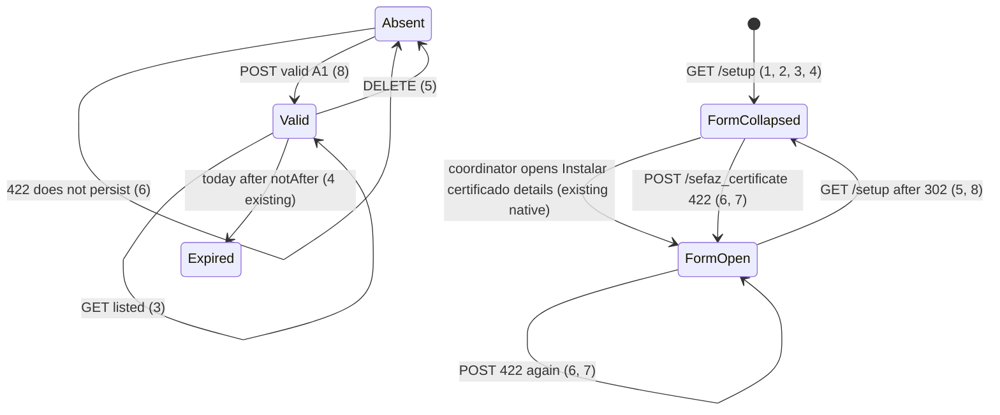

# Setup: Certificado Digital A1

> Build this with **tlc-implement**. Profile **`ui`**: screen `setup` is binding through
> `.specs/features/visual-identity/design.md` (criterion 9).
> Every criterion below becomes a check with a proof, referenced by its number. Nothing under
> `Unresolved` gets settled while building.

## Intent

The Certificado block on `/setup` is always the writable Arquivo and Senha fields plus submit
`Instalar certificado`, including when the focused organization has no A1 and when one is already
listed. The heading is `Certificado SEFAZ`; the empty line is only `Nenhum certificado`. Issue #82
gives no conversion figure. The cost is a setup section that looks like an install in progress
when the coordinator is only reading the slot, and a title that does not say the A1 is for SEFAZ
consulta.

When this ships, screen `setup` (`GET /setup`) titles the block `Certificado Digital A1 - Para
consulta na SEFAZ`. With no certificate, the titular block is the empty line in criterion 1.
Arquivo and Senha stay inside a closed `
` whose summary is `Instalar certificado` until
that summary is opened, including when a certificate is already listed (reinstall). `Remover`
stays visible whenever a certificate exists. A `422` from `POST /sefaz_certificate` re-renders
that details `open`. Keeping the chosen file or typed passphrase on 422 is #85. Binding design:
`.specs/features/visual-identity/design.md` section `setup`.

9 criteria in 4 slices · 0 one-way doors · 1 open, of which 0 block

## Criteria

### Heading and empty slot

1. Given a signed-in coordinator of the focused organization with no SEFAZ certificate, when
   `GET /setup` runs, then the status is `200`, the body includes the heading
   `Certificado Digital A1 - Para consulta na SEFAZ` and the text
   `Não há certificado A1 instalado. Use Instalar certificado.`, and it does not include
   `Certificado SEFAZ`, `Nenhum certificado`, a formatted titular CNPJ, `Válido até`,
   `Expirado em`, or `Remover o certificado SEFAZ?`.
2. When `GET /setup` runs as in criterion 1, then `input#certificate` and `input#passphrase` are
   descendants of a `
` that does not have the `open` attribute, whose `
` text is
   `Instalar certificado`, and `form[action="/sefaz_certificate"]` includes submit
   `Instalar certificado`. `#certificate` is `input type=file`.

### Listed slot, Remover, same disclosure

3. Given that organization has titular CNPJ `11222333000181` and `sefaz_not_after` `2027-09-18`,
   when `GET /setup` runs, then the status is `200`, the body includes `11.222.333/0001-81`,
   `Válido até 18/09/2027`, and `Remover` with Turbo confirm `Remover o certificado SEFAZ?`, and it
   does not include `Não há certificado A1 instalado. Use Instalar certificado.` The Arquivo and
   Senha controls match criterion 2 (same closed `
`, same summary, same submit). `Remover`
   is not a descendant of that `
`.
4. Given installed `sefaz_not_after` `2026-05-11`, while today is `2026-05-12`, when `GET /setup`
   runs, then the body includes `Expirado em 11/05/2026` and `Remover`, does not include
   `Válido até`, and the Arquivo/Senha `
` still does not have `open`.
5. When `DELETE /sefaz_certificate` runs after the organization in criterion 3, then the response
   is `302` to `/setup`, the slot is empty, and the following `GET /setup` matches criteria 1–2
   and has `[data-toast-kind="success"]` text `Pronto.`

### 422 keeps the install form open

6. Given no certificate, when `POST /sefaz_certificate` runs with a valid `.pfx` and passphrase
   `errada`, then no certificate is persisted, the status is `422`, `[data-notice="error"]` is
   `Não foi possível abrir o certificado com essa senha`, the empty line from criterion 1 is
   present, the Arquivo/Senha `
` has the `open` attribute, `#certificate` is
   `input type=file`, `#passphrase` value is `""`, and the body does not include `errada`.
7. Given the organization in criterion 3, when `POST /sefaz_certificate` runs with an e-CPF A1,
   then the stored titular stays `11222333000181`, the status is `422`,
   `[data-notice="error"]` is `O certificado deve ser e-CNPJ A1 vigente`, the page still includes
   `11.222.333/0001-81` and `Remover`, and the Arquivo/Senha `
` has the `open` attribute.
8. When `POST /sefaz_certificate` persists the A1 in criterion 3, then the response is `302` to
   `/setup`, and the following `GET /setup` matches criterion 3 (details not `open`) and has
   `[data-toast-kind="success"]` text `Pronto.`

### Binding setup wireframe

9. `.specs/features/visual-identity/design.md` section `setup` — the certificate block is no longer
   heading `Certificado SEFAZ` with always-visible Arquivo / Senha. It is heading
   `Certificado Digital A1 - Para consulta na SEFAZ`; empty line as in criterion 1; when a
   certificate exists, titular / validity / `Remover` (quiet, margem) stay outside the fold;
   Arquivo / Senha sit in `
` whose `
` is `Instalar certificado`.

## States

Certificate Absent / Valid / Expired install rules are unchanged (existing `#38`). FormCollapsed /
FormOpen is only the Arquivo/Senha `
`.

## Out of scope

- Restoring the chosen `.pfx` or typed passphrase on `422` — #85 (`input type=file` stays empty;
  passphrase is not echoed)
- Turbo Stream / morph that updates only the notice — #85
- Changing `Organization#install_sefaz_certificate` acceptance, wrap-key `422` copy, replace,
  size limit, or `GET /sefaz_certificate` `404` — existing `#38`
- Submitter seeing the certificate; unauthenticated install — existing `require_coordinator_organization`
- Contador read-after-save, arquivo Editar → Confirmar, contas bancárias, tipos extras — #80, #81, #83, #84
- `Cancelar` on the install fold — closed `
` on the next `GET /setup` (1–4, 8)
- Glossary rename of **SEFAZ certificate**; UI heading only
- Changing Turbo confirm `Remover o certificado SEFAZ?`

## Observable

| Surface | Decision | Landing |
| --- | --- | --- |
| screen `setup` certificate | empty state | 1 — empty line; 2 — closed fold |
| screen `setup` certificate | loading state | n/a — Turbo full-page `GET /setup`; no pending chrome |
| screen `setup` certificate | error state | 6, 7 — existing `:base` notice and error toast; details `open` |
| screen `setup` certificate | unauthorised | existing — `require_coordinator_organization`; unauthenticated `302` `/login`; submitter `GET /setup` and `POST`/`DELETE /sefaz_certificate` `404` |
| screen `setup` certificate | density and ordering | 1, 3, 4 — heading; empty line or titular then validity; `Remover` outside the fold; Arquivo/Senha inside `
` |
| screen `setup` certificate | destructive action confirms | existing — `Remover` Turbo confirm `Remover o certificado SEFAZ?` (3) |
| HTML `GET /setup` | response shape | 1, 2, 3, 4 — `200`; collapsed fold |
| HTML `POST /sefaz_certificate` | response shape | 8 — `302` `/setup`; 6, 7 — `422` with details `open` |
| HTML `POST /sefaz_certificate` | error shape and codes | 6, 7 and existing — `:base` strings; toast still extra (#76) |
| HTML `POST /sefaz_certificate` | who may call it | existing — coordinator of the focused organization |
| HTML `POST /sefaz_certificate` | versioning | n/a — existing HTML form; no published API |
| HTML `POST /sefaz_certificate` | rate limit | n/a — coordinator-only, small operator set |
| HTML `DELETE /sefaz_certificate` | response shape | 5 — `302` `/setup`; following GET is empty collapsed |
| HTML `DELETE /sefaz_certificate` | error shape and codes | existing — unauthenticated `302` `/login`; submitter `404` |
| HTML `DELETE /sefaz_certificate` | who may call it | existing |
| HTML `DELETE /sefaz_certificate` | versioning | n/a — existing HTML |
| HTML `DELETE /sefaz_certificate` | rate limit | n/a — coordinator-only |
| document `.specs/features/visual-identity/design.md` | structure, tone, depth, next action | 9 |
| collection certificate (one slot) | grouping | existing — focused organization |
| collection certificate (one slot) | naming | 1, 3, 4 — heading; empty line; formatted titular; `Válido até` / `Expirado em` |
| collection certificate (one slot) | ordering | n/a — one slot |
| collection certificate (one slot) | duplicates | existing — replace still one slot (#38) |
| collection certificate (one slot) | exception that does not fit | 1, 4, 6 — absent empty line; expired display; 422 does not persist |

## Swept

- validation: existing `Organization#install_sefaz_certificate`; 6, 7 reuse wrong passphrase and
  e-CPF `422` copy; this cut does not add a rule
- failure modes: 6, 7 — `422` re-renders setup with the Arquivo/Senha `
` `open`; file
  input stays `type=file` with no server-filled value
- idempotency and retry: 2, 3 — a second `GET /setup` stays collapsed; 8 — a successful POST still
  `302` and collapsed
- authorization: existing — `SefazCertificatesController` `require_coordinator_organization`;
  this cut does not add a route
- concurrency and ordering: n/a — two overlapping POSTs still leave one slot (#38 criterion 19);
  opening `
` is not a write
- data lifecycle: 3, 5 — organizations that already have a titular render the listed block on
  next `GET /setup`; no backfill; DELETE returns the empty line
- external-dependency failure: n/a — this cut does not call SEFAZ; wrap-key `422` copy is unchanged
- state transitions: 1, 2, 5, 6, 7, 8
- observability: n/a — the source names no log, metric, or trace; `filter_parameters` already
  covers passphrase; the person sees the fold and the existing toast

## Impact

| Front | What changes |
|---|---|
| domain | no new glossary term — `GLOSSARY.md` **SEFAZ certificate** stays; heading `Certificado Digital A1 - Para consulta na SEFAZ` is screen `setup` copy only |
| domain | existing term: `SEFAZ certificate` slot on `Organization` — still one optional A1; callers `SefazCertificatesController`, `Organization#install_sefaz_certificate` / `#remove_sefaz_certificate`, identified consulta, `setup/show`. What changes is HTML chrome, not the slot |
| stored data | nothing to migrate — no schema change; existing titular rows are the listed block (3) on next `GET /setup` |

Examples that still assert heading `Certificado SEFAZ` or empty `Nenhum certificado`
(`spec/requests/setup_spec.rb`, `spec/requests/sefaz_certificates_spec.rb`, action-result-toast
C22) must follow 1 and 5.

## Decided

None — `POST`/`DELETE /sefaz_certificate` and the one-slot A1 already exist. Folding Arquivo/Senha
into `
` with summary `Instalar certificado` copies the existing setup/ledger fold
(`rails.mdc` / visual-identity `
`); it is not a new pattern. Stimulus hide, or a query
like Contador `?edit=accountant`, is not required: 422 can set `open` on the same element (6, 7).

## Surface

| Route | In | Out | Status | Criteria |
|---|---|---|---|---|
| `GET /setup` | session, focus | certificate heading, empty or listed HTML, collapsed fold | `200` | 1, 2, 3, 4 |
| `POST /sefaz_certificate` | PKCS#12, passphrase | one slot or setup `422` with details `open` | `302`, `422` | 6, 7, 8 |
| `DELETE /sefaz_certificate` | session, focus | empty slot | `302` | 5 |

## Sources

- https://github.com/gutors/ai-accounting-assistant/issues/82 — **binding for this slice**: heading
  `Certificado Digital A1 - Para consulta na SEFAZ`; Arquivo and Senha hidden until
  `Instalar certificado` (same control reveals on reinstall); empty line instead of the titular
  block; `Remover` stays when a certificate exists; 422 keeps the install form open; keep
  `input type=file` on 422; file/passphrase restore is another child
- https://github.com/gutors/ai-accounting-assistant/issues/75 — parent: one tlc-plan slice; #82 is
  this certificate chrome; #85 is keep-form-on-422; profile `ui`
- https://github.com/gutors/ai-accounting-assistant/issues/85 — out: restore file/passphrase;
  do not echo A1 passphrase; do not stash a failed `.pfx`
- https://github.com/gutors/ai-accounting-assistant/issues/76 — success `Pronto.`; certificate
  `:base` 422 still has error toast
- `.specs/features/visual-identity/design.md` — **binding for the interface** once criterion 9
  lands: screen `setup`; today’s ASCII still has `Certificado SEFAZ` and always-visible form
- `app/views/setup/show.html.erb` — today’s always-visible Arquivo / Senha / `Instalar certificado`
- Open default in Unresolved 1 — empty line `Não há certificado A1 instalado. Use Instalar certificado.`
  from #82’s sketch (`não há A1 instalado; use Instalar certificado`)

This task is the record of decision. If a linked document diverges, ask before building.

## Unresolved

| # | Kind | Question | Until answered |
|---|---|---|---|
| 1 | open | Exact empty-state sentence? #82 sketches “não há A1 instalado; use Instalar certificado”, not a final string. | Criterion 1 uses `Não há certificado A1 instalado. Use Instalar certificado.` and drops `Nenhum certificado` |
