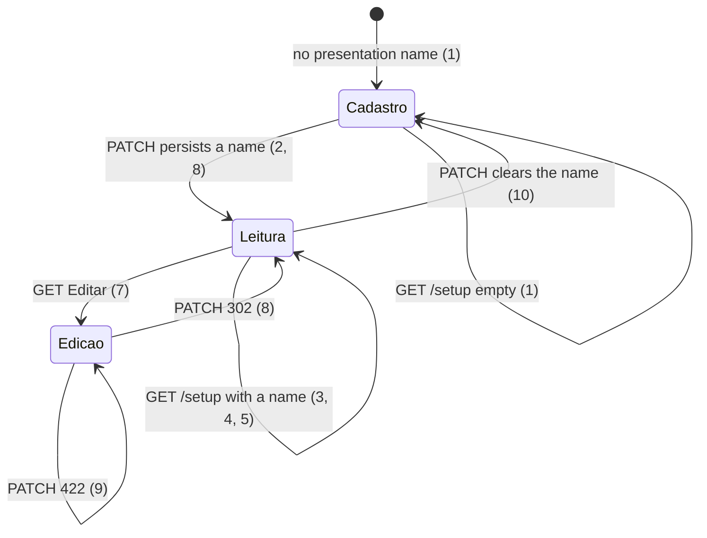

# Setup: accountant read-only after save

> Build this with **tlc-implement**. Profile **`ui`**: screen `setup` is binding through
> `.specs/features/visual-identity/design.md` (criterion 11).
> Every criterion below becomes a check with a proof, referenced by its number. Nothing under
> `Unresolved` gets settled while building.

## Intent

The Contador block on `/setup` is always the same five writable inputs, including after a
successful `PATCH /accountant`. Labels are `Id fiscal` and `Destino do pacote`; a stored tax id
shows as digits (`39053344705`). Issue #80 gives no conversion figure. The cost is that a
coordinator cannot tell standing accountant data from a draft, and the tax-id field does not look
like a CPF or CNPJ.

When this ships, screen `setup` (`GET /setup`) still uses the cadastro form when the focused
organization has no accountant presentation name, with labels `CPF/CNPJ (preencher apenas números)`
and `Email para envio`. After that name exists, the same five fields are read-only, CPF/CNPJ are
formatted on that read, and `Editar` returns the writable form. A successful save still toasts
`Pronto.` from #76. Binding design: `.specs/features/visual-identity/design.md` section `setup`.

11 criteria in 3 slices · 0 one-way doors · 2 open, of which 0 block

## Criteria

### Cadastro when there is no presentation name

1. Given a signed-in coordinator of the focused organization with no
   `accountant_presentation_name`, when `GET /setup` runs, then the status is `200`, the body
   includes `Cadastre o contador`, `form[action="/accountant"]` includes `Salvar contador` and
   inputs `#presentation_name`, `#tax_id`, `#legal_name`, `#pix_key`, and `#destination_email`
   none of which has `readonly`, the label for `#tax_id` is `CPF/CNPJ (preencher apenas números)`,
   the label for `#destination_email` is `Email para envio`, the body does not include `Id fiscal`
   or `Destino do pacote`, and the Contador section (from heading `Contador` through heading
   `Arquivo do pacote`) does not include a control whose text is `Editar`.
2. Given that empty organization, when `PATCH /accountant` runs with `presentation_name` `Ana`,
   then the response is `302` to `/setup`, the name is persisted, and the following `GET /setup`
   has `[data-toast-kind="success"]` text `Pronto.`

### Read-only after standing data

3. Given the focused organization has `accountant_presentation_name` `Ana Contábil`,
   `accountant_tax_id` `11222333000181`, `accountant_legal_name` `Contábil LTDA`,
   `accountant_pix_key` `chave-pix`, and `package_destination_email` `ana@example.com`, when
   `GET /setup` runs, then `form[action="/accountant"]` has those five inputs with `readonly`,
   `#presentation_name` value `Ana Contábil`, `#tax_id` value `11.222.333/0001-81`, `#legal_name`
   value `Contábil LTDA`, `#pix_key` value `chave-pix`, `#destination_email` value
   `ana@example.com`, the same two labels as criterion 1, no `Salvar contador` in that form, no
   `Cadastre o contador`, and the Contador section (from heading `Contador` through heading
   `Arquivo do pacote`) includes a control whose text is `Editar`.
4. Given `accountant_presentation_name` `Ana` and `accountant_tax_id` `39053344705` and no razão
   social, when `GET /setup` runs, then `#tax_id` is `readonly` with value `390.533.447-05` and
   `#legal_name` is `readonly` with value `""`.
5. Given `accountant_presentation_name` `Ana` and the four optional accountant fields blank, when
   `GET /setup` runs, then the five inputs are `readonly`, `#tax_id` value is `""`, and `Editar`
   is present in that Contador section as in criterion 3.
6. Always, `accountant_tax_id` on `Organization` stays digits-only; `GET /setup` in criteria 3–4
   does not persist punctuation. `BrazilianTaxId.format` is display on the read-only `#tax_id`
   only.

### Editar, then save or 422

7. Given the organization in criterion 3, when `GET` of the Contador `Editar` control’s URL
   runs, then the status is `200`, `form[action="/accountant"]` includes `Salvar contador`, the
   five inputs have no `readonly`, `#tax_id` value is `11222333000181`, the labels match
   criterion 1, and the Contador section has no `Editar`.
8. Given that writable form, when `PATCH /accountant` runs with `presentation_name` `Ana Contábil`,
   `tax_id` `11222333000181`, `legal_name` `Contábil LTDA`, `pix_key` `chave-pix`, and
   `destination_email` `ana@example.com`, then the response is `302` to `/setup`, stored tax id
   stays `11222333000181`, and the following `GET /setup` matches the read-only observations in
   criterion 3 and has `[data-toast-kind="success"]` text `Pronto.`
9. Given `accountant_presentation_name` `Ana` already persisted, when `PATCH /accountant` runs
   with `presentation_name` `Ana` and `tax_id` `11222333000181` and blank `legal_name`, then the
   status is `422`, the tax id on the organization stays unchanged, `[data-notice="error"]` is
   `Informe a razão social`, and `form[action="/accountant"]` is the writable form in criterion 7
   (no `readonly`, `Salvar contador` present).
10. Given the organization in criterion 3, when `PATCH /accountant` runs with
    `presentation_name` `""` and the optional fields blank, then the response is `302` to `/setup`,
    those five standing fields are absent, and the following `GET /setup` matches criterion 1.

### Binding setup wireframe

11. `.specs/features/visual-identity/design.md` section `setup` — `GET /setup` no longer shows
    Contador as always `Id fiscal` / `Destino do pacote` / `[Salvar contador]`. It shows those
    two labels as `CPF/CNPJ (preencher apenas números)` and `Email para envio`; cadastro when
    there is no presentation name; read-only fields plus `Editar` when that name exists; formatted
    CPF/CNPJ on read. `Arquivo do pacote` stays the always-writable URL form (`Salvar arquivo`)
    — #81.

## States

`PATCH /accountant` validation, submitter `404`, and unauthenticated `302` `/login` are unchanged
(existing).

## Out of scope

- Arquivo do pacote read-only / `Editar` → `Confirmar` — #81
- Certificado SEFAZ, contas bancárias, tipos extras — #82–#84
- Keeping typed values on document or A1 `422` — #85
- Changing `PATCH /accountant` acceptance (CPF/CNPJ check digits, razão social with CNPJ only,
  PIX length, `NormalizedEmail`, blank name with satellites `422`)
- Storing formatted punctuation on `accountant_tax_id`
- Glossary rename of **Package destination** or **Accountant**; UI copy only
- Accountant login, outbound mail to the destination, package archive Drive writes
- `Cancelar` on edit — Unresolved 2; `GET /setup` without the Editar URL is Leitura (3–5)

## Observable

| Surface | Decision | Landing |
| --- | --- | --- |
| screen `setup` Contador | empty state | 1 — `Cadastre o contador` and the writable cadastro form |
| screen `setup` Contador | loading state | n/a — Turbo full-page `GET /setup`; no pending chrome |
| screen `setup` Contador | error state | 9 — existing `:base` notice; form stays writable |
| screen `setup` Contador | unauthorised | existing — `require_coordinator_organization`; unauthenticated `302` `/login`; submitter `GET /setup` and `PATCH /accountant` `404` |
| screen `setup` Contador | density and ordering | 1, 3 — five fields in the existing order; new labels; formatted tax id on read |
| screen `setup` Contador | destructive action confirms | n/a — save and Editar are not destructive; no confirm |
| HTML `GET /setup` | response shape | 1, 3, 4, 5, 7 — `200`; cadastro, Leitura, or Edicao HTML |
| HTML `PATCH /accountant` | response shape | 2, 8, 10 — `302` `/setup`; 9 — `422` |
| HTML `PATCH /accountant` | error shape and codes | 9 and existing — `:base` `Informe a razão social`; field-only `422` still has no toast (#76 criterion 26) |
| HTML `PATCH /accountant` | who may call it | existing — coordinator of the focused organization |
| HTML `PATCH /accountant` | versioning | n/a — existing HTML form; no published API |
| HTML `PATCH /accountant` | rate limit | n/a — coordinator-only, small operator set |
| document `.specs/features/visual-identity/design.md` | structure, tone, depth, next action | 11 |
| collection | grouping, naming, ordering, duplicates, exception | n/a — one accountant per organization already; this cut does not list a collection |

## Swept

- validation: existing `Organization#update_accountant` / `accountant_shape`; 6 — display format is
  not a new stored shape; 9 — CNPJ without razão social still `422`
- failure modes: 9 — `422` re-renders the writable accountant form, not Leitura
- idempotency and retry: 8 — a second identical `PATCH` still `302` and Leitura; 3 — a second
  `GET /setup` stays Leitura
- authorization: existing — `require_coordinator_organization` on `SetupController` and
  `AccountantsController`; this cut does not add a route
- concurrency and ordering: n/a — two overlapping `PATCH /accountant` leave the last write; no
  new unique index or ordering
- data lifecycle: 3, 5 — organizations that already have a presentation name render Leitura on
  first `GET /setup` after this ships; no backfill; clearing the name (10) returns Cadastro
- external-dependency failure: n/a — accountant save does not call Drive, SMTP, or SEFAZ
- state transitions: 1, 2, 7, 8, 9, 10
- observability: n/a — the source names no log, metric, or trace; the person sees the form and
  the existing toast

## Impact

| Front | What changes |
|---|---|
| domain | no new glossary term — `GLOSSARY.md` **Accountant** and **Package destination** stay; copy `Email para envio` is the destination field on screen `setup` only |
| domain | existing term: standing accountant on `Organization` — still presentation name plus optional tax id / razão social / PIX / destination email. Callers: `AccountantsController`, `Organization#update_accountant`, close-for-send accountant gate, `SummarySpreadsheet` (already uses `BrazilianTaxId.format`), exception suggestions |
| stored data | nothing to migrate — no schema change; existing non-blank `accountant_presentation_name` rows are Leitura on next `GET /setup` |

## Decided

None — `PATCH /accountant` and digits-only tax id already exist (`BrazilianTaxId.normalize` /
`format`). Read-only HTML on the same form is reversible. Editar as a GET (Unresolved 1) is not a
new resource. #81’s archive `Editar` → `Confirmar` is a different child and is not copied here.

## Surface

| Route | In | Out | Status | Criteria |
|---|---|---|---|---|
| `GET /setup` | session, focus, optional Editar URL | Contador cadastro, Leitura, or Edicao HTML | `200` | 1, 3, 4, 5, 7 |
| `PATCH /accountant` | presentation_name, tax_id, legal_name, pix_key, destination_email | redirect or setup `422` | `302`, `422` | 2, 8, 9, 10 |

## Sources

- https://github.com/gutors/ai-accounting-assistant/issues/80 — **binding for this slice**: labels
  `CPF/CNPJ (preencher apenas números)` and `Email para envio`; after the first save with data,
  read-only fields plus `Editar`; formatted CPF/CNPJ on read; empty stays cadastro; toast on save;
  package archive is #81
- https://github.com/gutors/ai-accounting-assistant/issues/75 — parent: one tlc-plan slice; #80 is
  Contador read after save; toast helper already shipped (#76); profile `ui`
- https://github.com/gutors/ai-accounting-assistant/issues/76 — `PATCH /accountant` success already
  toasts `Pronto.`; field-only accountant `422` has no toast
- `.specs/features/visual-identity/design.md` — **binding for the interface** once criterion 11
  lands: screen `setup`, Contador two-column form from 768px, archive and banks unchanged here
- `app/views/setup/show.html.erb` — today’s always-writable accountant form (`Id fiscal`,
  `Destino do pacote`, `Salvar contador`)
- `Organization#update_accountant`, `BrazilianTaxId` — persist and format; 6 forbids storing the
  display punctuation
- Open defaults in Unresolved 1–2 — Editar is a GET; no `Cancelar`

This task is the record of decision. If a linked document diverges, ask before building.

## Unresolved

| # | Kind | Question | Until answered |
|---|---|---|---|
| 1 | open | How does `Editar` unlock the form? #80 names a button, not a URL. #81 is `Editar` → `Confirmar` on the archive and is out of this cut. | GET of the Contador `Editar` control (7). No new POST. Submit on edit stays `Salvar contador`, not `Confirmar` (7, 8) |
| 2 | open | Is there `Cancelar` on edit? | No (Out of scope). `GET /setup` without the Editar URL is Leitura (3–5) |
