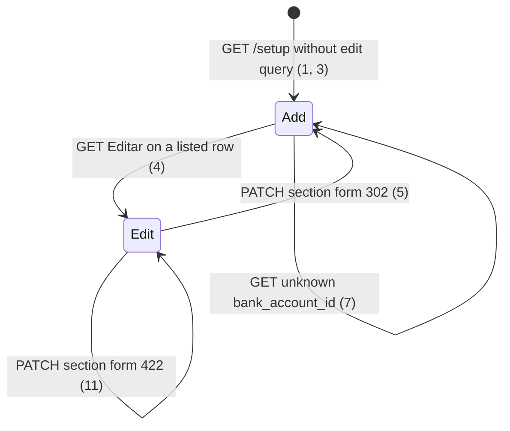

# Setup: bank accounts

> Build this with **tlc-implement**. Profile **`ui`**: screen `setup` is binding through
> `.specs/features/visual-identity/design.md` (criterion 12).
> Every criterion below becomes a check with a proof, referenced by its number. Nothing under
> `Unresolved` gets settled while building.

## Intent

The Contas bancárias block on `/setup` lists each account as name, `extrato-{slug}`, and optional
coordinates, then folds a second copy of Nome / Banco / Coordenadas under per-row `
`
`Editar`, while a separate empty POST form sits below the list. The field is labelled
`Coordenadas`. Issue #83 gives no conversion figure. The cost is two field sets for the same
account, a fold the coordinator must open to change standing data, and a label that does not say
agência or conta corrente.

When this ships, screen `setup` (`GET /setup`) still stays on `/setup` (no `/bank_accounts/new`).
Each listed row shows four cells in order: bank presentation name, account name, agência/conta
corrente text, `extrato-{slug}`. Desativar / Reativar stay on the row. One section form carries
Nome, Banco, and `Agência/Conta Corrente`: empty it POSTs a new account; Editar on a row fills
that same form and submit PATCHes that account. Binding design:
`.specs/features/visual-identity/design.md` section `setup`.

12 criteria in 4 slices · 0 one-way doors · 4 open, of which 0 block

## Criteria

### Columns and labels

1. Given a signed-in coordinator of the focused organization with no bank accounts, when
   `GET /setup` runs, then the status is `200`, the Contas bancárias section (from heading
   `Contas bancárias` through heading `Tipos extras de exceção`) includes `Nenhuma conta bancária`,
   has no `li[data-row="bank-account"]`, does not include `Coordenadas`, and its section form
   (the one form in that section that contains `#name`, `#compe`, and `#coordinates`) has
   `label[for=name]` `Nome`, `label[for=compe]` `Banco`, `label[for=coordinates]`
   `Agência/Conta Corrente`, `action` `/bank_accounts`, and submit `Adicionar conta`.
2. Given that organization has active Banco do Brasil account `Conta Principal` with coordinates
   `ag 1234` and inactive Santander account `Parada` with blank coordinates, when `GET /setup`
   runs, then each is `li[data-row="bank-account"][data-bank-account-id="{id}"]`, names still
   appear with `Alfa` before `Zeta` when those two names exist (existing order), `Conta Principal`’s
   row HTML contains `Banco do Brasil` then `Conta Principal` then `ag 1234` then
   `extrato-conta-principal` in that order, `Parada`’s row contains `Santander` then `Parada` then
   `extrato-parada` and includes `Inativa`, and neither row’s HTML includes `Coordenadas`. That
   GET has no header row whose cells are `Nome do Banco`, `Nome`, `Agência/Conta Corrente`,
   `extrato-{slug}` (Unresolved 2).

### One section form: add or edit

3. When `GET /setup` runs as in criterion 2, then that Contas bancárias section contains exactly
   one section form as defined in criterion 1, that form’s `action` is `/bank_accounts` with
   submit `Adicionar conta`, `#name` and `#coordinates` values are `""`, `#compe` is the existing
   twelve-name catalog picker (`select#compe`, no `Outro`), the section has no `
` whose
   `
` text is `Editar`, and each listed row includes a control whose text is `Editar`
   whose URL is on `/setup` (Unresolved 1). Desativar / Reativar `button_to` forms on the rows
   are not that section form (they do not contain `#name`).
4. Given the `Conta Principal` row from criterion 2, when `GET` of that row’s `Editar` control
   URL runs, then the status is `200`, the Contas bancárias section still lists both rows, the
   section form `action` is `/bank_accounts/{id}` of `Conta Principal` with `_method` `patch`,
   submit is `Salvar conta`, `#name` value is `Conta Principal`, `#compe` selected value is
   `001`, `#coordinates` value is `ag 1234`, labels match criterion 1, and there is no second
   form in that section that contains `#name`.
5. Given that edit form, when `PATCH /bank_accounts/{id}` runs with `name` `Nova Conta`, `compe`
   `001`, and `coordinates` `ag 1234`, then the response is `302` to `/setup`, the row persists
   that name and slug `nova-conta`, and the following `GET /setup` matches the add section form
   in criterion 3 (`action` `/bank_accounts`, submit `Adicionar conta`, empty `#name`) and has
   `[data-toast-kind="success"]` text `Pronto.` (Unresolved 3).
6. Given the empty organization in criterion 1, when `POST /bank_accounts` runs with `name`
   `Conta Principal`, `compe` `001`, and `coordinates` `ag 1234`, then the response is `302` to
   `/setup`, one active Banco do Brasil account is persisted, and the following `GET /setup`
   includes that row as in criterion 2 and has `[data-toast-kind="success"]` text `Pronto.`
7. Given focus on organization A while organization B has bank account id `{id}` named `Alheia`,
   when `GET /setup?edit=bank_account&bank_account_id={id}` runs, then the status is `200`, the
   body does not include `Alheia`, and the section form matches criterion 1 (add). The same GET
   with `bank_account_id` that is not an id of the focused organization matches that add form.

### Row Desativar / Reativar

8. When `GET /setup` runs as in criterion 2, then the `Conta Principal` row includes `Desativar`,
   the `Parada` row includes `Reativar` and `Inativa`, the Contas bancárias section does not
   include `Excluir`, and `DELETE /bank_accounts/:id` still responds `404` and keeps the row
   (existing).
9. When `PATCH /bank_accounts/{id}` of `Conta Principal` runs with `active` `false` only, then
   the response is `302` to `/setup`, the row stays, the following `GET /setup` includes
   `Conta Principal` and `Inativa` on that row, the section form is the add form in criterion 3,
   and that GET has `[data-toast-kind="success"]` text `Pronto.`

### 422 keeps add or edit

10. Given an existing account whose slug is `cafe`, when `POST /bank_accounts` runs with `name`
    `Cafe`, `compe` `033`, and `coordinates` `ag 9`, then no additional row is persisted, the
    status is `422`, the section form is still the add form (`action` `/bank_accounts`, submit
    `Adicionar conta`) with `#name` `Cafe`, `#compe` `033`, and `#coordinates` `ag 9`, and the
    body has no `[data-toast]` (field uniqueness, same as #76 field-only `422`).
11. Given `Outra` on the focused organization and a sibling whose slug is `cafe`, when
    `PATCH /bank_accounts/{id}` of `Outra` runs with `name` `Cafe`, `compe` `033`, and
    `coordinates` `x`, then `Outra`’s name stays `Outra`, the status is `422`, the section form
    `action` is `/bank_accounts/{id}` of `Outra` with submit `Salvar conta`, `#name` is `Cafe`,
    `#compe` is `033`, `#coordinates` is `x`, and the body has no `[data-toast]`.

### Binding setup wireframe

12. `.specs/features/visual-identity/design.md` section `setup` — Contas bancárias is no longer
    name / `extrato-{slug}` / coordinates with per-row `

Editar
` plus
    a separate empty POST form labelled `Coordenadas`. It is four cells per
    `li[data-row="bank-account"]` in order bank presentation name, name, agência/conta corrente,
    `extrato-{slug}`; `Desativar` / `Reativar` on the row; one section form Nome / Banco /
    `Agência/Conta Corrente`; empty POST `Adicionar conta`; Editar fills that form as PATCH
    `Salvar conta`. `visual-identity` C42 follows this, not the old fold.

## States

Catalog COMPE, slug uniqueness including inactive, submitter `404`, and unauthenticated `302`
`/login` are unchanged (existing). `Cancelar` on edit is out (Unresolved 4): `GET /setup` without
the Editar query is Add.

## Out of scope

- Bank catalog membership, COMPE picker options, `Outro` — existing twelve names; #83 forbids a
  catalog recorte
- Organization PIX on the bank account — glossary and #83
- `/bank_accounts/new` or any route off `/setup` for the section form
- Changing `BankAccount.create_for` / `#apply_from` acceptance (slug collision, empty slug,
  unknown COMPE, deactivate keeps the row)
- Month screen bank-account cards (`GET /months/:year_month`) — still show coordinates as the
  stored string; label change is `/setup` only
- Contador, arquivo do pacote, certificado A1, tipos extras — #80–#82, #84
- Keeping typed values on document or A1 `422` — #85
- `Cancelar` on edit — Unresolved 4
- Glossary rename of **Bank account** coordinates; UI label only
- Confirm before Desativar — existing has none

## Observable

| Surface | Decision | Landing |
| --- | --- | --- |
| screen `setup` Contas bancárias | empty state | 1 — `Nenhuma conta bancária` and the add section form |
| screen `setup` Contas bancárias | loading state | n/a — Turbo full-page `GET /setup`; no pending chrome |
| screen `setup` Contas bancárias | error state | 10, 11 — `422`; add vs edit section form; submitted fields; no toast |
| screen `setup` Contas bancárias | unauthorised | existing — `require_coordinator_organization`; unauthenticated `302` `/login`; submitter `GET /setup` and `POST`/`PATCH /bank_accounts` `404` |
| screen `setup` Contas bancárias | density and ordering | 2, 3 — four cells in that order; names ascending (existing); one section form; row actions |
| screen `setup` Contas bancárias | destructive action confirms | n/a — Desativar is reversible via Reativar; existing has no Turbo confirm |
| HTML `GET /setup` | response shape | 1, 2, 3, 4, 7 — `200`; add or edit HTML on `/setup` |
| HTML `POST /bank_accounts` | response shape | 6 — `302` `/setup`; 10 — `422` add form |
| HTML `POST /bank_accounts` | error shape and codes | 10 and existing — colliding slug `422`; no `[data-toast]` |
| HTML `POST /bank_accounts` | who may call it | existing — coordinator of the focused organization |
| HTML `POST /bank_accounts` | versioning | n/a — existing HTML form; no published API |
| HTML `POST /bank_accounts` | rate limit | n/a — coordinator-only, small operator set |
| HTML `PATCH /bank_accounts/:id` | response shape | 5, 9 — `302` `/setup`; 11 — `422` edit form; existing other-org `404` |
| HTML `PATCH /bank_accounts/:id` | error shape and codes | 11 and existing — colliding slug `422`; no `[data-toast]` |
| HTML `PATCH /bank_accounts/:id` | who may call it | existing |
| HTML `PATCH /bank_accounts/:id` | versioning | n/a — existing HTML |
| HTML `PATCH /bank_accounts/:id` | rate limit | n/a — coordinator-only |
| document `.specs/features/visual-identity/design.md` | structure, tone, depth, next action | 12 |
| collection bank accounts on setup | grouping | existing — focused organization |
| collection bank accounts on setup | naming | 2 — presentation name, account name, coordinates text, `extrato-{slug}` |
| collection bank accounts on setup | ordering | existing — `order(:name)` (2) |
| collection bank accounts on setup | duplicates | existing — unique name/slug including inactive |
| collection bank accounts on setup | exception that does not fit | 2, 8 — inactive still listed with `Inativa`; blank coordinates still a cell |

## Swept

- validation: existing `BankAccount` name/slug/COMPE; 10, 11 reuse colliding slug `422`; this cut
  does not add a rule; label `Agência/Conta Corrente` still posts `coordinates`
- failure modes: 10, 11 — `422` re-renders the section form in add or edit with submitted values
- idempotency and retry: 3 — a second `GET /setup` stays add; 5 — a second identical name PATCH
  still `302` and add
- authorization: existing — `BankAccountsController` / `SetupController`
  `require_coordinator_organization`; 7 — other-org id does not fill the form; this cut does not
  add a resource route
- concurrency and ordering: n/a — unique `(organization_id, name)` / `(organization_id, slug)`
  already serialize concurrent creates (existing); this cut does not add a write
- data lifecycle: 2 — existing rows render the four cells on next `GET /setup`; no backfill;
  stored `coordinates` unchanged
- external-dependency failure: n/a — bank-account save does not call Drive, SMTP, or SEFAZ
- state transitions: 1, 3, 4, 5, 6, 9, 10, 11
- observability: n/a — the source names no log, metric, or trace; 5, 6, 9 reuse the existing
  success toast helper (`Pronto.`)

## Impact

| Front | What changes |
|---|---|
| domain | no new glossary term — `GLOSSARY.md` **Bank account** stays (unique name, bank, optional free-text coordinates, active or inactive, never deleted). Copy `Agência/Conta Corrente` is the coordinates field on screen `setup` only |
| domain | existing term: **Bank account** list chrome on `/setup` — callers `SetupController`, `BankAccountsController`, `app/views/setup/show.html.erb`, month cards (out of this cut). What changes is HTML: four cells, one section form, no per-row edit fold. `coordinates` column and `POST`/`PATCH` params stay |
| stored data | nothing to migrate — no schema change; existing rows are the four-cell list (2) on next `GET /setup` |

Examples and checks that still assert per-row `
` `Editar` wrapping `PATCH /bank_accounts/{id}` (`spec/requests/setup_spec.rb` “setup h1 is Configuracao and bank account edit folds under Editar”, `.specs/features/visual-identity/checks.md` C42) must follow 3, 4, and 12.

## Decided

None — `POST /bank_accounts` and `PATCH /bank_accounts/:id` already exist. A query on `GET /setup`
to fill the section form copies Contador `?edit=accountant` (Unresolved 1) and is not a new
resource. Four-cell CSS on existing `li[data-row="bank-account"]` is reversible. No catalog or
PIX schema.

## Surface

| Route | In | Out | Status | Criteria |
|---|---|---|---|---|
| `GET /setup` | session, focus, optional `edit=bank_account` and `bank_account_id` | add or edit section form; listed rows | `200` | 1, 2, 3, 4, 7, 8 |
| `POST /bank_accounts` | name, compe, coordinates | new row or setup `422` add form | `302`, `422` | 6, 10 |
| `PATCH /bank_accounts/:id` | name, compe, coordinates and/or active | row or setup `422` edit form | `302`, `422`, `404` | 5, 9, 11 |

## Sources

- https://github.com/gutors/ai-accounting-assistant/issues/83 — **binding for this slice**:
  label `Coordenadas` → `Agência/Conta Corrente`; list columns Nome do Banco, Nome,
  Agencia/Conta Corrente, `extrato-{slug}`; one section form like Adicionar/Editar organização
  (same fields, not details per row); empty = Adicionar conta; Editar fills that form and
  submit saves that account; Desativar/Reativar on the row; no `/bank_accounts/new`; catalog
  and organization PIX out
- https://github.com/gutors/ai-accounting-assistant/issues/75 — parent: one tlc-plan slice; #83
  is this bank-account chrome; later children consume the toast helper; profile `ui`
- https://github.com/gutors/ai-accounting-assistant/issues/76 — success `Pronto.`; field-only
  `422` has no toast (10, 11). Bank-account `302` was not in that listed set; 5, 6, 9 use the
  helper because #75 said remaining slices consume it (Unresolved 3)
- `.specs/features/visual-identity/design.md` — **binding for the interface** once criterion 12
  lands: screen `setup`; today’s ASCII still has per-row `▸ Editar` details and `Coordenadas`
- `app/views/setup/show.html.erb` — today’s list plus per-row details plus empty POST form
- `app/views/administration/new.html.erb` / `edit.html.erb` — same field set for add vs edit;
  those screens use extra routes, which #83 forbids here
- Open defaults in Unresolved 1–4 — Editar is a GET on `/setup`; no column header row; toast
  `Pronto.` on `302`; no `Cancelar`

This task is the record of decision. If a linked document diverges, ask before building.

## Unresolved

| # | Kind | Question | Until answered |
|---|---|---|---|
| 1 | open | How does row `Editar` fill the section form? #83 names the control and forbids `/bank_accounts/new`, not a URL. Contador uses `GET /setup?edit=accountant`. | `GET /setup?edit=bank_account&bank_account_id={id}` (4). Other-org or unknown id is the add form (7). No new POST. Submit on edit is `Salvar conta` (4, 5) |
| 2 | open | Are `Nome do Banco`, `Nome`, `Agência/Conta Corrente`, `extrato-{slug}` a header row, or only cell order? #83 says “lista em colunas”. | Cell order only (2). No header row with those four strings |
| 3 | open | Do bank-account `302`s toast `Pronto.`? #76 listed accountant, archive, and A1, not `POST`/`PATCH /bank_accounts`. #75 said remaining slices consume the helper. | Yes on create, section-form save, and Desativar/Reativar (5, 6, 9) via existing `redirect_success` |
| 4 | open | Is there `Cancelar` on edit? | No (Out of scope). `GET /setup` without the Editar query is Add (1, 3) |
