# Setup: configuration polish

> Build this with **tlc-implement**. Profile **`ui`**: screens `setup` and `month` are binding
> through `.specs/features/visual-identity/design.md` (criterion 28).
> Every criterion below becomes a check with a proof, referenced by its number. Nothing under
> `Unresolved` gets settled while building.

## Intent

On `/setup`, the Contador `#tax_id` is an unmasked text box (label still says to type only
digits) while Documentos Valor already masks as the person types. Contador field titles use the
same `font-medium` as the standing values, so Nome de apresentação and Razão social do not read
as headers. The bank create/edit form and the extra-kind create form sit in the open, unlike
Arquivo/Senha behind `Instalar certificado`. Active bank and extra rows leave Situação blank
(only `Inativa` / `Desativado` appear). The two base document-exception names on that list have
no Situação and no Desativar; `.tasks/setup-extra-kinds-justification.md` criterion 3 forbids
those controls, and ADR-0003 keeps them out of the ExtraExceptionKind catalog. The conversation
gives no conversion figure. The cost is a tax-id field that does not look like a CPF or CNPJ
while typing, a Contador block whose labels compete with the data, two always-visible create
forms, and no way for an organization to stop offering Tarifa bancária or Honorário do contador
without deleting a mark that is not a catalog row.

When this ships, screen `setup` (`GET /setup`) masks `#tax_id` as CPF through eleven digits and
as CNPJ from the twelfth through the fourteenth; Contador labels use `text-ink-soft` against
`font-medium` values; Adicionar conta and Adicionar tipo extra sit in closed `
` like
Instalar certificado; Situação is `Ativa`/`Inativa` on banks and `Ativo`/`Inativo` on every
exception-kind row, including the two base names. Those two can be deactivated and reactivated
per organization without becoming ExtraExceptionKind rows and without `Excluir`. Screen `month`
hides `Marcar tarifa` / `Marcar honorário` when that offer is inactive; a POST of that kind is
`422`; a payment already marked keeps the name. Binding design:
`.specs/features/visual-identity/design.md` sections `setup` and `month`.

28 criteria in 5 slices · 1 one-way door · 1 open, of which 0 block

## Criteria

### CPF/CNPJ mask on Contador `#tax_id`

1. Given a signed-in coordinator of the focused organization with no
   `accountant_presentation_name`, when `GET /setup` runs, then `#tax_id` is a descendant of
   `form[action="/accountant"]`, is not `readonly`, has `inputmode` `numeric`, and has
   `data-controller` `tax-id-mask` with `data-action` `input->tax-id-mask#typed`.
2. Given that cadastro `#tax_id` is empty and the page is interactive, when the person types
   digits `11222333000` in order, then after the eleventh digit the field value is
   `112.223.330-00`. When they then type `1`, then `8`, then `1`, then the value is
   `11.222.333/0001-8` after the thirteenth digit and `11.222.333/0001-81` after the fourteenth.
3. Given `#tax_id` already shows `11.222.333/0001-81`, when the person types one more digit, then
   the value remains `11.222.333/0001-81`.
4. Given the focused organization has `accountant_presentation_name` `Ana Contábil` and
   `accountant_tax_id` `11222333000181`, when `GET /setup?edit=accountant` runs and the page is
   interactive, then `#tax_id` value is `11.222.333/0001-81` with no extra digits typed. Given
   instead `accountant_tax_id` `39053344705`, then that value is `390.533.447-05`.
5. Given that writable form, when `PATCH /accountant` runs with `presentation_name` `Ana
   Contábil`, `tax_id` `11.222.333/0001-81`, `legal_name` `Contábil LTDA`, and the other accountant
   fields valid, then the response is `302` to `/setup` and stored `accountant_tax_id` is
   `11222333000181` (digits only). Always, `BrazilianTaxId.normalize` remains the persist path;
   the mask does not write punctuation into `organizations.accountant_tax_id`.

### Contador label color

6. Given leitura (`accountant_presentation_name` present, not `?edit=accountant`), when
   `GET /setup` runs, then in the Contador section (from heading `Contador` through heading
   `Armazenamento do pacote mensal`) each of `label[for=presentation_name]`, `label[for=tax_id]`,
   `label[for=legal_name]`, `label[for=pix_key]`, and `label[for=destination_email]` includes
   class `text-ink-soft` and does not include class `font-medium`, and each of
   `p#presentation_name`, `p#tax_id`, `p#legal_name`, `p#pix_key`, and `p#destination_email`
   includes class `font-medium`. The `h2` whose text is `Contador` does not include class
   `text-ink-soft`.
7. Given cadastro or `GET /setup?edit=accountant`, when that GET runs, then those five labels
   still include `text-ink-soft` and still omit `font-medium`. Labels in Armazenamento do pacote
   mensal, Certificado, Contas bancárias, and Tipos extras de exceção are unchanged by this
   slice.

### Bank create fold and Situação Ativa/Inativa

8. Given a signed-in coordinator of the focused organization, when `GET /setup` runs with no
   `?edit=bank_account`, then the Contas bancárias section form (the one form in that section
   that contains `#name`, `#compe`, and `#coordinates`) is a descendant of a `
` that
   does not have the `open` attribute, whose `
` text is `Adicionar conta`. That form’s
   submit is `Adicionar conta` when not editing. `input#certificate` is not a descendant of this
   `
`.
9. Given that organization has active Banco do Brasil account `Conta Principal` and inactive
   Santander account `Parada`, when `GET /setup` runs, then the `Conta Principal`
   `li[data-row="bank-account"]` includes `Ativa` and does not include `Inativa`, and the
   `Parada` row includes `Inativa` and does not include `Ativa`. `Desativar` remains on the
   active row and `Reativar` remains on the inactive row.
10. Given `GET /setup?edit=bank_account&bank_account_id={id}` for `Conta Principal`, then that
    Contas bancárias `
` has the `open` attribute, the form `action` is
    `/bank_accounts/{id}` with method PATCH, and submit is `Salvar conta`. The `
` text
    is still `Adicionar conta`.
11. If `POST /bank_accounts` runs with blank `name` (other fields present), then the status is
    `422`, no BankAccount is persisted, and that Contas bancárias `
` has the `open`
    attribute. When a valid `POST /bank_accounts` then `302`s, the following `GET /setup` matches
    criterion 8 (details not `open`).

### Extra-kind create fold and Situação Ativo/Inativo

12. When `GET /setup` runs with no extra-kind create `422`, then
    `form[action="/extra_exception_kinds"]` is a descendant of a `
` that does not have
    the `open` attribute, whose `
` text is `Adicionar tipo extra`, and that form still
    includes `#extra_exception_kind_name`, `name="justification"`, and submit
    `Adicionar tipo extra`.
13. Given ExtraExceptionKind `Doação` is active and ExtraExceptionKind `Folha` is inactive and
    unused, when `GET /setup` runs, then the `Doação` `li[data-row="extra-exception-kind"]`
    includes `Ativo` and `Desativar` and does not include `Inativo`, `Desativado`, or `Reativar`,
    and the `Folha` row includes `Inativo` and `Ativar` and does not include `Ativo`,
    `Desativado`, or `Reativar`. Unused `Folha` still includes `Excluir`.
14. If `POST /extra_exception_kinds` runs with blank `name` and a non-blank `justification`, then
    the status is `422`, ExtraExceptionKind count is unchanged, and that extra-kind `
`
    has the `open` attribute. If `DELETE /extra_exception_kinds/{id}` runs for a kind a Payment
    references, then the status is `422`, the row remains, and that extra-kind `
` does
    not have the `open` attribute.

### Base kinds: Situação and per-organization offer

15. Given ExtraExceptionKind count `0` on the focused organization and both base offers active
    (the migration default), when `GET /setup` runs, then each `li[data-row="base-document-exception"]`
    for `Tarifa bancária` and `Honorário do contador` includes `Ativo` and `Desativar` and does
    not include `Excluir`, `Ativar`, or `Inativo`. Those two names are still not
    `li[data-row="extra-exception-kind"]`. ExtraExceptionKind count stays `0`.
16. When a coordinator PATCHes `/base_document_exceptions/bank_fee` with `active` `false`, then
    the focused organization’s `bank_fee_exception_active` is `false`, `accountant_fee_exception_active`
    stays `true`, the response is `302` to `/setup`, ExtraExceptionKind count is unchanged, and
    the following `GET /setup` shows the `Tarifa bancária` base row with `Inativo` and `Ativar`
    and without `Desativar` or `Excluir`. A second identical PATCH still leaves
    `bank_fee_exception_active` `false` and still `302`s. The following `GET /setup` has
    `[data-toast-kind="success"]` text `Pronto.` after the first PATCH.
17. When a coordinator PATCHes `/base_document_exceptions/accountant_fee` with `active` `false`,
    then `accountant_fee_exception_active` is `false`, `bank_fee_exception_active` is unchanged,
    ExtraExceptionKind count is unchanged, and the `Honorário do contador` base row matches the
    Situação/actions shape in criterion 16 (`Inativo`, `Ativar`, no `Excluir`).
18. When a coordinator PATCHes `/base_document_exceptions/bank_fee` with `active` `true` after
    criterion 16, then `bank_fee_exception_active` is `true` and the following `GET /setup`
    shows that base row with `Ativo` and `Desativar` as in criterion 15.
19. Given `bank_fee_exception_active` `false` and an open Month `2026-05` with a missing-document
    Payment, when `GET /months/2026-05` runs, then that payment’s Resolver panel does not include
    a control that submits `kind` `bank_fee` and does not include `Marcar tarifa`, and it still
    includes `Marcar honorário` while `accountant_fee_exception_active` is `true`.
20. Given `accountant_fee_exception_active` `false` and that same open month, when
    `GET /months/2026-05` runs, then that panel does not include a control that submits `kind`
    `accountant_fee` and does not include `Marcar honorário`.
21. If a coordinator POSTs `/months/2026-05/payments/{id}/document_exception` with `kind`
    `bank_fee` while `bank_fee_exception_active` is `false`, then `document_exception_kind` stays
    nil, the status is `422`, and the body includes `Informe um tipo de exceção permitido`.
22. If a coordinator POSTs that path with `kind` `accountant_fee` while
    `accountant_fee_exception_active` is `false`, then `document_exception_kind` stays nil, the
    status is `422`, and the body includes `Informe um tipo de exceção permitido`.
23. Given a Payment already marked `bank_fee`, when `bank_fee_exception_active` later becomes
    `false` and `GET /months/2026-05` runs, then that payment’s row still includes
    `Tarifa bancária`, does not include `Documento faltante`, and still includes `Desmarcar
    exceção` while the month is open. Spreadsheet copy and close-for-send for that mark stay
    existing.
24. Given organization B still has both base offers active, while focus is organization A with
    `bank_fee_exception_active` `false`, when a coordinator of B `GET`s B’s open month, then that
    month still includes `Marcar tarifa`. A’s flag is unchanged.
25. If an unauthenticated request PATCHes `/base_document_exceptions/bank_fee`, then no
    Organization column changes and the response is `302` to `/login`. If a submitter of the
    focused organization sends that PATCH, then the flags are unchanged and the response is
    `404`.
26. If a coordinator PATCHes `/base_document_exceptions/not_a_kind` with `active` `false`, then
    both flags stay unchanged and the response is `404`.
27. Always, `Payment.document_exception_kinds` keys and values remain exactly `bank_fee` and
    `accountant_fee`. Always, a POST of `name` `Tarifa bancária` or `Honorário do contador` to
    `/extra_exception_kinds` still persists no ExtraExceptionKind and responds `422`. Deactivating
    a base offer does not insert an ExtraExceptionKind row.
28. `.specs/features/visual-identity/design.md` section `setup` — Contador labels are
    `text-ink-soft` against `font-medium` values; `#tax_id` is masked as in criteria 1–4; Contas
    bancárias Situação is `Ativa` or `Inativa`; the add/edit bank form sits in `
` whose
    `
` is `Adicionar conta` (`open` on edit or bank `422`); extra-kind create sits in
    `
` whose `
` is `Adicionar tipo extra`; every exception-kind row including
    the two base names shows `Ativo` or `Inativo`; base rows have Desativar/Ativar and no
    Excluir. Section `month` — `Marcar tarifa` / `Marcar honorário` are absent from Resolver
    when that organization’s matching offer is inactive.

## States

```mermaid
stateDiagram-v2
    offered --> hidden: PATCH active false (16, 17)
    hidden --> offered: PATCH active true (18)
    offered --> offered: PATCH active true while already true
    hidden --> hidden: PATCH active false while already false (16)
    offered --> marked: existing POST kind while offered
    hidden --> hidden: POST kind refused 422 (21, 22)
    marked --> marked: offer later hidden, label stays (23)
    marked --> missing: existing Desmarcar exceção
    ExtraActive --> ExtraInactive: existing PATCH extra active false; copy Ativo to Inativo (13)
    ExtraInactive --> ExtraActive: PATCH extra Ativar (13)
    ExtraActive --> gone: existing DELETE unused
    ExtraInactive --> gone: existing DELETE unused
    ExtraActive --> ExtraActive: DELETE used refused; extra details not open (14)
```

BankAccount active/inactive is existing (`Desativar` / `Reativar`); this task only fills
Situação `Ativa` (9). Certificate `
` is existing.

## Out of scope

- Renaming an ExtraExceptionKind, copying kinds across organizations, or persisting
  Tarifa/Honorário as ExtraExceptionKind rows — ADR-0003; 27
- Changing `Excluir` copy to `Remover` on unused extras
- Renaming bank `Reativar` to `Ativar`
- Toast on extra-kind create / PATCH / DELETE — existing extra-kinds task left `redirect_to`
- Keeping typed extra-kind fields on create `422` — #85 is document insert and A1
- SEFAZ titular CNPJ mask, package-archive chrome, A1 install fold
- Close-for-send, summary spreadsheet, Match, exception suggestion catalog (#37)
- Changing closed-month refusal to mark or unmark — existing `Mês fechado`
- Accountant login, Drive, Open Finance, NF-e issuance, submitter `/setup`

## Observable

| Surface | Decision | Landing |
| --- | --- | --- |
| screen `setup` Contador | empty state | existing cadastro — 1, 7 on that form |
| screen `setup` Contador | loading | n/a — Turbo full-page `GET /setup` |
| screen `setup` Contador | error state | existing accountant `422` writable form; mask wiring 1, 7 still apply |
| screen `setup` Contador | unauthorised | existing — unauthenticated `302` `/login`; submitter `404` |
| screen `setup` Contador | density and ordering | 6, 7 — five labels recede; values stay `font-medium` |
| screen `setup` Contador | destructive action confirms | n/a — mask and labels are not destructive |
| screen `setup` Contas bancárias | empty state | existing `Nenhuma conta bancária` plus 8 — add form in closed details |
| screen `setup` Contas bancárias | error state | 11 — `422` opens the bank details |
| screen `setup` Contas bancárias | unauthorised | existing bank routes |
| screen `setup` Contas bancárias | density and ordering | 8, 9 — Situação `Ativa`/`Inativa`; form folded |
| screen `setup` Contas bancárias | destructive action confirms | n/a — Desativar has no confirm today |
| screen `setup` extras | empty extras | 12, 15 — two base rows with Situação; create form folded; no `Nenhum tipo extra` (existing) |
| screen `setup` extras | error state | 14 — create `422` opens extra details; used DELETE `422` does not |
| screen `setup` extras | unauthorised | 25 on the new PATCH; existing extra-kind routes otherwise |
| screen `setup` extras | density and ordering | 13, 15 — Ativo/Inativo; base pair first |
| screen `setup` extras | destructive action confirms | existing — unused `Excluir` submits immediately; base rows have no delete (15–17) |
| screen `month` Resolver | empty / missing document | 19, 20 — omit inactive base mark controls |
| screen `month` Resolver | loading | n/a — Turbo full-page |
| screen `month` Resolver | error state | 21, 22 — `422` `Informe um tipo de exceção permitido` |
| screen `month` Resolver | unauthorised | existing document-exception routes |
| screen `month` Resolver | density and ordering | 19, 20 — remaining mark buttons stay; no new layout |
| screen `month` Resolver | destructive action confirms | n/a — mark posts have no confirm |
| HTML `GET /setup` | response shape | 1, 6–10, 12, 13, 15 |
| HTML `PATCH /accountant` | error shape and codes | existing; 5 is success persist |
| HTML `POST /bank_accounts` | error shape and codes | 11 |
| HTML `POST /extra_exception_kinds` | error shape and codes | 14 |
| HTML `PATCH /base_document_exceptions/:kind` | response shape | 16, 17, 18 — `302` `/setup`; 25, 26 — `302` `/login` or `404` |
| HTML `PATCH /base_document_exceptions/:kind` | error shape and codes | 26 — unknown `kind` `404`; no `:base` notice on success |
| HTML `PATCH /base_document_exceptions/:kind` | who may call it | 25 |
| HTML `PATCH /base_document_exceptions/:kind` | versioning | n/a — HTML form, not a published API |
| HTML `PATCH /base_document_exceptions/:kind` | rate limit | n/a — coordinator-only, small operator set |
| HTML `POST .../document_exception` | error shape and codes | 21, 22 |
| document `design.md` `setup` / `month` | structure, next action | 28 |
| collection exception-kind offer | grouping | 24 — per focused Organization |
| collection exception-kind offer | naming | 27 — enum keys `bank_fee` / `accountant_fee`, not catalog names |
| collection exception-kind offer | ordering | existing — Tarifa then Honorário then extras by name |
| collection exception-kind offer | duplicates | n/a — two booleans, not a list that can duplicate |
| collection exception-kind offer | exception that does not fit | 26 — unknown kind `404`; 27 — reserved extra names still refused |

## Swept

- validation: 2, 3, 5 — mask length 14 and digit-only display; persist still
  `BrazilianTaxId.normalize` / accountant_shape; 21, 22, 26, 27 — inactive or unknown kind
- failure modes: 11, 14, 21, 22, 26 — `422` or `404` as named; bank/extra create fold `open` only
  for that resource’s `422`
- idempotency and retry: 16 — a second PATCH `active` `false` stays false and `302`s; 5 — a
  second identical accountant PATCH still stores digits
- authorization: 25 and existing `require_coordinator_organization` on setup, bank, extra, and
  document-exception routes
- concurrency and ordering: n/a — two overlapping PATCHes of the same boolean leave the last
  write; no new unique index. Extra-kind unique name index is existing
- data lifecycle: 15 — existing organizations receive `true`/`true` defaults; no backfill of
  ExtraExceptionKind rows; 23 — deactivating an offer does not clear Payment marks; unused extra
  DELETE is existing
- external-dependency failure: n/a — no Drive, SMTP, or SEFAZ call
- state transitions: 16, 17, 18, 21, 22, 23
- observability: n/a — the source names no log, metric, or trace; the person sees Situação, the
  fold, the month mark buttons, and existing `Pronto.` on the new PATCH (16)

## Impact

| Front | What changes |
|---|---|
| domain | new term: **base document-exception offer** — per Organization, whether `bank_fee` / `accountant_fee` may be newly marked; lives on `Organization` booleans, not ExtraExceptionKind |
| domain | existing term: ExtraExceptionKind `active` — still catalog on/off; setup copy `Desativado`/`Reativar` becomes `Inativo`/`Ativar` (13). Callers: `spec/requests/extra_exception_kinds_spec.rb`, `.tasks/extra-exception-kinds.md` criteria 15–17 |
| domain | existing term: `.tasks/setup-extra-kinds-justification.md` criterion 3 (base rows have no Desativar/Reativar/Excluir) — this task supersedes Desativar/Ativar on those rows; `Excluir` stays absent (15) |
| domain | existing term: `Payment#mark_base` — offered kinds still persist the enum; inactive offer is now `UNKNOWN_KIND` (21, 22). Callers: `DocumentExceptionsController`, month Resolver, exception suggestion confirm (Unresolved 1) |
| stored data | migrate with boolean defaults `true`, `null: false`; existing Organization rows are offered=`true` on first boot; nothing to backfill on Payment |

## Decided

| Decision | Shape | Alternative rejected |
|---|---|---|
| Base offer is two booleans on `organizations` | `bank_fee_exception_active` and `accountant_fee_exception_active`, `boolean`, `null: false`, default `true`. `PATCH /base_document_exceptions/:kind` with `:kind` ∈ {`bank_fee`,`accountant_fee`} and `active`. Amend ADR-0003: bases stay the Payment enum, not catalog rows; an organization may hide the mark without deleting historical `document_exception_kind` | Persist Tarifa/Honorário as ExtraExceptionKind so they share `active` — ADR-0003 and #84 already rejected that identity. A text/json array of inactive keys — two closed enum members do not need a list type this app does not use. Setup-only chrome with month still offering the mark — refused in planning (org_override) |
| Tax-id live mask is Stimulus | Eager-loaded controller identifier `tax-id-mask` on `#tax_id`, same wiring shape as `money-mask` (`inputmode` `numeric`, `typed` on `input`). Display: digits 1–11 CPF grouping `000.000.000-00`; digits 12–14 CNPJ grouping `00.000.000/0000-00`; extra digits dropped | `type=tel` without a controller — does not insert punctuation. Server-only format on GET — does not format as the person types (the Documentos pattern this slice copies) |

## Surface

| Route | In | Out | Status | Criteria |
|---|---|---|---|---|
| `GET /setup` | session, focus, optional `edit` query | Contador mask/labels; bank and extra folds; Situação copy | `200` | 1, 4, 6–10, 12, 13, 15 |
| `PATCH /accountant` | tax_id may include punctuation | stored digits; redirect | `302`, existing `422` | 5 |
| `POST /bank_accounts` | existing fields | setup HTML | `302`, `422` | 11 |
| `POST /extra_exception_kinds` | existing name, justification | setup HTML | `302`, `422` | 14 |
| `PATCH /base_document_exceptions/:kind` | `active` | redirect or empty | `302`, `404` | 16, 17, 18, 25, 26 |
| `GET /months/:year_month` | session, focus | Resolver mark controls | `200` | 19, 20, 23, 24 |
| `POST /months/:year_month/payments/:id/document_exception` | `kind` | redirect or `422` body | `302`, `422` | 21, 22 |

## Sources

- https://github.com/gutors/ai-accounting-assistant/issues/105 — **binding for this slice**: Contador tax-id mask; label color; bank and extra create folds; Situação Ativa/Inativa and Ativo/Inativo; base kinds deactivate per organization without ExtraExceptionKind; month hides inactive mark
- This conversation (2026-10-09) — **binding list** that #105 records: (1) mask CPF then CNPJ like Documentos Valor; (2) Contador field titles a different color from the values; (3) hide bank create like Instalar certificado; (4) Situação `Ativa` or `Inativa`; (5) hide extra create like Instalar certificado; (6) Situação Ativo/Inativo plus Desativar/Ativar/remover; system types cannot be removed, only deactivated. Offer of base kinds: org override, hide month mark, keep existing marks
- https://github.com/gutors/ai-accounting-assistant/issues/75 — parent umbrella; one tlc-plan child (#105); profile `ui`
- `docs/adr/0003-extra-exception-kinds.md` — bases are not ExtraExceptionKind; Payment enum unchanged; amend with the offer booleans
- `.tasks/setup-a1-certificate.md` — `
` closed until `422` `open`; copy this for bank and extra create
- `.tasks/setup-extra-kinds-justification.md` criterion 3 — superseded for Desativar/Ativar only
- `.tasks/extra-exception-kinds.md` criteria 15–17, 29–30 — deactivated extra copy and month hide; this task changes that copy to `Inativo`/`Ativar` and extends hide to base kinds
- `.specs/features/visual-identity/design.md` — **binding for the interface** once 28 lands: screens `setup` and `month`
- `app/views/setup/show.html.erb`, `app/javascript/controllers/money_mask_controller.js`, `BrazilianTaxId`

This task is the record of decision. If a linked document diverges, ask before building.

## Unresolved

| # | Kind | Question | Until answered |
|---|---|---|---|
| 1 | open | While `accountant_fee_exception_active` is false, does `GET /months/:year_month` still show `Sugestão de exceção` when ExceptionSuggestion would propose `accountant_fee`? | Hide `Marcar honorário` / `kind=accountant_fee` (20, 22). Leave suggestion copy as existing #37 until Product says otherwise |
