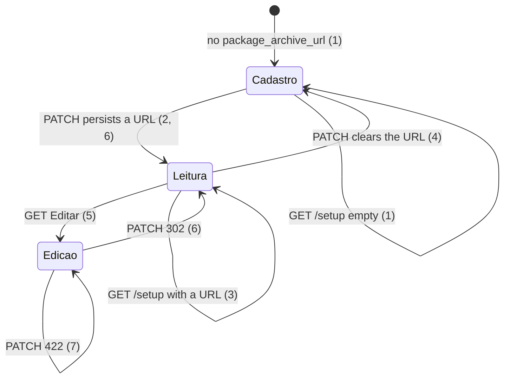

# Setup: package archive storage

> Build this with **tlc-implement**. Profile **`ui`**: screen `setup` is binding through
> `.specs/features/visual-identity/design.md` (criterion 11).
> Every criterion below becomes a check with a proof, referenced by its number. Nothing under
> `Unresolved` gets settled while building.

## Intent

The Arquivo do pacote block on `/setup` is always the same writable URL and `Salvar arquivo`,
including after a successful `PATCH /package_archive`. The heading does not say the field is
monthly-package storage, and the copy says `Drive` rather than `Google Drive`. Contador leitura
from #80 is the same five `input` nodes as cadastro (`border-rule` `bg-sheet`), so standing data
still looks like a draft. Issue #81 gives no conversion figure. The cost is that a coordinator
cannot tell a standing package archive or accountant from a form they should type in, and `Drive`
is easy to mix with the writer Google account.

When this ships, screen `setup` (`GET /setup`) still uses the cadastro form when the focused
organization has no `package_archive_url`, with heading `Armazenamento do pacote mensal` and copy
`Google Drive`. After that URL exists, the value is labeled text (not an input) and `Editar`
unlocks the writable field; `Confirmar` persists the new URL (not a second `Salvar arquivo`).
Contador leitura uses that same labeled-text chrome for its five values; cadastro and edição keep
today’s inputs. A successful save still toasts `Pronto.` from #76. Binding design:
`.specs/features/visual-identity/design.md` section `setup`.

13 criteria in 5 slices · 0 one-way doors · 2 open, of which 0 block

## Criteria

### Cadastro copy when there is no URL

1. Given a signed-in coordinator of the focused organization with no `package_archive_url`, when
   `GET /setup` runs, then the status is `200`, the body includes heading `Armazenamento do pacote
   mensal` and `Cole a URL da pasta do Google Drive`, `form[action="/package_archive"]` includes
   `Salvar arquivo` and `input#url` whose classes include `border-rule` and `bg-sheet` and which
   does not have `readonly` or `disabled`, the label for `#url` is `URL da pasta do Google Drive`,
   the Armazenamento section (from heading `Armazenamento do pacote mensal` through heading
   `Certificado SEFAZ`) does not include a control whose text is `Editar` and does not include
   `Confirmar`, and the body does not include `Arquivo do pacote`, `Cole a URL da pasta do Drive`,
   or `URL da pasta do Drive`.
2. Given that empty organization, when `PATCH /package_archive` runs with
   `https://drive.google.com/drive/folders/15uNXeRBIhVvZJIhL4yTw4IsStMhUaaxl`, then the response is
   `302` to `/setup`, that URL and folder id `15uNXeRBIhVvZJIhL4yTw4IsStMhUaaxl` are persisted, and
   the following `GET /setup` has `[data-toast-kind="success"]` text `Pronto.` and matches the
   read-only observations in criterion 3.

### Standing URL as labeled text

3. Given the focused organization has `package_archive_url`
   `https://drive.google.com/drive/folders/15uNXeRBIhVvZJIhL4yTw4IsStMhUaaxl`, when `GET /setup`
   runs, then the Armazenamento section has label text `URL da pasta do Google Drive`, has
   `p#url` with class `font-medium` and that URL as its text, has no `input` `textarea` or
   `select`, has no `Salvar arquivo`, has no `Cole a URL da pasta do Google Drive`, has no
   `Confirmar`, and includes a control whose text is `Editar`. `p#url` classes do not include
   `border-rule` or `bg-sheet`.
4. Given that standing URL, when `PATCH /package_archive` runs with `url` `""`, then the response
   is `302` to `/setup`, `package_archive_url` and `package_archive_folder_id` are absent, and the
   following `GET /setup` matches criterion 1.

### Editar, then Confirmar or 422

5. Given the organization in criterion 3, when `GET` of the Armazenamento `Editar` control’s URL
   runs, then the status is `200`, `form[action="/package_archive"]` includes `Confirmar` and
   `input#url` whose classes include `border-rule` and `bg-sheet`, `#url` has no `readonly` or
   `disabled` and value
   `https://drive.google.com/drive/folders/15uNXeRBIhVvZJIhL4yTw4IsStMhUaaxl`, the label matches
   criterion 1, and the Armazenamento section has no `Editar`, no `Salvar arquivo`, and no
   `p#url`.
6. Given that writable form, when `PATCH /package_archive` runs with
   `https://drive.google.com/drive/folders/1AbCdEfGhIjKlMnOpQrStUvWxYz123456`, then the response is
   `302` to `/setup`, that URL and folder id `1AbCdEfGhIjKlMnOpQrStUvWxYz123456` are persisted, and
   the following `GET /setup` matches the read-only observations in criterion 3 for the new URL
   and has `[data-toast-kind="success"]` text `Pronto.`
7. Given the organization in criterion 3, when `PATCH /package_archive` runs with
   `https://drive.google.com/file/d/0B_NiLAzvehC9R2stRmQyM3ZiVjQ/view`, then the status is `422`,
   the stored URL stays
   `https://drive.google.com/drive/folders/15uNXeRBIhVvZJIhL4yTw4IsStMhUaaxl`, there is no
   `[data-toast]`, and `form[action="/package_archive"]` is the writable form in criterion 5
   (`Confirmar` present, `input#url` not `readonly`).
8. Given no `package_archive_url`, when `PATCH /package_archive` runs with
   `https://example.com/drive/folders/15uNXeRBIhVvZJIhL4yTw4IsStMhUaaxl`, then the status is `422`,
   URL and folder id stay absent, there is no `[data-toast]`, and `form[action="/package_archive"]`
   is the cadastro form in criterion 1 (`Salvar arquivo` present, `input#url` with `border-rule`
   `bg-sheet`).

### Contador leitura uses the same labeled-text chrome

9. Given the focused organization has `accountant_presentation_name` `Ana Contábil`,
   `accountant_tax_id` `11222333000181`, `accountant_legal_name` `Contábil LTDA`,
   `accountant_pix_key` `chave-pix`, and `package_destination_email` `ana@example.com`, when
   `GET /setup` runs, then the Contador section (heading `Contador` through heading
   `Armazenamento do pacote mensal`) has no `input` `textarea` or `select`, has `p#presentation_name`
   `Ana Contábil`, `p#tax_id` `11.222.333/0001-81`, `p#legal_name` `Contábil LTDA`, `p#pix_key`
   `chave-pix`, and `p#destination_email` `ana@example.com`, each of those `p` nodes has class
   `font-medium` and does not have `border-rule` or `bg-sheet`, the labels for those ids stay
   `Nome de apresentação`, `CPF/CNPJ (preencher apenas números)`, `Razão social`, `PIX`, and
   `Email para envio`, there is no `Salvar contador` and no `Cadastre o contador`, and that
   section includes a control whose text is `Editar`.
10. Given `accountant_presentation_name` `Ana` and `accountant_tax_id` `39053344705` and no razão
    social, when `GET /setup` runs, then `p#tax_id` is `390.533.447-05` and `p#legal_name` is
    empty. Given `accountant_presentation_name` `Ana` and the four optional accountant fields
    blank, `p#tax_id` `p#legal_name` `p#pix_key` and `p#destination_email` are empty and `Editar`
    is still present. `accountant_tax_id` on `Organization` stays digits-only; those GETs do not
    persist punctuation.

### Shared `edit` query and binding setup wireframe

11. Given the organization in criterion 9 and the archive URL in criterion 3, when
    `GET /setup?edit=package_archive` runs, then the Armazenamento form matches criterion 5 and
    the Contador section matches criterion 9 (labeled text, `Editar` present).
12. Given that same organization, when `GET /setup?edit=accountant` runs, then
    `form[action="/accountant"]` includes `Salvar contador` and `input#presentation_name`
    `input#tax_id` `input#legal_name` `input#pix_key` `input#destination_email` whose classes
    include `border-rule` and `bg-sheet` and which have no `readonly` or `disabled`, `#tax_id`
    value is `11222333000181`, there is no `p#presentation_name`, and the Armazenamento section
    matches criterion 3 (`p#url`, `Editar` present, no `Confirmar`).
13. `.specs/features/visual-identity/design.md` section `setup` — `GET /setup` no longer shows
    `Arquivo do pacote` as an always-writable `URL da pasta do Drive` / `[Salvar arquivo]`, and
    no longer shows Contador leitura as the same bordered `sheet` inputs as cadastro. It shows
    heading `Armazenamento do pacote mensal`; cadastro when there is no URL (`Cole a URL da pasta
    do Google Drive`, label `URL da pasta do Google Drive`, `[Salvar arquivo]`); standing URL as
    labeled `font-medium` text plus `Editar`; `GET /setup?edit=package_archive` as `input#url`
    with `[Confirmar]`. Contador leitura is the same labeled-text chrome for the five values
    (formatted CPF/CNPJ on read); cadastro and `GET /setup?edit=accountant` keep the input
    chrome. The Contador bullet no longer says the archive stays always-writable for #81.

## States

Contador cadastro / leitura / edição from #80 stay; this cut only changes leitura chrome (9, 10,
12). `PATCH /package_archive` URL parse, blank clear, submitter `404`, and unauthenticated `302`
`/login` are unchanged (existing).

## Out of scope

- Changing `PATCH /accountant` acceptance, labels, tax-id format, or cadastro / edição as inputs
  — #80; this cut only replaces leitura `input[readonly]` with labeled text (9, 10, 12)
- Making the standing URL an `<a href>` to Drive
- Hiding empty optional accountant fields — empty values stay as empty `p` nodes (10)
- Certificado SEFAZ, contas bancárias, tipos extras — #82–#84
- Keeping a typed invalid URL on `422` — #85 is document and A1; archive `422` still re-renders
  from the stored organization (7, 8)
- Changing `DriveFolderUrl.parse` acceptance (HTTPS `drive.google.com` `/folders/<id>`, blank
  clears, file URL `422`)
- Glossary rename of **Package archive**; UI copy only
- Drive writer OAuth, close-for-send, month-folder restore
- `Cancelar` on edit — Unresolved 2; `GET /setup` without the archive Editar URL is Leitura (3)

## Observable

| Surface | Decision | Landing |
| --- | --- | --- |
| screen `setup` Armazenamento | empty state | 1 — `Cole a URL da pasta do Google Drive` and the writable cadastro form |
| screen `setup` Armazenamento | loading state | n/a — Turbo full-page `GET /setup`; no pending chrome |
| screen `setup` Armazenamento | error state | 7, 8 — existing field `422`; form stays in the mode that submitted (edição or cadastro); no toast |
| screen `setup` Armazenamento | unauthorised | existing — `require_coordinator_organization`; unauthenticated `302` `/login`; submitter `GET /setup` and `PATCH /package_archive` `404` |
| screen `setup` Armazenamento | density and ordering | 1, 3 — one URL field; new heading and Google Drive copy; input chrome on cadastro/edição; labeled `p#url` `font-medium` on leitura; `Editar` / `Confirmar` after a URL exists |
| screen `setup` Armazenamento | destructive action confirms | n/a — save, Editar, and Confirmar are not destructive; blank clear (4) has no extra confirm |
| screen `setup` Contador | empty state | existing #80 cadastro — `Cadastre o contador` and writable inputs (12 is edição) |
| screen `setup` Contador | loading state | n/a — same full-page GET |
| screen `setup` Contador | error state | existing #80 — accountant `422` re-renders edição inputs, not leitura text |
| screen `setup` Contador | unauthorised | existing — same coordinator guard |
| screen `setup` Contador | density and ordering | 9, 10 — five labeled `p.font-medium` values, same two-column order; formatted tax id; empty optionals stay as empty `p` |
| screen `setup` Contador | destructive action confirms | n/a — Editar is not destructive |
| HTML `GET /setup` | response shape | 1, 3, 5, 9, 10, 11, 12 — `200`; cadastro, Leitura, or Edicao HTML |
| HTML `PATCH /package_archive` | response shape | 2, 4, 6 — `302` `/setup`; 7, 8 — `422` |
| HTML `PATCH /package_archive` | error shape and codes | 7, 8 and existing — field `package_archive_url` `:invalid`; no `:base` notice; no toast (#76 field-only) |
| HTML `PATCH /package_archive` | who may call it | existing — coordinator of the focused organization |
| HTML `PATCH /package_archive` | versioning | n/a — existing HTML form; no published API |
| HTML `PATCH /package_archive` | rate limit | n/a — coordinator-only, small operator set |
| document `.specs/features/visual-identity/design.md` | structure, tone, depth, next action | 13 |
| collection | grouping, naming, ordering, duplicates, exception | n/a — one package archive per organization already; this cut does not list a collection |

## Swept

- validation: existing `DriveFolderUrl.parse` / `Organization#update_package_archive`; 7, 8 —
  rejected URLs still `422` and do not persist
- failure modes: 7 — `422` during edição re-renders `Confirmar` and `input#url`, not `p#url`; 8 —
  `422` during cadastro re-renders `Salvar arquivo`
- idempotency and retry: 6 — a second identical `PATCH` still `302` and Leitura; 3 — a second
  `GET /setup` stays Leitura
- authorization: existing — `require_coordinator_organization` on `SetupController` and
  `PackageArchivesController`; this cut does not add a route
- concurrency and ordering: n/a — two overlapping `PATCH /package_archive` leave the last write;
  no new unique index or ordering
- data lifecycle: 3, 9 — organizations that already have `package_archive_url` or
  `accountant_presentation_name` render labeled text on first `GET /setup` after this ships; no
  backfill; clearing the URL (4) returns Cadastro
- external-dependency failure: n/a — archive save parses the URL in-process and does not call
  the Drive writer
- state transitions: 1, 2, 4, 5, 6, 7, 8
- observability: n/a — the source names no log, metric, or trace; the person sees the form and
  the existing toast

## Impact

| Front | What changes |
|---|---|
| domain | no new glossary term — `GLOSSARY.md` **Package archive** stays; heading `Armazenamento do pacote mensal` and copy `Google Drive` are screen `setup` only |
| domain | existing term: package archive on `Organization` — still one folder URL plus extracted folder id. Callers: `PackageArchivesController`, `Organization#update_package_archive`, `Month` close-for-send / restore (`package_archive_folder_id`), `DriveFolderUrl` |
| domain | existing term: standing accountant on `Organization` — still presentation name plus optional tax id / razão social / PIX / destination email. Callers: `AccountantsController`, `setup/show` Contador, #80 request specs that assert `input[readonly]` |
| stored data | nothing to migrate — no schema change; existing non-blank `package_archive_url` and `accountant_presentation_name` rows are labeled-text Leitura on next `GET /setup` |

`spec/requests/setup_spec.rb` still asserts heading `Arquivo do pacote`, `Cole a URL da pasta do
Drive`, and Contador `input[readonly]`. `spec/docs/setup_accountant_read_after_save_spec.rb` pins
the design `setup` section to `Arquivo do pacote`, `Salvar arquivo`, and `#81`. #80 checks that
name archive heading `Arquivo do pacote` or leitura as `readonly` inputs are historical; live
proofs must follow criteria 1, 3, 9, 10, and 13.

## Decided

None — `PATCH /package_archive` and `DriveFolderUrl` already exist. Labeled-text Leitura copies
the certificado titular `p.font-medium` already on this screen; it is reversible HTML. Editar as
a GET (Unresolved 1) extends the existing `params[:edit]` query #80 used for Contador; it is not
a new resource. `Confirmar` is the submit label on archive edição only.

## Surface

| Route | In | Out | Status | Criteria |
|---|---|---|---|---|
| `GET /setup` | session, focus, optional Editar URL | archive cadastro, Leitura, or Edicao HTML; Contador leitura text or edição inputs | `200` | 1, 3, 5, 9, 10, 11, 12 |
| `PATCH /package_archive` | url | redirect or setup `422` | `302`, `422` | 2, 4, 6, 7, 8 |

## Sources

- https://github.com/gutors/ai-accounting-assistant/issues/81 — **binding for this slice**:
  heading `Armazenamento do pacote mensal`; copy `Drive` → `Google Drive`; after `Salvar arquivo`,
  URL standing (not a second `Salvar arquivo`); `Editar` unlocks; `Confirmar` persists; toast on
  confirm; certificado out
- user delegated — Contador leitura must not use the same chrome as editable inputs; archive URL
  Leitura uses that same labeled-text style
- https://github.com/gutors/ai-accounting-assistant/issues/75 — parent: one tlc-plan slice; toast
  helper already shipped (#76); profile `ui`
- https://github.com/gutors/ai-accounting-assistant/issues/76 — `PATCH /package_archive` success
  already toasts `Pronto.`; field-only `422` has no toast
- https://github.com/gutors/ai-accounting-assistant/issues/80 — Contador `GET /setup?edit=accountant`;
  formatted CPF/CNPJ on read; 12 keeps edição as inputs
- `.specs/features/visual-identity/design.md` — **binding for the interface** once criterion 13
  lands: screen `setup`; standing values `font-medium` like certificado titular; inputs stay
  `border-rule` `bg-sheet`; SEFAZ install form and banks unchanged here except the archive heading
- `app/views/setup/show.html.erb` — today’s always-writable archive form and Contador
  `input[readonly]` on leitura
- `Organization#update_package_archive`, `DriveFolderUrl` — persist and reject; 7–8 do not change
  the parse table
- Open defaults in Unresolved 1–2 — Editar is a GET; no `Cancelar`

This task is the record of decision. If a linked document diverges, ask before building.

## Unresolved

| # | Kind | Question | Until answered |
|---|---|---|---|
| 1 | open | How does `Editar` unlock the form? #81 names a button, not a URL. #80 used `GET /setup?edit=accountant`. | GET of the Armazenamento `Editar` control (5), `href` `/setup?edit=package_archive`. `PackageArchivesController` `422` keeps edição without that query (7). No new POST. Submit on edit is `Confirmar`, not `Salvar arquivo` (5, 6) |
| 2 | open | Is there `Cancelar` on edit? | No (Out of scope). `GET /setup` without the archive Editar URL is Leitura (3) |
