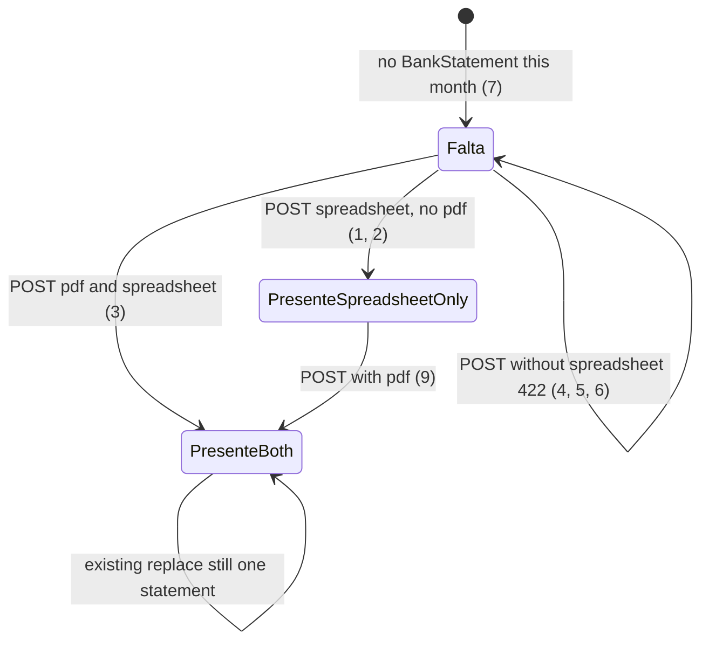

# Statement: optional PDF, compact upload, Documentos column

> Build this with **tlc-implement**. Profile **`ui`**: screen `month` is binding through
> `.specs/features/visual-identity/design.md` (criterion 16).
> Every criterion below becomes a check with a proof, referenced by its number. Nothing under
> `Unresolved` gets settled while building.

## Intent

On `GET /months/:year_month`, a coordinator cannot mark an extrato `Presente` without a PDF, even
though movements come only from the spreadsheet. The include form sits inline with two full file
widgets (`Incluir PDF`, `Incluir planilha`) plus `Enviar extrato`, while replace is already a
`
` `Substituir extrato`. Filenames share the Situação cell with `Presente`. Issue #108
gives no conversion figure. The cost is a forced PDF the accountant copy does not always have, a
tall Falta row, and Situação that mixes status with file names.

When this ships, screen `month` (`GET /months/:year_month`) accepts a spreadsheet without a PDF.
`Presente` means that account has a BankStatement with a spreadsheet this month. The include form
lives in `

Incluir extrato
` like replace. A Documentos column shows
`Pdf {filename}` and `Planilha {filename}` on their own lines; Situação is only `Presente` or
`Falta`. Binding design: `.specs/features/visual-identity/design.md` section `month` (amended).

16 criteria in 4 slices · 2 one-way doors · 2 open, of which 0 block

## Criteria

### Spreadsheet-only Presente

1. Given a signed-in coordinator of the focused organization, open Month `2026-05`, and an active
   COMPE `001` BankAccount `Conta Principal`, when `POST /months/2026-05/bank_statements` runs
   with `bank_account_id` of that account and the BB May 2026 fixture spreadsheet, without `pdf`,
   then the status is `302` to `/months/2026-05`, one BankStatement persists for that pair, that
   statement’s `spreadsheet` is attached with the fixture filename, and `pdf` is not attached.
2. When the following `GET /months/2026-05` runs, then that `li[data-row="bank-account"]` includes
   `Presente`, includes a Documentos cell whose text contains `Planilha` then the spreadsheet
   filename, does not include `Pdf`, and the Situação cell’s text is exactly `Presente` (no
   filename in that cell). The page does not include `Falta o extrato`.
3. Given the same setup, when `POST /months/2026-05/bank_statements` runs with that
   `bank_account_id`, `pdf` the May 2026 statement PDF (`extrato-maio-2026.pdf`), and the BB
   spreadsheet (`extrato-maio-2026.xlsx`), then the status is `302` to `/months/2026-05`, both
   blobs are attached, and the following GET’s Documentos cell contains `Pdf extrato-maio-2026.pdf`
   on one line and `Planilha extrato-maio-2026.xlsx` on the next, in that order, and Situação text
   is exactly `Presente`.
4. Given no statement on that account, when `POST /months/2026-05/bank_statements` runs with that
   `bank_account_id` and `pdf` only (no spreadsheet), then no BankStatement persists, the status
   is `422`, and `[data-notice="error"]` is `Envie a planilha` (Unresolved 1). The same POST with
   no files matches that `422` and copy.
5. When `POST /months/2026-05/bank_statements` runs with a valid `pdf` and a movement file whose
   extension is `.ofx`, then no BankStatement persists, the status is `422`, and
   `[data-notice="error"]` is `Envie a planilha` (Unresolved 1).
6. When `POST /months/2026-05/bank_statements` runs with `pdf` of `10485761` bytes and a valid
   spreadsheet, then no BankStatement persists, the status is `422`, and `[data-notice="error"]`
   is `Cada arquivo pode ter no máximo 10 MB`.
7. Given that account has no statement this month, when `GET /months/2026-05` runs, then that
   row includes `Falta` in `text-margem`, its Documentos cell includes neither `Pdf` nor
   `Planilha`, and Situação text is exactly `Falta`.

### Replace keeps an omitted PDF

8. Given a statement that has both `extrato-maio-2026.pdf` and `extrato-maio-2026.xlsx`, when
   `POST /months/2026-05/bank_statements` runs with a different valid spreadsheet and without
   `pdf`, then one BankStatement remains, `pdf` is still `extrato-maio-2026.pdf`, `spreadsheet`
   is the new filename, and the following GET shows `Pdf extrato-maio-2026.pdf` and `Planilha`
   plus that new filename.
9. Given a spreadsheet-only statement as in criterion 1, when `POST /months/2026-05/bank_statements`
   runs with `pdf` `extrato-maio-2026.pdf` and a valid spreadsheet, then `pdf` is attached as
   that filename and the following GET’s Documentos cell includes `Pdf extrato-maio-2026.pdf` and
   `Planilha` plus the spreadsheet filename.

### Incluir extrato details

10. When `GET /months/2026-05` runs as in criterion 7 (Falta, month open), then that row’s
    upload is inside a `
` whose `
` text is `Incluir extrato`, that details is
    not `open` (Unresolved 2), and the details contain the existing file fields (`PDF` /
    `Incluir PDF`, `Planilha` / `Incluir planilha`) and submit `Enviar extrato`. The row has no
    `
` `Substituir extrato`.
11. When `GET /months/2026-05` runs as in criterion 3 (Presente, month open), then that row’s
    upload is inside a `
` whose `
` text is `Substituir extrato`, not `open`,
    with the same inner form as criterion 10. The row has no `
` `Incluir extrato`.
12. While the month is closed, `GET /months/2026-05` for a Presente row still shows Situação
    `Presente` and the Documentos lines from criterion 3, and that row includes neither
    `Incluir extrato` nor `Substituir extrato`.
13. When the `422` from criterion 4 renders, then the `Incluir extrato` details of that
    `bank_account_id` is `open` (Unresolved 2), and `[data-notice="error"]` is still
    `Envie a planilha`.

### Documentos column and binding month wireframe

14. Given at least one active BankAccount, when `GET /months/2026-05` runs, then
    `.ledger-head.ledger-month-bank` children in order are `Nome`, `Agência/conta`, `Situação`,
    `Documentos`, then an empty actions heading. Each `li[data-row="bank-account"]` uses that
    same cell order. The Documentos cell of a Presente row includes `whitespace-nowrap`.
15. Given two active accounts, one Presente with both files and one Falta, when that GET runs,
    then only the Presente row includes `Pdf` / `Planilha` filenames, and the Falta row matches
    criterion 7.
16. `.specs/features/visual-identity/design.md` section `month` — Contas bancárias is no longer
    name | coordinates | `Presente` plus two filenames in meta (or `Falta`) | inline include or
    `Substituir extrato`. It is name | coordinates | Situação `Presente` or `Falta` (no
    filenames) | Documentos (`Pdf {filename}` when a PDF is attached, omitted otherwise;
    `Planilha {filename}` when a spreadsheet is attached; one per line, no wrap) | `Incluir
    extrato` details when Falta and open, `Substituir extrato` when Presente and open. Closed
    month: no form. `visual-identity` month bank-row checks follow this, not the old Situação
    filenames.

## States

## Out of scope

- PagSeguro Entradas/Saídas zero — #109
- Hide Recebimentos/Pagamentos until the coordinator confirms accounts — #110
- Matching screen, Resolver, N:1 — #111
- Overview: drop Ações, filter, collapse lists, Voltar para Início, richer pool — #112
- Requiring a `.pdf` extension or MIME on the optional PDF — existing: only non-blank
- A control that removes an attached PDF — #108 only omit-keeps and new-replaces
- Toast `Pronto.` on statement `302` — existing redirect has none; #76 did not list this POST
- Open Finance, OFX as a movement source, other COMPE parsers — existing `422`s stay except the
  missing-spreadsheet copy (5)
- Changing `Month#close_blocker` copy `Importe o extrato de cada conta ativa` — it already keys
  off a BankStatement row, not the PDF blob (`MonthPackage` already skips a missing PDF)

## Observable

| Surface | Decision | Landing |
| --- | --- | --- |
| screen `month` | empty state | existing — `Nenhuma conta bancária ativa` omits the ledger (no Documentos heading) |
| screen `month` | loading | n/a — server-rendered GET |
| screen `month` | error state | 4, 5, 6, 13 — `[data-notice="error"]`; 13 opens the failing details |
| screen `month` | unauthorised | existing — unauthenticated `302` `/login`; submitter `404` on month and POST |
| screen `month` | density and ordering | 10, 11, 14, 16 — details; Documentos after Situação; Pdf then Planilha |
| screen `month` | destructive action confirms | existing — replace still has no confirm; close confirm unchanged |
| API `POST /months/:year_month/bank_statements` | who may call | existing — coordinator, focused org, active account; else `404` |
| API `POST /months/:year_month/bank_statements` | error shape and codes | 4, 5, 6 — `422` HTML `months/show` with first `:base` on `[data-notice="error"]`; no new JSON |
| API `POST /months/:year_month/bank_statements` | versioning | n/a — HTML form POST |
| API `POST /months/:year_month/bank_statements` | rate limit | n/a — no limit in this app |
| document visual-identity `month` | structure, tone, next action | 16 |
| collection bank-account rows | grouping, naming, ordering, duplicates, exception | 14, 15 — one row per active account; Documentos omitted lines when no blob; inactive stays off the list (existing) |

## Swept

- validation: 4, 5, 6 — spreadsheet required and `.csv`/`.xlsx`; PDF optional; 10 MB when a PDF is sent; other existing `:base` strings (`Não foi possível ler a planilha`, unsupported bank, dates outside the month, `Mês fechado`) stay
- failure modes: 4, 13 — missing spreadsheet `422` re-renders show with notice and open details
- idempotency and retry: 8 — same `POST` is replace; omit `pdf` does not attach a second PDF and does not purge. `BankStatement.import` `RecordNotUnique` retry is existing
- authorization: existing — `require_coordinator_organization`; foreign or inactive account `404`; closed month `:base` `Mês fechado`
- concurrency and ordering: existing — `import` find-or-initialize plus unique (month, bank_account); two overlapping POSTs serialize on that row; omit-pdf keep is per persist of the winner
- data lifecycle: 1, 8, 9 — PDF blob may be absent; existing rows already have both attachments; nothing to backfill or strip
- external-dependency failure: n/a — Disk Active Storage local; Drive is close-for-send, unchanged
- state transitions: 1–3, 7–9 — Falta / Presente; spreadsheet-only vs both files
- observability: n/a — the source names no log, metric, or trace; the person sees Situação, Documentos, and the notice

## Impact

| Front | What changes |
|---|---|
| domain | existing term: **Bank statement Presente** — meant both PDF and spreadsheet were on the card. Now means a BankStatement exists for that active account and month (spreadsheet attached; PDF optional). Callers: `app/views/months/show.html.erb` Situação, `spec/requests/bank_statements_spec.rb`, `.specs/features/visual-identity/design.md` month, historical `.specs/features/bank-statement-upload/` C17/C25/C26 (those checks describe the old both-files gate) |
| domain | existing term: **Bank statement** files — PDF stays the accountant consult copy and stays optional on the Open Finance path in #4; this cut makes the manual path match that optionality. `MonthPackage.statement_files` already skips a missing PDF |
| stored data | nothing to migrate — `has_one_attached :pdf` is already optional; production statements from the old gate have both blobs |

## Decided

| Decision | Shape | Alternative rejected |
|---|---|---|
| Spreadsheet-only is a valid BankStatement | `submit` requires a `.csv`/`.xlsx` spreadsheet; `pdf` may be blank on first import; `Presente` iff a BankStatement row exists (spreadsheet attached). `Month#missing_active_statement?` stays “no row”, not “no PDF” | Keep requiring PDF — #108. Treat Presente as both files while allowing persist without PDF — Situação would lie |
| Omit PDF on replace keeps the blob | `persist_import` attaches `pdf` only when the param is present; a blank `pdf` does not `purge`. A new `pdf` replaces. Spreadsheet always attaches on a successful submit | Purge PDF when the file field is empty — the browser cannot say “keep” vs “clear”. A dedicated remove control is out of scope |

## Surface

| Route | In | Out | Status | Criteria |
|---|---|---|---|---|
| `GET /months/:year_month` | session, focus | bank rows: Situação, Documentos, Incluir/Substituir details | `200`, `302`, `404` | 2, 3, 7, 10–12, 14, 15 |
| `POST /months/:year_month/bank_statements` | `bank_account_id`, optional `pdf`, `spreadsheet` | redirect show or `422` show | `302`, `422`, `404` | 1, 3–6, 8, 9, 13 |

## Sources

- https://github.com/gutors/ai-accounting-assistant/issues/108 — **binding for this slice**: spreadsheet required, PDF optional on include and replace; Presente with spreadsheet only; close-for-send still “statement per active account” = spreadsheet present; omit PDF on replace keeps PDF; new PDF replaces; `422` copy is no longer `Envie o PDF e a planilha`; include in `
` like Substituir (default summary `Incluir extrato`); Documentos column `Pdf {filename}` / `Planilha {filename}`, one per line, no wrap; omit Pdf line when no PDF; Situação only Presente/Falta
- https://github.com/gutors/ai-accounting-assistant/issues/75 — parent umbrella; one tlc-plan per child
- Conversation that cut #108 — Documentos shows the statement PDF and spreadsheet; those names leave Situação; labels `Pdf` and `Planilha` before the filename
- `.specs/features/visual-identity/design.md` section `month` — **binding for the interface** once criterion 16 lands; today’s ASCII still puts filenames on Situação and inline include
- `app/models/bank_statement.rb` — today’s both-files gate `MISSING_FILES`, `persist_import` always attaches both
- `app/views/months/show.html.erb` / `_statement_form.html.erb` — today’s four-column bank ledger and inline include
- `app/models/month_package.rb` — already skips unattached PDF at close-for-send
- Open defaults in Unresolved 1–2 — `Envie a planilha`; Falta details closed until `422` opens them

This task is the record of decision. If a linked document diverges, ask before building.

## Unresolved

| # | Kind | Question | Until answered |
|---|---|---|---|
| 1 | open | Exact `422` copy when the spreadsheet is missing or not `.csv`/`.xlsx`? #108 says it is no longer `Envie o PDF e a planilha`, not the replacement sentence. | `Envie a planilha` (4, 5, 13). Other `:base` strings unchanged |
| 2 | open | Is `Incluir extrato` open on a Falta GET, or closed like `Substituir extrato`? On `422`, should that details be `open`? | Closed on success GET (10). `open` on the failing account’s `422` (13), same as setup certificate/extra-kind folds |
