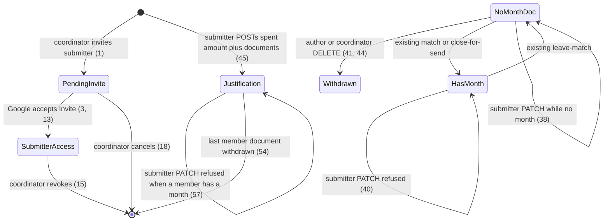
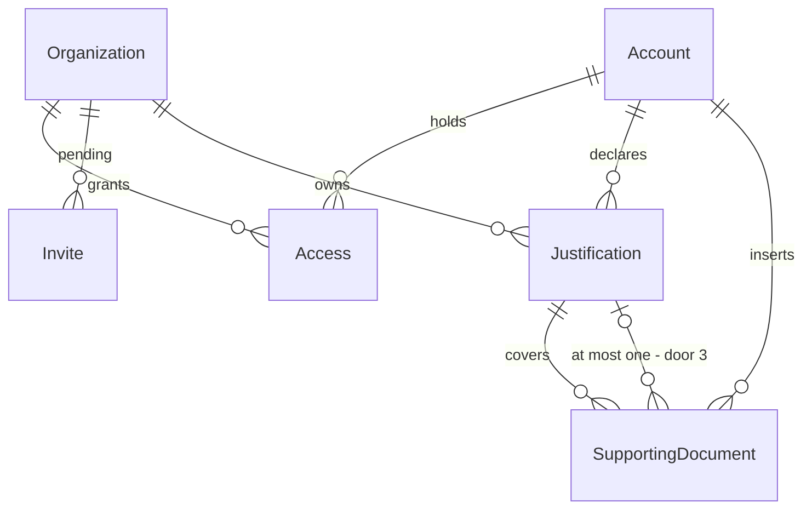

# Submitter access

> Build this with **tlc-implement**.
> Every criterion below becomes a check with a proof, referenced by its number. Nothing under
> `Unresolved` gets settled while building.

## Intent

A planted coordinator can sign in, invite another coordinator, and insert supporting documents, but the second operator of the ritual cannot. `Invite` and `Access` already store kind `submitter` and never write it: `Invite.create_pending` / `accept!` always persist coordinator, and `OperatorAuthenticator` signs in only when `coordinator_accesses` exist. `focused_organization` looks up `coordinator_organizations`, so a submitter session cannot reach `/supporting_documents` and would be sent to `/login` while still holding `account_id`. Issue #35 gives no conversion figure; the cost is that notes still arrive on WhatsApp for the coordinator to gather, and #3 / #24’s submitter never enters.

When this ships, a coordinator of the focused organization invites a submitter by email; that person signs in with Google, works inside organizations they have Access on, inserts supporting documents, sees only what they inserted and their justifications, and cannot see payments, statements, matches, close-for-send, setup, or anyone else’s documents. A justification is a spent amount plus the documents that cover it. The coordinator sees those justifications on `/supporting_documents`. The submitter may change the spent amount while every member document has no month. Turning a justification into a suggestion stays #37.

58 criteria in 5 slices · 4 one-way doors · 2 open, of which 0 block

## Criteria

### Submitter is invited and signs in

1. When a coordinator of the focused organization submits a well-formed email that has neither standing Access nor a pending Invite on that organization as a submitter, then the system persists one pending Invite of kind `submitter` for that email and responds `302` to `/`.
2. When `/` renders for that coordinator, then it includes that pending email.
3. When Google OIDC succeeds with `email_verified` true and that normalized email matches a pending submitter Invite and has no Account, then the system persists one Account, one submitter Access on that organization, deletes that Invite, sets the session to that Account and focus to that organization, and responds `302` to `/`.
4. When that submitter then opens `/`, then the response is `200` and includes that organization’s name.
5. When Google OIDC succeeds a second time for that submitter email, then the system persists no second Account and no second Access on that organization and sets the session to the existing Account.
6. Given an Account that already has coordinator Access on organization A and a pending submitter Invite on organization B, when Google OIDC succeeds for that verified email, then the system persists submitter Access on B, deletes that Invite, and persists no second Account, and responds `302` to `/`.
7. Given an Account that has submitter Access and no pending Invite, when Google OIDC succeeds for that verified email, then the system sets the session to that Account, sets focus to an organization of that Access, and responds `302` to `/`.
8. If a coordinator submits that email and it already has standing Access of either kind on that organization, then the system persists no Invite and responds `422`.
9. If a coordinator submits that email and it already has a pending Invite on that organization, then the system persists no additional Invite and responds `422`.
10. If a coordinator submits a string that is not an email as a submitter invite, then the system persists no Invite and responds `422`.
11. If an unauthenticated request submits a submitter Invite, then the system persists no Invite and responds `302` to `/login`.
12. When two concurrent submitter Invite submissions use the same email and organization, then the system persists exactly one pending Invite.
13. Always, accepting a submitter Invite persists Access kind `submitter` and does not persist coordinator Access on that organization for that Account.
14. When `/` renders for a coordinator and the organization has a standing submitter Access, then the page includes that submitter’s email.
15. When a coordinator of the focused organization confirms revoke of a submitter Access, then the system deletes that Access and responds `302` to `/`, and that Account remains.
16. While that revoked Account has no remaining Access, when Google OIDC succeeds for that email, then the system leaves the Account in place, sets no organization focus, and responds `302` to `/denied`.
17. When a coordinator revokes the only submitter Access and at least one coordinator Access remains, then those coordinator Accesses are unchanged.
18. When a coordinator DELETEs a pending submitter Invite on the focused organization, then that Invite is gone and the response is `302` to `/`.

### Focus follows any Access

19. When an Account holds submitter Access on more than one organization, then `/` includes a control that lists those organizations’ names.
20. When that submitter selects the other organization, then the system sets focus to that organization and responds `302` to `/`, and that page includes that organization’s name.
21. While focus is organization A, `GET /supporting_documents` does not include payee text that exists only on organization B’s supporting documents.
22. If the submitter requests to focus an organization they have no Access on, then the system responds `404` and leaves focus unchanged.
23. Given an Account that is coordinator of A and submitter of B, while focus is B, `GET /months/2026-05` responds `404`.
24. Given that same Account, while focus is A, `GET /months/2026-05` responds `200`.

### Submitter cut hides the close ritual and others’ documents

25. While a submitter is focused on an organization whose month `2026-05` has a Payment whose history is `PIX Isolado`, `GET /months/2026-05` responds `404` and the body does not include `PIX Isolado`.
26. While that submitter is focused, `GET /setup` responds `404` and the body does not include a bank-account name that exists only on that organization’s setup.
27. When that submitter opens `/`, then the page does not include `Abrir mês`, `Fechar para envio`, `Configuração`, or `Convidar coordenador`.
28. When a submitter opens `/supporting_documents` and another Account has a no-month document whose payee is `Doc Alheio` on that organization, then the page responds `200`, includes `Documentos de suporte`, and does not include `Doc Alheio`.
29. When that submitter’s organization has no SupportingDocument belonging to that Account, then `/supporting_documents` includes `Nenhum documento`.
30. If a submitter POSTs `/months`, then the system persists no Month and responds `404`.
31. If a submitter POSTs `/months/2026-05/close`, then the month remains not closed and the response is `404`.
32. If a submitter POSTs `/months/2026-05/matches`, then the system persists no Match and responds `404`.
33. If a submitter POSTs a coordinator or submitter Invite, then the system persists no Invite and responds `404`.
34. If a submitter DELETEs an Access, then that Access remains and the response is `404`.
35. While a submitter’s own document is in a Match, `/supporting_documents` does not include `Casado em`.
36. When a coordinator of that organization opens `/supporting_documents`, then the page includes the payee of a document the submitter inserted.

### Submitter inserts, edits, and withdraws own no-month documents

37. When a submitter POSTs `kind=recibo`, amount `155,00`, date `2026-05-11`, payee `Padaria Central`, a `.jpg` photo, and no XML, then the system persists one SupportingDocument for the focused organization belonging to that Account and to no Month, responds `302` to `/supporting_documents`, and that page includes `11/05/2026`, `R$ 155,00`, `Padaria Central`, and `Recibo`.
38. When that submitter PATCHes payee `Mercado Silva` on that no-month document, then the system persists that payee, responds `302` to `/supporting_documents`, and that page includes `Mercado Silva` and does not include `Padaria Central`.
39. If that submitter PATCHes payee on a SupportingDocument of the focused organization that belongs to another Account, then the system persists no change and responds `404`.
40. If that submitter PATCHes payee on their own SupportingDocument that belongs to a Month, then the system persists no change and responds `422`.
41. When that submitter DELETEs their own SupportingDocument that belongs to no Month, then the system deletes that row and its blobs and responds `302` to `/supporting_documents`, and that page does not include that payee.
42. If that submitter DELETEs their own SupportingDocument that belongs to a Month, then the row remains and the response is `422`.
43. If that submitter DELETEs a no-month SupportingDocument of another Account, then the row remains and the response is `404`.
44. When a coordinator DELETEs a no-month SupportingDocument the submitter inserted, then the system deletes that row and responds `302` to `/supporting_documents`.

### Submitter declares a justification

45. When a submitter POSTs spent amount `200,00` and the ids of two of their no-month SupportingDocuments (amounts `15500` and `4500` cents), then the system persists one Justification for that Account and organization with `amount_cents` `20000`, both documents belong to that Justification, the system responds `302` to `/supporting_documents`, and that page includes `R$ 200,00`.
46. When a submitter POSTs spent amount `155,00` and the id of one of their no-month SupportingDocuments of `15500` cents, then the system persists `amount_cents` `15500`.
47. If a submitter POSTs a spent amount with no supporting-document ids, then the system persists no Justification and responds `422`.
48. If a submitter POSTs a document id that belongs to another Account, then the system persists no Justification, that document belongs to no Justification, and the response is `422`.
49. If a submitter POSTs a document id that belongs to a Month, then the system persists no Justification and responds `422`.
50. If a submitter POSTs a document id that already belongs to a Justification, then the system persists no additional Justification, that document still belongs to the original Justification, and the response is `422`.
51. If a submitter POSTs spent amount `0` or a string that is not a BRL amount, then the system persists no Justification and responds `422`.
52. When another Account has a Justification of `R$ 80,00` on that organization, then the submitter’s `/supporting_documents` does not include `R$ 80,00`.
53. When two concurrent POSTs include the same supporting-document id, then that document belongs to exactly one Justification.
54. When a submitter DELETEs the last remaining no-month document of their Justification, then that Justification row is gone.
55. When a coordinator of that organization opens `/supporting_documents` and that organization has a Justification of `20000` cents whose member documents have payees `Padaria Central` and `Mercado Silva`, then the page includes `R$ 200,00`, `Padaria Central`, and `Mercado Silva`.
56. When a submitter PATCHes spent amount `180,00` on their Justification whose member documents all have no Month, then the system persists `amount_cents` `18000`, responds `302` to `/supporting_documents`, and that page includes `R$ 180,00` and does not include `R$ 200,00`.
57. If a submitter PATCHes spent amount on their Justification and any member SupportingDocument belongs to a Month, then the system persists no change and responds `422`.
58. If a submitter PATCHes a Justification that belongs to another Account on that organization, then the system persists no change and responds `404`.

## States

## Out of scope

- Turning a justification into a suggestion, or any payment association the submitter does not choose - #37; CONTEXT: after statements are in, the system *may* turn a justification into a suggestion
- Promoting submitter Access to coordinator Access on the same organization (or the reverse) in one gesture - unique Access per Account per Organization already forbids two kinds; revoke then invite is the existing path
- Replacing the last coordinator, creating organizations in the UI, magic-link email proof, outbound invite SMTP - #29 / #24; unchanged
- Locking typed fields because XML is attached, identified SEFAZ consulta, reading the photo - #38
- Destroying a SupportingDocument that belongs to a Month - leave-match (#33) returns it to no month; closed month stays read-only (#34)
- Accountant login, Drive writes, public signup
- Coordinator-declared justifications - CONTEXT: a justification is submitter-declared

## Observable

| Surface | Decision | Landing |
| --- | --- | --- |
| screen `/` (coordinator) | empty pending submitter invite | 2 - listed only after a persist |
| screen `/` (coordinator) | standing submitters empty | n/a - no submitter email to show until 14 |
| screen `/` (coordinator) | loading | n/a - Turbo full-page / redirect |
| screen `/` (coordinator) | error state | 8, 9, 10 |
| screen `/` (coordinator) | unauthorised | 11, 33, 34 |
| screen `/` (coordinator) | density and ordering | 2, 14 - standing submitter emails and pending submitter emails on home |
| screen `/` (coordinator) | destructive action confirms | existing - `DELETE /accesses/:id` already uses Turbo confirm for coordinator revoke; same control for 15 |
| screen `/` (submitter) | empty | 4, 27, 29 |
| screen `/` (submitter) | loading | n/a - Turbo full-page / redirect |
| screen `/` (submitter) | error state | n/a - submitter `/` has no form this task adds |
| screen `/` (submitter) | unauthorised | 11 - guests still `302` `/login` |
| screen `/` (submitter) | density and ordering | 19, 27 - org names when more than one Access; no close-ritual chrome |
| screen `/` (submitter) | destructive action confirms | n/a - no destructive action on submitter `/` |
| screen `/supporting_documents` (submitter) | empty documents | 29 |
| screen `/supporting_documents` (submitter) | empty justifications | Unresolved 1 |
| screen `/supporting_documents` (submitter) | loading | n/a - Turbo full-page / redirect |
| screen `/supporting_documents` (submitter) | error state | 40, 42, 47, 48, 49, 50, 51, 57 |
| screen `/supporting_documents` (submitter) | unauthorised | 28, 39, 43, 52, 58 |
| screen `/supporting_documents` (submitter) | density and ordering | existing - document date descending from #32; 37, 45, 52 |
| screen `/supporting_documents` (submitter) | destructive action confirms | Unresolved 1 |
| screen `/supporting_documents` (coordinator) | others’ documents still listed | 36 |
| screen `/supporting_documents` (coordinator) | justifications visible | 55 |
| screen `/months/:year_month` | submitter unauthorised | 23, 25 |
| screen `/setup` | submitter unauthorised | 26 |
| HTML POST submitter Invite | who may call it | 1, 11, 33 |
| HTML POST submitter Invite | error shape and codes | 8, 9, 10, 11, 33 |
| HTML POST submitter Invite | versioning | n/a - first HTML surface, no published API version |
| HTML POST submitter Invite | rate limit | n/a - coordinator-only, small operator set |
| HTML `GET /auth/google_oauth2/callback` | response shape | 3, 5, 6, 7, 16 |
| HTML `GET /auth/google_oauth2/callback` | error shape and codes | existing - unverified / OmniAuth failure still `302` `/login`; uninvited still `/denied` |
| HTML `POST /focus` | who may call it | 20, 22 |
| HTML `POST /focus` | error shape and codes | 22 |
| HTML `DELETE /accesses/:id` | who may call it | 15, 34 |
| HTML `DELETE /accesses/:id` | error shape and codes | 34 |
| HTML `DELETE /supporting_documents/:id` | who may call it | 41, 43, 44 |
| HTML `DELETE /supporting_documents/:id` | error shape and codes | 42, 43 |
| HTML POST Justification | who may call it | 45 |
| HTML POST Justification | error shape and codes | 47, 48, 49, 50, 51 |
| HTML POST Justification | versioning | n/a - first HTML surface |
| HTML POST Justification | rate limit | n/a - small operator set |
| HTML PATCH Justification | who may call it | 56, 58 |
| HTML PATCH Justification | error shape and codes | 57, 58 |
| HTML PATCH Justification | versioning | n/a - first HTML surface |
| HTML PATCH Justification | rate limit | n/a - small operator set |
| collection pending Invites | grouping | 2 - pending submitter emails listed on coordinator `/` |
| collection pending Invites | naming | 2 - email |
| collection pending Invites | ordering | existing - `Invite.order(:email)` on home |
| collection pending Invites | duplicates | 9, 12 |
| collection pending Invites | exception that does not fit | 8 - standing Access of either kind |
| collection standing submitters | grouping | 14 |
| collection standing submitters | naming | 14 - email |
| collection standing submitters | ordering | existing - coordinator emails already `order("accounts.email")`; same for submitters |
| collection standing submitters | duplicates | existing - unique Access per Account per Organization |
| collection standing submitters | exception that does not fit | 17 - last submitter may leave; last coordinator still cannot |
| collection submitter documents | grouping | 28, 29 - only the session Account’s documents |
| collection submitter documents | naming | 37 - date, amount, payee, kind |
| collection submitter documents | ordering | existing - `#32` date desc, id desc |
| collection submitter documents | duplicates | existing - two documents with the same amount/date/payee both persist |
| collection submitter documents | exception that does not fit | 35 - matched documents stay listed without `Casado em` |
| collection justifications | grouping | 45, 52, 55 - own justifications for the submitter; all of the org for the coordinator |
| collection justifications | naming | 45, 55 - spent amount `R$ 200,00` |
| collection justifications | ordering | Unresolved 1 |
| collection justifications | duplicates | 50, 53 - a document is in at most one |
| collection justifications | exception that does not fit | 47 - spent amount without documents is not a justification |

## Swept

- validation: 8, 10, 47, 48, 49, 50, 51
- failure modes: 25, 26, 39, 40, 42, 43, 57
- idempotency and retry: 5, 9, 50
- authorization: 23, 25, 28, 33, 34, 39, 58
- concurrency and ordering: 12, 53
- data lifecycle: 15, 16, 41, 54
- external-dependency failure: existing - Google OIDC failure and unverified email still `302` `/login` from #29; this task adds no new remote
- state transitions: 3, 13, 15, 18, 41, 45, 54, 56, 57
- observability: n/a - no operator metric or log line is required; Rails request logging already covers HTML

## Impact

| Front | What changes |
|---|---|
| domain | existing term: `Access` - kind `submitter` is now written, not only enumerated. `OperatorAuthenticator` currently branches on `coordinator_accesses` only (`app/models/operator_authenticator.rb`); `Account#coordinator_organizations` and `focused_organization` currently treat a submitter session as no focus (`app/models/account.rb`, `app/controllers/application_controller.rb`); every month, statement, match, setup, invite, and close controller uses that helper |
| domain | existing term: `Invite` - pending grant of coordinator *or* submitter Access; `CONTEXT.md` updated to match #24. `Invite.create_pending` and `accept!` currently hardcode coordinator (`app/models/invite.rb`); `email_must_not_have_standing_access` currently checks only coordinator Access |
| domain | existing term: `focused_organization` - today it means the session org among coordinator Accesses; this task makes session `organization_id` valid for any Access and makes coordinator-only HTML 404 for submitter Access (door 1). Callers: `OrganizationsController`, `MonthsController`, `BankStatementsController`, `MatchesController`, `DocumentExceptionsController`, `SetupController`, `AccountantsController`, `PackageArchivesController`, `BankAccountsController`, `CoordinatorInvitesController`, `AccessesController`, `FocusController`, `SupportingDocumentsController` |
| domain | new term: `Justification` - a submitter-declared spent amount plus the supporting documents that cover it; lives beside `SupportingDocument`; the submitter does not choose a Payment |
| domain | existing term: `SupportingDocument` - still belongs to the inserting `Account`; may belong to one Justification; may be destroyed while `month_id` is nil. `SupportingDocumentsController` currently lists every document of the focused organization and has no destroy |
| stored data | add `justifications` and a nullable `justification_id` on `supporting_documents`; existing documents stay null and need no backfill. `accesses.kind` and `invites.kind` already allow `submitter`; no enum migration. Existing Access rows are all `coordinator` |

## Decided

| Decision | Shape | Alternative rejected |
|---|---|---|
| 1. Focus is any Access; coordinator-only HTML is 404 for submitter | Session `organization_id` may be an organization the Account holds Access on, of either kind. HTML that lists or mutates months, statements, payments, matches, document exceptions, close-for-send, setup, accountant, package archive, Invites, or Accesses requires coordinator Access on the focused organization and otherwise responds `404` with no Payment / Bank statement body. | Keep `focused_organization` coordinator-only — a signed-in submitter would `302` `/login` on `/` despite `account_id`. Expand focus without the 404 — one missed guard on `MonthsController#show` leaks payments (#24, `.cursor/rules/rails.mdc`) |
| 2. Invite.kind is the Access that accept persists | `Invite.create_pending` takes the kind; `accept!` creates `Access` with `invite.kind` and deletes the Invite. Unique pending Invite per Organization per email still covers both kinds. Standing Access of either kind blocks a new Invite on that organization. | A second `SubmitterInvite` table — glossary is one Invite. Accept always coordinator — a submitter invite would grant the close ritual |
| 3. Justification is its own row, document at most one | `Justification` belongs to `Organization` and to `Account` (the declarer). `SupportingDocument` belongs to at most one `Justification`. Spent amount is integer cents, same money lock as documents. | Spent amount on `SupportingDocument` — cannot express more than one document toward one amount (CONTEXT Submitter / Justification). `Justification` belongs to `Access` — revoke would cascade or strand the grouping while documents must remain on Account (#32 inserter door) |
| 4. Destroy SupportingDocument only while it has no month | `DELETE` succeeds only when `month_id` is nil, and only for the inserting Account (submitter) or a coordinator of that organization. Blobs go with the row. | Destroy while a Match exists — would have to dissolve the Match as a side effect; leave-match is the existing path back to no month. Submitter destroy after month assignment — #24 limits the author to documents that still have no month |

- Nothing else in this change is hard to reverse

## Relations

One-way constraints: Access unique per Account per Organization (existing), Invite unique per Organization per email (existing), SupportingDocument at most one Justification (door 3), Justification belongs to Account not Access (door 3). No columns and no types here.

## Surface

| Route | In | Out | Status | Criteria |
|---|---|---|---|---|
| `POST` submitter Invite | session, focus, `email` | pending Invite kind `submitter` | `302`, `422` | 1, 8, 9, 10, 11, 12, 33 |
| `GET /auth/google_oauth2/callback` | Google OIDC | session, focus, Access of Invite kind | `302` | 3, 5, 6, 7, 13, 16 |
| `POST /focus` | session, `organization_id` | new focus | `302`, `404` | 20, 22 |
| `DELETE /accesses/:id` | session, focus, confirmation | Access gone | `302`, `404` | 15, 17, 34 |
| `GET /` | session, focus | coordinator home or submitter cut | `200`, `302` | 2, 4, 14, 19, 27 |
| `GET /supporting_documents` | session, focus | own documents (submitter) or all (coordinator); justifications | `200`, `302` | 21, 28, 29, 35, 36, 55 |
| `POST /supporting_documents` | session, focus, existing insert fields | SupportingDocument of current Account | `302`, `422`, `404` | 37 |
| `PATCH /supporting_documents/:id` | session, focus, payee (etc.) | updated document | `302`, `404`, `422` | 38, 39, 40 |
| `DELETE /supporting_documents/:id` | session, focus | document gone | `302`, `404`, `422` | 41, 42, 43, 44, 54 |
| `POST` Justification | session, focus, spent amount, supporting-document ids | Justification `amount_cents`, membership | `302`, `422` | 45, 46, 47, 48, 49, 50, 51, 53 |
| `PATCH` Justification | session, focus, spent amount | `amount_cents` | `302`, `404`, `422` | 56, 57, 58 |
| `GET /months/:year_month` | session, focus | month HTML | `200`, `404` | 23, 24, 25 |
| `GET /setup` | session, focus | setup HTML | `200`, `404` | 26 |
| `POST /months` | session, focus, `year_month` | Month | `302`, `404` | 30 |
| `POST /months/:year_month/close` | session, focus | closed month | `302`, `404` | 31 |
| `POST /months/:year_month/matches` | session, focus, ids | Match | `302`, `404` | 32 |

## Sources

- https://github.com/gutors/ai-accounting-assistant/issues/35 - this cut: submitter invite, isolation (only what they inserted, no payments/statements), justification
- https://github.com/gutors/ai-accounting-assistant/issues/24 - one person one Account by email; Access per organization; coordinator invites submitter or coordinator; Accesses accumulate; coordinator of A is not submitter of A; on B’s focus they do not see payments even if they coordinate A; submitter sees only what they inserted and their justifications; no payment, match, statement, close-for-send, or someone else’s document; author corrects or withdraws while the document has no month; only coordinator invites and revokes
- https://github.com/gutors/ai-accounting-assistant/issues/3 - authorized people insert supporting documents; who inserts does not see the statement and does not choose the payment
- https://github.com/gutors/ai-accounting-assistant/issues/20 - document has no month at insert; submitter and coordinator send to the organization at any time
- `CONTEXT.md` - Account, Access, Invite, Submitter, Justification, Supporting document, SEFAZ certificate (submitters do not see it)
- https://github.com/gutors/ai-accounting-assistant/issues/32 / `.specs/features/supporting-document-insert/` - insert/edit path this task reuses; inserter Account already persisted; destroy was out of that cut
- https://github.com/gutors/ai-accounting-assistant/issues/29 / `.specs/features/coordinator-access/` - Google OIDC, Invite unique per org per email, last-coordinator guard, focus cookie; this feature only wrote `coordinator`
- https://github.com/gutors/ai-accounting-assistant/issues/37 - suggestion from a justification is a later feature
- user delegated - coordinator sees justifications on `/supporting_documents`; submitter may PATCH spent amount while every member document has no month, and that PATCH responds `422` once any member has a Month

No design source for the screens.

This task is the record of decision. If a linked document diverges, ask before building.

## Unresolved

| # | Kind | Question | Until answered |
|---|---|---|---|
| 1 | open | Empty-justification copy, section headings (`Submitters` / `Convidar submitter` / `Justificativas`), justification list order, and whether document DELETE uses Turbo confirm | Criteria pin emails, `Nenhum documento`, and `R$ 200,00`. Recommendation: headings in pt-BR using the glossary word Submitter; empty justifications `Nenhuma justificativa`; order by created_at desc; confirm DELETE like Access revoke |
| 2 | open | Which organization is focused after sign-in when the Account has both coordinator and submitter Access (no remaining pending Invite)? | 6 does not assert A vs B; 7 says an organization of that Access. Recommendation: a coordinator organization if any exist, else a submitter organization (matches today’s `coordinator_organizations.first`) |
