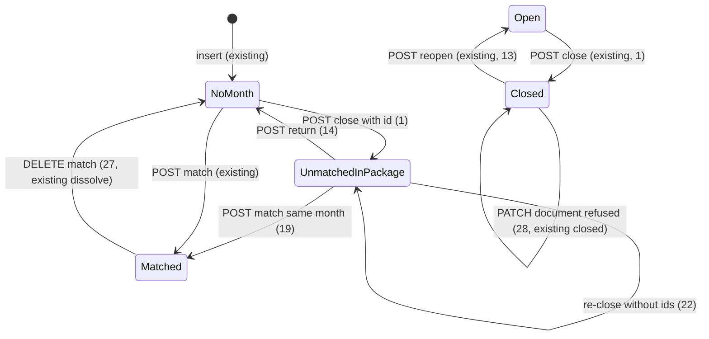
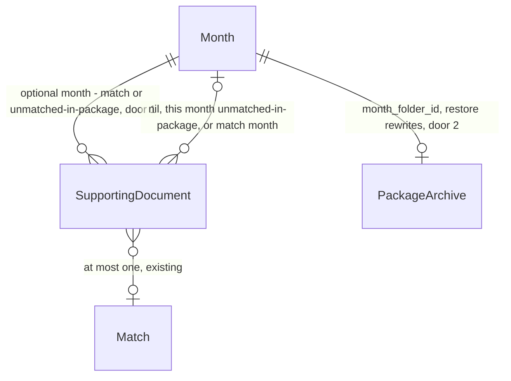

# Unmatched documents in the package and restore month folder

> Build this with **tlc-implement**.
> Every criterion below becomes a check with a proof, referenced by its number. Nothing under
> `Unresolved` gets settled while building.

## Intent

A coordinator can close a month and write `{YYYY-MM}` to the package archive, but unmatched supporting documents never enter that package. `MonthPackage#document_files` only emits `notas/` stems for rows that already have `month_id` from a Match; `SummarySpreadsheet` never writes a third section; close POSTs no document ids. Issue #18 resolved that unmatched files belong in the one monthly package, identified as unmatched, without blocking close. Issue #20 resolved that the coordinator chooses which no-month documents go in — nothing enters alone — and that those documents then belong to that month until matched or returned. The accountant therefore still receives a pack that cannot show leftover notes the coordinator already sees at close. Issue #19 resolved that a damaged month folder is rewritten from the frozen product copy without thawing the month; that POST does not exist (`config/routes.rb` has `close` and `reopen` only). Issues #39, #18, #19, and #20 give no conversion figure; the cost is a hand copy into Drive, or a reopen that does not restore the folder.

When this ships, a coordinator of an open month ready to close picks no-month documents on `GET /months/:year_month` and those files land under `notas-sem-casamento/` with a `Documentos sem casamento` section on `resumo-YYYY-MM.xlsx`. After reopen they still belong to that month until the coordinator matches them there or returns them to no month. While the month is closed, `Restaurar pasta` rewrites the same Drive folder from the current frozen month and does not open it.

45 criteria in 2 slices · 4 one-way doors · 0 open, of which 0 block

## Criteria

### Unmatched documents in the monthly package

1. Given open Month `2026-05` that is ready to close and an unmatched SupportingDocument with no month, kind `recibo`, payee `Padaria Central`, `amount_cents` `15500`, `document_on` `2026-05-11`, and a `.jpg` photo, when a coordinator POSTs `/months/2026-05/close` with `supporting_document_ids` of that document, then the response is `302` to `/months/2026-05`, the Month is closed, that document’s `month_id` is that Month and `match_id` is nil, and the writer files include `notas-sem-casamento/recibo-2026-05-11-padaria-central-{id}.jpg` and do not include that `{id}` under `notas/`.
2. When that POST omits `supporting_document_ids` (or sends an empty list) while that Padaria document still has no month, then the response is `302`, that document’s `month_id` stays nil, and the writer files have no path starting with `notas-sem-casamento/`.
3. Given no-month documents payees `Padaria Central` and `Mercado Silva`, when POST close includes only Padaria’s id, then Padaria’s `month_id` is the `2026-05` Month, Mercado’s `month_id` is nil, and the writer files include Padaria’s `notas-sem-casamento/` path and no path containing Mercado’s id.
4. If POST close includes a SupportingDocument id that exists only on organization B while focused on A, then the response is `404`, A’s Month stays open, B’s document `month_id` stays nil, and the writer is not invoked.
5. If POST close includes a document whose `month_id` is already Month `2026-06`, then the response is `422` with `Documento já pertence a um mês`, `2026-05` stays open, the June document is unchanged, and the writer is not invoked.
6. If POST close includes a document that belongs to a Match, then the response is `422` with `Documento já está em um casamento`, the Month stays open, and the writer is not invoked.
7. If the package-archive writer raises during a close that selected Padaria, then the response is `422` with `Não foi possível gravar no arquivo do pacote`, the Month stays open, and Padaria’s `month_id` stays nil.
8. If POST close selects Padaria while a Payment of `22000` cents on that Month is still a missing document, then the response is `422` with `Há documento faltante`, Padaria’s `month_id` stays nil, and the writer is not invoked.
9. When `GET /months/2026-05` on an open Month lists unmatched no-month `Padaria Central`, then the response is `200`, the page includes `Documentos sem casamento`, includes `Padaria Central`, includes an input named `supporting_document_ids[]` whose value is that document’s id, and the `Fechar para envio` control uses Turbo confirm `Fechar o mês para envio?`.
10. When `GET /months/2026-05` after a close that included Padaria, then the page includes `Mês fechado`, includes `Restaurar pasta`, includes `Reabrir`, includes `Padaria Central` under `Documentos sem casamento`, does not include `Fechar para envio`, does not include a later-inserted no-month payee `Mercado Silva`, the `Restaurar pasta` control uses Turbo confirm `Restaurar a pasta do mês no arquivo do pacote?`, and the `Reabrir` control uses Turbo confirm `Reabrir o mês?`.
11. If an unauthenticated request POSTs close with `supporting_document_ids`, then the response is `302` to `/login` and no `month_id` is written.
12. If a submitter POSTs close with `supporting_document_ids`, then the response is `404`, the Month stays open, and no `month_id` is written.
13. When a coordinator POSTs reopen after a close that included Padaria, then the Month is open, the writer is not invoked, Padaria’s `month_id` is still that Month and `match_id` is nil, and `GET /months/2026-05` includes `Fechar para envio` with Turbo confirm `Fechar o mês para envio?`, includes `Devolver`, includes `Padaria Central`, and does not include `Restaurar pasta` or `Mês fechado`.
14. When a coordinator POSTs `/months/2026-05/supporting_documents/:id/return` for that Padaria while the Month is open, then Padaria’s `month_id` is nil, the response is `302` to `/months/2026-05`, and that page under `Documentos sem casamento` includes `Padaria Central` and does not include `Devolver` for that document.
15. If that return POST happens while the Month is closed, then the response is `422` with `Mês fechado` and Padaria’s `month_id` stays.
16. If an unauthenticated request POSTs return, then the response is `302` to `/login` and the document’s `month_id` stays.
17. If a submitter POSTs return, then the response is `404` and the document’s `month_id` stays.
18. If that return POST is for a document that is in a Match on `2026-05`, or that has no month, or that belongs only to another organization, then the response is `404` and the document is unchanged.
19. Given Padaria unmatched-in-package on open `2026-05` and a missing-document Payment of `15500` cents on that Month, when a coordinator POSTs a format-1 Match of that Payment and Padaria, then the Match persists, Padaria’s `month_id` stays that Month, `GET /months/2026-05` includes `Casado` and does not include `Devolver` for Padaria, and `GET /supporting_documents` includes `Casado em 2026-05` and does not include `Sem casamento em 2026-05` for that row.
20. If a coordinator POSTs a Match of May unmatched-in-package Padaria onto a Payment of open Month `2026-06`, then the response is `422` with `Documento já pertence a um mês` and no Match is persisted.
21. While Padaria is unmatched-in-package of `2026-05`, `GET /months/2026-06` does not include `Padaria Central` under `Documentos sem casamento` and does not include an input `supporting_document_ids[]` whose value is Padaria’s id.
22. When `2026-05` is reopened and closed again with no `supporting_document_ids`, then Padaria remains `month_id` of that Month with `match_id` nil, and the writer files again include `notas-sem-casamento/recibo-2026-05-11-padaria-central-{id}.jpg`.
23. When Padaria is returned and `2026-05` is closed with no `supporting_document_ids`, then Padaria’s `month_id` is nil and the writer files have no path containing Padaria’s id.
24. Given Padaria unmatched-in-package of closed `2026-05` with `amount_cents` `22000`, and open `2026-06` with a missing-document Payment of `22000` cents whose history is `Pix enviado — Padaria Central`, when a coordinator GETs `/months/2026-06`, then that payment’s row includes `Documento faltante` and does not include `Sugestão`.
25. Given `2026-05` closed with a `bank_fee` Payment of `22000` cents and Padaria unmatched-in-package of `22000` cents payee `Padaria Central`, when a coordinator reopens, DELETEs that document exception, and GETs `/months/2026-05`, then that payment’s row includes `Documento faltante`, `Sugestão`, and `Padaria Central`.
26. Given a Justification whose members are May unmatched-in-package Padaria and no-month `Mercado Silva`, when a coordinator GETs `/months/2026-06` that has a missing-document Payment of the justification amount, then that payment’s row does not include `Sugestão` together with `Padaria Central`.
27. When a coordinator DELETEs the Match that includes a document that had been unmatched-in-package, then that document’s `month_id` is nil.
28. While `2026-05` is closed and Padaria is unmatched-in-package of it, a coordinator PATCH of payee `Mercado Silva` on Padaria leaves the payee unchanged and responds `422` with `Mês fechado`.
29. When `2026-05` is open after reopen, a coordinator PATCH of Padaria payee `Mercado Silva` responds `302` and persists that payee.
30. If a submitter PATCHes or DELETEs Padaria while it has `month_id`, then the document is unchanged and the response is `422` with `Documento já pertence a um mês`.
31. If two concurrent POSTs close ready Months `2026-05` and `2026-06`, each with `supporting_document_ids` of the same no-month Padaria, then exactly one of those Months is closed, Padaria’s `month_id` is that Month, the other POST is `422` with `Documento já pertence a um mês`, and that other close does not invoke the writer.
32. When `GET /supporting_documents` after a close that included Padaria, then that row includes `Sem casamento em 2026-05` and does not include `Casado em 2026-05`.
33. When close includes that Padaria recibo with observation `pago em dinheiro`, the workbook sheet `2026-05` includes heading `Documentos sem casamento`, column headers `Arquivo`, `Tipo`, `Valor`, `Data`, `Favorecido`, `Observação` in that order, and a row with `notas-sem-casamento/recibo-2026-05-11-padaria-central-{id}.jpg`, `Recibo`, numeric `155`, `11/05/2026`, `Padaria Central`, `pago em dinheiro`, and that heading appears after the cell `Resultado mês`.
34. When the included document is `nota_fiscal` payee `Padaria Central` `document_on` `2026-05-11` with a `.jpg` photo and a `.xml`, that unmatched `Arquivo` cell equals `notas-sem-casamento/nota-2026-05-11-padaria-central-{id}.jpg; notas-sem-casamento/nota-2026-05-11-padaria-central-{id}.xml` and `Tipo` is `Nota fiscal`.
35. When two unmatched documents dated `2026-05-04` and `2026-05-20` are included, those unmatched rows appear in that date order.
36. When close includes no unmatched document, the workbook does not include `sem casamento`.
37. When close includes Padaria unmatched and a matched recibo `Mercado Silva` `document_on` `2026-05-11`, the writer files include `notas/recibo-2026-05-11-mercado-silva-{id}.jpg` and the unmatched section does not include Mercado Silva.

### Restore the month folder

38. Given closed `2026-05` with Padaria unmatched-in-package and a matched Mercado under `notas/`, when a coordinator POSTs `/months/2026-05/restore`, then the response is `302` to `/months/2026-05`, the Month stays closed, `month_folder_id` is unchanged, Padaria’s `month_id` is unchanged, no Active Job is enqueued, and the writer is invoked once with that `folder_id` and files that include Padaria’s `notas-sem-casamento/` path, Mercado’s `notas/` path, and `resumo-2026-05.xlsx`.
39. If POST restore while the Month is open, then the response is `422` with `Mês aberto` and the writer is not invoked.
40. If the writer raises on restore, then the response is `422` with `Não foi possível gravar no arquivo do pacote`, the Month stays closed, and `month_folder_id` is unchanged.
41. If an unauthenticated request POSTs restore, then the response is `302` to `/login` and the writer is not invoked.
42. If a submitter POSTs restore, then the response is `404`, the Month stays closed, and the writer is not invoked.
43. If a coordinator focused on organization A POSTs restore for a closed `2026-05` that exists only on organization B, then B stays closed, B’s writer is not invoked, and the response is `404`.
44. If POST restore for a year_month that was never opened, then the response is `404`.
45. If two concurrent POSTs restore the same closed `2026-05`, then the Month stays closed, `month_folder_id` is unchanged, and both responses are `302`.

## States

## Out of scope

- Email or any dispatch to the accountant - #6 / #17; coordinator still delivers
- Creating the package-archive folder or changing Drive ACL - #23
- Drive scopes on operator login; a second package-archive writer - ADR-0001; close-for-send door 2
- Open Finance JSON as a statement path - #16
- Storing a byte snapshot of the last close to replay on restore - working files stay on the blob store; restore rebuilds `MonthPackage.files` from the frozen month (user delegated)
- Submitter choosing unmatched documents into the package, restoring, or returning - coordinator-only, same as close
- Accountant login - accountant is not an operator
- N×M match, extra exception kinds, SEFAZ consulta - already shipped or other issues
- Restructuring `/supporting_documents` away from heading `Sem mês` - only the unmatched-in-package label in criterion 32

## Observable

| Surface | Decision | Landing |
| --- | --- | --- |
| screen `/months/:year_month` | empty unmatched pool | existing - `Nenhum documento sem casamento`; 2 - choosing none is valid |
| screen `/months/:year_month` | empty selection at close | 2, 9 |
| screen `/months/:year_month` | loading | n/a - Turbo full-page POST; close and restore wait on the same request as today |
| screen `/months/:year_month` | error state | 5, 6, 7, 8, 15, 20, 39, 40 |
| screen `/months/:year_month` | unauthorised | 11, 12, 16, 17, 41, 42 |
| screen `/months/:year_month` | density and ordering | 9, 10, 13, 21 - open pool is no-month plus this month’s unmatched-in-package; closed pool is only this month’s unmatched-in-package; `Restaurar pasta` only while closed |
| screen `/months/:year_month` | destructive action confirms | 9, 10, 13 - `Fechar para envio` uses Turbo confirm `Fechar o mês para envio?`; `Reabrir` uses Turbo confirm `Reabrir o mês?`; `Restaurar pasta` uses Turbo confirm `Restaurar a pasta do mês no arquivo do pacote?`; `Devolver` submits immediately |
| screen `/supporting_documents` | empty / loading | existing - `Nenhum documento`; Turbo full-page |
| screen `/supporting_documents` | error / unauthorised | 28, 30 - closed PATCH `422`; submitter with month `422` `Documento já pertence a um mês` |
| screen `/supporting_documents` | density and ordering | 19, 32 - `Casado em 2026-05` vs `Sem casamento em 2026-05` |
| screen `/supporting_documents` | destructive action confirms | existing - `Excluir` still Turbo confirm; still hidden while `month_id` present |
| HTML `POST /months/:year_month/close` | who may call it | 1, 11, 12, 4 |
| HTML `POST /months/:year_month/close` | error shape and codes | 4, 5, 6, 7, 8, 11 |
| HTML `POST /months/:year_month/close` | versioning | n/a - existing HTML surface; body gains `supporting_document_ids[]` |
| HTML `POST /months/:year_month/close` | rate limit | n/a - coordinator-only, small operator set |
| HTML `POST /months/:year_month/restore` | who may call it | 38, 41, 42, 43 |
| HTML `POST /months/:year_month/restore` | error shape and codes | 39, 40, 41, 44 |
| HTML `POST /months/:year_month/restore` | versioning | n/a - first HTML surface for restore |
| HTML `POST /months/:year_month/restore` | rate limit | n/a - coordinator-only |
| HTML `POST /months/:year_month/supporting_documents/:id/return` | who may call it | 14, 16, 17, 18 |
| HTML `POST /months/:year_month/supporting_documents/:id/return` | error shape and codes | 15, 16, 18 |
| HTML `POST /months/:year_month/supporting_documents/:id/return` | versioning | n/a - first HTML surface |
| HTML `POST /months/:year_month/supporting_documents/:id/return` | rate limit | n/a - coordinator-only |
| HTML `POST /months/:year_month/matches` | error shape and codes | 20 - HAS_MONTH when the document belongs to another month |
| HTML `POST /months/:year_month/matches` | who may call it | existing - coordinator |
| HTML `PATCH /supporting_documents/:id` | error shape and codes | 28, 29, 30 |
| HTML `GET /months/:year_month` | who may call it | existing - coordinator with focus |
| document `resumo-YYYY-MM.xlsx` | structure | 33, 34, 36 |
| document `resumo-YYYY-MM.xlsx` | tone | n/a - labels are #22 Portuguese headings, not prose |
| document `resumo-YYYY-MM.xlsx` | depth | 33, 37 - unmatched section after totals; matched files stay in `notas/` |
| document `resumo-YYYY-MM.xlsx` | what the reader does next | n/a - accountant receives the folder from the coordinator |
| collection month-folder files | grouping | 1, 2, 37 - `notas/` matched; `notas-sem-casamento/` chosen unmatched; omit the unmatched folder when empty |
| collection month-folder files | naming | 1, 34 - same stem rule as #23, folder identifies unmatched |
| collection month-folder files | ordering | n/a - Drive listing order is not part of the package; the spreadsheet is the index |
| collection month-folder files | duplicates | 22, 38 - one `{YYYY-MM}` folder id; re-close and restore replace contents |
| collection month-folder files | exception that does not fit | 2, 3 - unselected no-month documents stay out |
| collection unmatched pool on a month | grouping | 10, 21 - this month’s unmatched-in-package plus no-month while open |
| collection unmatched pool on a month | naming | 9, 13 - payee; `Devolver` only on unmatched-in-package while open |
| collection unmatched pool on a month | ordering | existing - `document_on` desc, then id (`listed`) |
| collection unmatched pool on a month | duplicates | existing - two documents with the same triple both list |
| collection unmatched pool on a month | exception that does not fit | 10, 21 - other month’s unmatched-in-package; inserts after close |

## Swept

- validation: 5, 6, 8, 18 - selected ids must be focused-org, no month, no Match; return only unmatched-in-package of that Month
- failure modes: 7, 40 - writer raise leaves assignment and closedness unchanged
- idempotency and retry: 2, 22 - omitting ids on first close includes none; omitting ids on re-close keeps already-assigned unmatched-in-package; restore may run again (45)
- authorization: 11, 12, 16, 17, 41, 42, 43 - existing `require_coordinator_organization` (`302` `/login`, submitter `404`); other org `404`
- concurrency and ordering: 31, 45 - two months cannot take the same no-month document; two restores leave the month closed with the same folder id
- data lifecycle: 13, 14, 22, 27, 30 - reopen keeps `month_id`; return and leave-match clear it; submitter cannot withdraw once assigned; no TTL; no backfill of existing no-month rows
- external-dependency failure: 7, 40 - `PackageArchiveWriter::Error` is `422` `Não foi possível gravar no arquivo do pacote`
- state transitions: 1, 13, 14, 19, 27, 38 - see States; restore is a self-loop on closed
- observability: existing - close/restore failures surface as `@month_error` on the month page; no new metric. 38 - restore enqueues no job

## Impact

| Front | What changes |
|---|---|
| domain | existing term: `Unmatched document` meant a SupportingDocument in no Match, listed on every open month’s pool (`SupportingDocument.unmatched`, `ApplicationController#load_month_page`). Now a no-Match document may also belong to a Month (unmatched-in-package). Callers: month pool, match checkboxes, `Suggestion::Assigner#groups` (`app/models/suggestion.rb`), `MonthPackage#document_files` (today every `month_id` goes under `notas/`), `Match.confirm` (today only rejects `match_id`) |
| domain | existing term: `Supporting document` optional Month was written only by `Match.confirm` / dissolve (`app/models/match.rb`). Close now writes the same `month_id` without a Match; return clears it without destroying a Match |
| domain | existing term: `Closed month` still read-only; coordinators may now restore the month folder without reopening (`CONTEXT.md` already names that act) |
| domain | existing term: `Month folder` still one Drive id per month; restore rewrites it through the same writer close already uses |
| domain | existing term: `Summary spreadsheet` gains the #22 unmatched section this cut omitted |
| domain | existing term: `Suggestion` must not pair a document that already has a Month with a payment of a different Month (`.tasks/assisted-suggestions.md` deferred that to #39) |
| stored data | no new table. Existing nullable `supporting_documents.month_id` stays. No backfill: rows with `month_id` nil remain choosable. Unique `match_id` indexes already allow many nils. Closed months already have `month_folder_id` from close-for-send |

## Decided

| Decision | Shape | Alternative rejected |
|---|---|---|
| 1. Unmatched-in-package is `month_id` set and `match_id` nil | Close that selects a no-month document, after a successful `replace_month_folder`, persists that document’s `month_id` to the Month in the same lock as `closed`. Return sets `month_id` nil while the Month is open and `match_id` is nil. Match confirm on that Month keeps `month_id`. Leave-match still nulls `month_id` (`Match#dissolve`). | A second column or close-inclusion join — match-and-exception door 4 reserved this optional Month for #39. Assign `month_id` before the writer — a Drive failure would leave documents of an open month with no folder (criterion 7). |
| 2. Restore rewrites through `PackageArchiveWriter.replace_month_folder` in the request | `POST /months/:year_month/restore` holds the same Month row lock as close, calls `replace_month_folder(parent_id:, name:, folder_id: month_folder_id, files: MonthPackage.files(month))`, does not change `closed` or `month_folder_id`, enqueues no job. Only while `closed` is true. | A second Drive client in the restore action — close-for-send door 2. Active Job / a `closing` flag — #19 forbids a third state. Treating restore as POST close — close-while-closed is already `422` `Mês fechado`. |
| 3. Spreadsheet unmatched section is third, after `Resultado mês`, omitted when empty | Sheet `{YYYY-MM}`. Heading `Documentos sem casamento`. Headers `Arquivo`, `Tipo`, `Valor`, `Data`, `Favorecido`, `Observação`. `Tipo` is `Nota fiscal` or `Recibo`. Amounts are Excel numerics like expenses (`155` for `15500` cents). No `SUM` over that section. Photo and XML in `Arquivo` joined with `; `. Rows by `document_on` then id. | Mixing unmatched rows into Custos/Despesas — #22 third section, does not feed totals. Putting the section before totals — would require excluding those rows from `SUM`. |
| 4. Unmatched package files use folder `notas-sem-casamento/` and the existing stem | `{nota\|recibo}-{YYYY-MM-DD}-{parameterize(payee)}-{id}.{ext}` under `notas-sem-casamento/`. Matched documents stay under `notas/`. Folder omitted when no unmatched-in-package document has a blob. `id` is the SupportingDocument primary key. | A `sem-casamento-` filename prefix inside `notas/` — #23 the folder identifies. A generated UUID per close — re-close of an unchanged set would rename files. |

- Nothing else in this change is hard to reverse. Button copy, wrapping `Fechar para envio` so the pool can post ids, Turbo confirm strings, and the exact return path helper are criteria or placement. This cut amends close-for-send’s “no extra dialog” assumption for `Fechar para envio` and `Reabrir`. Door 1 reaches past this feature: suggestions, submitter withdraw, and a later dispatch must treat `month_id` without a Match as belonging to that month. Door 2 reaches past this feature: later Drive writes keep this port.

## Relations

One-way constraints: SupportingDocument belongs to at most one Match (existing), optional Month is the unmatched-in-package signal when Match is absent (door 1), Restore does not create a second month folder (door 2). No columns and no types here.

## Surface

| Route | In | Out | Status | Criteria |
|---|---|---|---|---|
| `POST /months/:year_month/close` | session, focus, `supporting_document_ids[]` | Month closed, selected documents `month_id`, archive tree | `302`, `422`, `404` | 1, 2, 3, 4, 5, 6, 7, 8, 11, 12, 31 |
| `POST /months/:year_month/restore` | session, focus | same `month_folder_id`, rewritten files, Month still closed | `302`, `422`, `404` | 38, 39, 40, 41, 42, 43, 44, 45 |
| `POST /months/:year_month/supporting_documents/:id/return` | session, focus, id | document `month_id` nil | `302`, `422`, `404` | 14, 15, 16, 17, 18 |
| `GET /months/:year_month` | session, focus | month HTML, pool, close/return/restore controls | `200`, `302`, `404` | 9, 10, 13, 21, 24, 25 |
| `POST /months/:year_month/matches` | session, focus, ids | Match or `422` HAS_MONTH | `302`, `422`, `404` | 19, 20 |
| `GET /supporting_documents` | session, focus | `Sem casamento em YYYY-MM` / `Casado em YYYY-MM` | `200`, `302` | 19, 32 |
| `PATCH /supporting_documents/:id` | session, focus, fields | unchanged when closed; allowed when open | `302`, `422`, `404` | 28, 29, 30 |

## Sources

- https://github.com/gutors/ai-accounting-assistant/issues/39 - this cut: coordinator chooses no-month documents for the package; restore the month folder from the closed month; task file `.tasks/unmatched-docs-and-restore.md`; after the first close-for-send
- https://github.com/gutors/ai-accounting-assistant/issues/18#issuecomment-5625697017 - unmatched documents enter the monthly package (the files); Drive archive and what the accountant receives are the same set; the package identifies which are unmatched; they do not block close; no one-by-one waiver gate; observation stays optional
- https://github.com/gutors/ai-accounting-assistant/issues/18#issuecomment-5628194570 - which unmatched documents go is the coordinator’s choice among documents that still have no month; nothing enters alone
- https://github.com/gutors/ai-accounting-assistant/issues/19#issuecomment-5625697908 - closed month is read-only; restore rewrites the package-archive folder equal to the frozen month; does not thaw; is not a new close; restore is not valid while open; reopen does not touch Drive
- https://github.com/gutors/ai-accounting-assistant/issues/20#issuecomment-5628193823 - month is born at confirmed match or when the coordinator includes the document at close-for-send; those belong to that month and freeze with it; on reopen they stay of that month until matched on it or returned to no month
- https://github.com/gutors/ai-accounting-assistant/issues/22#issuecomment-5625699009 - third spreadsheet section `Arquivo`, `Tipo` (nota fiscal / recibo), `Valor`, `Data`, `Favorecido`, `Observação`; omitted entirely when the coordinator takes none; no total line
- https://github.com/gutors/ai-accounting-assistant/issues/23#issuecomment-5625700120 - tree `notas-sem-casamento/` for documents the coordinator took at close; same filename stem as `notas/`; the folder identifies
- `CONTEXT.md` - Unmatched document, Supporting document, Closed month, Month folder, Close-for-send, Monthly package, Summary spreadsheet
- `.specs/features/close-for-send/plan.md` Landing doors 2 and 4 - restore reuses `PackageArchiveWriter`; close stays in-request with the Month row lock
- `.specs/features/match-and-exception/plan.md` Landing door 4 - optional Month on SupportingDocument is the unmatched-in-package path
- `.tasks/assisted-suggestions.md` Out of scope - suggesting against a month assigned only at close-for-send is #39
- [ADR-0001](../docs/adr/0001-rails-8-hotwire.md) - Rails 8 + Hotwire; restore is the same long Puma request as close
- user delegated - month-page copy `Devolver` / `Restaurar pasta`; Turbo confirm on `Fechar para envio` (`Fechar o mês para envio?`), `Reabrir` (`Reabrir o mês?`), and `Restaurar pasta` (`Restaurar a pasta do mês no arquivo do pacote?`); `Devolver` has no extra confirm; close field `supporting_document_ids[]`
- user delegated - supporting-documents label `Sem casamento em YYYY-MM`; heading `Sem mês` stays
- user delegated - spreadsheet heading `Documentos sem casamento`; Tipo `Nota fiscal` / `Recibo`
- user delegated - restore rebuilds `MonthPackage.files` (live organization header, frozen month rows); no snapshot blob

No design source for the screens. Verification stays on project profile `standard`.

This task is the record of decision. If a linked document diverges, ask before building.

## Unresolved

| # | Kind | Question | Until answered |
|---|---|---|---|
| 1 |  | None |  |
